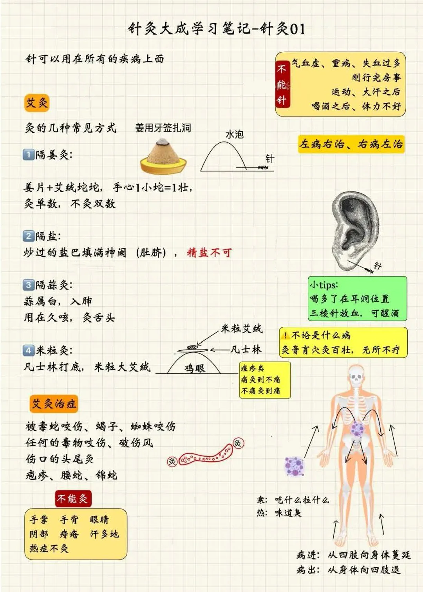
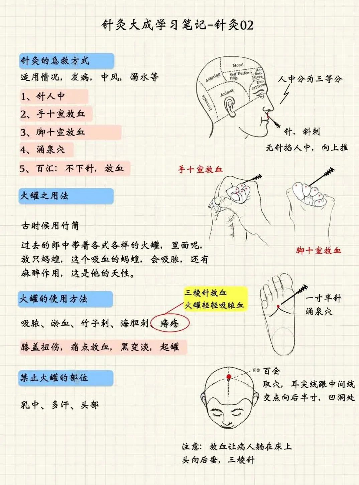

# 针灸的使用时机

## 1. 针灸的起源与历史

- 针灸比中药早约一千年，是中医的重要组成部分。
- 针灸可以治疗任何病。
- 本章重点介绍针灸的使用时机和禁忌，而非其历史。

## 2. 针灸的使用时机

### 不宜针灸的情况

- 气血大虚
- 重病
- 失血过多
- 元气不足
- 行房事后
- 运动后
- 大汗后
- 饮酒后
- 体力不足时

### 适用病症

- 针灸可用于治疗从感冒到癌症的各种疾病。
- 针灸与中药可以独立使用。

## 3. 灸法

> 基本原则：**灸单数，不灸双数**。艾为纯阳，取阳数。

### 隔姜灸

- 用生姜片隔开艾绒，灸至温热，不用很烫。
- 生姜片不用换。
- “一壮”即一个艾绒金字塔。
- 适用于气血大虚等情况。
- 灸后起水泡的处理：用消毒针刺小洞排水，不撕皮，撒硫磺粉和大黄粉。

### 隔盐灸

- 用炒熟的青盐填满肚脐，再放艾绒灸。
- **精盐不能用**，必须用青盐。
- 盐要等变温凉了再填脐，否则容易烫伤肚皮。
- 适用于下利等症状。

### 隔蒜灸

- 用蒜片隔开艾绒。
- 适用于久咳、肺病和咳嗽。
- 取“蒜辛白入肺，舌为心表”之意，可灸舌头上。

### 米粒灸

- 用米粒大小的艾绒灸治。
- 适用于鼻窦炎、鸡眼等。

## 4. 灸法的禁忌

- 热症不灸。
- 流汗多的地方不灸。
- 津液多的地方不灸。
- 眼睛不灸。
- 阴部不灸。
- 痔疮不灸。

## 5. 针灸的急救法

急救有明确的递进顺序，通常按以下步骤进行：

1. **人中穴**：昏迷时首先针刺人中穴。
2. **手十宣放血**：手指尖放血，适用于急救。
3. **足十宣放血**：手十宣无效后，加做脚趾尖放血。
4. **涌泉穴**：脚底穴位，用于急救。
5. **百会穴放血**：头顶穴位，用于中风急救。临床指征是**病人整个脸都呈现红色时**，即刚中风，可在百会穴放血。

## 6. 火罐的使用

### 火罐的作用

- 吸脓
- 化瘀
- 治疗扭伤
- 抽出体内的断刺：被竹子或海胆刺到时，可以用火罐抽出。

### 操作要点

- 急性扭伤时，**马上**在扭到的痛点拔火罐。
- 放血时观察颜色，**由黑变淡，就起罐**。

### 禁忌

- 乳中不宜拔火罐。
- 多汗处不宜拔火罐。
- 头部不宜拔火罐。

## 总结

本篇介绍了针灸的使用时机、灸法的种类及其适用病症，以及针灸的急救方法和火罐的使用。重点补充了急救的递进顺序（含足十宣与百会放血指征）、灸法“灸单数”原则、隔盐灸用盐要求、隔姜灸操作与灸后处理、隔蒜灸的久咳用法，以及火罐抽出断刺和急性扭伤即刻拔罐等操作细节。同时强调针灸的禁忌和注意事项，帮助学习者正确应用针灸技术。

---

> 作者: [Acuherb](https://acuherb.xyz/)  
> URL: https://acuherb.xyz/posts/zhenjiu-01/  

