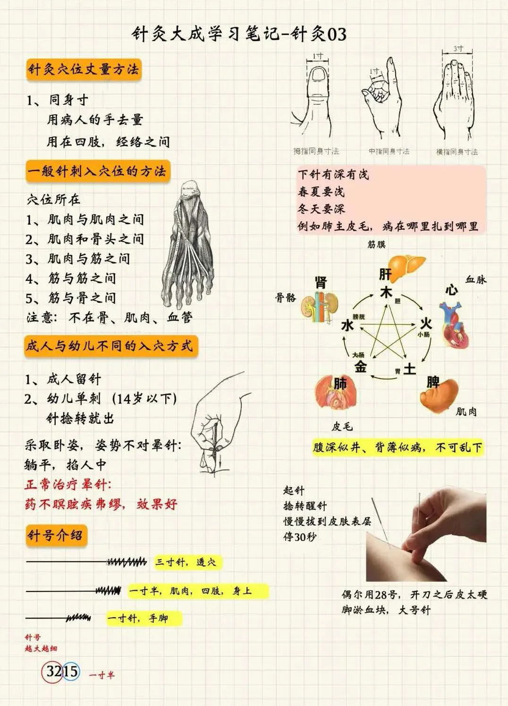

# 针灸穴位丈量方法

## 1. 穴位丈量方法

### 同身寸

- 每个人的身体尺寸不同，因此针灸穴位的丈量需使用“同身寸”。
- 具体方法：将中指弯曲，两个横纹头之间的距离定义为一寸。三个指头宽度为两寸，四个指头为三寸。
- 四肢和经络的丈量主要使用同身寸，而胸腹部有独立的丈量方式。
- **关键操作提醒：看的时候要看病人的手，不能看自己的手；小孩子要看小孩子的手。**

### 比例法（均等法）

- 任脉和督脉，以及围绕二脉展开的其他经络的穴道，采用比例法丈量。

## 2. 针刺的深浅

### 季节影响

- 春夏季节针刺较浅，秋冬季节针刺较深，类似于钓鱼时鱼在不同季节的深浅分布。

### 病情决定深浅

- 病在皮毛则浅刺。
- 病在肌肉则刺入肌肉。
- 病在血脉则刺在脉旁。
- 病在肾脏则刺至骨旁。

### 部位差异

- 口诀：**“腹深似井，背薄似饼。”**
- 腹部可深刺，背部则不宜深刺。背部深刺**扎到肺会引起肺气肿**。
- 但也不能说“腹深似井”就扎那么深，**不能乱搞**，腹部虽可深刺，仍有分寸。
- 胖子和瘦子的针刺深浅也不同。

## 3. 针刺入穴方法

- **传统方法**：古代针灸使用咳嗽辅助进针，以减少疼痛。现代使用针管，无需咳嗽。
- **穴位定位**：穴位通常位于肌肉之间、筋与骨之间或筋与肌肉之间，不会在肌肉、骨头或血管上。通过触摸可以找到正确的穴位位置。

## 4. 成人与幼儿的针刺方式

### 成人

- 需留针，留针时间根据病情而定，通常为20分钟至数小时。
- 中风病人可以留二十分钟、三十分钟、四十分钟、一个小时、两个小时都没关系。
- **出针手法**：起针时慢慢地拔出来，可以做到一滴血都没有。

### 幼儿

- 采用“单刺法”，即**针进去捻一捻就出来了**，快速进针和出针，不留针。
- 14岁以下的儿童通常不留针，14岁以上则与成人相同。

## 5. 晕针的处理

### 晕针原因

- 晕针可能是由于病人姿势不当或针灸刺激引起。
- 中医认为，治疗反应性的晕针（瞑眩）是治疗有效的表现之一，即“**药不瞑眩疾弗缪**”，起针后效果往往很好。
- 但**姿势不对引起的晕针不在此列**，不能一概视为“好现象”。

### 处理方法（有层级，不是并列选项）

1. **常规处理**：让病人平躺，打开胸腔衣物，保持空气流通，一般就会醒过来。
2. **不醒再递进**：刺激人中穴 → 手十宣放血 → 足十宣放血。
3. **分寸提醒**：如果是性急的人，不醒就十宣放血、脚趾头再放血，**太过也不好**。

## 6. 现代针具的使用

### 针号与尺寸

- 针号越大，针越细。
- 常用针具代号：
  - **3215**：32号1.5寸，适用于肌肉和四肢。
  - **3210**：32号1寸，适用于手指等较薄部位。
  - **3230**：32号3寸，用于透针。
- 特殊情况下使用28号针处理硬结或瘀血。

### 透针法

- 透针法用于特定穴位，能够在不伤筋、骨、血脉的情况下达到治疗效果。
- 典型适应症：**脚伤、腕骨痛，针一下去当场痛就去掉了。**

## 7. 黄帝时代的九针

古代有九种不同形状的针，各有不同用途。现代针灸主要使用毫针。古代针具多为金或银制，较粗且易断；现代针具为不锈钢，不易断裂。

- **镵针**：头大末锐，用于点刺放血泻热，如眼睛红肿、耳尖放血。
- **员针**：针如卵形，不刺入，用于两筋之间按摩导气，适合怕针或气虚之人。
- **鍉针**：锋如黍栗之锐，主按脉取气，也用于透针。
- **锋针**（三棱针）：用于痈肿放血。
- **铍针**：末如剑锋，用于切开排脓。
- **员利针**：治痛与酸痛。
- **毫针**：最常用。
- **长针**、**大针**：各有其位。

## 总结

针灸操作需根据病人的体型、病情、季节等因素调整针刺的深浅和方式。穴位定位需准确，针刺手法需灵活，尤其是对成人和幼儿的针刺方式有显著区别。同身寸要“看病人的手”，深浅要记“腹深似井，背薄似饼”并警惕背部深刺伤肺，幼儿单刺要“捻一捻就出来”，成人出针要慢。晕针处理有层级：先平躺通风，不醒再人中、十宣、足十宣，且“太过也不好”；瞑眩反应与姿势性晕针要区分。现代针具要认得3215、3210、3230等代号，透针对脚伤、腕骨痛有当场止痛之效。黄帝九针各有其名其用，不宜以“各有不同用途”一笔带过。晕针是常见现象，处理得当不会造成严重后果。现代针具更加精细和安全，透针法等技术能够有效治疗多种疾病。

---

> 作者: [Acuherb](https://acuherb.xyz/)  
> URL: https://acuherb.xyz/posts/zhenjiu-02/  

