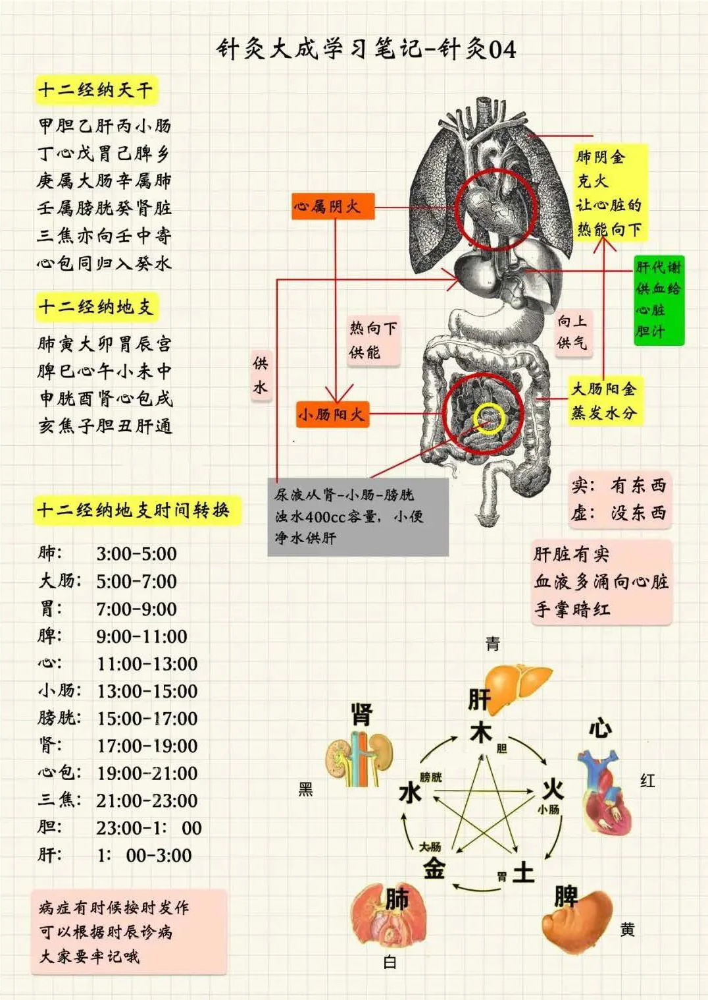

# 十二经纳天干地支歌总结

## 一、十二经纳天干歌

**歌诀：**
甲胆乙肝丙小肠，丁心戊胃己脾乡，
庚属大肠辛属肺，壬属膀胱癸肾脏，
三焦亦向壬中寄，心包同归入癸水。

### 要点解析

**1. 天干与脏腑对应关系**

- 甲（胆）、乙（肝）、丙（小肠）、丁（心）、戊（胃）、己（脾）、庚（大肠）、辛（肺）、壬（膀胱）、癸（肾）。
- 三焦归于壬（膀胱），心包归于癸（肾）。
- 需注意定位：**三焦与心包在六腑/五脏体系之外，寄附于壬癸水**，不是与膀胱、肾平级的独立对应。

**2. 核心逻辑：脏阴腑阳，一脏一腑互为表里（夫妻）**

- 脏为阴、为里、主收藏；腑为阳、为表、主消化传导。
- 一脏一腑配成一对，一阴一阳，互为表里，常用“**夫妻**”作比：
  - 肝（阴木）—胆（阳木）
  - 心（阴火）—小肠（阳火）
  - 脾（阴土）—胃（阳土）
  - 肺（阴金）—大肠（阳金）
  - 肾（阴水）—膀胱（阳水）
- 这个“夫妻”关系不是修辞，而是可操作的通道：**治腑可以调脏，治脏可以调腑**。只背“甲胆乙肝”而不点明表里关系，对应关系就只是十个代号，而不是一套可以推演的关系。

**3. 五行属性**

- 天干分阴阳五行：甲乙（木）、丙丁（火）、戊己（土）、庚辛（金）、壬癸（水）。

**4. 中医核心理论**

- 五行相生相克（木→火→土→金→水）与阴阳平衡是中医辨证的基础。
- 西医重“形”（结构），中医重“神”（功能与能量），如心脏属火因其持续搏动生热。

---

## 二、十二经纳地支歌

**歌诀：**
肺寅大卯胃辰宫，脾巳心午小未中，
申胱酉肾心包戌，亥焦子胆丑肝通。

### 要点解析

**1. 地支与时辰对应**

- 肺（寅时，3-5点）→大肠（卯时，5-7点）→胃（辰时，7-9点）→脾（巳时，9-11点）→心（午时，11-13点）→小肠（未时，13-15点）→膀胱（申时，15-17点）→肾（酉时，17-19点）→心包（戌时，19-21点）→三焦（亥时，21-23点）→胆（子时，23-1点）→肝（丑时，1-3点）。

**2. 诊断链条（完整三步，缺一不可）**

**第一步：正常人的基线——“一觉到天亮”**

- “**一觉到天亮**”作为正常人的第一标准。
- 它之所以重要，是因为它**横跨子时（胆）、丑时（肝）、寅时（肺）三个脏**。能通宵睡过这三个时段，说明胆、肝、肺的气血流注都没有被阻断。
- 判断疗效时，“好”的标准是**一觉到天亮**，而不是“比以前好一点”。缺了这个基线，后面的“诊断依据”就缺了参照系。

**第二步：固定时辰醒来——反推病位**

- 如凌晨1-3点（肝经时段）易醒，提示肝脏问题。
- 5-7点（大肠经）正常排便，代表气血通畅。

**第三步：治疗后时辰改变——判断传变**

- 治疗后睡眠改善（如肝病患者不再丑时醒），即为疗效指标。
- 更有力的用法是看**病位是否转移**：如肝癌病人开刀后，本来1-3点不能睡，现在变成3-5点不能睡，说明病已经转移到肺；反过来，胆结石病人治后子时（23-1点）能安睡，说明胆的问题解决了。
- 完整链条：**固定时辰醒来 → 反推病位 → 治疗后时辰改变 → 判断传变**。

**3. 望诊佐证：手掌颜色**

- 问诊的时辰线索之外，还要加一条望诊锚点：正常手掌是**粉红**，肝病的人手掌会变成**暗红色**。
- 时辰线索 + 颜色线索，两条证据叠在一起，诊断分量完全不同。

**4. 生理机制：心—肺—小肠的功能通路**

- 心脏产生的热，本性是**往上走**的；如果只升不降，人就会过热。
- 肺的作用不是简单“克火”，而是**把心热往下导**——“把心当成引擎的话，肺就是水箱”。
- 肺功能正常，热才会**沉到小肠**去；小肠有了这个热，食物才能消化。
- 完整链条：**心热下导（肺为导引者）→小肠得温→消化启动**。
- 大肠吸收水分依赖小肠热能，水液气化后由肺布散全身。
- 注意表述方向：不是“心火自己下移小肠”，而是“**肺将心热下导至小肠**”。

---

## 三、中医整体观与西医对比

**1. 健康标准差异**

- 中医以“常人”为基准（如睡眠、二便正常），西医以指标范围判定疾病。
- 中医在症状初现时干预，西医多在器质性病变后确诊。

**2. 癌症与热力关系**

- 心脏无癌因持续高热，若全身维持高温（如气化正常），可抑制癌细胞。

**3. 物理医学属性**

- 中医注重时间、温度、压力、速度的平衡，如膀胱排尿依赖热气球般的气化压力。

---

## 四、总结

- **天干地支歌**是中医经络与时辰诊断的核心工具，结合五行阴阳理论，贯穿生理、病理、诊疗全过程。
- **天干的核心是表里关系**：脏阴腑阳，一脏一腑互为表里（夫妻），治腑可调脏，治脏可调腑；三焦、心包寄附于壬癸水，不与膀胱、肾平级。
- **地支的核心是完整诊断链**：以“一觉到天亮”（横跨子丑寅）为正常基线，以固定时辰醒来反推病位，以治疗后时辰改变判断传变，并用手掌颜色作望诊佐证。
- **生理机制要讲方向**：肺为水箱，将心热下导至小肠，小肠得温而能消化。
- **学习关键**：理解“五行生克”与“脏腑表里”，通过症状与时辰关联掌握疾病本质。
- **实践意义**：简化复杂生理过程为符号系统（如壬癸水代表肾与膀胱），实现“外察知内病”。

> **注**：后续需结合《黄帝内经》深化气化、津液代谢等内容，逐步掌握“人纪”诊断思维。

---

> 作者: [Acuherb](https://acuherb.xyz/)  
> URL: https://acuherb.xyz/posts/zhenjiu-3-1/  

