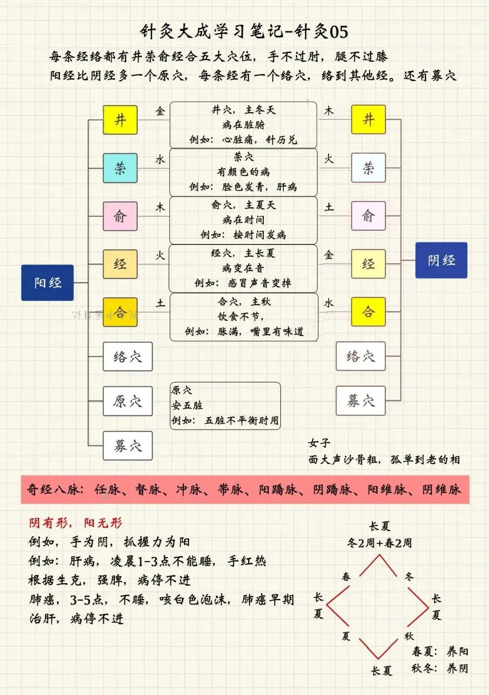

# 十二正经之原经合井荣俞穴总结

## 一、基本概念

**1. 正经与奇经**

- **正经十二条**（六阴经、六阳经），**奇经八脉**（任脉、督脉、冲脉、带脉、阳蹻、阴蹻、阳维、阴维）。
- 每条正经均有**井、荥、俞、经、合**五穴，位于**手肘以下或膝盖以下**（"手不过肘，足不过膝"）。

**2. 阴阳经五行属性**

- **阴经五穴属性**：井（木）→荥（火）→俞（土）→经（金）→合（水）。
- **阳经五穴属性**：井（金）→荥（水）→俞（木）→经（火）→合（土）。

**3. 原穴的关键差异：阳经有原，阴经以俞代原**

- **阳经有独立的原穴**，阴经**没有独立的原穴**，以五输穴中的**俞穴代替原穴**。
- 例：肺经的**太渊**，既是俞穴，又是阴经代原穴，**一穴两用**。
- 原穴的功能是"**安五脏**，五脏不平衡时用"。此外，原穴还有**诊断用途**：可根据原穴的反应变化，推测脏腑功能的盛衰——原穴不只是治疗点，也是探查点。

**4. 络穴功能**

- 每条经络均有**络穴**，连接表里两经（如肺经与大肠经），维持气血贯通。

---

## 二、五输穴主治口诀与临床应用

> **五条主治口诀（每类穴位自带的主治靶点，不可省略）：**
> **井主心下满，荥主身热，俞主体重节痛，经主喘咳寒热，合主逆气而泄。**

这五条不只是歌诀，它们直接决定了每一类穴位的临床靶点：井穴治心下满闷，荥穴治热证，俞穴治身体沉重与关节疼痛，经穴治呼吸系统喘咳寒热，合穴治气机上逆与泄泻。

### 1. 井穴（病在脏）

- **定位**：手足末梢（如胃经井穴厉兑在第二脚趾）。
- **主治**：脏腑深部疾病（如心绞痛、动脉堵塞），针后迅速缓解剧痛。
- **主治口诀**：**井主心下满**——心下满闷、剧痛取井穴。
- **操作尺度**：用一寸针，**刺一点点就可以**，不拿三寸针去扎末梢。

### 2. 荥穴（病变于色）

- **主治**：面色异常（青—肝、红—心、黄—脾、白—肺、黑—肾）。
- **主治口诀**：**荥主身热**——荥穴偏泻实热、炎症、上火，所以"病变于色"的本质往往是郁热外显。
- **例**：面色发黄取脾经荥穴（如大都）。
- **操作特点**：荥穴**痛感明显**，偏泻实热。按时发病首选俞穴，用荥穴也可以，只是"比较痛"——理解这一点，才知道什么时候该忍这个痛。

### 3. 俞穴（病在时间）

- **主治**：按时发作的疾病（如胆经问题致子时醒，取胆经俞穴足临泣）。
- **主治口诀**：**俞主体重节痛**——俞穴同时管两类问题：定时发作的疾病，以及身体沉重、关节疼痛。
- **灵活应用**：病情轻用荥穴（痛感强），重则用俞穴（效果更佳）。

### 4. 经穴（病变于音）

- **主治**：声音异常（如感冒声哑取肺经经穴经渠）。
- **主治口诀**：**经主喘咳寒热**——呼吸系统症状（喘、咳、寒热）取经穴。

### 5. 合穴（饮食不节）

- **主治**：暴饮暴食、胀满（如胃胀取胃经合穴足三里）。
- **主治口诀**：**合主逆气而泄**——气机上逆和泄泻取合穴。
- **养生关键**：保持"七分饱"，原文的标准是"**吃完还要有一点点饿的感觉**"。
- **临床底线**："**治病的时候，只要病人感觉到饿，有一点胃气，这个病人就救回来了。**"——"七分饱"是养生建议，"有胃气则生"是临床判断，后者对理解合穴的意义更重要。

---

## 三、五穴与四季对应（完整时令框架）

> **冬—井，春—荥，夏—俞，长夏—经，秋—合。**

- **井穴主冬**：冬季或脏病优先刺井穴。
- **春刺荥**：春季取荥穴。
- **夏刺俞**：夏季取俞穴。
- **长夏刺经**：长夏（季节交替，如春转夏前后两周）取经穴。
- **秋刺合**：秋季取合穴；**合穴主味**（味觉、嗅觉异常，口苦、口甜、金属味等取合穴）。

> **注意**：不要把"合穴主味"错接到"长夏"上。正确的链条是：长夏刺经穴，秋刺合穴，合穴主味。

---

## 四、五行生克与治未病

**1. 五行生克**

- **正常**：相生循环（木→火→土→金→水）。
- **病理**：相克传变，沿克我/我克链条走：**肝（木）→ 脾（土）→ 肾（水）→ 心（火）→ 肺（金）→ 回到肝**，形成闭环，病情逐步恶化。
- 注意：**"脾→肺"是相生（土生金），不是相克传变**。相克传变链中肾在心之前、心在肺之前，顺序不能打乱。

**2. 上工治未病（沿相克链截断）**

- **见肝之病，知肝传脾，当先实脾。**
- 肝病先强脾；脾来不及守则强肾；肾再守不住才轮到心。这是沿相克链逐级截断的思路。
- **例1**：肝病初现（面黄、掌红、丑时醒），立即**强脾胃（土）**，阻断传变。
- **例2**：沿同一链条理解——肾病先**护心（火）**，防其传心；肺病截断点要落到链条上对应的下一脏，而不是跳跃式的"肺癌初期强肝"。
- **西医对比**：化疗可能加速转移（如肺癌→肝癌），中医截断病势。

**3. 阴阳养生**

- **春夏养阳**：多运动助气血生发。
- **秋冬养阴**：收敛节制（如减少房事）。

---

## 五、总结要点

1. **五穴定位与主治口诀**：井（末梢，主心下满）、荥（色病，主身热）、俞（时病，主体重节痛）、经（音病，主喘咳寒热）、合（饮食病，主逆气而泄）。
2. **原穴**：阳经有独立原穴，**阴经以俞穴代原穴**（如太渊一穴两用）；原穴既安五脏，也可作诊断探查点。
3. **四季—五穴**：**冬井、春荥、夏俞、长夏经、秋合**；合穴主味，归在秋。
4. **时间医学**：地支歌结合俞穴治疗按时发作疾病（如寅时肺病取太渊）。
5. **五行策略**：相克传变链为**肝→脾→肾→心→肺**，沿链逐级截断（见肝之病，当先实脾），避免疾病传变。
6. **安全原则**：四肢穴位风险极低，适合初学者操作；井穴用一寸针刺一点点即可。

> **注**：后续需结合具体经络详解（如肺经太渊为俞穴兼原穴），深化辨证选穴技巧。

---

> 作者: [Acuherb](https://acuherb.xyz/)  
> URL: https://acuherb.xyz/posts/zhenjiu-3-2/  

