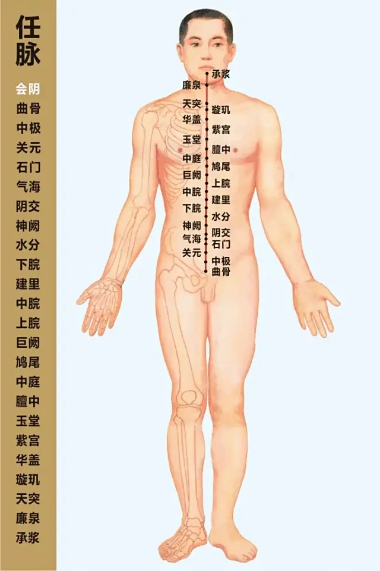
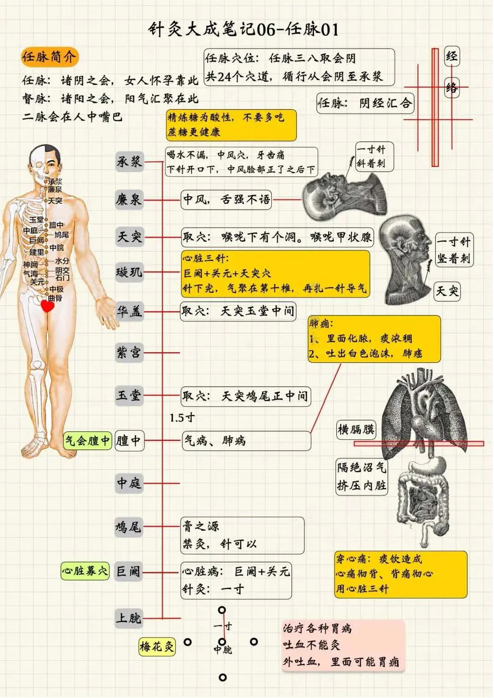
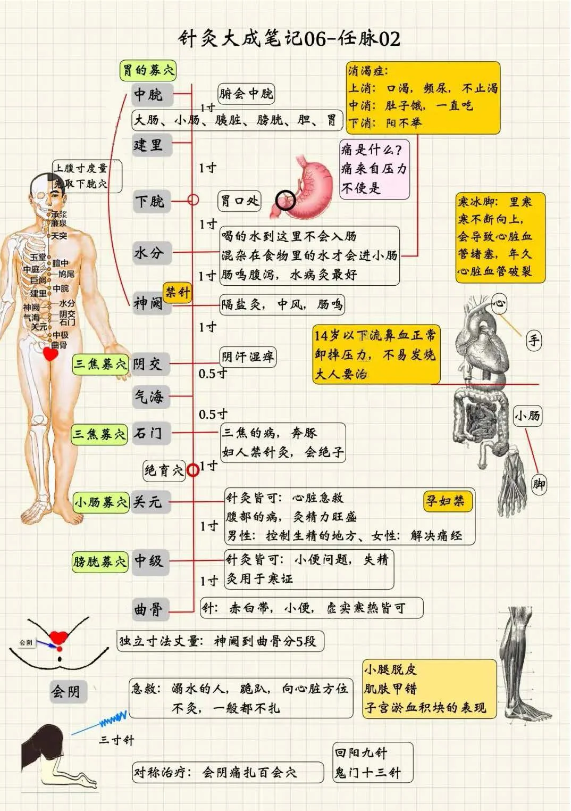

# 任脉二十四穴循行笔记：从会阴到承浆

> [!TIP]- 循行及穴位
> 
>> [!todo] 循行
>> 任脉者，起于中极之下，以上毛际，循腹里，上关元，至咽喉，上颐，循面，入目。
>>
>> [!todo] 穴位
>> 任脉穴行二十四，会阴潜伏两阴间。
>> 曲骨之前中极在，关元石门气海边。
>> 阴交神阙水分处，下脘建里中脘前。
>> 上脘巨阙连鸠尾，中庭膻中玉堂里。
>> 紫宫华盖循璇玑，天突廉泉承浆止。

## **一、任脉基础概念**

1. **任脉定位与功能**  
   - **“任”通“妊”**：主一身之阴，统管六阴经（肝、心、脾、肺、肾、心包），为“阴脉之海”。  
   - **循行路线**：起于会阴，沿腹、胸正中线至承浆，共24穴。  
   - **功能抓手**：下焦生殖与元气、中焦脾胃与水湿、上焦心肺与胸气、颈喉口舌，是任脉的四个临床板块。  
   - **八纲应用**：通过阴阳、表里、虚实、寒热八纲辨证，贯穿诊断、治疗及预后。

2. **取穴方法：腹部分寸法**  
   以神阙（脐）与曲骨（耻骨联合上缘）为基准，均分5段（非同身寸）：

   - 曲骨上1/5处 → 中极（脐下4寸）
   - 曲骨上2/5处 → 关元（脐下3寸）
   - 曲骨上3/5处 → 石门（脐下2寸）
   - 曲骨上4/5处 → 阴交（脐下1寸）
   - 气海在脐下1.5寸，位于关元与阴交之间
   - 神阙与心蔽骨（胸骨剑突）中点 → 中脘（脐上4寸）

3. **重点等级说明**

   - **核心**：必须掌握，临床高频。
   - **常用**：知道定位与主治方向。
   - **了解**：顺着经络认识即可。

---

## **二、24穴循行速查表**

按“会阴 → 承浆”自下而上排列。定位为笔记锚点，具体取穴以教材为准。

| 序 | 穴名 | 定位锚点 | 一句关键词 | 重点 |
|---:|---|---|---|---|
| 1 | 会阴 | 前后二阴之间 | 急救、二阴、督任冲交会 | 了解 |
| 2 | 曲骨 | 耻骨联合上缘 | 膀胱募、小便不利 | 常用 |
| 3 | 中极 | 脐下4寸 | 膀胱募、癃闭、妇科 | 常用 |
| 4 | 关元 | 脐下3寸 | 小肠募、元气、虚劳、急救 | **核心** |
| 5 | 石门 | 脐下2寸 | 三焦募、水肿、奔豚 | 常用 |
| 6 | 气海 | 脐下1.5寸 | 生气之源、气虚总穴 | **核心** |
| 7 | 阴交 | 脐下1寸 | 妇科、水肿 | 了解 |
| 8 | 神阙 | 脐中央 | 回阳固脱、禁针宜灸 | **核心** |
| 9 | 水分 | 脐上1寸 | 分利水湿、水肿 | **核心** |
| 10 | 下脘 | 脐上2寸 | 食谷不化、腹痛 | 了解 |
| 11 | 建里 | 脐上3寸 | 胃脘胀满、纳差 | 了解 |
| 12 | 中脘 | 脐上4寸 | 胃募、腑会、胃病总穴 | **核心** |
| 13 | 上脘 | 脐上5寸 | 呕吐、呃逆、胃上口 | 常用 |
| 14 | 巨阙 | 脐上6寸 | 心募、心痛彻背 | **核心** |
| 15 | 鸠尾 | 胸骨剑突下 | 任脉络穴、胸满、癫痫 | 常用 |
| 16 | 中庭 | 胸剑结合部 | 胸满、呕吐 | 了解 |
| 17 | 膻中 | 两乳连线中点 / 第4肋间 | 气会、心包募、胸闷乳少 | **核心** |
| 18 | 玉堂 | 第3肋间 | 咳嗽、胸痛 | 了解 |
| 19 | 紫宫 | 第2肋间 | 咳嗽、胸痛 | 了解 |
| 20 | 华盖 | 第1肋间附近 | 气喘、咳嗽 | 了解 |
| 21 | 璇玑 | 天突下 | 咽痛、咳嗽 | 了解 |
| 22 | 天突 | 胸骨上窝 | 咽喉、咳喘、甲状腺 | **核心** |
| 23 | 廉泉 | 舌骨上缘 | 舌强不语、吞咽困难 | **核心** |
| 24 | 承浆 | 下唇沟正中 | 面瘫、流涎、牙痛 | **核心** |

**最该先掌握的十穴**：关元、气海、神阙、水分、中脘、巨阙、膻中、天突、廉泉、承浆。  
这十穴立住，任脉的主线就清楚了。

---

## **三、按经络走向分段精讲**

### **1. 骨盆段：会阴 → 阴交**

这一段主下焦、生殖、二阴与元气，是任脉“固本”的部分。

| 穴位 | 定位 | 属性/要点 | 主治方向 | 操作与禁忌 |
|---|---|---|---|---|
| 会阴 | 前后二阴之间 | 督、任、冲交会 | 急救、二阴病、癫狂 | 临床多慎取 |
| 曲骨 | 耻骨联合上缘 | 膀胱募穴 | 小便不利、遗尿、妇科病 | 孕妇慎针 |
| 中极 | 脐下4寸 | 膀胱募穴 | 癃闭、频数、白带、痛经 | 直刺1寸；寒证可灸 |
| 关元 | 脐下3寸 | 小肠募穴 | 生殖、虚劳、中风急救 | 孕妇禁针 |
| 石门 | 脐下2寸 | 三焦募穴 | 水肿、奔豚气、绝孕 | 妇女禁针灸 |
| 气海 | 脐下1.5寸 | 生气之源 | 气虚、脱肛、水气病 | 常与关元配伍 |
| 阴交 | 脐下1寸 | 任、冲、少阴交会 | 妇科、水肿、腹痛 | 孕妇慎针 |

#### **【核心】关元**

- **定位**：脐下3寸，前正中线上。
- **重点理由**：小肠募穴，元气所居；任脉补虚、温阳、固本的第一要穴。
- **主治抓手**：虚劳、寒证、生殖、二便、急救。
- **操作要点**：多用灸法；孕妇禁针。
- **常用配伍**：配气海补气；配足三里扶正；与巨阙、天突组成“心脏病三针”思路。

> 关元为“练气要穴”，重在温养下焦元气。  
> 灸关元常用于虚寒、元气不足一类证候，仍须辨证。

#### **【核心】气海**

- **定位**：脐下1.5寸。
- **重点理由**：气之海，补气要穴，常与关元形成“温阳补气”组合。
- **主治抓手**：乏力、气短、脱肛、虚脱、水气病。
- **操作要点**：可针可灸，虚证多用灸。

#### **【常用】中极 / 石门**

- **中极**：膀胱募穴，重心在“小便异常与妇科”；癃闭、频数、白带、痛经。
- **石门**：三焦募穴，重心在“水肿与奔豚”；传统有“女子禁针灸、恐致不孕”的说法，笔记中保留为禁忌提示。

---

### **2. 脐腹段：神阙 → 上脘**

这一段主脾胃、水湿与后天之本，是任脉“和胃化水”的部分。

| 穴位 | 定位 | 属性/要点 | 主治方向 | 操作与禁忌 |
|---|---|---|---|---|
| 神阙 | 脐中央 | 禁针宜灸 | 中风脱证、肠炎虚寒 | 隔盐灸，回阳固脱 |
| 水分 | 脐上1寸 | 分水之处 | 水肿、腹胀、消渴 | 灸优于针 |
| 下脘 | 脐上2寸 | 胃下口 | 食谷不化、腹痛、呕吐 | 可针可灸 |
| 建里 | 脐上3寸 | 胃脘局部 | 胃脘胀满、食欲不振 | 可针可灸 |
| 中脘 | 脐上4寸 | 胃募穴 / 腑会 | 一切胃病、印堂痛 | 梅花灸治顽固胃病 |
| 上脘 | 脐上5寸 | 胃上口 | 呕吐、呃逆、胃痛 | 孕妇慎针 |

#### **【核心】神阙**

- **定位**：脐中央。
- **重点理由**：任脉最特殊的穴位之一，禁针，专以灸法回阳。
- **主治抓手**：中风脱证、虚寒腹泻、腹痛、急救回阳。
- **操作要点**：隔盐灸为常用古法。

#### **【核心】水分**

- **定位**：脐上1寸。
- **重点理由**：名为“水分”，是分清饮食水谷与饮水水湿的关键穴。
- **主治抓手**：水肿、腹胀、肠鸣腹泻、消渴。
- **操作要点**：灸优于针，治水病为关键。

> 水分穴区分饮食水谷与饮水，灸水分可治小肠不化水湿之腹泻。  
> 水肿病机复杂，此处仅记其“分利水湿”的辨证抓手。

#### **【核心】中脘**

- **定位**：脐上4寸，神阙与心蔽骨连线中点。
- **重点理由**：胃募穴、腑会穴，胃病总穴。
- **主治抓手**：胃痛、呕吐、反胃、腹胀；亦用于胃经上扰之印堂痛。
- **操作要点**：梅花灸（中脘上下左右各一寸）治顽固胃病。

#### **【常用】下脘 / 建里 / 上脘**

- **下脘**：偏“食谷不化”，食后腹胀、腹痛。
- **建里**：偏胃脘胀满、食欲不振，为局部和胃穴。
- **上脘**：偏胃上口，呕吐、呃逆、反胃更常用。

---

### **3. 胸心段：巨阙 → 璇玑**

这一段主心、肺与胸气，是任脉“调胸中气机”的部分。巨阙与膻中是核心，其余穴位顺着经络认识即可。

| 穴位 | 定位 | 属性/要点 | 主治方向 | 操作提示 |
|---|---|---|---|---|
| 巨阙 | 脐上6寸，心蔽骨下 | 心募穴 | 心痛彻背、胸痛、痰饮心痛 | 提豆许泻法 |
| 鸠尾 | 剑突下 | 任脉络穴 | 胸满、心烦、癫痫 | 不宜深刺 |
| 中庭 | 胸剑结合部 | 胸中局部 | 胸满、呕吐、噎膈 | 顺经了解 |
| 膻中 | 两乳连线中点 | 气会 / 心包募 | 气喘、胸闷、乳少、肺痈 | 可针可灸 |
| 玉堂 | 第3肋间 | 胸部局部 | 咳嗽、胸痛 | 顺经了解 |
| 紫宫 | 第2肋间 | 胸部局部 | 咳嗽、胸痛 | 顺经了解 |
| 华盖 | 第1肋间附近 | 胸部局部 | 气喘、咳嗽 | 顺经了解 |
| 璇玑 | 天突下 | 喉胸交界 | 咽痛、咳嗽、气喘 | 顺经了解 |

#### **【核心】巨阙**

- **定位**：脐上6寸，心蔽骨下。
- **重点理由**：心募穴，心病在胸前的反映点。
- **主治抓手**：胸痛彻背、痰饮心痛、心烦。
- **操作要点**：提豆许泻法，针尖微向下推。

> 心脏病三针取天突、巨阙、关元。

#### **【核心】膻中**

- **定位**：两乳头连线中点；女性需按骨度取穴。
- **重点理由**：气会穴、心包募穴，气病总治。
- **主治抓手**：气喘、胸闷、乳少、肺痈脓痰白沫。
- **操作要点**：可针可灸，气机不利者常用。

#### **【常用】鸠尾 / 上胸诸穴**

- **鸠尾**：任脉络穴，胸满、心烦、癫痫，注意不宜深刺。
- **中庭、玉堂、紫宫、华盖、璇玑**：从剑突下到天突之间依次上行，多治胸中局部气机不利、咳嗽、咽痛，作为循行补全即可。

---

### **4. 颈喉段：天突 → 承浆**

这一段主咽喉、舌、口面，是任脉“清窍”的部分。天突、廉泉、承浆都为常用核心穴。

| 穴位 | 定位 | 主治方向 | 操作提示 |
|---|---|---|---|
| 天突 | 胸骨上窝中央 | 甲状腺肿、喉痹、咳喘、心脏病配穴 | 向胸骨后斜刺1寸，勿伤气管 |
| 廉泉 | 喉结上方，舌骨上缘 | 舌强不语、吞咽困难 | 针尖向舌根方向 |
| 承浆 | 下唇沟正中凹陷 | 面瘫、流涎、牙痛 | 张口取穴，可配人中 |

#### **【核心】天突**

- **定位**：胸骨上窝中央。
- **重点理由**：任脉上行至咽喉的关口，咽喉、气道、甲状腺病变常用。
- **主治抓手**：喉痹、咳喘、甲状腺肿；配巨阙、关元用于心脏病三针思路。
- **操作要点**：针向胸骨后斜刺1寸，勿伤气管。

#### **【核心】廉泉**

- **定位**：喉结上方，舌骨上缘凹陷。
- **重点理由**：舌本、咽喉局部要穴。
- **主治抓手**：中风舌强不语、吞咽困难。
- **操作要点**：针尖向舌根方向刺入。

#### **【核心】承浆**

- **定位**：下唇沟正中凹陷。
- **重点理由**：任脉终点，口面局部固本穴。
- **主治抓手**：面瘫、流涎、牙痛；其固疗防复发。
- **操作要点**：张口取穴，针后配合人中。

---

## **四、关键治疗法则**

1. **募穴应用**  
   - **俞募配穴法**：如心脏病针巨阙（募）配心俞（背俞），胃病针中脘配胃俞。  
   - **会穴应用**：腑病取中脘（腑会），气病取膻中（气会）。

2. **心脏病三针**  
   - **天突 + 巨阙 + 关元**：用于心痛彻背、心肌梗塞一类病机的经验组合，思路是导心气至第10胸椎下散邪。

3. **水肿治疗**  
   - **分水理论**：水分穴区分饮食水谷与饮水，灸水分治肠鸣腹泻、小肠不化水湿。

4. **禁忌与注意事项**  
   - 孕妇禁针或慎针下腹部：中极、关元、石门、气海、曲骨。  
   - 神阙禁针，宜隔盐灸。  
   - 天突注意针刺方向，勿伤气管。  
   - 鸠尾不宜深刺。

---

## **五、任脉与整体生理**

1. **气血循环**  
   - **后升前降**：督脉升阳气，任脉降阴津，形成小周天循环。  
   - **小肠热化理论**：心火下移小肠，蒸化肾水为气，上承润肺，是“金生水”的动态过程。  

2. **解剖关联**  
   - **横膈膜功能**：西医视为呼吸肌，中医认为其协调心气与肠气；痰饮停滞可致“心痛彻背”。  

3. **前后配穴思路**  
   - 任脉在前为募，督脉与背俞在后。俞募相配，是任脉临床落地的关键方法。

---

## **六、临床案例参考**

- **案例1**：患者丑时（1—3点）易醒，面黄掌红，辨为肝病传脾；针肝俞、灸关元，以强土截病。  
- **案例2**：中风舌强，针廉泉（向舌根）、承浆固本，配合地仓透颊车治口歪。  

---

## **七、小结**

> 任脉为阴脉之海，与督脉共构人体气血循环主轴。掌握其24穴循行，不必每穴平均用力：先抓住关元、气海、神阙、水分、中脘、巨阙、膻中、天突、廉泉、承浆这十个核心穴，再以“经脉所过，主治所及”串起其余穴位，临床辨证会更有抓手。

---

> 作者: [Acuherb](https://acuherb.xyz/)  
> URL: https://acuherb.xyz/posts/zhenjiu-4-1/  

