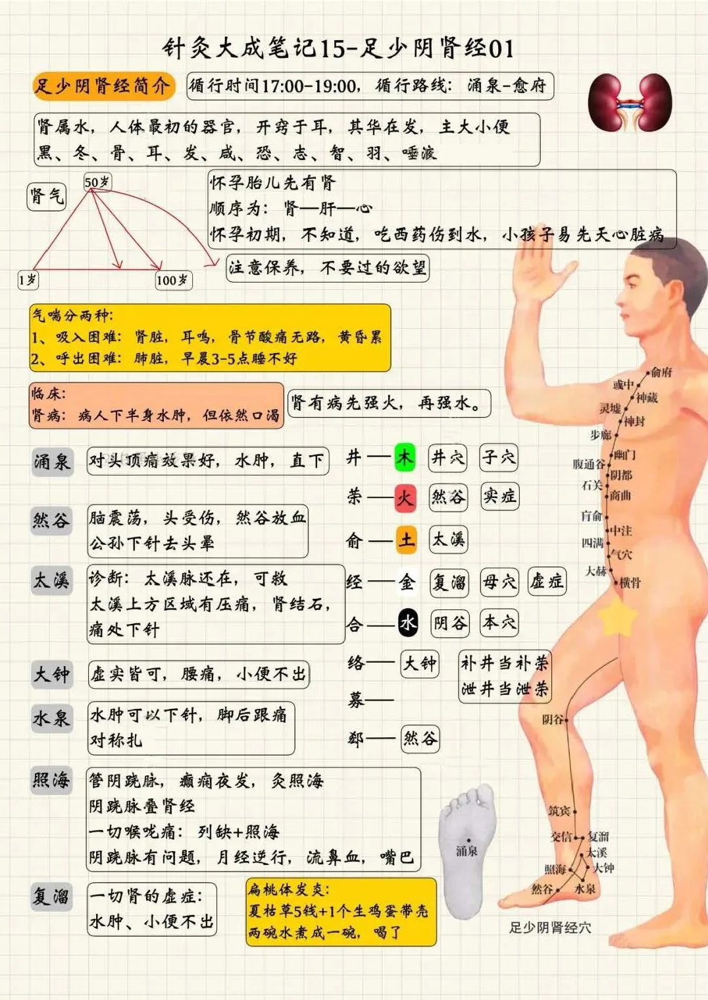
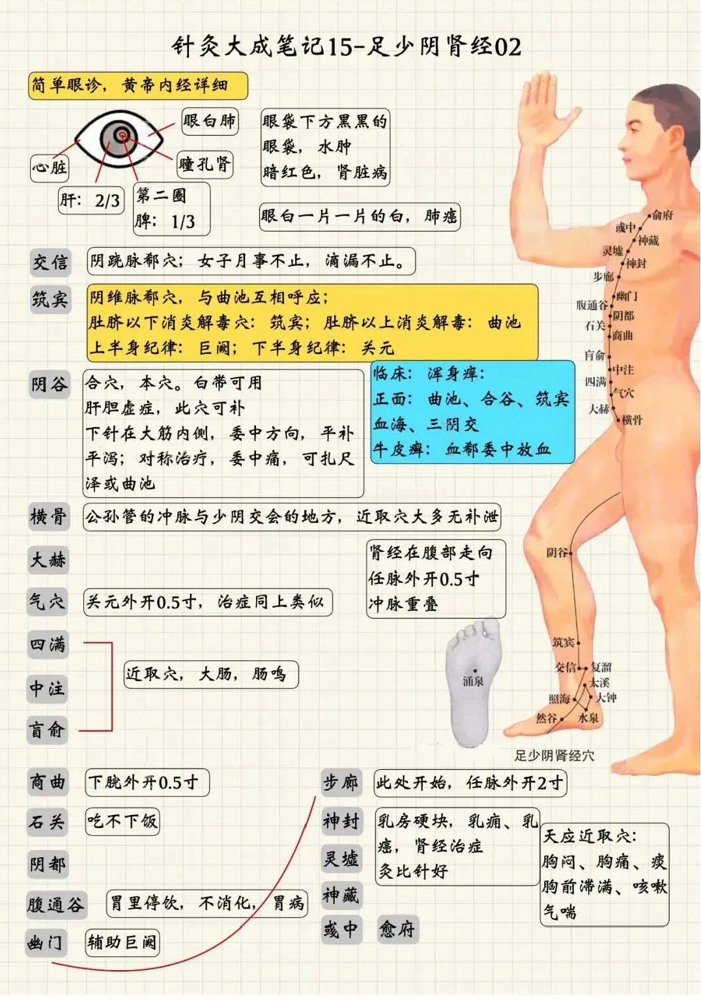

# 足少阴肾经二十七穴循行笔记：从涌泉到俞府

> **说明**：本文为倪海厦老师讲课笔记的整理与补全。穴位定位以教材及骨度分寸为准；讲者经验性表述单独放在引用块中。内容仅供学习，不作为诊疗建议，临床操作须由专业人士辨证执行。

<!-- 循行速查表 -->
## **循行速查表**

> 按经络循行顺序排列；标有“核心”的穴位为优先掌握对象，其余顺着经络认识即可。

| 序 | 穴名 | 重点 |
|---:|---|---|
| 1 | 涌泉 | **核心** |
| 2 | 然谷 | **核心** |
| 3 | 太溪 | **核心** |
| 4 | 大钟 | — |
| 5 | 水泉 | — |
| 6 | 照海 | **核心** |
| 7 | 复溜 | **核心** |
| 8 | 交信 | — |
| 9 | 筑宾 | — |
| 10 | 阴谷 | **核心** |
| 11 | 横骨 | — |
| 12 | 大赫 | — |
| 13 | 气穴 | — |
| 14 | 四满 | — |
| 15 | 中注 | — |
| 16 | 肓俞 | **核心** |
| 17 | 商曲 | — |
| 18 | 石关 | — |
| 19 | 阴都 | — |
| 20 | 腹通谷 | — |
| 21 | 幽门 | — |
| 22 | 步廊 | — |
| 23 | 神封 | — |
| 24 | 灵墟 | — |
| 25 | 神藏 | — |
| 26 | 彧中 | — |
| 27 | 俞府 | **核心** |

> **核心穴提示**：涌泉、然谷、太溪、照海、复溜、阴谷、肓俞、俞府。

---
## **一、肾经基础特性**
1. **气血流注时间**：下午5-7点（酉时）。
2. **五行属性**：属水，涌泉穴为井穴（木），是肾经的子穴。
3. **肾的功能**：
   - **作强之官**：主创造力、记忆、骨骼健康。
   - **其华在发**：头发光泽反映肾气盛衰（肾气绝时头发枯干无光）。
   - **开窍于耳**：耳鸣、耳聋与肾相关。
   - **主骨生髓**：骨病需治肾。
   - **主二便**：大小便异常可能为肾虚。

---

## **二、肾经重要穴位与治症**
### **1. 涌泉穴**
- **定位**：足底人字纹顶端。
- **作用**：
  - 急救大穴（剧痛促醒）。
  - 治顽固头痛、头顶痛（配合百会穴）。
  - 肾经实症（泻井当泻荣，改取然谷穴）。

### **2. 然谷穴**
- **定位**：内踝前高骨下缘，公孙穴后一寸。
- **作用**：
  - 脑震荡急救（放血可缓解头晕、恶心）。
  - 肾经实症（如小便不利）。

### **3. 太溪穴**
- **定位**：内踝与跟腱之间凹陷处。
- **作用**：
  - 肾经原穴，诊断肾气存亡（太溪脉消失预后不良）。
  - **肾结石诊断**：太溪附近压痛点为阿是穴，针刺可止痛排石。
  - 禁忌：避免过量钙片（易致肾结石）。

### **4. 照海穴**
- **定位**：内踝下五分。
- **作用**：
  - 阴蹻脉交会穴，治夜间癫痫、喉病（配列缺）。
  - 逆经（月经从鼻出）特效穴。

### **5. 复溜穴**
- **定位**：太溪上二寸。
- **作用**：
  - 肾经母穴（虚症如水肿、遗精）。
  - 艾灸可温补肾阳。

### **6. 阴谷穴**
- **定位**：膝后腘窝内侧两筋间。
- **作用**：
  - 肾经合穴（本穴），治妇科病（白带）、肝胆虚症。

---

## **三、特殊诊疗方法**
1. **眼诊法**：
   - 瞳孔大小与肾气相关（缩小为聪慧，散大为危象）。
   - 眼袋暗黑或水肿提示肾虚。
   - 肺区白斑可能为肺癌（结合凌晨3点醒等症状）。

2. **喉病治疗**：
   - 扁桃腺炎：刺破肿胀处，针列缺+照海（立效）。
   - 预防复发：夏枯草煮蛋。

3. **皮肤瘙痒**：
   - 上半身：合谷+曲池；下半身：筑宾+三阴交+血海。
   - 癣症：委中放血。

---

## **四、肾经与冲脉关联**
- **腹部穴位**（横骨至幽门）：
  - 均位于任脉旁开一寸，与冲脉重叠。
  - 近取穴，治症取决于附近的脏腑。
- **胸部穴位**（步廊至俞府）：
  - 旁开二寸，治乳房硬块（按经络定位选穴）。
  - 针刺手法：斜刺入肋间，避免伤肺。

---

## **五、养生与禁忌**
1. **固肾关键**：
   - 50岁后肾气渐衰，需节欲（房事、情志）。
   - 避免滥用类固醇（伤肾致骨坏死）。
2. **饮食建议**：
   - 天然钙质（如骨汤）优于钙片。
   - 肾结石患者多饮水，忌高钙食物。

---

## **六、总结**
- 肾经贯穿全身，从足至胸，主水、骨、脑、发、耳。
- 临床注重整体观（如气喘分吸/呼困难辨肾/肺）。
- 针刺结合五行补泻（如复溜补虚，然谷泻实）。
- 预防胜于治疗（如灸关元、中极固本）。

---

> 作者: [Acuherb](https://acuherb.xyz/)  
> URL: https://acuherb.xyz/posts/zhenjiu-4-10/  

