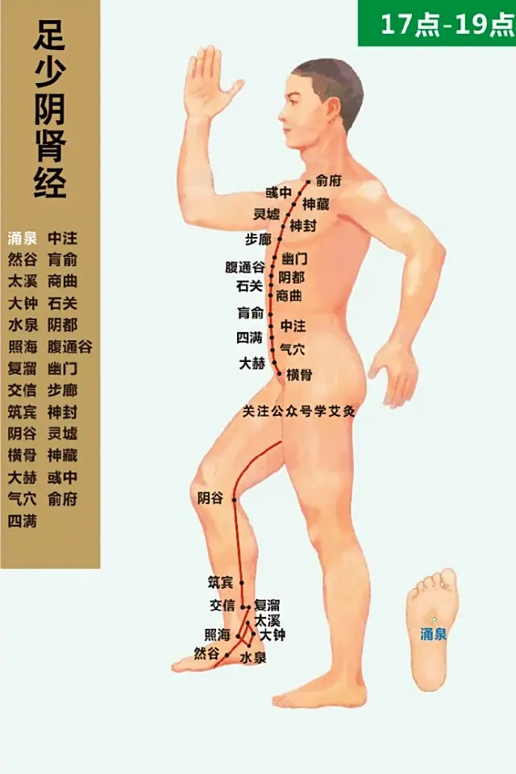

# 足少阴肾经二十七穴循行笔记：从涌泉到俞府

> [!quote]- 足少阴肾经循行及穴位
> 
>
>> [!TIP] 循行
>> 肾足少阴之脉：起于小指之下，斜走足心，出于然骨之下，循内踝之后，别入跟中，以上踹内，出腘内廉，上股内后廉，贯脊属肾，络膀胱。其直者：从肾，上贯肝、膈，入肺中，循喉咙，挟舌本。其支者：从肺出，络心，注胸中。
>
>> [!todo] 穴位
>>
>> 足少阴肾二十七，涌泉然谷出太溪。
>>
>> 大钟水泉连照海，复溜交信筑宾立。
>>
>> 阴谷横骨趋大赫，气穴四满中注得。
>>
>> 肓俞商曲石关蹲，阴都通谷幽门直。
>>
>> 步廊神封出灵墟，神藏彧中俞府毕。

## 一、肾经总论

### 1. 肾的核心定位

> **结论**：肾为"作强之官"，主创造力、记忆、骨骼健康。

- **肾主藏精**：精气是生长、发育、生殖与衰老的根本。
- **肾主水**：主水液代谢，与膀胱气化、三焦水道密切相关。
- **其华在发**：头发光泽反映肾气盛衰；肾气绝时头发枯干无光。
- **开窍于耳**：耳鸣、耳聋与肾气相关。
- **主骨生髓**：骨病、髓病、脑病可从肾论治。
- **主二便**：大小便异常可能涉及肾虚与气化失常。

### 2. 流注与五行

| 项目 | 内容 |
|---|---|
| 流注时辰 | 酉时（17:00—19:00） |
| 五行 | 水 |
| 五味 | 咸 |
| 五色 | 黑 |
| 情志 | 恐，恐伤肾 |

> 酉时发热、腰酸、耳鸣或排尿异常加重，可作为肾经辨证的时相线索。

### 3. 肾经五输与特定穴

| 项目 | 穴位 | 记忆 |
|---|---|---|
| 井穴 | 涌泉（木） | 子穴，急救 |
| 荥穴 | 然谷（火） | 泻实、脑震荡 |
| 输穴 | 太溪（土） | 原穴，肾气存亡 |
| 经穴 | 复溜（金） | 母穴，补肾 |
| 合穴 | 阴谷（水） | 本穴，妇科 |
| 原穴 | 太溪 | 诊肾气 |
| 络穴 | 大钟 | 腰脊、二便 |
| 郄穴 | 水泉 | 急症、痛经 |
| 八脉交会 | 照海 | 通阴跷，咽喉 |

- **母穴复溜**：金生水，肾虚水肿、遗精可补复溜。
- **子穴涌泉**：水生木，肾经实症按"泻井当泻荥"，改取然谷。

## 二、二十七穴循行速查表

> 按涌泉 → 俞府排列；标有"核心"的穴位为优先掌握对象。

| 序 | 穴名 | 定位锚点 | 一句关键词 | 重点 |
|---:|---|---|---|---|
| 1 | 涌泉 | 足底人字纹顶端 | 急救、头顶痛 | **核心** |
| 2 | 然谷 | 内踝前高骨下 | 脑震荡、泻实 | **核心** |
| 3 | 太溪 | 内踝与跟腱之间 | 原穴、肾气存亡 | **核心** |
| 4 | 大钟 | 太溪下0.5寸 | 络穴、腰脊 | — |
| 5 | 水泉 | 太溪下1寸 | 郄穴、痛经 | — |
| 6 | 照海 | 内踝下0.5寸 | 阴跷、咽喉、逆经 | **核心** |
| 7 | 复溜 | 太溪上2寸 | 母穴、水肿遗精 | **核心** |
| 8 | 交信 | 复溜前0.5寸 | 阴跷郄、妇科 | — |
| 9 | 筑宾 | 小腿内侧 | 皮肤瘙痒、解毒 | — |
| 10 | 阴谷 | 腘窝内侧两筋间 | 合穴、妇科 | **核心** |
| 11 | 横骨 | 耻骨联合上 | 泌尿生殖 | — |
| 12 | 大赫 | 下腹旁开 | 妇科、生殖 | — |
| 13 | 气穴 | 下腹旁开 | 月经、不孕 | — |
| 14 | 四满 | 下腹旁开 | 腹胀、水肿 | — |
| 15 | 中注 | 脐下旁开 | 腹痛、便秘 | — |
| 16 | 肓俞 | 脐旁 | 腹痛、便秘 | **核心** |
| 17 | 商曲 | 上腹旁开 | 腹痛、腹泻 | — |
| 18 | 石关 | 上腹旁开 | 呕吐、腹痛 | — |
| 19 | 阴都 | 上腹旁开 | 胃痛、腹胀 | — |
| 20 | 腹通谷 | 上腹旁开 | 呕吐、食积 | — |
| 21 | 幽门 | 上腹旁开 | 胃痛、呕吐 | — |
| 22 | 步廊 | 第5肋间旁开 | 胸痛、咳喘 | — |
| 23 | 神封 | 第4肋间旁开 | 心悸、乳痈 | — |
| 24 | 灵墟 | 第3肋间旁开 | 咳嗽、胸满 | — |
| 25 | 神藏 | 第2肋间旁开 | 咳喘、心悸 | — |
| 26 | 彧中 | 第1肋间旁开 | 咳喘、胸满 | — |
| 27 | 俞府 | 锁骨下缘旁开 | 咳嗽、气喘 | **核心** |

> **核心穴提示**：涌泉、然谷、太溪、照海、复溜、阴谷、肓俞、俞府。

> **腹部旁开距离的两个口径**：标准教材多取**任脉旁开0.5寸**；**倪海厦讲课取任脉旁开一寸**（肓俞在神阙外开一寸，位于任脉与胃经天枢旁开二寸之间）。对照倪师视频取穴时，以"旁开一寸"为准；按教材定位时，以0.5寸为准，两者不宜混用。

## 三、按循行分段精讲

### 1. 足部段：涌泉 → 照海

这一段是肾经的"根"，主**急救、头脑、肾气与咽喉**。

| 穴位 | 定位 | 主治方向 | 操作要点 |
|---|---|---|---|
| 涌泉 | 足底人字纹顶端 | 急救、头痛、昏迷 | 强刺激促醒 |
| 然谷 | 内踝前高骨下缘 | 脑震荡、小便不利 | 放血可缓解头晕恶心 |
| 太溪 | 内踝与跟腱之间 | 肾虚、结石诊断 | 原穴，候肾气 |
| 大钟 | 太溪下0.5寸 | 腰脊痛、二便 | 络穴 |
| 水泉 | 太溪下1寸 | 痛经、急症 | 郄穴 |
| 照海 | 内踝下0.5寸 | 喉病、夜间癫痫、逆经 | 通阴跷 |

#### 【核心】涌泉

- **定位**：足底第2、3趾趾缝纹头与足跟连线的前1/3处。
- **重点理由**：肾经井穴，急救大穴。
- **主治抓手**：昏迷、剧痛促醒、顽固头痛、头顶痛。
- **配伍**：配百会治头顶痛；急救时常与水沟、百会同用。

#### 【核心】然谷

- **定位**：内踝前高骨下缘。
- **重点理由**：肾经荥穴，肾经实症"泻井当泻荥"的落点。
- **主治抓手**：脑震荡（放血可缓解头晕恶心）、小便不利。
- **操作要点**：脑震荡时在然谷附近放血。

#### 【核心】太溪

- **定位**：内踝尖与跟腱之间凹陷处。
- **重点理由**：肾经原穴，是判断肾气存亡的重要穴位。
- **主治抓手**：肾虚、耳鸣、腰膝酸软、失眠、消渴。
- **诊断经验**：
  - **太溪脉还在，就是肾气还在，人还能救回来**；**太溪脉消失与瞳孔放大并见时，才是肾气败绝的危候**——单看太溪脉消失不足以定生死，要与瞳孔并见。
  - 太溪附近压痛可作**肾结石**诊断线索。

> 肾结石患者应避免过量钙片，易致结石。饮食与用药应遵医嘱，不自行停用或滥用补充剂。

#### 【核心】照海

- **定位**：内踝尖下方凹陷处。
- **重点理由**：八脉交会穴，通阴跷脉，咽喉与妇科要穴。
- **主治抓手**：咽喉肿痛、夜间癫痫、月经逆行从鼻出。
- **配伍**：配列缺治咽喉病；这是八脉交会"列缺任脉行肺系，阴跷照海膈喉咙"的常用组合。

### 2. 小腿段：复溜 → 阴谷

这一段偏重**补肾、利水、皮肤与妇科**。

| 穴位 | 定位 | 主治方向 | 操作要点 |
|---|---|---|---|
| 复溜 | 太溪上2寸 | 水肿、遗精、肾虚 | 母穴，可灸 |
| 交信 | 复溜前0.5寸 | 妇科、月经 | 阴跷郄 |
| 筑宾 | 小腿内侧 | 皮肤瘙痒、解毒 | 下半身瘙痒常用 |
| 阴谷 | 腘窝内侧两筋间 | 白带、肝胆虚证 | 合穴、本穴 |

#### 【核心】复溜

- **定位**：太溪上2寸，跟腱前缘。
- **重点理由**：肾经母穴，补肾要穴。
- **主治抓手**：水肿、遗精、盗汗、腰膝酸软。
- **操作要点**：艾灸可温补肾阳。

#### 【核心】阴谷

- **定位**：屈膝，腘窝内侧，半腱肌与半膜肌之间。
- **重点理由**：肾经合穴，属水，为本穴。
- **主治抓手**：妇科病如白带，肝胆虚证，膝痛。

### 3. 腹部段：横骨 → 幽门

腹部穴位位于任脉旁开约0.5寸（教材口径；倪师讲课取旁开一寸），与冲脉关系密切，多作**近取穴**。

| 穴位 | 定位 | 主治方向 |
|---|---|---|
| 横骨 | 耻骨联合上 | 泌尿、生殖 |
| 大赫 | 下腹旁开 | 妇科、生殖 |
| 气穴 | 下腹旁开 | 月经、不孕 |
| 四满 | 下腹旁开 | 腹胀、水肿 |
| 中注 | 脐下旁开 | 腹痛、便秘 |
| 肓俞 | 脐旁 | 腹痛、便秘 |
| 商曲 | 上腹旁开 | 腹痛、腹泻 |
| 石关 | 上腹旁开 | 呕吐、腹痛 |
| 阴都 | 上腹旁开 | 胃痛、腹胀 |
| 腹通谷 | 上腹旁开 | 呕吐、食积 |
| 幽门 | 上腹旁开 | 胃痛、呕吐 |

#### 【核心】肓俞

- **定位**：脐旁。教材取旁开0.5寸；**倪师讲课取神阙外开一寸**，正好在任脉与胃经天枢（旁开二寸）之间。
- **重点理由**：肾经腹部近取要穴，接近中焦与肠腑。
- **主治抓手**：腹痛、便秘、腹泻、腹胀。
- **冲脉关联**：腹部肾经穴与冲脉循行重叠，治症常看附近脏腑。

### 4. 胸部段：步廊 → 俞府

胸部穴位旁开约2寸，多用于**胸、肺、心与乳房局部病**。

| 穴位 | 定位 | 主治方向 |
|---|---|---|
| 步廊 | 第5肋间旁开 | 胸痛、咳喘 |
| 神封 | 第4肋间旁开 | 心悸、乳痈 |
| 灵墟 | 第3肋间旁开 | 咳嗽、胸满 |
| 神藏 | 第2肋间旁开 | 咳喘、心悸 |
| 彧中 | 第1肋间旁开 | 咳喘 |
| 俞府 | 锁骨下缘旁开 | 咳嗽、气喘 |

#### 【核心】俞府（及胸部诸穴）

- **定位**：锁骨下缘，前正中线旁开2寸。
- **重点理由**：肾经终点，胸上部气机收束处。
- **主治抓手**：咳嗽、气喘、胸满。
- **操作要点（** ：**沿肋骨交缝处平刺/斜刺，不从肋间隙深扎**；针尖向外，贴着骨缝走。"**要下在肋骨交缝的地方，不要从两个肋骨中间扎**"，**从一寸半向二寸平刺**。

## 四、特殊诊疗方法

### 1. 眼诊法

> 瞳孔大小与肾气相关：**缩小为聪慧，散大为危象**。
> 眼袋暗黑或水肿提示肾虚。
> 肺区白斑可能为肺癌，结合凌晨3点醒等症状判断。

### 2. 喉病治疗（发作期与不发作期分开）

**发作期**：
- 扁桃腺炎：**刺破肿胀处**，针**列缺 + 照海**。

**不发作期（预防）** ：
- **夏枯草煮蛋**：**必须在没有扁桃腺发炎的时候服用**；**正在发炎、喉咙肿痛时不能用**，发作时服用不恰当。
- 剂量与煮法的常见整理版本为夏枯草五钱、两碗水煮成一碗、加蛋煮，属整理稿常见版本，具体以原讲课为准。

### 3. 皮肤瘙痒

| 部位 | 常用穴 |
|---|---|
| 上半身 | 合谷、曲池 |
| 下半身 | 筑宾、三阴交、血海 |
| 癣症 | 委中放血 |

- **筑宾**：肚脐以下的消炎解毒穴，下半身瘙痒常用。

### 4. 肾经与冲脉

- 腹部肾经穴位于任脉旁开约0.5寸（教材口径；倪师取一寸），与冲脉重叠。
- 胸部肾经穴旁开约2寸，治乳房硬块时按经络定位选穴。
- 针刺胸部穴应**沿肋骨交缝平刺/斜刺，避免伤肺**。

## 五、临床配穴速查

| 应用方向 | 常用穴 | 配伍思路 |
|---|---|---|
| 急救促醒 | 涌泉、水沟、百会 | 井穴与督脉开窍 |
| 头顶痛 | 涌泉、百会 | 上病下取 |
| 肾虚腰痛 | 太溪、复溜、肾俞 | 原穴与背俞 |
| 水肿 | 复溜、阴陵泉、三阴交 | 补肾利水 |
| 咽喉病 | 照海、列缺、少商 | 八脉交会与井穴 |
| 妇科病 | 照海、阴谷、三阴交 | 肾肝脾同调 |
| 失眠 | 太溪、神门、复溜 | 滋阴安神 |
| 咳喘 | 俞府、神藏、膻中 | 胸部近取 |
| 脑震荡 | 然谷放血 | 荥穴泻实 |

### 肾经取穴口诀

> 涌泉急救头顶痛，然谷泻实脑震同；
> 太溪原穴候肾气，照海阴跷利咽喉；
> 复溜母穴补虚水，阴谷本穴妇科从；
> 肓俞脐旁调腹气，俞府锁骨咳喘通。

## 六、养生与禁忌

### 1. 固肾关键

> 50岁后肾气渐衰，需节欲，包括房事与情志耗散。

- 避免过恐，恐伤肾。
- 避免熬夜与过度耗精。
- 可灸关元、气海、中极固本。

### 2. 用药与饮食

> 避免滥用类固醇，因伤肾可致骨坏死；肾结石患者多饮水，忌高钙食物。

> **说明**："天然钙质如骨汤优于钙片"。

## 七、小结

> 肾经二十七穴，从涌泉到俞府，主线是"足底开窍、小腿补肾、腹部近取、胸部降逆"。
> 涌泉、然谷、太溪、照海、复溜、阴谷、肓俞、俞府八穴立住，再按五输、原络、郄穴与八脉交会串起来，肾经体系就清楚了。
> 肾经学习的关键，是一个"水"字：水足则骨强、发润、耳聪、二便调和；水亏则虚火上扰、腰膝失养。

---

> 作者: [Acuherb](https://acuherb.xyz/)  
> URL: https://acuherb.xyz/posts/zhenjiu-4-10/  

