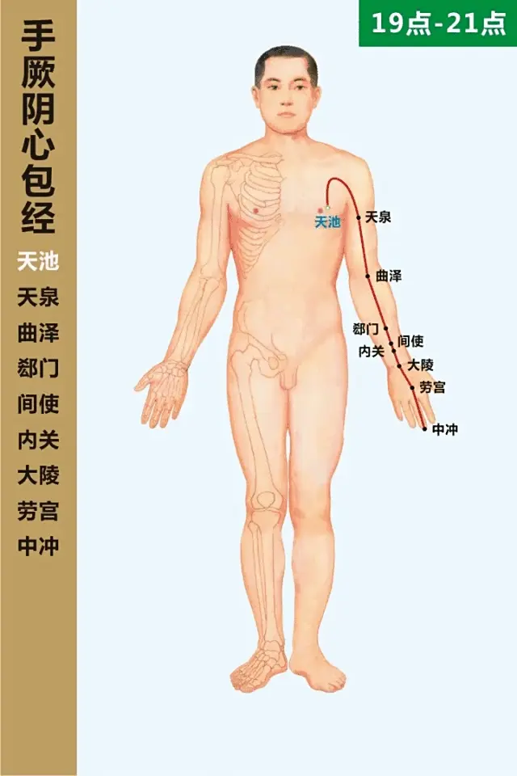

# 手厥阴心包经九穴循行笔记：从天池到中冲

> [!quote]- 手厥阴心包经循行及穴位
> 
>
>> [!TIP] 循行
>> 心主手厥阴心包络之脉，起于胸中，出属心包络，下膈，历络三焦。其支者：循胸出胁，下腋三寸，上抵腋下，循臑内，行太阴、少阴之间，入肘中，下臂，行两筋之间，入掌中，循中指，出其端。其支者：别掌中，循小指次指出其端。
>
>> [!todo] 穴位
>>
>> 心包九穴天池近，天泉曲泽郄门认。
>>
>> 间使内关逾大陵，劳宫中冲中指尽。

## 一、心包经总论

### 1. 心包与心脏

> 心脏为"君主之官"，本身不受病；心包是心脏外膜，代心受邪。

- 心包护心，邪气犯心先犯心包，故心病多从心包论治。
- 心主汗，心脏功能恢复时，患者可出现发汗现象。
- 心包属阴，主血脉与神志；三焦属阳，行气化物，二者互为表里。

> 中医认为胚胎初期先有肾水，再至肝、心；西医因两周后才能检测到心跳，误以为心脏为首个器官。

### 2. 流注与相火

- **戌时流注**：19:00—21:00，心包经气血最旺，与肾经酉时相接。
- **相火特性**：心包为相火，随节气有属火、属水之分。

> 夏至→冬至，心包经属火，木穴（大陵）为母穴；冬至→夏至，心包经属水，金穴（间使）为母穴。冬季热内敛（小便多），夏季热外散（汗多），心热下移小肠。

### 3. 心包与三焦

| 项目 | 心包 | 三焦 |
|---|---|---|
| 阴阳 | 阴 | 阳 |
| 功能 | 主血脉、神志，护心 | 行气化水，遍布内脏之间 |
| 关系 | 表里相合 | 心包病可从三焦调，三焦病也可从心包调 |

## 二、九穴循行速查表

> 按天池 → 中冲排列；标有"核心"的穴位为优先掌握对象。

| 序 | 穴名 | 定位锚点 | 一句关键词 | 重点 |
|---:|---|---|---|---|
| 1 | 天池 | 乳中旁开1寸 | 乳房硬块辨经、腋肿 | — |
| 2 | 天泉 | 腋横纹下2寸 | 上臂局部病 | — |
| 3 | 曲泽 | 肘横纹肱二头肌腱尺侧缘 | 合穴、心功能恢复 | **核心** |
| 4 | 郄门 | 腕上5寸两筋间 | 郄穴、镇痛 | **核心** |
| 5 | 间使 | 腕上3寸 | 经穴、手麻、疟疾癫狂 | **核心** |
| 6 | 内关 | 腕上2寸 | 络穴、胃心胸 | **核心** |
| 7 | 大陵 | 腕横纹中央 | 输穴 / 原穴、足跟痛 | **核心** |
| 8 | 劳宫 | 掌心第3、4掌骨间 | 荥穴、儿科退烧 | **核心** |
| 9 | 中冲 | 中指尖端 | 井穴、醒神退热 | **核心** |

> **核心穴提示**：曲泽、郄门、间使、内关、大陵、劳宫、中冲。

## 三、按循行分段精讲

### 1. 胸腋段：天池 → 天泉

| 穴位 | 定位 | 主治方向 | 操作要点 |
|---|---|---|---|
| 天池 | 乳中旁开1寸 | 乳房硬块、腋下肿、四肢不举 | 近取穴，辨经用 |
| 天泉 | 腋前纹头下2寸 | 上臂痛、胸满 | 近取穴 |

#### 【常用】天池

- **定位**：乳中穴旁开1寸。
- **重点理由**：心包经起始穴，用于**判断乳房硬块是否归属心包经**。
- **辨经用法（关键）** ："如果有个妇人，乳房硬块**正好在乳中穴外开一寸**的地方，这条经络是心包经"。**"恰好在这个位置"是辨经成立的空间条件**；硬块不在这个位置，辨经的落点就要换到其他经络，不能一见到乳房硬块就归到天池。
- **主治抓手**：乳房硬块（恰好位于乳中外开一寸）、腋下肿、手臂不举。
- **记忆抓手**：乳房病不只看胃经，也要看心包经循行；但"看"的前提是先看硬块位置。

### 2. 肘臂段：曲泽 → 间使

| 穴位 | 定位 | 属性 | 主治方向 |
|---|---|---|---|
| 曲泽 | 肘横纹肱二头肌腱尺侧缘 | 合穴 | 心脏功能恢复、膝后痛对称治 |
| 郄门 | 腕上5寸两筋间 | 郄穴 | 心绞痛、胸胁痛 |
| 间使 | 腕上3寸两筋间 | 经穴 | 手麻、疟疾、癫狂 |

#### 【核心】曲泽

- **定位**：肘横纹中，**肱二头肌腱的尺侧缘**。与肺经尺泽（肱二头肌腱的桡侧缘）贴着同一条肌腱，区别就在尺侧还是桡侧——补上"尺侧缘"这个解剖边界，定位才有明确依据。
- **重点理由**：心包经合穴，与肺经尺泽相对。
- **主治抓手**：心胸病、肘臂痛、膝后痛对称治疗。
- **对称治疗**：膝后痛（委中、委阳）可针曲泽或曲池（对侧）。
- **经验提示**：心脏功能恢复时，患者会发汗，因心主汗。

#### 【核心】郄门

- **定位**：腕横纹上5寸，两筋之间。
- **重点理由**：心包经郄穴，善治心胸急痛。
- **主治抓手**：心绞痛、胸胁痛、心悸。
- **记忆抓手**：郄穴主急症，心包郄门治心胸急痛。

#### 【核心】间使

- **定位**：腕横纹上3寸，两筋之间。
- **重点理由**：心包经经穴，随节气不同可作母穴或子穴。
- **主治抓手**：手麻、疟疾、癫狂。
- **手麻的具体操作（两步导引法，不能只写"对侧下针"）** ：
  - "**间使专治手麻，在对侧大陵下针，再在同侧间使下针，为之导引法**"。
  - **第一步**：在**对侧大陵**下针，引气。
  - **第二步**：在**同侧间使**下针，导引。
  - 大陵管"引"、间使管"导"，两者分工明确。只写"对侧下针"，读者会以为随便在对侧取一穴即可，丢掉了"对侧大陵 + 同侧间使"这个固定搭配。

### 3. 腕掌段：内关 → 中冲

| 穴位 | 定位 | 属性 | 主治方向 |
|---|---|---|---|
| 内关 | 腕上2寸两筋间 | 络穴，通阴维 | 胃心胸、呕吐、心悸 |
| 大陵 | 腕横纹中央 | 输穴 / 原穴（阴经以输代原） | 乳块剧痛、足跟痛 |
| 劳宫 | 掌心第3、4掌骨间 | 荥穴 | 退烧、清心火 |
| 中冲 | 中指尖端 | 井穴 | 昏迷、舌强、退烧 |

#### 【核心】内关

- **定位**：腕横纹上2寸，两筋之间。
- **重点理由**：心包经络穴，八脉交会通阴维脉。
- **经典配伍**：配公孙治"胃心胸"疾病。
- **双向调节**：可止吐，也可催吐，取决于意念引导——专注"不吐"则止吐，意念"想吐"则催吐。
- **主治抓手**：晕车、孕吐、胃痛、心脏病、气喘、肋骨内侧痛。

#### 【核心】大陵（输穴 + 原穴，一穴两职）

- **定位**：腕横纹中央，两筋之间。
- **重点理由**：
  - **输穴**：随节气变化充当子穴或母穴（夏至到冬至为子穴）。
  - **原穴**：阴经**没有独立原穴，以输穴代替原穴**，大陵**一穴兼两职**。作为原穴，它是心包经"安五脏、调不平衡"的独立入口——需要从原穴层面处理心包相关失衡时，大陵就是那个入口，不能只记"输穴"而漏掉"原穴"。
- **主治抓手**：乳中外开1寸硬块剧痛、拒按；足跟痛。
- **特殊用法**：足跟痛取**对侧大陵**，透压痛点，如左脚跟痛针右手大陵。

#### 【核心】劳宫

- **定位**：握拳时中指尖所指处，第3、4掌骨之间。
- **重点理由**：心包经荥穴，属火，为本穴。
- **主治抓手**：心烦、掌中热、小儿退烧。
- **儿科应用**：清天河水等推拿手法中用劳宫清心火退热。
- **禁忌**：劳宫禁灸，多汗易烫伤。

#### 【核心】中冲（井穴，补泻有特殊规则）

- **定位**：中指尖端。
- **重点理由**：心包经井穴，属木，善醒神开窍。
- **主治抓手**：退烧、中风昏迷、舌强不语。
- **要点**：心包络舌后，故舌强不语可取中冲。
- **特殊补泻规则——"补井当补合"** ：
  - **中冲穴是井穴，井穴是木，由夏至到冬至是属火，所以井穴成为心包经的母穴。按照针灸的原则'补井当补合'，在中冲穴上作补泻**
  - **含义**：当**中冲在夏至到冬至期间成为母穴、需要做补法时，不在中冲这个井穴上直接补，而要把补的作用转移到合穴（曲泽）上**。
  - **原因**：井穴皮薄肉少，不宜做重补；遇到井穴为母穴需要补时，补法要转到合穴去做。这是五输穴补泻中"井穴特殊处理"的硬规则。
  - **操作含义**：需要补心包、而当时中冲是母穴时，**补在曲泽，不在中冲**。只写"中冲是井穴、能醒神退热"，读者若直接在井穴上做补，恰好踩在倪师特意划出的例外上。

## 四、心包经治疗原则

### 1. 时间疗法

> 戌时发病的"时症"，可取心包经俞穴或荥穴。

### 2. 本穴与节气

- 夏至后与冬至后分别取不同五行属性的穴位作为补泻依据。
- **井穴为母穴时的例外**：中冲在夏至到冬至为母穴，补法不在中冲做，**补井当补合**，补在曲泽。

### 3. 对称治疗

| 病位 | 对侧取穴 |
|---|---|
| 足跟痛 | 对侧大陵 |
| 膝后痛 | 曲泽或曲池 |
| 手麻 | **对侧大陵引气 + 同侧间使导引**（两步，不是单一对侧穴） |

### 4. 导引与儿科指针

- 同侧针穴可引导气血；手麻的"对侧大陵 + 同侧间使"即导引法的具体应用。
- 儿科以指代针，如劳宫退烧。

## 五、临床配穴速查

| 应用方向 | 常用穴 | 配伍思路 |
|---|---|---|
| 胃心胸病 | 内关、公孙 | 八脉交会经典配穴 |
| 心绞痛、胸痛 | 郄门、内关、膻中 | 郄穴止痛，络穴宽胸 |
| 呕吐、晕车 | 内关、中脘、足三里 | 和胃降逆 |
| 心悸、失眠 | 内关、神门、大陵 | 安神定悸；大陵兼原穴调心包失衡 |
| 乳房硬块（心包经辨经） | 天池、大陵、膻中 | 硬块须**恰好位于乳中外开一寸**才归心包经 |
| 足跟痛 | 大陵（对侧） | 对称取穴 |
| 手麻 | 对侧大陵 + 同侧间使 | 两步导引法，引气+导引 |
| 中风昏迷 | 中冲、水沟、百会 | 井穴醒神（补法则转曲泽） |

### 心包经取穴口诀

> 天池乳块腋下肿，辨经先看一寸中；
> 天泉上臂近取功，曲泽尺侧复心汗；
> 郄门镇痛胸心通，间使手麻引大陵；
> 内关胃心胸与共，大陵输原足跟用；
> 劳宫退烧中冲醒，补井当补合曲泽。

## 六、操作与禁忌速查

| 穴位 | 注意 |
|---|---|
| 天池 | 胸乳部针刺不宜过深；辨经看硬块是否在乳中外开一寸 |
| 内关 | 注意针感，避免强刺激神经 |
| 劳宫 | 禁灸，多汗易烫伤 |
| 中冲 | 点刺须消毒，体弱者慎用；**补法不在中冲做，补井当补合（曲泽）** |
| 大陵 | 透穴为特殊操作，须专业人员执行；兼原穴，可调心包失衡 |

## 七、小结

> 心包经九穴，从天池到中冲，主线是"胸腋辨块、肘臂止痛、腕掌宽胸醒神"。
> 曲泽、郄门、间使、内关、大陵、劳宫、中冲七穴立住，再以心包代心受邪、公孙内关胃心胸、对称取穴与儿科指针串起来，心包经体系就清楚了。
> **四个容易漏掉的关键点**：大陵是**输穴兼原穴**，不只"输穴"；间使治手麻是**对侧大陵引气 + 同侧间使导引**两步；中冲是井穴，**补井当补合**，补法转曲泽；天池辨经看硬块**是否恰好位于乳中外开一寸**。
> 心包经学习的关键，是一个"护"字：护心、宽胸、安神、降逆。

---

> 作者: [Acuherb](https://acuherb.xyz/)  
> URL: https://acuherb.xyz/posts/zhenjiu-4-11/  

