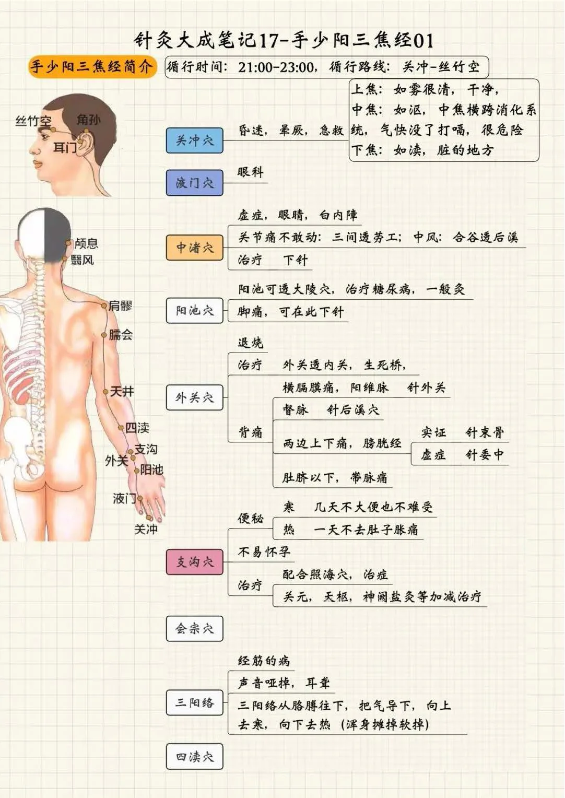
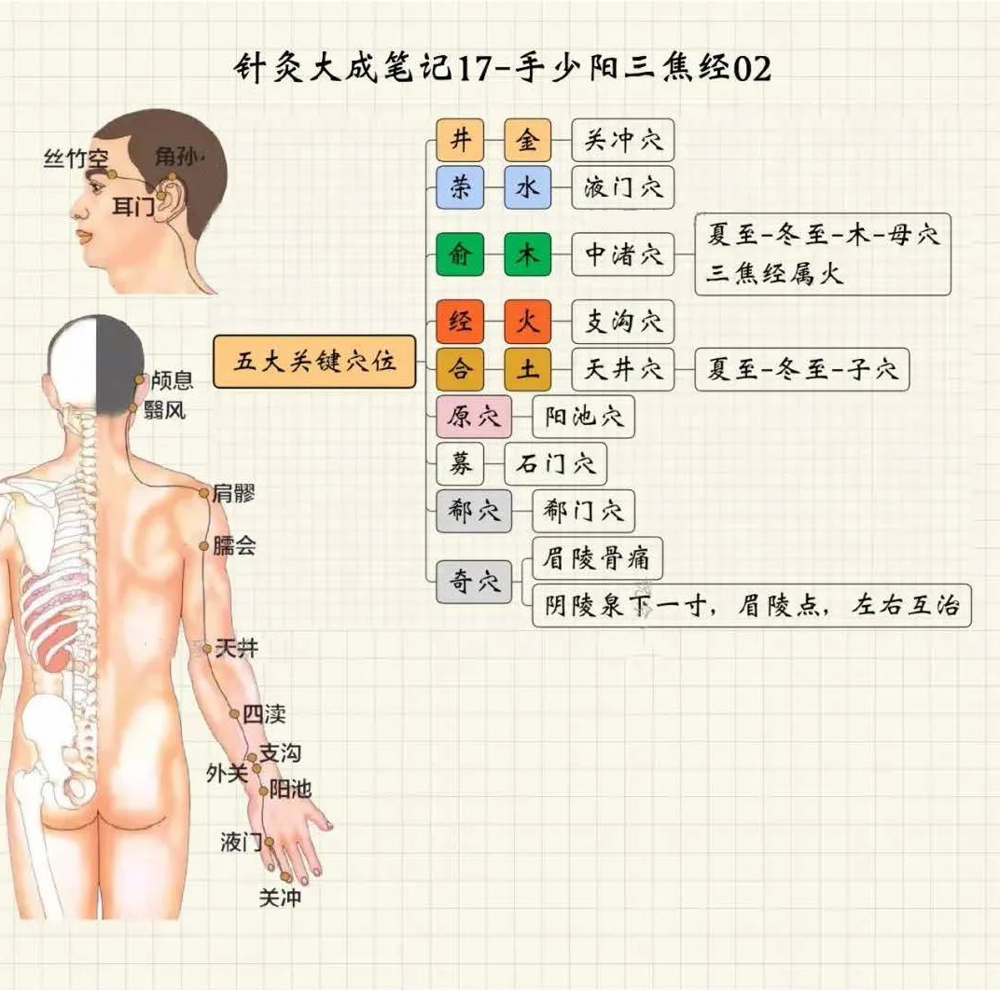
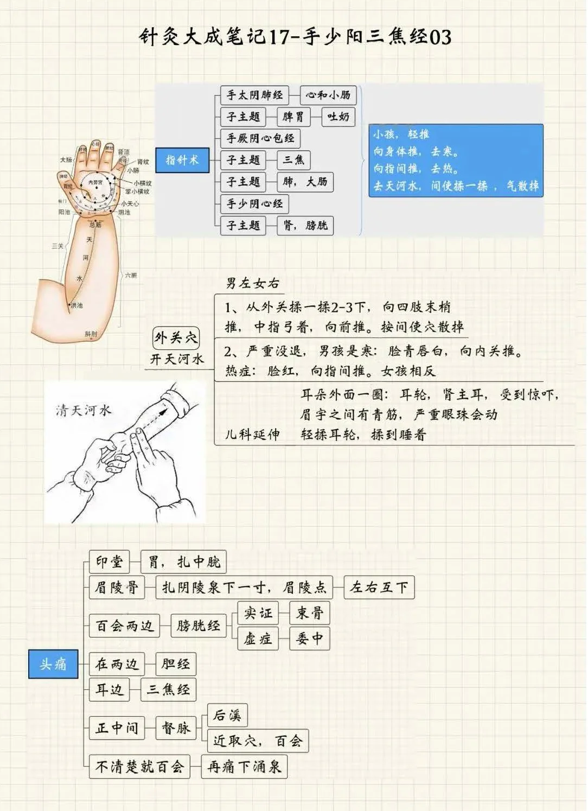

# 手少阳三焦经二十三穴循行笔记：从关冲到丝竹空

## **一、三焦总论**

### 1. 三焦分部

> 上焦如雾，胸蔽骨以上，水气蒸发而清；中焦如沤，胸蔽骨至肚脐，为消化区域；下焦如渎，肚脐以下，内含残渣。

- **上焦**：心、肺与胸中，主宣发与布散。
- **中焦**：脾胃，主腐熟水谷与化生气血。
- **下焦**：肾、膀胱、大小肠，主分清泌浊与排泄。

### 2. 三焦功能

> 三焦为“决渎之官，水道出焉”，主水液代谢。

- 三焦是水液运行的通道，也是阳气通行的道路。
- 阳气通过三焦布散全身；中焦气绝则打嗝（哕），原笔记视为危症。
- 三焦与命门相连，行房时三焦气聚命门。
- 手少阳三焦经气血流注于亥时（21:00—23:00）。

### 3. 三焦经五输与特定穴

| 项目 | 穴位 | 记忆 |
|---|---|---|
| 井穴 | 关冲（金） | 急救、昏迷 |
| 荥穴 | 液门（水） | 往来寒热、目疾 |
| 输穴 | 中渚（木） | 母穴，虚证眼病 |
| 原穴 | 阳池 | 消渴、腕痛 |
| 经穴 | 支沟（火） | 便秘、难产 |
| 合穴 | 天井（土） | 子穴，泻实 |
| 络穴 | 外关 | 通阳维，退热 |

- **母穴中渚**：木生火，虚证如白内障可取中渚。
- **子穴天井**：火生土，实证可泻天井。

---

## **二、二十三穴循行速查表**

> 按关冲 → 丝竹空排列；标有“核心”的穴位为优先掌握对象。

| 序 | 穴名 | 定位锚点 | 一句关键词 | 重点 |
|---:|---|---|---|---|
| 1 | 关冲 | 无名指尺侧指甲角 | 井穴、急救 | **核心** |
| 2 | 液门 | 第4、5指蹼间 | 寒热、目疾 | — |
| 3 | 中渚 | 液门后1寸骨缝 | 母穴、虚眼病 | **核心** |
| 4 | 阳池 | 腕背横纹中点 | 原穴、消渴 | **核心** |
| 5 | 外关 | 阳池上2寸 | 络穴、退热 | **核心** |
| 6 | 支沟 | 外关上1寸 | 便秘、难产 | **核心** |
| 7 | 会宗 | 支沟尺侧 | 郄穴、耳疾 | — |
| 8 | 三阳络 | 前臂背侧 | 手臂痛 | — |
| 9 | 四渎 | 前臂背侧 | 耳聋、臂痛 | — |
| 10 | 天井 | 肘尖后凹陷 | 合穴、泻实 | 常用 |
| 11 | 清冷渊 | 天井上1寸 | 肘臂痛 | — |
| 12 | 消泺 | 上臂背侧 | 头痛、颈项 | — |
| 13 | 臑会 | 上臂外侧 | 淋巴结、甲亢 | 常用 |
| 14 | 肩髎 | 肩峰后下方 | 肩痛、中风 | **核心** |
| 15 | 天髎 | 肩井与曲垣之间 | 肩颈痛 | — |
| 16 | 天牖 | 颈侧乳突后 | 头项、耳疾 | — |
| 17 | 翳风 | 耳垂后凹陷 | 耳鸣、牙关、脱臼 | **核心** |
| 18 | 瘛脉 | 耳后乳突 | 惊痫、耳鸣 | — |
| 19 | 颅息 | 耳后 | 头痛、耳鸣 | — |
| 20 | 角孙 | 耳尖上方 | 目疾、头项 | — |
| 21 | 耳门 | 耳屏上前方 | 耳鸣、耳聋 | **核心** |
| 22 | 耳和髎 | 耳前上方 | 头痛、耳鸣 | — |
| 23 | 丝竹空 | 眉尾凹陷 | 眼疾、放血 | **核心** |

> **核心穴提示**：关冲、中渚、阳池、外关、支沟、肩髎、翳风、耳门、丝竹空。

---

## **三、按循行分段精讲**

### **1. 手腕段：关冲 → 阳池**

| 穴位 | 定位 | 属性 | 主治方向 |
|---|---|---|---|
| 关冲 | 无名指尺侧指甲角旁 | 井穴 | 急救、昏迷、热病 |
| 液门 | 第4、5掌指关节前 | 荥穴 | 往来寒热、目疾 |
| 中渚 | 第4、5掌指关节后 | 输穴 | 虚证眼病、手臂痛 |
| 阳池 | 腕背横纹中点 | 原穴 | 消渴、腕痛 |

#### **【核心】关冲**

- **定位**：无名指尺侧指甲角旁。
- **重点理由**：三焦经井穴，急救与清热要穴。
- **主治抓手**：昏迷、热病、咽喉痛、头痛。
- **操作要点**：可点刺放血。

#### **【核心】中渚**

- **定位**：第4、5掌指关节后骨缝间。
- **重点理由**：三焦经输穴、母穴。
- **主治抓手**：虚证眼病如白内障、手臂痛、耳鸣。
- **特点**：虚证可补中渚。

#### **【核心】阳池**

- **定位**：腕背横纹中点凹陷。
- **重点理由**：三焦经原穴。
- **主治抓手**：消渴、腕臂痛。
- **经验用法**：可透大陵；对称治疗可用对侧解溪。

---

### **2. 前臂肘段：外关 → 天井**

| 穴位 | 定位 | 属性 | 主治方向 |
|---|---|---|---|
| 外关 | 阳池上2寸 | 络穴，通阳维 | 发热、感冒、耳鸣 |
| 支沟 | 外关上1寸 | 经穴 | 便秘、妇人难产 |
| 会宗 | 支沟尺侧 | 郄穴 | 耳疾、臂痛 |
| 三阳络 | 前臂背侧 | 局部 | 手臂痛 |
| 四渎 | 前臂背侧 | 局部 | 耳聋、臂痛 |
| 天井 | 肘尖后凹陷 | 合穴 | 实证、膝痛对称治 |

#### **【核心】外关**

- **定位**：腕背横纹上2寸，尺桡骨之间。
- **重点理由**：三焦经络穴，通阳维脉。
- **通生死桥**：高烧时左捻右捻，引气至内关退热。
- **幼儿指针**：开天河水，外关揉推退热。
- **主治抓手**：发热、感冒、头痛、耳鸣、胁痛。

#### **【核心】支沟**

- **定位**：腕背横纹上3寸，尺桡骨之间。
- **重点理由**：三焦经经穴，善治便秘。
- **主治抓手**：便秘，配照海；妇人难产。
- **配伍**：支沟配照海，是治疗便秘的常用对穴。

#### **【常用】天井**

- **定位**：屈肘，肘尖后上方凹陷。
- **重点理由**：三焦经合穴，属土，为子穴。
- **主治抓手**：实证，夏至至冬至泻实；对称治膝盖痛。
- **对称治疗**：左膝痛可针右天井。

---

### **3. 肩臂段：臑会 → 天髎**

| 穴位 | 定位 | 主治方向 |
|---|---|---|
| 清冷渊 | 天井上1寸 | 肘臂痛 |
| 消泺 | 上臂背侧 | 头痛、颈项痛 |
| 臑会 | 上臂外侧 | 淋巴结、甲状腺 |
| 肩髎 | 肩峰后下方 | 肩痛、中风上肢不遂 |
| 天髎 | 肩井与曲垣之间 | 肩颈痛 |

#### **【核心】肩髎**

- **定位**：肩峰后下方凹陷处。
- **重点理由**：肩部三焦经穴，与肩髃、肩贞合称肩三针。
- **主治抓手**：肩痛、上肢不遂、中风偏瘫。

#### **【常用】臑会**

- **定位**：上臂外侧，三角肌止点后下方。
- **主治抓手**：原笔记用于淋巴结、甲状腺相关病证的近取或阿是取穴。

---

### **4. 颈耳段：天牖 → 丝竹空**

| 穴位 | 定位 | 主治方向 |
|---|---|---|
| 天牖 | 颈侧乳突后 | 头项强、耳疾 |
| 翳风 | 耳垂后乳突前凹陷 | 耳鸣、耳聋、牙关痛、下巴脱臼 |
| 瘛脉 | 耳后乳突 | 惊痫、耳鸣 |
| 颅息 | 耳后 | 头痛、耳鸣 |
| 角孙 | 耳尖上方 | 目疾、头项 |
| 耳门 | 耳屏上前方 | 耳鸣、耳聋、中耳炎 |
| 耳和髎 | 耳前上方 | 头痛、耳鸣 |
| 丝竹空 | 眉尾凹陷 | 眼疾、角膜炎 |

#### **【核心】翳风**

- **定位**：耳垂后，乳突前下方凹陷。
- **重点理由**：耳后局部要穴，善治耳鸣、耳聋与牙关病。
- **主治抓手**：耳鸣、耳聋、牙关痛、下颌脱臼。

#### **【核心】耳门**

- **定位**：耳屏上前方凹陷，张口取穴。
- **重点理由**：耳前三穴之一，与听宫、听会轮刺治耳疾。
- **主治抓手**：耳鸣、耳聋、中耳炎、耳流脓。
- **操作要点**：张口进针，避免夹针。

#### **【核心】丝竹空**

- **定位**：眉尾凹陷处。
- **重点理由**：三焦经终点，眼科常用穴。
- **主治抓手**：目赤、角膜炎、眼睑跳动。
- **操作要点**：可点刺放血治眼疾。

---

## **四、特殊治法**

### 1. 指针法

- **开天河水**：外关揉推退热，男左女右。
- **推三关**：食指、中指、无名指三关，男寒上推、热下推，女反之。
- **耳轮揉按**：治小儿惊吓，眼珠偏斜时对侧拉耳。

### 2. 放血疗法

- 耳后青筋放血：治中风、癫痫、脑膜炎。
- 太阳、耳尖、丝竹空放血：治眼疾、红肿。

### 3. 对称治疗

> 左病右治，如左膝痛针右天井。

---

## **五、临床辨证**

### 1. 头痛分经

| 头痛部位 | 归属 | 取穴 |
|---|---|---|
| 后头痛 | 太阳经 | 虚扎委中，实扎束骨 |
| 侧头痛 | 三焦经 | 中渚或天井 |
| 眉棱骨痛 | 局部辨经 | 对侧阴陵泉下1寸眉棱点 |

### 2. 淋巴结与甲状腺

- 臑会可作近取或阿是穴，原笔记用于肿瘤、甲亢一类病证。

### 3. 儿科三关诊断

| 三关 | 位置 | 意义 |
|---|---|---|
| 风关 | 近端 | 病浅 |
| 气关 | 中段 | 入腑 |
| 命关 | 远端 | 危症 |

---

## **六、临床配穴速查**

| 应用方向 | 常用穴 | 配伍思路 |
|---|---|---|
| 发热 | 外关、大椎、合谷 | 解表退热 |
| 便秘 | 支沟、照海 | 经典对穴 |
| 耳鸣耳聋 | 耳门、听宫、听会、翳风 | 耳周轮刺 |
| 侧头痛 | 中渚、外关、风池 | 少阳经辨证 |
| 肩痛 | 肩髎、肩髃、肩贞 | 肩三针 |
| 目疾 | 丝竹空、太阳、耳尖 | 放血清热 |
| 小儿惊吓 | 耳轮揉按 | 指针法 |
| 膝痛 | 天井（对侧） | 对称治疗 |

### 三焦经取穴口诀

> 关冲急救液门热，中渚补虚阳池竭；  
> 外关通维生死桥，支沟照海便秘解；  
> 天井泻实膝痛对，肩髎肩痛臂不折；  
> 翳风耳门丝竹空，耳目头项一路节。

---

## **七、禁忌**

- 耳周穴位禁灸，宜针刺或放血。
- 耳门、听宫、听会需张口进针，避免夹针。
- 放血疗法须严格消毒，体弱者慎用。

---

## **八、小结**

> 三焦经二十三穴，从关冲到丝竹空，主线是“指端清热、腕肘通阳、肩臂利痹、耳目开窍”。  
> 关冲、中渚、阳池、外关、支沟、肩髎、翳风、耳门、丝竹空九穴立住，再以三焦气化、五输补泻、外关通阳维和耳周三穴串联，三焦经体系就清楚了。  
> 三焦经的关键，是一个“通”字：通水道、通阳气、通耳窍、通肩臂。

---

> 作者: [Acuherb](https://acuherb.xyz/)  
> URL: https://acuherb.xyz/posts/zhenjiu-4-12/  

