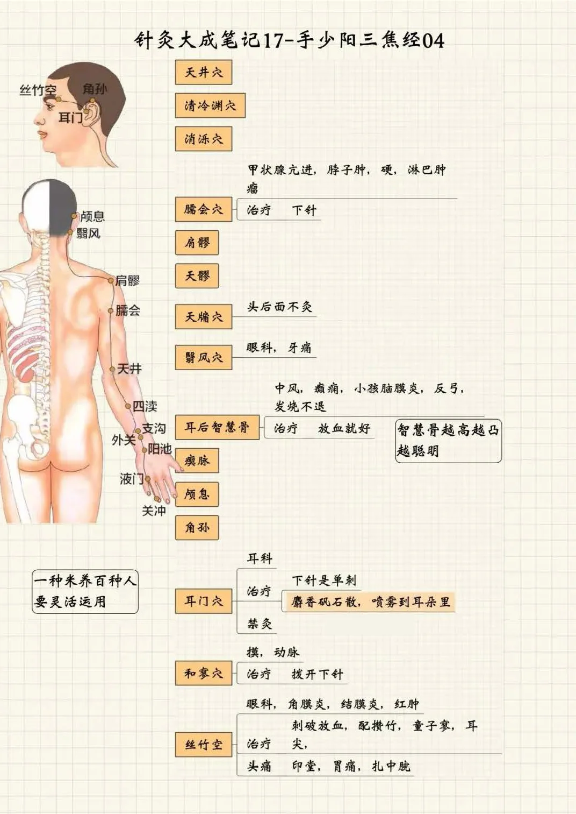

# 手少阳三焦经二十三穴循行笔记：从关冲到丝竹空

> **说明**：本文为倪海厦老师讲课笔记的整理与补全。穴位定位以教材及骨度分寸为准；讲者经验性表述单独放在引用块中。内容仅供学习，不作为诊疗建议，临床操作须由专业人士辨证执行。

<!-- 循行速查表 -->
## **循行速查表**

> 按经络循行顺序排列；标有“核心”的穴位为优先掌握对象，其余顺着经络认识即可。

| 序 | 穴名 | 重点 |
|---:|---|---|
| 1 | 关冲 | **核心** |
| 2 | 液门 | — |
| 3 | 中渚 | **核心** |
| 4 | 阳池 | **核心** |
| 5 | 外关 | **核心** |
| 6 | 支沟 | **核心** |
| 7 | 会宗 | — |
| 8 | 三阳络 | — |
| 9 | 四渎 | — |
| 10 | 天井 | — |
| 11 | 清冷渊 | — |
| 12 | 消泺 | — |
| 13 | 臑会 | — |
| 14 | 肩髎 | **核心** |
| 15 | 天髎 | — |
| 16 | 天牖 | — |
| 17 | 翳风 | **核心** |
| 18 | 瘛脉 | — |
| 19 | 颅息 | — |
| 20 | 角孙 | — |
| 21 | 耳门 | **核心** |
| 22 | 耳和髎 | — |
| 23 | 丝竹空 | **核心** |

> **核心穴提示**：关冲、中渚、阳池、外关、支沟、肩髎、翳风、耳门、丝竹空。

---
## 一、三焦的概念与功能
1. **三焦分部**：
   - **上焦**：胸蔽骨以上，如雾（水气蒸发，干净）。
   - **中焦**：胸蔽骨至肚脐，如沤（消化区域）。
   - **下焦**：肚脐以下，如渎（脏，含残渣）。
2. **生理功能**：
   - 三焦为“决渎之官，水道出焉”，主水液代谢。
   - 阳气通行三焦，若中焦气绝则打嗝（哕），属危症。
   - 与命门相连，行房时三焦气聚命门。

## 二、三焦经穴位与主治
1. **关冲穴（井穴，金）**：
   - 位置：无名指外侧指甲角。
   - 主治：急救、昏迷。
2. **液门穴（荣穴，水）**：
   - 位置：第4、5掌骨间，近指蹼。
   - 主治：往来寒热、眼科。
3. **中渚穴（俞穴，木）**：
   - 位置：液门后1寸，骨缝间。
   - 主治：虚症（如白内障）、手臂痛。
4. **阳池穴（原穴）**：
   - 位置：腕背横纹中点。
   - 主治：糖尿病消渴（透大陵）、对称治疗（如对侧解溪）。
5. **外关穴（络穴）**：
   - 位置：阳池上2寸，通阳维脉。
   - 主治：
     - 通生死桥：高烧时左捻右捻引气至内关退热。
     - 幼儿指针法（开天河水）：外关揉推退热。
6. **支沟穴（经穴，火）**：
   - 位置：外关上1寸。
   - 主治：便秘（配照海）、妇人难产。
7. **天井穴（合穴，土）**：
   - 位置：屈肘时肘尖后凹窝。
   - 主治：实症（夏至-冬至）、对称治膝盖痛。
8. **翳风穴**：
   - 位置：耳垂后乳突前凹陷。
   - 主治：耳鸣、耳聋、牙关痛、下巴脱臼。
9. **耳门/听宫/听会**：
   - 轮刺法治疗耳疾（耳鸣、流脓）。
10. **丝竹空**：
    - 位置：眉尾凹陷。
    - 主治：眼科（放血治角膜炎、红肿）。

## 三、特殊治法
1. **指针法**：
   - **开天河水**：外关揉推退烧（男左女右）。
   - **推三关**：食指、中指、无名指三关，男寒上推/热下推，女反之。
   - **耳轮揉按**：治小儿惊吓（眼珠偏斜对侧拉耳）。
2. **放血疗法**：
   - 耳后青筋放血治中风、癫痫、脑膜炎。
   - 太阳、耳尖、丝竹空放血治眼疾。
3. **对称治疗**：
   - 左病右治（如左膝痛针右天井）。

## 四、临床辨证
1. **头痛分经**：
   - 后头痛（太阳经）：虚扎委中，实扎束骨。
   - 侧头痛（三焦经）：中渚或天井。
   - 眉棱骨痛：对侧阴陵泉下1寸（眉棱点）。
2. **淋巴结/甲状腺**：
   - 臑会穴（近取或阿是穴）治肿瘤、甲亢。
3. **儿科三关诊断**：
   - 风关（近端）：病浅；气关：入腑；命关（远端）：危症。

## 五、禁忌
- 耳周穴道禁灸，宜针或放血。
- 下针耳门、听宫等需张口避免夹针。

## 附：三焦经穴位歌诀（简）
关冲无名指侧角，液门掌蹼寒热消，  
中渚骨缝虚眼疗，阳池消渴腕中凹，  
外关退烧生死桥，支沟便秘照海邀，  
天井肘尖泻实好，耳门轮刺聋鸣调。  

---

> 作者: [Acuherb](https://acuherb.xyz/)  
> URL: https://acuherb.xyz/posts/zhenjiu-4-12/  

