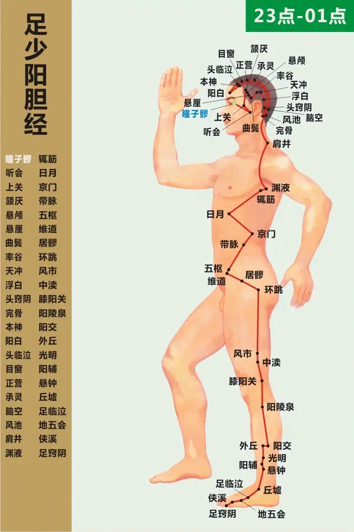
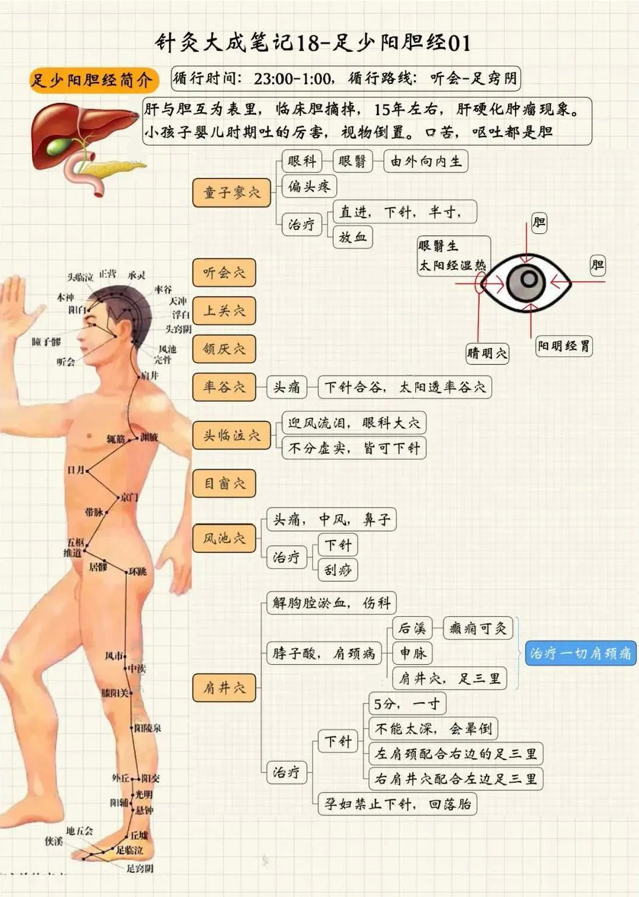
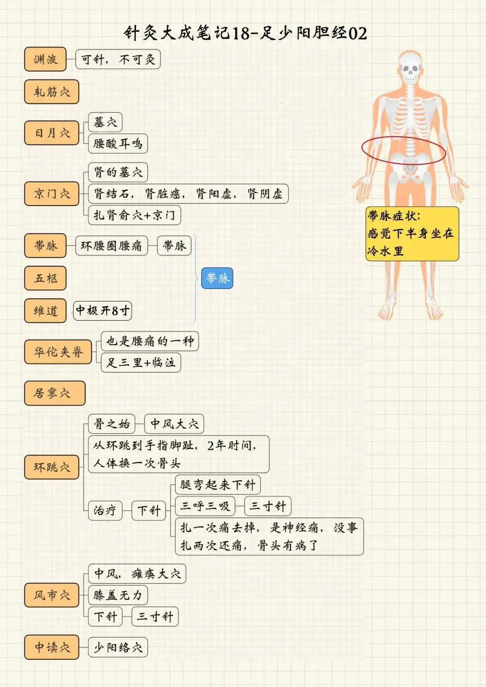
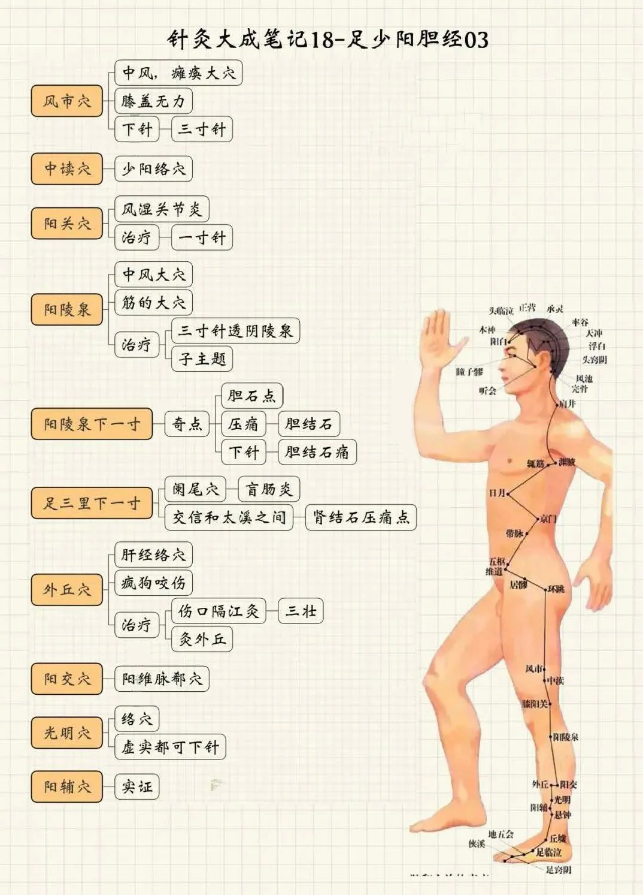
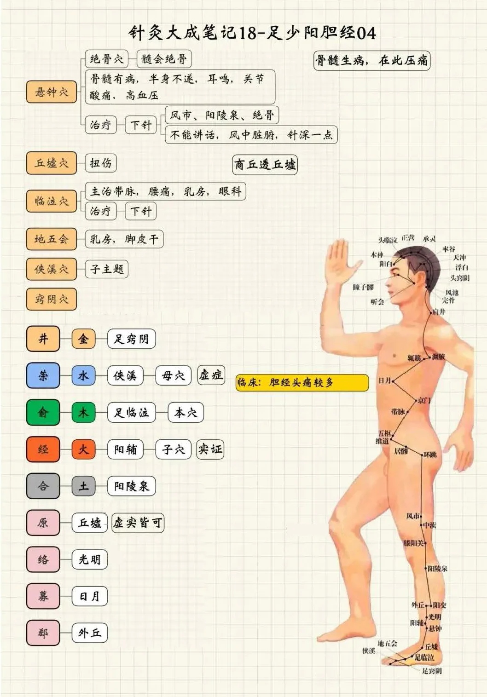

# 足少阳胆经四十四穴循行笔记：从瞳子髎到足窍阴

> [!quote]- 足少阳胆经循行及穴位
> 
>
>> [!TIP] 循行
>> 胆足少阳之脉，起于目锐眦，上抵头角，下耳后，循颈行手少阳之前，至肩上，却交出手少阳之后，入缺盆；其支者，从耳后入耳中，出走耳前，至目锐眦后；其支者，别锐眦，下大迎，合于手少阳，抵于，下加颊车，下颈、合缺盆，以下胸中，贯膈，络肝，属胆，循胁里，出气街，绕毛际，横入髀厌中；其直者，从缺盆下腋，循胸过季胁，下合髀厌中，以下循髀阳，出膝外廉，下外辅骨之前，直下抵绝骨之端，下出外踝之前，循足跗上，入小指次指之间；其支者，别跗上，人大指之间，循大指歧骨内出其端，还贯爪甲，出三毛。
>
>> [!todo] 穴位
>>
>> 足少阳经瞳子髎，四十四穴行迢迢。
>>
>> 听会上关颔厌集，悬颅悬厘曲鬓翘。
>>
>> 率谷天冲浮白次，窍阴完骨本神至。
>>
>> 阳白临泣开目窗，正营承灵脑空是。
>>
>> 风池肩井渊腋长，辄筋日月京门乡。
>>
>> 带脉五枢维道续，居髎环跳市中渎。
>>
>> 阳关阳陵复阳交，外丘光明阳辅高。
>>
>> 悬钟丘墟足临泣，地五侠溪窍阴闭。

## **一、胆经总论**

### 1. 胆的核心定位

> 胆属木，与肝相表里；胆为“中正之官”，主决断。

- 胆储存和排泄胆汁，帮助消化。
- 胆汁排泄受心脏搏动影响，呈阵发性。
- 胆气足则决断有力；胆气虚则犹豫、惊悸、口苦。
- 子时（23:00—1:00）胆经气血最旺，胆经病变常在此发作。

### 2. 五行相生链

> 木（肝胆）→ 火（心小肠）→ 土（脾胃）→ 金（肺大肠）→ 水（肾膀胱）。

胆经属木，是阳气初生的起点；木气条达，则心肺脾胃肾依次相生。

### 3. 临床意义

> 胆病常见口苦、呕吐、视物倒置（胆囊反转）。治疗原则为增强心脏功能、促进肝脏代谢、清除浊物。反对盲目切除胆囊，可能导致肝内结石。

### 4. 胆经五输与特定穴

| 项目 | 穴位 | 记忆 |
|---|---|---|
| 井穴 | 足窍阴（金） | 头昏、昏迷 |
| 荥穴 | 侠溪（水） | 母穴，虚证眼疾耳鸣 |
| 输穴 | 足临泣（木） | 本穴，带脉、乳房、时症 |
| 经穴 | 阳辅（火） | 子穴，实症偏头痛 |
| 合穴 | 阳陵泉（土） | 筋会，抽筋膝痛 |
| 原穴 | 丘墟 | 脚扭伤 |
| 络穴 | 光明 | 眼科 |
| 郄穴 | 外丘 | 急症、解毒 |
| 募穴 | 日月 | 胆病诊断 |
| 筋会 | 阳陵泉 | 筋病 |
| 髓会 | 悬钟 | 骨髓、中风 |

- **母穴侠溪**：水生木，虚证眼疾、耳鸣可取侠溪。
- **子穴阳辅**：木生火，实症偏头痛可取阳辅。

---

## **二、四十四穴循行速查表**

> 按瞳子髎 → 足窍阴排列；标有“核心”的穴位为优先掌握对象。

| 序 | 穴名 | 定位锚点 | 一句关键词 | 重点 |
|---:|---|---|---|---|
| 1 | 瞳子髎 | 目外眦外侧 | 眼疾、偏头痛 | **核心** |
| 2 | 听会 | 耳屏前下方 | 耳鸣、耳疾 | **核心** |
| 3 | 上关 | 耳前上方 | 耳鸣近取 | — |
| 4 | 颔厌 | 头维下1寸 | 偏头痛 | — |
| 5 | 悬颅 | 头侧 | 偏头痛 | — |
| 6 | 悬厘 | 头侧 | 偏头痛 | — |
| 7 | 曲鬓 | 耳前上方 | 头痛、牙关 | — |
| 8 | 率谷 | 耳尖直上1.5寸 | 太阳透率谷 | 常用 |
| 9 | 天冲 | 耳后上方 | 头痛、耳鸣 | — |
| 10 | 浮白 | 耳后上方 | 头痛、耳鸣 | — |
| 11 | 头窍阴 | 耳后 | 头痛、耳疾 | — |
| 12 | 完骨 | 耳后乳突后下方 | 头痛、项强 | — |
| 13 | 本神 | 神庭旁开3寸 | 神志病 | — |
| 14 | 阳白 | 眉中上1寸 | 阳白透鱼腰 | 常用 |
| 15 | 头临泣 | 瞳孔直上入发际 | 风泪眼 | — |
| 16 | 目窗 | 头临泣后1.5寸 | 眼疾 | — |
| 17 | 正营 | 头侧 | 头痛、目眩 | — |
| 18 | 承灵 | 头侧 | 头痛、鼻塞 | — |
| 19 | 脑空 | 枕骨部 | 头痛、项强 | — |
| 20 | 风池 | 枕骨下凹陷 | 鼻塞、项强、中风 | **核心** |
| 21 | 肩井 | 大椎与肩峰连线中点 | 活血化瘀、肩颈 | **核心** |
| 22 | 渊腋 | 腋下3寸 | 胸胁病、多汗 | — |
| 23 | 辄筋 | 渊腋前1寸 | 胸胁病 | — |
| 24 | 日月 | 乳头下肋间 | 胆募、胆结石 | **核心** |
| 25 | 京门 | 第12肋端 | 肾募、腰酸耳鸣 | **核心** |
| 26 | 带脉 | 章门下1.8寸 | 环腰疼、带下 | **核心** |
| 27 | 五枢 | 带脉下3寸 | 妇科、腹痛 | — |
| 28 | 维道 | 五枢前下方 | 妇科、肠病 | — |
| 29 | 居髎 | 髂前上棘后方 | 腰腿痛 | — |
| 30 | 环跳 | 臀部外侧 | 坐骨神经痛、中风 | **核心** |
| 31 | 风市 | 大腿外侧中线 | 中风、膝无力 | **核心** |
| 32 | 中渎 | 大腿外侧 | 下肢痹痛 | — |
| 33 | 膝阳关 | 膝外侧上方 | 膝痛 | — |
| 34 | 阳陵泉 | 腓骨小头前下 | 筋会、膝痛、胆石点 | **核心** |
| 35 | 阳交 | 小腿外侧 | 胸胁痛 | — |
| 36 | 外丘 | 小腿外侧 | 郄穴、解毒 | 常用 |
| 37 | 光明 | 外踝上5寸 | 络穴、眼科 | **核心** |
| 38 | 阳辅 | 小腿外侧 | 子穴、偏头痛 | — |
| 39 | 悬钟 | 外踝上3寸 | 髓会、中风 | **核心** |
| 40 | 丘墟 | 足外踝前下方 | 原穴、扭伤 | **核心** |
| 41 | 足临泣 | 第4、5跖骨间 | 本穴、带脉、时症 | **核心** |
| 42 | 地五会 | 足背 | 耳鸣、乳痈 | — |
| 43 | 侠溪 | 第4、5趾缝 | 母穴、眼疾耳鸣 | 常用 |
| 44 | 足窍阴 | 第4趾外侧甲角 | 井穴、头昏昏迷 | **核心** |

> **核心穴提示**：瞳子髎、听会、风池、肩井、日月、京门、带脉、环跳、风市、阳陵泉、光明、悬钟、丘墟、足临泣、足窍阴。

---

## **三、按循行分段精讲**

### **1. 头面段：瞳子髎 → 脑空**

| 穴位 | 定位 | 主治方向 | 操作要点 |
|---|---|---|---|
| 瞳子髎 | 目外眦外侧 | 眼红肿、角膜炎、翳膜、偏头痛 | 浅刺或放血，禁灸 |
| 听会 | 耳屏前下方 | 耳鸣、耳聋 | 张口取穴 |
| 上关 | 耳前上方 | 耳鸣 | 阿是穴原则 |
| 颔厌、悬颅、悬厘、曲鬓 | 头侧 | 偏头痛 | 循经取穴 |
| 率谷 | 耳尖直上1.5寸 | 偏头痛 | 太阳透率谷 |
| 完骨、本神、阳白 | 头侧与额部 | 头痛、眼疾、神志病 | 阳白透鱼腰 |
| 头临泣、目窗、正营、承灵、脑空 | 头顶部 | 风泪眼、头痛、目眩 | 循经认识 |

#### **【核心】瞳子髎**

- **定位**：目外眦外侧凹陷。
- **重点理由**：胆经起始穴，眼疾与偏头痛都要穴。
- **主治抓手**：眼红肿、角膜炎、翳膜、偏头痛。
- **操作要点**：浅刺0.5寸或点刺放血；禁灸，避免留疤。

#### **【常用】率谷 / 太阳透率谷**

- **定位**：耳尖直上1.5寸。
- **重点理由**：偏头痛特效透穴终点。
- **操作**：从太阳透向率谷，三寸针透刺，可配合合谷麻醉。
- **经验**：头痛发作时下针效果最佳。

#### **【核心】风池**

- **定位**：枕骨下，胸锁乳突肌与斜方肌之间凹陷。
- **重点理由**：风邪入中之门户，治鼻塞、项强、中风。
- **针向**：针向对侧颧髎。
- **配伍**：中风可配风府、风门，配合拔罐刮痧。

---

### **2. 颈肩段：肩井**

#### **【核心】肩井**

- **定位**：大椎与肩峰连线中点。
- **重点理由**：活血化瘀要穴，治跌打损伤与肩颈病。
- **主治抓手**：血胸、跌打损伤、肩颈强痛。
- **配伍**：配合足三里防止气闷。
- **注意**：禁深针，防气胸；孕妇禁用。

---

### **3. 胸胁腰段：渊腋 → 居髎**

| 穴位 | 定位 | 主治方向 |
|---|---|---|
| 渊腋、辄筋 | 腋下与胸侧 | 胸胁病，多汗区禁灸 |
| 日月 | 乳头下肋间 | 胆募，胆结石、胁痛 |
| 京门 | 第12肋端 | 肾募，肾虚、耳鸣、腰酸 |
| 带脉 | 章门下1.8寸 | 带脉病、妇科带下 |
| 五枢、维道、居髎 | 腰骶与髋部 | 妇科、腰腿痛 |

#### **【核心】日月 / 京门**

- **日月**：胆募穴，治胆结石可俞募配胆俞。
- **京门**：肾募穴，治肾虚、耳鸣、腰酸。

#### **【核心】带脉**

- **定位**：章门下1.8寸。
- **重点理由**：带脉病环腰痛、下半身冷湿感。
- **主治抓手**：妇科带下、腰腹环痛。
- **配伍**：足临泣通带脉，常与带脉穴同用。

---

### **4. 下肢段：环跳 → 足窍阴**

| 穴位 | 定位 | 主治方向 | 操作要点 |
|---|---|---|---|
| 环跳 | 股骨大转子与骶管裂孔连线外1/3 | 骨病初始痛、中风、坐骨神经痛 | 深针补法 |
| 风市 | 大腿外侧中线，膝上7寸 | 中风瘫痪、膝无力 | 配阴市 |
| 中渎、膝阳关 | 大腿与膝外侧 | 下肢痹痛、膝痛 | 局部取穴 |
| 阳陵泉 | 腓骨小头前下方 | 筋会、抽筋、膝痛、胆石点 | 可透阴陵泉 |
| 阳交、外丘 | 小腿外侧 | 胸胁痛、急症 | 外丘为郄 |
| 光明 | 外踝上5寸 | 眼科 | 络穴 |
| 阳辅 | 小腿外侧 | 子穴，实症偏头痛 | 泻法 |
| 悬钟 | 外踝上3寸 | 髓会、骨髓病、中风 | 可灸 |
| 丘墟 | 足外踝前下方 | 原穴、脚扭伤 | 商丘透丘墟 |
| 足临泣 | 第4、5跖骨间 | 带脉痛、乳房硬块、时症 | 通带脉 |
| 侠溪 | 第4、5趾缝 | 母穴，虚证眼疾耳鸣 | 补法 |
| 足窍阴 | 第4趾外侧甲角 | 头昏、昏迷 | 井穴，可点刺 |

#### **【核心】环跳**

- **定位**：侧卧屈股，股骨大转子最凸点与骶管裂孔连线外1/3处。
- **重点理由**：“骨之始”，治骨病初始痛处。
- **主治抓手**：中风偏瘫、坐骨神经痛、髋痛。
- **操作要点**：深针补法。

#### **【核心】阳陵泉**

- **定位**：腓骨小头前下方凹陷。
- **重点理由**：胆经合穴、筋会穴，筋病总穴。
- **主治抓手**：抽筋、膝痛、胁痛、胆石痛。
- **胆石点**：阳陵泉下1寸压痛点，用于胆结石诊断与治疗。

#### **【核心】悬钟**

- **定位**：外踝尖上3寸，腓骨后缘。
- **重点理由**：髓会穴，治骨髓病与中风。
- **主治抓手**：中风偏瘫、颈项强痛、骨髓病。

#### **【核心】丘墟 / 足临泣**

- **丘墟**：胆经原穴，治脚扭伤，常用商丘透丘墟。
- **足临泣**：胆经本穴，通带脉，治带脉痛、乳房硬块、夜半发病的时症。

---

## **四、特殊治疗方法**

1. **太阳透率谷**：治疗偏头痛，从太阳透向耳尖直上1.5寸处。
2. **商丘透丘墟**：治疗踝关节扭伤。
3. **胆石点**：阳陵泉下1寸压痛点，诊断和治疗胆结石。
4. **华佗夹脊**：督脉旁开5分，配合足三里、足临泣治疗脊柱旁疼痛。
5. **阳白透鱼腰**：治近视、白内障等眼疾。

---

## **五、临床辨证要点**

1. 偏头痛、侧头病变多属胆经。
2. 环腰一周疼痛属带脉病，取足临泣。
3. 胆经循行部位的疼痛、麻木均可按经取穴。
4. 胆经病变多在子时发作。
5. 治疗胆病需兼顾心、肝功能。
6. 下肢穴位多需深刺至骨膜，效佳。

> 外丘用于疯狗咬伤，局部灸配合针外丘解毒。  

---

## **六、临床配穴速查**

| 应用方向 | 常用穴 | 配伍思路 |
|---|---|---|
| 偏头痛 | 太阳透率谷、风池、阳辅 | 少阳经辨证 |
| 眼疾 | 瞳子髎、阳白透鱼腰、光明 | 局部与络穴 |
| 耳鸣 | 听会、上关、中渚 | 少阳经同调 |
| 中风偏瘫 | 环跳、风市、阳陵泉、悬钟 | 下肢少阳经 |
| 胆结石 | 日月、胆俞、阳陵泉、胆石点 | 俞募与筋会 |
| 带下、环腰痛 | 带脉、足临泣 | 带脉辨证 |
| 膝痛、抽筋 | 阳陵泉、膝阳关 | 筋会穴 |
| 踝扭伤 | 商丘透丘墟 | 对称透刺 |
| 乳块 | 足临泣、天池、膻中 | 少阳与心包辨经 |

### 胆经取穴口诀

> 瞳子髎目外眦开，听会耳前风池来；  
> 肩井深针须谨慎，日月京门募穴裁；  
> 带脉环腰足临泣，环跳风市腿破产；  
> 阳陵筋会悬钟髓，丘墟原穴扭伤排；  
> 侠溪补虚阳辅泻，窍阴井穴醒神开。

---

## **七、操作与禁忌速查**

| 穴位/部位 | 注意 |
|---|---|
| 瞳子髎 | 禁灸，眼周浅刺或放血 |
| 风池 | 注意针刺方向，不宜深刺 |
| 肩井 | 禁深针防气胸，孕妇禁用 |
| 渊腋、辄筋 | 多汗区禁灸 |
| 环跳 | 深针须由专业人员操作 |
| 外丘 | 疯狗咬伤等急症必须就医 |

---

## **八、小结**

> 胆经四十四穴，从瞳子髎到足窍阴，主线是“头侧清目、颈肩散风、胸胁利胆、下肢利筋”。  
> 瞳子髎、听会、风池、肩井、日月、京门、带脉、环跳、风市、阳陵泉、光明、悬钟、丘墟、足临泣、足窍阴十五穴立住，再以五输、原络、郄穴、俞募与八会穴串起来，胆经体系就清楚了。  
> 胆经学习的关键，是一个“决”字：胆主决断，少阳主转枢，肝胆条达则筋脉通、耳目清。

---

> 作者: [Acuherb](https://acuherb.xyz/)  
> URL: https://acuherb.xyz/posts/zhenjiu-4-13/  

