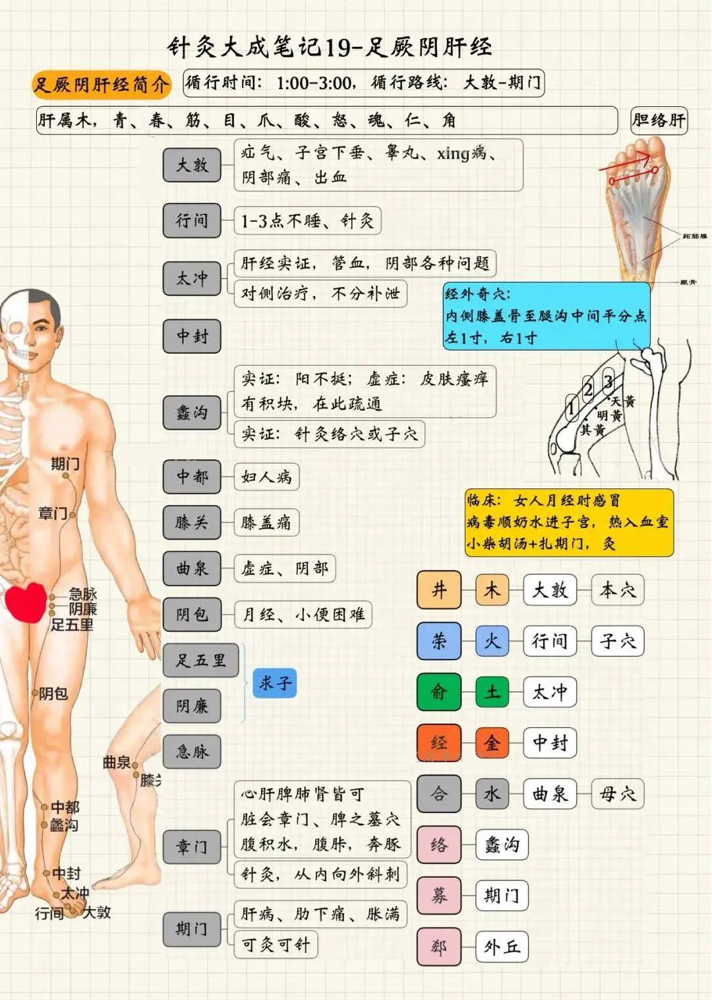

# 足厥阴肝经十四穴循行笔记：从大敦到期门

> **说明**：本文为倪海厦老师讲课笔记的整理与补全。穴位定位以教材及骨度分寸为准；讲者经验性表述单独放在引用块中。内容仅供学习，不作为诊疗建议，临床操作须由专业人士辨证执行。

---

## **一、肝经总论**

### 1. 循行与时间

- **流注时辰**：丑时（1:00—3:00），肝胆相表里，子时胆经之后转入肝经。
- **循行路线**：起于足大趾外侧大敦，沿足背、下肢内侧上行，环绕阴器，经胁肋，上达头顶。
- **临床抓手**：丑时失眠、胁痛、头痛、阴部病、目疾与情绪病，都要想到肝经。

### 2. 肝的核心功能

> 肝藏血，睡眠时血归肝，失眠多与肝血不足相关；肝主筋，抽筋、癫痫等筋病属肝；肝开窍于目，眼疾与肝相关，瞳孔黑属肾；情志主怒，易怒或抑郁均伤肝。

- **肝主疏泄**：调畅气机，影响情志、消化与气血运行。
- **肝藏血**：贮藏血液、调节血量。
- **肝主筋**：筋膜、关节、抽搐与肝相关。
- **开窍于目**：目眩、目赤、视物不清可从肝论治。
- **情志主怒**：怒伤肝，悲胜怒。

### 3. 病理信号

| 信号 | 意义 |
|---|---|
| 面色青 | 肝病本色外显 |
| 丑时1—3点失眠或疼痛 | 肝经异常早期信号 |
| 阴部病症 | 肝经绕阴器，疝气、妇科病可从肝论治 |
| 胁肋胀痛 | 肝经循行区气机不畅 |

### 4. 肝经五输与特定穴

| 项目 | 穴位 | 记忆 |
|---|---|---|
| 井穴 | 大敦（木） | 疝气、崩漏 |
| 荥穴 | 行间（火） | 子穴，泻肝火 |
| 输穴 | 太冲（土） | 原穴，疏肝解郁 |
| 经穴 | 中封（金） | 疝气、小便 |
| 合穴 | 曲泉（水） | 母穴，补肝血 |
| 原穴 | 太冲 | 肝气郁结 |
| 络穴 | 蠡沟 | 妇科、阴部病 |
| 郄穴 | 中都 | 急痛 |
| 肝募 | 期门 | 肝病诊断治疗 |
| 脾募 / 脏会 | 章门 | 五脏虚损 |

- **实症泻行间**：肝火、易怒、急性胁痛。
- **虚症补曲泉**：肝血不足、皮肤瘙痒、阴挺。

---

## **二、十四穴循行速查表**

> 按大敦 → 期门排列；标有“核心”的穴位为优先掌握对象。

| 序 | 穴名 | 定位锚点 | 一句关键词 | 重点 |
|---:|---|---|---|---|
| 1 | 大敦 | 大趾外侧甲角 | 疝气、崩漏、阴痛 | **核心** |
| 2 | 行间 | 第1、2趾蹼后 | 子穴、泻肝火 | **核心** |
| 3 | 太冲 | 第1、2跖骨间 | 原穴、开四关 | **核心** |
| 4 | 中封 | 内踝前1寸 | 疝气、小便不利 | — |
| 5 | 蠡沟 | 内踝上5寸 | 络穴、阴部病 | **核心** |
| 6 | 中都 | 内踝上7寸 | 郄穴、急痛 | — |
| 7 | 膝关 | 膝内侧 | 膝痛 | — |
| 8 | 曲泉 | 膝内侧横纹头 | 母穴、补肝 | **核心** |
| 9 | 阴包 | 大腿内侧 | 妇科、腰腿 | — |
| 10 | 足五里 | 大腿内侧 | 小便、阴部 | — |
| 11 | 阴廉 | 大腿内侧 | 妇科、下肢 | — |
| 12 | 急脉 | 腹股沟 | 疝气、阴部痛 | — |
| 13 | 章门 | 第11肋游离端 | 脾募、脏会 | **核心** |
| 14 | 期门 | 第6肋间 | 肝募、热入血室 | **核心** |

> **核心穴提示**：大敦、行间、太冲、蠡沟、曲泉、章门、期门。

---

## **三、按循行分段精讲**

### **1. 足趾足背段：大敦 → 中封**

| 穴位 | 定位 | 主治方向 | 操作要点 |
|---|---|---|---|
| 大敦 | 足大趾外侧甲角旁 | 疝气、睾丸痛、崩漏、阴部病 | 点刺或灸 |
| 行间 | 第1、2趾蹼缘后方 | 肝实症、胸胁痛、易怒失眠 | 子穴泻火 |
| 太冲 | 第1、2跖骨结合部前凹陷 | 高血压、头痛、肝郁、月经不调 | 原穴，疏肝 |
| 中封 | 内踝前1寸 | 疝气、小便不利、遗精 | 经穴 |

#### **【核心】大敦**

- **定位**：足大趾外侧，趾甲角旁。
- **重点理由**：肝经井穴，专治阴部、疝气与妇科急证。
- **主治抓手**：疝气、睾丸痛、阴部痛、崩漏、子宫下垂。
- **配伍**：疝气可左取右、右取左；配太冲加强疏肝。

#### **【核心】行间**

- **定位**：第1、2趾蹼缘后方。
- **重点理由**：肝经荥穴、子穴，善泻肝火。
- **主治抓手**：急性肝炎、胸胁痛、易怒、失眠。
- **操作要点**：实则泻之，常用于肝火旺。

#### **【核心】太冲**

- **定位**：足背第1、2跖骨结合部前凹陷。
- **重点理由**：肝经原穴，疏肝解郁第一要穴。
- **主治抓手**：高血压、头痛、月经不调、肝郁气滞、抑郁、胁痛。
- **开四关**：合谷配太冲，调和全身气血。

---

### **2. 小腿膝部：蠡沟 → 曲泉**

| 穴位 | 定位 | 主治方向 |
|---|---|---|
| 蠡沟 | 内踝上5寸 | 络穴、妇科、阴部病 |
| 中都 | 内踝上7寸 | 郄穴、急痛 |
| 膝关 | 膝内侧 | 膝痛 |
| 曲泉 | 膝内侧横纹头上方 | 母穴、肝虚、妇科 |

#### **【核心】蠡沟**

- **定位**：内踝尖上5寸，胫骨内侧。
- **重点理由**：肝经络穴，联络胆经，专治阴部与妇科。
- **主治抓手**：阴部瘙痒、妇科病、疝气。

#### **【核心】曲泉**

- **定位**：屈膝，膝内侧横纹头上方凹陷。
- **重点理由**：肝经合穴，属水，为肝经母穴。
- **主治抓手**：肝虚证、皮肤瘙痒、阴挺、痛经、阴道炎。
- **操作要点**：虚证用补法。

---

### **3. 大腿阴部：阴包 → 急脉**

| 穴位 | 定位 | 主治方向 |
|---|---|---|
| 阴包 | 大腿内侧 | 妇科、腰腿痛 |
| 足五里 | 大腿内侧 | 小便不利、阴部病 |
| 阴廉 | 大腿内侧 | 妇科、下肢病 |
| 急脉 | 腹股沟 | 疝气、阴部痛 |

这一段多作近取穴，顺着肝经“绕阴器”的路线理解即可。

---

### **4. 胸胁段：章门 → 期门**

| 穴位 | 定位 | 主治方向 | 操作要点 |
|---|---|---|---|
| 章门 | 第11肋游离端下际 | 脾胰病、腹胀、水肿、五脏虚损 | 斜刺或灸，忌重击 |
| 期门 | 乳头直下第6肋间 | 肝炎、肝硬化、胸胁痛、热入血室 | 斜刺或灸，配肝俞 |

#### **【核心】章门**

- **定位**：第11肋游离端下际。
- **重点理由**：脾募穴，又是脏会，统治五脏虚损。
- **主治抓手**：腹胀、水肿、脾胰疾病、五脏虚损。
- **临床思路**：肝病传脾时，章门是“强土”要穴。

#### **【核心】期门**

- **定位**：乳头直下，第6肋间。
- **重点理由**：肝募穴，肝病在胸前的反映点。
- **主治抓手**：肝炎、肝硬化、胸胁痛、热入血室。
- **配伍**：配肝俞，俞募配穴治肝病。

---

## **四、肝病诊疗要点**

### 1. 诊断

- **时间辨证**：丑时1—3点症状加重，如失眠、疼痛。
- **经络按压**：太冲、章门、期门等处压痛。
- **治肝三穴**：大腿内侧压痛点，膝盖上至腹股沟分三等份。

> 治肝三穴压痛提示肝硬化、肝癌等重症。  

### 2. 治疗原则

- **实症泻行间**：肝火、易怒、急性胁痛。
- **虚症补曲泉**：肝血不足、皮肤瘙痒、阴挺。
- **俞募配穴**：期门配肝俞。
- **强土制水**：健脾取章门、三阴交，防肝病传变。

---

## **五、特殊疗法与案例参考**

### 1. 开四关

> 合谷 + 太冲，调和气血，治全身痛与气机郁滞。

### 2. 治肝三穴

- 膝盖上至腹股沟分三等份。
- 用于肝硬化、肝癌的压痛诊断与治疗参考。

### 3. 情志疗法

> 悲胜怒。引导哭泣可缓解肝郁与怒气。

### 4. 临床案例

| 病证 | 取穴思路 |
|---|---|
| 肝癌 / 肝硬化 | 治肝三穴、期门，灸章门 |
| 疝气 | 大敦点刺，太冲辅助 |
| 丑时失眠 | 行间，灸肝俞 |

---

## **六、临床配穴速查**

| 应用方向 | 常用穴 | 配伍思路 |
|---|---|---|
| 肝郁气滞 | 太冲、膻中、期门 | 疏肝理气 |
| 肝火上炎 | 行间、太冲、风池 | 泻肝火 |
| 肝血不足 | 曲泉、三阴交、血海 | 补肝血 |
| 疝气、阴痛 | 大敦、太冲、蠡沟 | 循经与局部 |
| 妇科病 | 太冲、蠡沟、三阴交 | 肝肾脾同调 |
| 肝病 | 期门、肝俞、章门 | 俞募与脏会 |
| 丑时失眠 | 行间、太冲、神门 | 时间辨证 |
| 全身痛 | 合谷、太冲 | 开四关 |

### 肝经取穴口诀

> 大敦疝气崩漏先，行间泻火太冲原；  
> 中封小便蠡沟阴，曲泉补虚肋膝间；  
> 章门脏会脾募土，期门肝募热血室；  
> 四关合谷太冲配，丑时辨证肝经全。

---

## **七、操作与禁忌速查**

| 穴位 | 注意 |
|---|---|
| 大敦 | 点刺须消毒，体弱者慎用 |
| 章门 | 忌重击，针刺不宜过深 |
| 期门 | 斜刺，避免伤肺与肝 |
| 急脉 | 靠近腹股沟血管，慎针 |
| 治肝三穴 | 属经验压痛区，须专业人员操作 |

---

## **八、小结**

> 肝经十四穴，从大敦到期门，主线是“足趾清肝、小腿补虚、大腿绕阴、胸胁调肝”。  
> 大敦、行间、太冲、蠡沟、曲泉、章门、期门七穴立住，再以五输、原络、俞募、脏会与时间辨证串起来，肝经体系就清楚了。  
> 肝经学习的关键，是一个“疏”字：肝气疏则气血和，情志畅，筋脉柔，睡眠安；肝气郁则胁痛、怒、失眠与妇科诸证丛生。

**注**：肝经治疗需结合情志调节（少怒多悲）、饮食（酸味入肝，宜天然酸味如柠檬）。

---

> 作者: [Acuherb](https://acuherb.xyz/)  
> URL: https://acuherb.xyz/posts/zhenjiu-4-14/  

