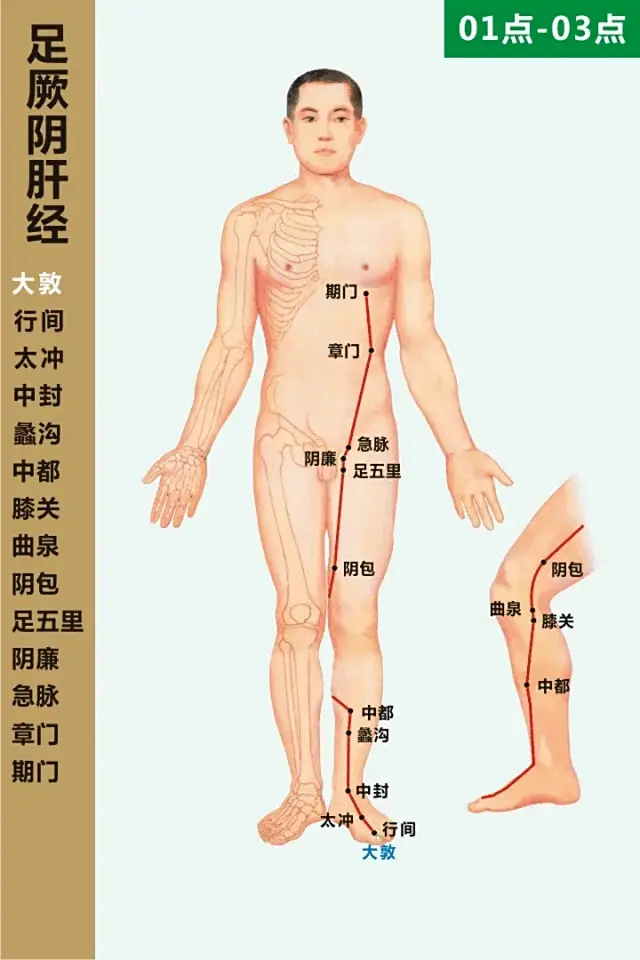

# 足厥阴肝经十四穴循行笔记：从大敦到期门

> [!quote]- 足厥阴肝经循行及穴位
> 
>
>> [!TIP] 循行
>> 肝足厥阴之脉。起于大指丛毛之际，上循足跗上廉，去内踝一寸，上踝八寸，交出太阴之后，上腘内廉，循股阴，入毛中，过阴器，抵小腹，夹胃、属肝、络胆，上贯膈，布胁肋，循喉咙之后，上入颃颡，连目系，上出额，与督脉会于巅；其支者，从目系下颊里，环唇内；其支者，复从肝别，贯膈，上注肺。
>
>> [!todo] 穴位
>>
>> 足厥阴经一十四，大敦行间太冲是。
>>
>> 中封蠡沟伴中都，膝关曲泉阴包次。
>>
>> 五里阴廉上急脉，章门才过期门至。

## **一、肝经总论**

### 1. 循行与时间

- **流注时辰**：丑时（1:00—3:00），肝胆相表里，子时胆经之后转入肝经。
- **循行路线**：起于足大趾外侧大敦，沿足背、下肢内侧上行，环绕阴器，经胁肋，上达头顶。
- **临床抓手**：丑时定时醒来、胁痛、头痛、阴部病、目疾与情绪病，都要想到肝经。

### 2. 肝的核心功能

> 肝藏血，睡眠时血归肝；肝主筋，抽筋、癫痫等筋病属肝；肝开窍于目；情志主怒，怒伤肝，悲胜怒。

- **肝主疏泄**：调畅气机，影响情志、消化与气血运行。
- **肝藏血**：贮藏血液、调节血量。**人卧则血归于肝**，魂随血归肝则安睡；血不归肝，魂无处安住，就会在丑时醒来。
- **肝主筋**：筋膜、关节、抽搐与肝相关。
- **开窍于目**：目眩、目赤、视物不清可从肝论治。

肝病还有一个容易被忽略的脏腑维度：**肝的上面是肺，下面是大肠**。人一呼一吸之间，肺向下扩张挤压肝脏；如果大肠不通，肠中浊气上逆，肝就被上下夹击，疏泄功能必然受阻。**大肠不通，肝气无路可走**——治肝不能只盯着肝经穴位，大便通畅是肝气疏泄的前提条件之一。

### 3. 病理信号

| 信号 | 意义 |
|---|---|
| 面色青 | 肝病本色外显 |
| 丑时1—3点定时醒来或疼痛 | 肝经阻滞的早期信号，但需分虚实 |
| 阴部病症 | 肝经绕阴器，疝气、妇科病可从肝论治 |
| 胁肋胀痛 | 肝经循行区气机不畅 |
| 大便长期不畅 | 浊气上逆，肝疏泄受阻 |

丑时醒来要分三层看：**肝血不足、魂不归肝**，治在补肝血；**肝有实物（肝硬化、肝癌等）** ，血回肝后被反逆出来，治在通泄化瘀软坚；**肝火旺盛、烦躁易怒**，才是行间、太冲泻火的适应证。定时醒是信号，不是单一病机。

### 4. 肝经五输与特定穴

| 项目 | 穴位 | 记忆 |
|---|---|---|
| 井穴 | 大敦（木） | 疝气、崩漏 |
| 荥穴 | 行间（火） | 子穴，泻肝火 |
| 输穴 | 太冲（土） | 原穴，疏肝解郁 |
| 经穴 | 中封（金） | 疝气、小便 |
| 合穴 | 曲泉（水） | 母穴，补肝血 |
| 原穴 | 太冲 | 肝气郁结 |
| 络穴 | 蠡沟 | 妇科、阴部病 |
| 郄穴 | 中都 | 急痛 |
| 肝募 | 期门 | 肝病诊断治疗 |
| 脾募 / 脏会 | 章门 | 五脏虚损、强土 |

- **实症泻行间**：肝火、易怒、急性胁痛。
- **虚症补曲泉**：肝血不足、皮肤瘙痒、阴挺。

---

## **二、十四穴循行速查表**

| 序 | 穴名 | 定位锚点 | 一句关键词 | 重点 |
|---:|---|---|---|---|
| 1 | 大敦 | 大趾外侧甲角 | 疝气、崩漏、阴痛 | **核心** |
| 2 | 行间 | 第1、2趾蹼后 | 子穴、泻肝火 | **核心** |
| 3 | 太冲 | 第1、2跖骨间 | 原穴、开四关 | **核心** |
| 4 | 中封 | 内踝前1寸 | 疝气、小便不利 | — |
| 5 | 蠡沟 | 内踝上5寸 | 络穴、阴部病 | **核心** |
| 6 | 中都 | 内踝上7寸 | 郄穴、急痛 | — |
| 7 | 膝关 | 膝内侧 | 膝痛 | — |
| 8 | 曲泉 | 膝内侧横纹头 | 母穴、补肝 | **核心** |
| 9 | 阴包 | 大腿内侧 | 妇科、腰腿 | — |
| 10 | 足五里 | 大腿内侧 | 小便、阴部 | — |
| 11 | 阴廉 | 大腿内侧 | 妇科、下肢 | — |
| 12 | 急脉 | 腹股沟 | 疝气、阴部痛 | — |
| 13 | 章门 | 第11肋游离端 | 脾募、脏会、强土 | **核心** |
| 14 | 期门 | 第6肋间 | 肝募、热入血室 | **核心** |

> **核心穴提示**：大敦、行间、太冲、蠡沟、曲泉、章门、期门。

---

## **三、按循行分段精讲**

### **1. 足趾足背段：大敦 → 中封**

| 穴位 | 定位 | 主治方向 | 操作要点 |
|---|---|---|---|
| 大敦 | 足大趾外侧甲角旁 | 疝气、睾丸痛、崩漏、阴部病 | 点刺或灸 |
| 行间 | 第1、2趾蹼缘后方 | 肝实症、肝火、胸胁痛、易怒 | 子穴泻火 |
| 太冲 | 第1、2跖骨结合部前凹陷 | 肝郁、高血压、头痛、月经不调 | 原穴，开四关 |
| 中封 | 内踝前1寸 | 疝气、小便不利、遗精 | 经穴 |

#### **【核心】大敦**

- **定位**：足大趾外侧，趾甲角旁。
- **重点理由**：肝经井穴，专治阴部、疝气与妇科急证。
- **主治抓手**：疝气、睾丸痛、阴部痛、崩漏、子宫下垂。
- **配伍**：疝气可左取右、右取左；配太冲加强疏肝。

#### **【核心】行间**

- **定位**：第1、2趾蹼缘后方。
- **重点理由**：肝经荥穴、子穴，善泻肝火。
- **主治抓手**：肝火旺所致的烦躁、易怒、急性胁痛；丑时失眠属肝火者。
- **操作要点**：实则泻之，逆经方向取泻。

#### **【核心】太冲 / 开四关**

- **定位**：足背第1、2跖骨结合部前凹陷。
- **重点理由**：肝经原穴，疏肝解郁第一要穴。
- **主治抓手**：高血压、头痛、月经不调、肝郁气滞、抑郁、胁痛。
- **开四关**：合谷配太冲，左右共四穴。**合谷主气，太冲主血**，同时下针，气血兼顾。
- **第一功能是“定位病经”** ：病人诉“全身痛”而无从下手时，先下四关。气血重新分布后，全身痛会收束到某一条经上——**病变经络自己会“跳出来”**。这是倪师讲开四关时最传神的一层：先捉贼，再治贼。
- **对称取穴**：右太冲痛扎左合谷，左合谷痛扎右太冲；对称治疗时不论补泻、不管虚实寒热。

---

### **2. 小腿膝部：蠡沟 → 曲泉**

| 穴位 | 定位 | 主治方向 |
|---|---|---|
| 蠡沟 | 内踝上5寸 | 络穴、妇科、阴部病 |
| 中都 | 内踝上7寸 | 郄穴、急痛 |
| 膝关 | 膝内侧 | 膝痛 |
| 曲泉 | 膝内侧横纹头上方 | 母穴、肝虚、妇科 |

#### **【核心】蠡沟**

- **定位**：内踝尖上5寸，胫骨内侧。
- **重点理由**：肝经络穴，联络胆经，专治阴部与妇科。
- **主治抓手**：阴部瘙痒、妇科病、疝气。

#### **【核心】曲泉**

- **定位**：屈膝，膝内侧横纹头上方凹陷。
- **重点理由**：肝经合穴，属水，为肝经母穴。
- **主治抓手**：肝虚证、皮肤瘙痒、阴挺、痛经、阴道炎。
- **补法操作**：从**一寸处向一寸半的方向斜刺**，是曲泉补法的进针方向。仅写“虚证用补法”不够，手上要有这个方向感。
- **外治补充**：肝虚所致的皮肤瘙痒，可在曲泉按揉或拔罐，作为针刺之外的辅助调用方式。

---

### **3. 大腿阴部：阴包 → 急脉**

| 穴位 | 定位 | 主治方向 |
|---|---|---|
| 阴包 | 大腿内侧 | 妇科、腰腿痛 |
| 足五里 | 大腿内侧 | 小便不利、阴部病 |
| 阴廉 | 大腿内侧 | 妇科、下肢病 |
| 急脉 | 腹股沟 | 疝气、阴部痛 |

这一段多作近取穴，顺着肝经“绕阴器”的路线理解即可。

#### **【奇穴】治肝三穴：压痛是肝硬化的“窗口”**

- **取法**：膝盖内侧高骨与腹股沟连线，**中点为肝一**；中点**往前一寸**为肝二，**往后一寸**为肝三。左右对称。
- **诊断意义**：**肝炎阶段，邪在气分，按压不痛；肝硬化或肝癌，有实质的东西长在里面，一按就剧痛**。这是一组可以在化验指标尚未明显报警之前给出警示的压痛反应点。
- **针法**：用**一寸半针**，**不要用三寸针**——内侧有大动脉，扎一寸即可。痛在哪个点就扎哪个点，两腿都下。
- **治疗定位**：专治肝硬化、肝癌的临床大穴；有腹水时还需配合水分、水道、阴陵泉、地机、三阴交等通利水湿的穴位组合。

---

### **4. 胸胁段：章门 → 期门**

| 穴位 | 定位 | 主治方向 | 操作要点 |
|---|---|---|---|
| 章门 | 第11肋游离端下际 | 脾募、脏会、强土、腹胀水肿 | 斜刺或灸，忌重击 |
| 期门 | 乳头直下第6肋间 | 肝募、肝炎、肝硬化、热入血室 | 斜刺或灸，配肝俞 |

#### **【核心】期门 / 肝俞 / 章门：一套有次第的治肝动作**

- **期门**：肝募穴，肝病在胸前的反映点。
- **操作顺序**：**先刺期门（斜刺），再刺肝俞（斜刺）**。针后让病人回家**自己灸期门**，把治疗延伸到诊室之外。
- **强土不能省**：俞募治肝之后，必须“强土”。**章门是脾募，又是脏会**，正是在这个节点上用——**期门、肝俞治肝，章门强土**，防止木继续克土。病情需要时还可进一步“强水”，让水生木，形成**治肝—强土—强水**的链条。章门、期门不是几个并列的穴位，而是一套有先后次第的治疗动作。

#### **【核心】章门**

- **定位**：第11肋游离端下际。
- **重点理由**：脾募穴，又是脏会，统治五脏虚损，在肝病治疗中承担“强土”角色。
- **主治抓手**：腹胀、水肿、脾胰疾病、五脏虚损。

---

## **四、肝病诊疗要点**

### 1. 诊断

- **时间辨证**：丑时1—3点定时醒来，是肝经阻滞的早期信号，但需分肝血虚、肝有实物、肝火三层。
- **治肝三穴压痛**：**肝炎不痛，肝硬化/肝癌剧痛**，这是最直接的鉴别抓手。
- **经络按压**：太冲、章门、期门等处压痛。
- **大便状态**：长期不畅提示浊气上逆、肝疏泄受阻，是治肝时必须同步处理的一环。

### 2. 治疗原则

- **实症泻行间**：肝火、易怒、急性胁痛。
- **虚症补曲泉**：肝血不足、皮肤瘙痒、阴挺；进针从一寸向一寸半斜刺。
- **俞募有序**：先期门，再肝俞；针后灸期门。
- **强土制木**：章门不可省，防止肝病传脾。
- **通大肠**：大肠不通，肝气无路可走；治肝不能只看肝经穴位。

---

## **五、特殊疗法与案例参考**

### 1. 开四关

> 合谷 + 太冲，左右共四穴。**先用于定位病经**：全身痛时下四关，气血重新分布，病变经络会收束暴露；同时气血兼顾，合谷主气、太冲主血。对称取穴不论补泻。

### 2. 治肝三穴

- 膝盖内侧高骨与腹股沟连线：中点肝一，前一寸肝二，后一寸肝三。
- **压痛辨肝硬化/肝癌**；用一寸半针，勿用三寸深刺。

### 3. 情志与生活

> 悲胜怒；肝病避免生气。饮食上酸味入肝，但宜取天然酸味。

肝—大肠联动也属于生活层面的治疗：保持大便通畅，减少肠中浊气上逆对肝的“下压”。

### 4. 临床案例

| 病证 | 取穴思路 |
|---|---|
| 肝硬化 / 肝癌 | 治肝三穴（压痛取穴）、期门、肝俞，章门强土 |
| 疝气 | 大敦点刺，太冲辅助 |
| 丑时失眠（肝火） | 行间、太冲泻火 |
| 丑时失眠（肝血虚） | 曲泉补肝血，而非一味泻火 |
| 全身痛 | 先开四关定位病经，再针对暴露的经络处理 |

---

## **六、临床配穴速查**

| 应用方向 | 常用穴 | 配伍思路 |
|---|---|---|
| 肝郁气滞 | 太冲、膻中、期门 | 疏肝理气 |
| 肝火上炎 | 行间、太冲、风池 | 泻肝火 |
| 肝血不足 | 曲泉、三阴交、血海 | 补肝血；曲泉从一寸向一寸半斜刺 |
| 疝气、阴痛 | 大敦、太冲、蠡沟 | 循经与局部 |
| 妇科病 | 太冲、蠡沟、三阴交 | 肝肾脾同调 |
| 肝病 | 期门、肝俞、章门 | **先期门→肝俞，再章门强土** |
| 肝硬化/肝癌 | 治肝三穴、期门、肝俞、章门 | 压痛取穴；一寸半针，勿深刺 |
| 丑时失眠 | 分三层：曲泉（血虚）、行间/太冲（肝火）、通泄化瘀（有实物） | 不把“丑时醒”直接等同于“泻行间” |
| 全身痛 | 合谷、太冲 | 开四关**先定位病经**，再治暴露的经络 |

### 肝经取穴口诀

> 大敦疝气崩漏先，行间泻火太冲原；  
> 中封小便蠡沟阴，曲泉补虚肋膝间；  
> 章门脏会脾募土，期门肝募热血室；  
> 四关合谷太冲配，先捉病经再调全。

---

## **七、操作与禁忌速查**

| 穴位/部位 | 注意 |
|---|---|
| 大敦 | 点刺须消毒，体弱者慎用 |
| 章门 | 忌重击，针刺不宜过深 |
| 期门 | 斜刺，避免伤肺与肝 |
| 急脉 | 靠近腹股沟血管，慎针 |
| 治肝三穴 | 用**一寸半针**，勿用三寸深刺；内侧有大动脉 |
| 曲泉补法 | 进针方向为**一寸向一寸半斜刺** |
| 开四关 | 对称取穴时不论补泻；先用于定位病经，再行治疗 |

---

## **八、小结**

> 肝经十四穴，从大敦到期门，主线是“足趾清肝、小腿补虚、大腿绕阴、胸胁调肝”。  
> 大敦、行间、太冲、蠡沟、曲泉、章门、期门七穴立住，再以五输、原络、俞募、脏会与时间辨证串起来，肝经体系就清楚了。  
> 肝经学习的关键，是一个“疏”字：肝气疏则气血和，情志畅，筋脉柔，睡眠安；肝气郁则胁痛、怒、失眠与妇科诸证丛生。

治肝三穴压下去痛不痛，是肝硬化的窗口；开四关先让病经自己跳出来；曲泉补虚要有进针方向；期门、肝俞之后章门强土不能省；大肠不通，肝气无路可走；丑时醒来要分虚实，不把“定时醒”一刀切成“泻行间”。把这些操作和辨证的枝叶接上，肝经笔记就不只是十四穴主治汇编，而更接近一张能在临床上按步骤走的路径图。

---

> 作者: [Acuherb](https://acuherb.xyz/)  
> URL: https://acuherb.xyz/posts/zhenjiu-4-14/  

