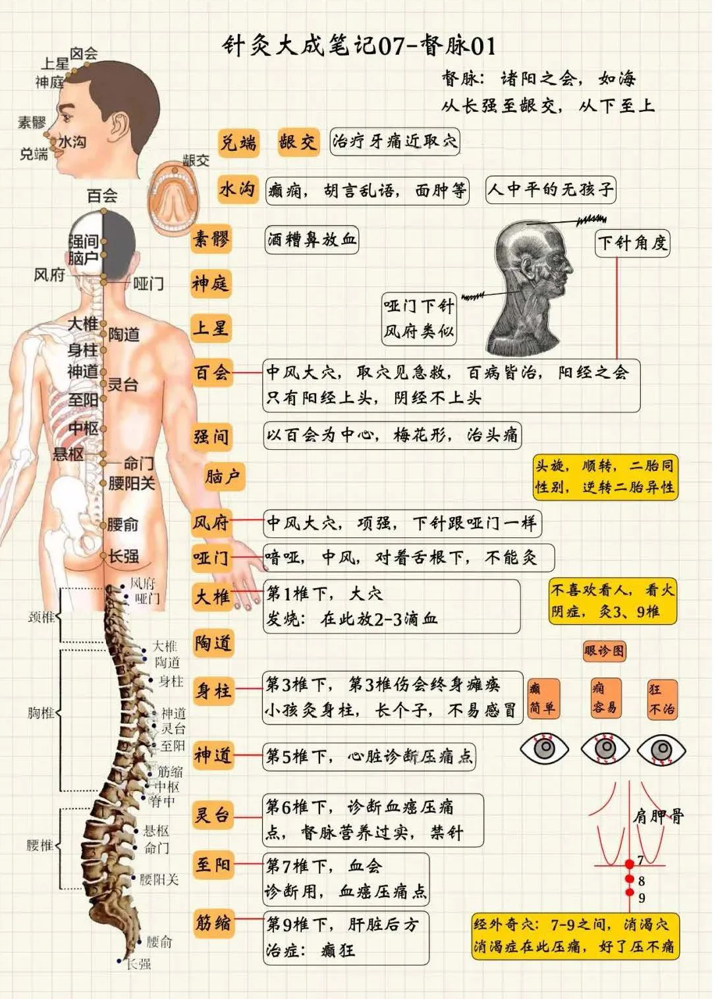
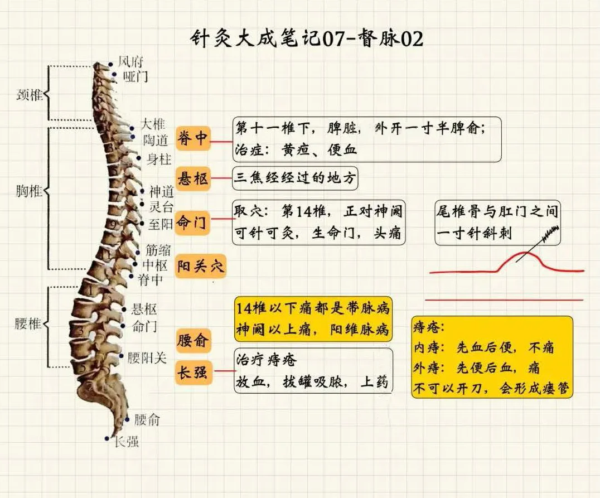

# 督脉二十八穴循行笔记：从长强到龈交

## **一、督脉总论**

### 1. 督脉的核心定位

- **督脉为阳脉之海**：阳气运行全身后归于督脉，督脉总督一身之阳。
- **循行路线**：起于长强，沿脊柱后正中线上行，过项、入脑，再沿头顶、额、鼻、口唇，终于龈交。
- **穴位特点**：督脉无井、荥、输、经、合五输穴；任督二脉重功用与气化，不重五输形式。
- **临床重心**：急症、神志病、项背腰脊病、阳气虚衰与头面清窍病。

### 2. 小周天与“闭四门”

> 小周天以任督二脉为循环：督脉阳气上升，任脉阴津下降。启动时可“闭四门”——耳、目、口、鼻，意守气行。

这里要抓住一句话：**督脉是阳气的“主干道”，不是单纯的一组背部穴位。**

### 3. 分段记忆

| 分段 | 穴位范围 | 功能抓手 |
|---|---|---|
| 尾骶腰段 | 长强 → 悬枢 | 元阳、腰骶、二阴、生殖 |
| 胸背段 | 脊中 → 陶道 | 脾胃、心肺、胸背、发热 |
| 项枕段 | 哑门 → 脑户 | 咽喉、舌、风、神志 |
| 头顶段 | 强间 → 神庭 | 头风、目鼻、清阳 |
| 面口段 | 素髎 → 龈交 | 鼻、口、齿龈、急救开窍 |

---

## **二、二十八穴循行速查表**

> 按经络循行顺序排列；标有“核心”的穴位为优先掌握对象，其余顺着督脉路线认识即可。

| 序 | 穴名 | 定位锚点 | 一句关键词 | 重点 |
|---:|---|---|---|---|
| 1 | 长强 | 尾骨端与肛门连线中点 | 痔疮、便血、肛肠局部 | **核心** |
| 2 | 腰俞 | 骶管裂孔处 | 腰骶痛、月经不调 | — |
| 3 | 腰阳关 | 第4腰椎棘突下 | 腰痛、下肢痿痹 | 常用 |
| 4 | 命门 | 第2腰椎棘突下 | 元阳、腰痛、四肢冷 | **核心** |
| 5 | 悬枢 | 第1腰椎棘突下 | 腹痛、泄泻、腰脊强痛 | — |
| 6 | 脊中 | 第11胸椎棘突下 | 黄疸、便血、癫痫 | 常用 |
| 7 | 中枢 | 第10胸椎棘突下 | 胃痛、黄疸、腰背痛 | — |
| 8 | 筋缩 | 第9胸椎棘突下 | 癫痫、抽搐、筋脉拘急 | 常用 |
| 9 | 至阳 | 第7胸椎棘突下 | 消渴、黄疸、胸背痛 | **核心** |
| 10 | 灵台 | 第6胸椎棘突下 | 胸痛、咳喘、疔疮 | 常用 |
| 11 | 神道 | 第5胸椎棘突下 | 心悸、失眠、心脏病压痛点 | 常用 |
| 12 | 身柱 | 第3胸椎棘突下 | 小儿体弱、咳嗽、保健灸 | 常用 |
| 13 | 陶道 | 第1胸椎棘突下 | 感冒、项强、疟疾 | — |
| 14 | 大椎 | 第7颈椎棘突下 | 高热、疟疾、项强 | **核心** |
| 15 | 哑门 | 后发际上0.5寸 | 失语、舌强、癫狂 | **核心** |
| 16 | 风府 | 后发际上1寸 | 中风、头项强痛 | **核心** |
| 17 | 脑户 | 枕外隆凸上缘 | 头痛、目痛、眩晕 | — |
| 18 | 强间 | 后发际上4寸 | 头痛、目眩、癫痫 | — |
| 19 | 后顶 | 百会后1.5寸 | 头痛、眩晕 | — |
| 20 | 百会 | 两耳尖连线中点 | 中风、癫狂、百病皆治 | **核心** |
| 21 | 前顶 | 百会前1.5寸 | 头痛、眩晕、鼻渊 | — |
| 22 | 囟会 | 前顶前1.5寸 | 头痛、鼻渊；小儿慎针 | — |
| 23 | 上星 | 前发际上1寸 | 鼻炎、鼻窦炎、目痛 | **核心** |
| 24 | 神庭 | 前发际上0.5寸 | 头风、目赤、癫狂 | — |
| 25 | 素髎 | 鼻尖正中 | 酒渣鼻、鼻炎、昏迷 | 常用 |
| 26 | 水沟 | 人中沟上1/3处 | 休克、癫痫、急救开窍 | **核心** |
| 27 | 兑端 | 上唇尖端 | 口疮、齿龈肿 | — |
| 28 | 龈交 | 上唇系带与齿龈交界 | 牙痛、牙龈肿烂、痔疾 | **核心** |

> **核心穴提示**：长强、命门、至阳、大椎、哑门、风府、百会、上星、水沟、龈交。

---

## **三、按循行分段精讲**

### **1. 尾骶腰段：长强 → 悬枢**

这一段是督脉的“根”，着重于**元阳、腰骶、二阴与生殖**。

| 穴位 | 定位 | 主治方向 | 操作要点 |
|---|---|---|---|
| 长强 | 尾骨端与肛门连线中点 | 痔疮、便血、脱肛、腰脊痛 | 斜刺约1寸；外痔可点刺放血 |
| 腰俞 | 骶管裂孔处 | 腰骶痛、月经不调、痔疾 | 多作辅助穴 |
| 腰阳关 | 第4腰椎棘突下 | 腰痛、下肢痿痹、妇科病 | 可针可灸 |
| 命门 | 第2腰椎棘突下 | 腰痛、遗精、带下、四肢冷 | 针灸皆宜，尤重温灸 |
| 悬枢 | 第1腰椎棘突下 | 腹痛、泄泻、腰脊强痛 | 辅助三焦气化 |

#### **【核心】长强**

- **定位**：尾骨端下方，尾骨端与肛门连线中点。
- **重点理由**：督脉起始穴，贴近肛肠局部，是治痔、治便血的第一线穴位。
- **主治抓手**：内痔、外痔、便血、脱肛、腰脊尾骶痛。
- **操作要点**：斜刺约1寸；原笔记记录外痔可点刺放血，再用火罐吸瘀。
- **配伍思路**：配承山、二白，加强肛肠局部与远端取穴联动。

#### **【核心】命门**

- **定位**：第2腰椎棘突下。
- **重点理由**：生命之门，元阳所居，是温肾助阳、强壮腰膝的核心穴。
- **主治抓手**：腰痛、四肢冷、遗精、带下、泄泻、虚劳。
- **操作要点**：多用灸法；练功观想中也是重要下丹田附近参照。
- **配伍思路**：配肾俞、关元，温补下焦；配足三里，扶正固本。

---

### **2. 胸背段：脊中 → 陶道**

这一段沿胸椎上行，和五脏背俞关系密切，既可用于**局部胸背病**，也常用于**压痛点诊断**。

| 穴位 | 定位 | 主治方向 | 操作要点 |
|---|---|---|---|
| 脊中 | 第11胸椎棘突下 | 黄疸、便血、泄泻、癫痫 | 禁灸 |
| 中枢 | 第10胸椎棘突下 | 胃痛、呕吐、黄疸、腰背痛 | 辅助中焦病 |
| 筋缩 | 第9胸椎棘突下 | 癫痫、抽搐、筋脉拘急 | 可配眼诊判断预后 |
| 至阳 | 第7胸椎棘突下 | 消渴、黄疸、胸背痛、咳喘 | 可作诊断与治疗穴 |
| 灵台 | 第6胸椎棘突下 | 胸痛、咳喘、疔疮 | 原笔记用于压痛点诊察 |
| 神道 | 第5胸椎棘突下 | 心悸、失眠、健忘、心脏病压痛点 | 多用于诊断，下针少用 |
| 身柱 | 第3胸椎棘突下 | 小儿体弱、易感冒、咳嗽、发育 | 常用保健灸 |
| 陶道 | 第1胸椎棘突下 | 感冒、项强、疟疾、热病 | 辅助大椎退热 |

#### **【核心】至阳**

- **定位**：第7胸椎棘突下。
- **重点理由**：胸背阳气转枢之处，原笔记特别强调其在消渴、黄疸和腰脊痛中的诊断价值。
- **主治抓手**：消渴、黄疸、胸背痛、咳喘、腰脊痛。
- **操作要点**：可针可灸；原笔记提到“灸后无痛”可作为病势转机观察点。

> 至阳可作为糖尿病相关的背部压痛点来观察。  

#### **【常用】身柱**

- **定位**：第3胸椎棘突下。
- **重点理由**：小儿保健灸要穴，原笔记称其对体弱、易感冒、身高发育有帮助。
- **主治抓手**：小儿体弱、易感冒、咳嗽、气喘、疔疮。
- **操作要点**：多用灸法，刺激宜温和。

#### **【核心】大椎**

- **定位**：第7颈椎棘突下。
- **重点理由**：诸阳交会之处，是督脉退热、解表、治项强的第一要穴。
- **主治抓手**：高热、感冒、疟疾、项强、咳喘。
- **操作要点**：高热可用三棱针点刺放血；亦常配风池、外关、合谷。
- **经验提示**：太阳少阳并病、发热无汗时，大椎是常用加减穴。

---

### **3. 项枕段：哑门 → 脑户**

这一段靠近延髓与舌咽通路，是督脉最需要谨慎操作的区域。

| 穴位 | 定位 | 主治方向 | 操作要点 |
|---|---|---|---|
| 哑门 | 后发际正中上0.5寸 | 暴喑、舌强不语、癫狂、项强 | 谨慎针刺，禁灸 |
| 风府 | 后发际正中上1寸 | 中风、头项强痛、眩晕、目痛 | 向舌根方向斜刺，禁灸 |
| 脑户 | 枕外隆凸上缘 | 头痛、目痛、眩晕 | 了解定位，少作强刺激 |

#### **【核心】哑门 / 风府**

- **哑门**：重点在“舌强不语、失语、癫狂”。平刺向舌根。
- **风府**：重点在“中风、头项强痛、风邪入里”。向舌根斜刺，禁灸。
- **共同点**：均靠近项枕要害，针刺方向、深度必须严格掌握。

> 本段穴位涉及延髓、颈髓区域，任何针刺都应由专业人员操作，不可自行深刺。

---

### **4. 头顶段：强间 → 神庭**

这一段主打**头风、清阳、目鼻与神志**。

| 穴位 | 定位 | 主治方向 | 操作要点 |
|---|---|---|---|
| 强间 | 后发际上4寸 | 头痛、目眩、癫痫 | 辅助百会 |
| 后顶 | 百会后1.5寸 | 头痛、眩晕、烦心 | 配合百会 |
| 百会 | 两耳尖连线中点 | 中风、癫痫、头痛、眩晕、脱肛 | 可平刺、艾灸或点刺放血 |
| 前顶 | 百会前1.5寸 | 头痛、眩晕、鼻渊 | 配合百会 |
| 囟会 | 前顶前1.5寸 | 头痛、鼻渊 | 小儿囟门未闭时禁针 |
| 上星 | 前发际上1寸 | 鼻炎、鼻窦炎、目痛、鼻出血 | 可米粒灸 |
| 神庭 | 前发际上0.5寸 | 头风、目赤、失眠、癫狂 | 可针可灸 |

#### **【核心】百会**

- **定位**：两耳尖连线与前后正中线交点。
- **重点理由**：督脉与诸阳经交会之处，原笔记称“百病皆治”。
- **主治抓手**：中风、癫痫、头痛、眩晕、不寐、脱肛。
- **操作要点**：可平刺、艾灸，急证可点刺放血。
- **配伍思路**：配水沟急救；配风池治头风；配关元、气海升阳固脱。

#### **【核心】上星**

- **定位**：前发际正中直上1寸。
- **重点理由**：鼻部疾患的督脉要穴。
- **主治抓手**：鼻炎、鼻窦炎、鼻塞、鼻出血、目痛。
- **操作要点**：原笔记记有米粒灸7～11壮，麻感可直达鼻部。

---

### **5. 面口段：素髎 → 龈交**

这一段虽穴少，但急救与局部病价值很高。

| 穴位 | 定位 | 主治方向 | 操作要点 |
|---|---|---|---|
| 素髎 | 鼻尖正中 | 酒渣鼻、鼻炎、鼻出血、昏迷 | 点刺放血，不针不灸 |
| 水沟 | 人中沟上1/3处 | 休克、昏迷、癫痫、口面肿 | 斜刺强刺激，急救要穴 |
| 兑端 | 上唇尖端 | 口疮、牙龈肿、鼻渊 | 了解即可 |
| 龈交 | 上唇系带与齿龈交界 | 牙痛、牙龈肿烂、牙周病、痔疾 | 点刺出血，不灸 |

#### **【核心】水沟**

- **定位**：人中沟上1/3处。
- **重点理由**：急救开窍第一穴，刺激强、起效快。
- **主治抓手**：休克、昏迷、癫痫、口面肿、饮水无度。
- **操作要点**：斜刺，强刺激；“救急穴”。

#### **【核心】龈交**

- **定位**：上唇系带与齿龈交界处。
- **重点理由**：督脉终点，口齿局部与肛肠病有经验联系。
- **主治抓手**：牙痛、牙龈肿烂、牙周病、痔疾。
- **操作要点**：拉唇后点刺出血，不灸。

---

## **四、督脉与压痛点诊断**

督脉在背部的“诊断性压痛点”。这一类内容属于经验性观察，应作为线索而非结论。

| 症状/病机 | 对应压痛穴 | 笔记要点 |
|---|---|---|
| 血癌、白血球异常 | 灵台 | 以灵台压痛作观察点 |
| 消渴、糖尿病 | 至阳 | 灸后压痛减轻视为转机 |
| 心脏病 | 神道 | 诊断多用，下针少用 |
| 腰脊痛 | 命门、腰阳关、悬枢 | 局部压痛配合功能判断 |
| 癫狂、抽搐 | 筋缩 | 可配合眼诊辨预后 |

### 癫痫狂症眼诊

> 血丝在眼珠**上方**：易治；  
> 血丝**上下贯穿黑珠**：难治；  
> 血丝在眼珠**下方**：不治。

> “不治”是原讲者语气，现代理解应作“预后较差、治疗难度大”，不可机械放弃治疗。

---

## **五、督脉配穴与临床应用**

| 应用方向 | 常用穴 | 配伍思路 |
|---|---|---|
| 高热、外感 | 大椎、陶道、风池、外关 | 大椎退热，风池疏风，外关解表 |
| 中风急救 | 水沟、百会、风府、涌泉 | 开窍醒神，升阳固脱 |
| 癫狂、神志病 | 百会、筋缩、神道、水沟 | 督脉入脑，神志病多取督脉 |
| 腰脊痛 | 命门、腰阳关、长强、委中 | 局部配远端，“腰背委中求” |
| 痔疾、便血 | 长强、承山、二白、龈交 | 肛肠局部与督脉首尾相应 |
| 鼻炎、鼻窦炎 | 上星、素髎、迎香、印堂 | 督脉清阳上通鼻窍 |
| 小儿体弱 | 身柱、足三里、关元 | 保健灸与扶正固本 |

> **督脉取穴总诀**：  
> 下取长强治肛肠，中取命门温元阳；  
> 胸背至阳辨消渴，大椎一针退热狂；  
> 项枕风府哑门禁深刺，百会水沟救急方；  
> 上星通鼻龈交齿，督脉一路阳气长。

---

## **六、操作与禁忌速查**

| 穴位 | 禁忌/注意 |
|---|---|
| 脊中 | 禁灸，仅针刺 |
| 哑门 | 禁灸，针刺方向与深度须严格掌握 |
| 风府 | 禁灸，慎针，勿粗暴深刺 |
| 囟会 | 小儿囟门未闭时禁针 |
| 素髎 | 不针不灸，多用点刺 |
| 龈交 | 点刺出血即可，不灸 |
| 大椎 | 放血退热时须严格消毒，体弱者慎用 |

---

## **七、经典医案与记忆**

### 扁鹊救太子

> 扁鹊为秦越人，救虢国太子尸厥于百会放血，天下改称“扁鹊”为其尊号。

这个典故提示：**百会不仅是头顶局部穴，更是督脉入脑、醒神开窍的代表穴。**

### 实用口诀

- 督脉主阳，从**尾入脑、沿脊而上**。
- **百会**为督脉要穴，“百病皆治”，中风癫痫必取。
- **身柱**强身灸，小儿常用、增强免疫。
- **大椎**退高烧，感冒放血首选穴。
- **长强、龈交**首尾相应，一个治肛肠局部，一个治口齿与痔疾。
- **命门、至阳、神道**是胸背压痛点诊断的三条线索。

---

## **八、小结**

> 督脉为阳脉之海，起于长强，终于龈交。记忆时不要只背二十八穴名称，而要抓住三段主线：  
> **下段温元阳、中段调胸背、上段开清窍。**  
> 核心穴立住，其余穴位顺着脊柱与头顶面口一路串起来，督脉系统就完整了。

---

> 作者: [Acuherb](https://acuherb.xyz/)  
> URL: https://acuherb.xyz/posts/zhenjiu-4-2/  

