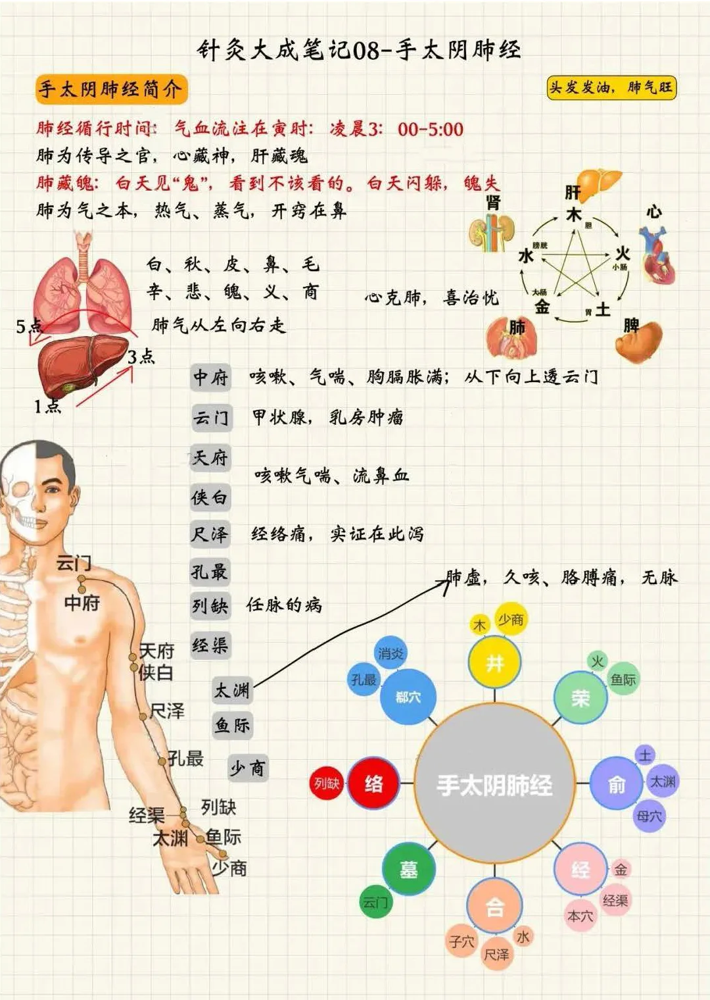

# 手太阴肺经十一穴循行笔记：从中府到少商

## **一、肺经总论**

### 1. 肺的生理定位

- **肺为相傅之官**：心为君主，肺为相傅；肺主治节，协助心管理人体节律、规矩与气机开合。
- **肺主气、司呼吸**：肺为气之本，气的推动、输布与肃降都与肺相关。
- **肺藏魄**：魄代表本能反应、感知、进退与气节。魄失则可见怕光、幻觉、不安等表现。
- **肺主皮毛**：毛孔、皮肤状态反映肺的宣发与卫外功能，皮肤病常可从肺论治。
- **开窍于鼻**：鼻塞、流涕、鼻出血、嗅觉异常，都可从肺经找思路。
- **眉属肺**：“长眉长寿，眉脱伤肺”，作为望诊线索记忆。

### 2. 情志、五行与时间

| 项目 | 内容 | 记忆抓手 |
|---|---|---|
| 五行 | 金 | 肺属金，主肃降 |
| 五音 | 商 | 呬音属肺 |
| 天干 | 辛 | 辛金 |
| 时辰 | 寅时（3:00—5:00） | 肺经气血最旺 |
| 情志 | 忧 | 忧伤肺，喜胜忧 |

> 咳嗽、鼻塞、皮肤问题若常在寅时加重，可作为肺经辨证的时相线索。

### 3. 肺经循行与穴位特点

- **循行方向**：从胸走手，起于中府，止于少商，后接手阳明大肠经。
- **气血特点**：肺经多气少血。
- **五输穴属性**：阴经五输为“井木、荥火、输土、经金、合水”。
- **取穴重心**：胸背肺疾、咽喉鼻病、皮肤皮毛、咳喘与气道急症。

### 4. 肺经五输穴

| 五行 | 木 | 火 | 土 | 金 | 水 |
|---|---|---|---|---|---|
| 肺经五输 | 少商（井） | 鱼际（荥） | 太渊（输） | 经渠（经） | 尺泽（合） |
| 记忆 | 井木 | 荥火 | 输土 | 经金 | 合水 |

- **母穴**：太渊（土生金）。
- **子穴**：尺泽（金生水）。
- **临床应用抓手**：虚证多用母穴太渊，实证、热证多用子穴尺泽或井穴少商放血。

---

## **二、十一穴循行速查表**

> 按中府 → 少商排列；标有“核心”的穴位为优先掌握对象。

| 序 | 穴名 | 定位锚点 | 一句关键词 | 重点 |
|---:|---|---|---|---|
| 1 | 中府 | 云门下一肋 | 肺募、久咳气喘 | **核心** |
| 2 | 云门 | 锁骨下凹陷 | 肺气出入、俞募配穴 | 常用 |
| 3 | 天府 | 上臂内侧，鼻尖点按处 | 鼻出血 | 常用 |
| 4 | 侠白 | 天府下1寸 | 加强天府 | — |
| 5 | 尺泽 | 肘横纹大筋外侧 | 泻肺热、实咳 | **核心** |
| 6 | 孔最 | 尺泽下3寸 | 咳血、痔疮、急症 | **核心** |
| 7 | 列缺 | 腕横纹上1.5寸 | 咽痛、小便、头项 | **核心** |
| 8 | 经渠 | 寸口脉动处 | 本经本穴、可补可泻 | 常用 |
| 9 | 太渊 | 寸口动脉 | 脉会、久咳、气虚 | **核心** |
| 10 | 鱼际 | 第一掌骨桡侧 | 咽痛、泄热 | 常用 |
| 11 | 少商 | 拇指桡侧指甲角 | 放血退热、咽喉急症 | **核心** |

> **核心穴提示**：中府、尺泽、孔最、列缺、太渊、少商。

---

## **三、按循行分段精讲**

### **1. 胸肩段：中府 → 云门**

这一段是肺经的“根”，着重于**肺气出入、胸肺局部与呼吸深度**。

| 穴位 | 定位 | 主治方向 | 操作要点 |
|---|---|---|---|
| 中府 | 胸前壁外上方，云门下一肋 | 久咳、气喘、胸痛、虚证 | 斜刺，不可直刺 |
| 云门 | 锁骨下窝凹陷处 | 咳嗽、气喘、胸痛 | 与中府透刺 |

#### **【核心】中府**

- **定位**：胸前壁外上方，云门下一肋。
- **重点理由**：肺之募穴，肺气汇聚于胸前的反映点。
- **主治抓手**：久咳、气喘、胸满、肺虚证。
- **操作要点**：实际取穴常先找云门，再下一肋取中府；可从中府透云门，顺经为补、逆经为泻。
- **禁忌**：不可直刺过深，避免伤肺。

> 云门是肺的“实际募穴”，触诊时常从云门找中府。  
> 教材标准以中府为肺募穴；云门可作为定位与触诊的重要参照。

---

### **2. 上臂段：天府 → 侠白**

这一段重点非常集中：**鼻出血**。

| 穴位 | 定位 | 主治方向 | 操作要点 |
|---|---|---|---|
| 天府 | 上臂内侧，腋前纹头下3寸 | 鼻出血、气喘 | 左鼻出血取右侧，右鼻出血取左侧 |
| 侠白 | 天府下1寸 | 加强天府 | 作为“随寸针”使用 |

#### **【常用】天府 / 侠白**

- **天府取法**：原笔记用“肩下拉袖，鼻尖点到处”为定位法。
- **主治抓手**：鼻出血最常用。
- **经验配法**：左鼻出血取右天府，右鼻出血取左天府，对称取穴。
- **侠白**：位于天府下1寸，作用与天府相近，用于加强天府效果。

---

### **3. 肘腕段：尺泽 → 太渊**

这一段是肺经临床最密集的一段，涵盖**泻热、止血、咽痛、头项、脉病与久咳**。

| 穴位 | 定位 | 属性 | 主治方向 | 操作要点 |
|---|---|---|---|---|
| 尺泽 | 肘横纹大筋外侧 | 合穴，属水 | 新咳、热咳、实咳 | 泻法常用 |
| 孔最 | 尺泽下3寸 | 郄穴 | 咳血、痔疮、急性咳喘 | 重压痛点取穴 |
| 列缺 | 腕横纹上1.5寸 | 络穴，通任脉 | 咽痛、头项、小便 | 顺补逆泻 |
| 经渠 | 寸口脉动处 | 经穴，属金 | 本经诸证 | 可补可泻 |
| 太渊 | 寸口动脉 | 输穴、脉会 | 久咳、气虚、脉病 | 母穴，宜补 |

#### **【核心】尺泽**

- **定位**：肘横纹中，肱二头肌腱桡侧凹陷。
- **重点理由**：肺经合穴，属水，为肺经子穴，善于泻肺中实热。
- **主治抓手**：新咳、热咳、痰黄、咽痛、肘臂痛。
- **操作要点**：逆经为泻；原笔记强调“久咳虚证不可用”。

> 尺泽偏泻，实证、热证更常用；久咳虚喘多转太渊、中府。

#### **【核心】孔最**

- **定位**：尺泽下3寸，前臂桡侧。
- **重点理由**：肺经郄穴，郄穴主急症、疼痛与出血。
- **主治抓手**：咳血、鼻出血、咽喉肿痛、痔疮。
- **取穴要点**：原笔记强调“阿是穴”要灵活，不能死守三寸，以压痛点最准确。

#### **【核心】列缺**

- **定位**：腕横纹上1.5寸，桡骨茎突上方。
- **重点理由**：肺经络穴，联络大肠经；又是八脉交会穴，通任脉。
- **主治抓手**：咽喉痛、头痛项强、咳嗽、小便频数、阴茎痛。
- **取法**：双手交叉，食指定位；或由高骨向下量五分。
- **手法**：顺经为补，逆经为泻。

> 列缺既是肺经络穴，又通任脉；所以既能治肺系头面，又能治任脉所过的溺与生殖相关问题。

#### **【常用】经渠**

- **定位**：腕横纹上1寸，寸口脉动处。
- **重点理由**：肺经经穴，属金，为本经本穴。
- **主治抓手**：咳嗽、气喘、咽喉痛、腕臂痛。
- **特点**：可补可泻，治疗本经诸证均有效。

#### **【核心】太渊**

- **定位**：腕掌侧横纹桡侧，桡动脉搏动处。
- **重点理由**：肺经输穴，属土，为肺经母穴；又是八会穴中的脉会。
- **主治抓手**：久咳、气虚、气短、脉病、心律不齐。
- **手法**：向拇指方向为补，对准身体方向为泻；平补平泻亦可用。

---

### **4. 手掌指段：鱼际 → 少商**

这一段偏清泄肺热，尤其擅长**咽喉、发热与肺系急症**。

| 穴位 | 定位 | 属性 | 主治方向 | 操作要点 |
|---|---|---|---|---|
| 鱼际 | 第一掌骨桡侧中点赤白肉际 | 荥穴，属火 | 咽喉肿痛、咳嗽、泄热 | 泻热为主 |
| 少商 | 拇指桡侧指甲角旁 | 井穴，属木 | 高热、咽喉肿痛、扁桃腺炎 | 点刺放血 |

#### **【常用】鱼际**

- **定位**：第一掌骨桡侧中点，赤白肉际处。
- **重点理由**：肺经荥穴，荥主身热，善清肺热。
- **主治抓手**：咽喉肿痛、咳嗽、发热、乳痈。
- **操作要点**：多用泻法。

#### **【核心】少商**

- **定位**：拇指桡侧指甲角旁。
- **重点理由**：肺经井穴，肺经终点，善治肺系急症。
- **主治抓手**：小儿高热、扁桃腺炎、乳蛾、咽喉肿痛、昏迷急救。
- **操作要点**：常点刺放血；可配列缺、照海加强退热利咽。

> 少商放血属于有创操作，须严格消毒并由专业人士执行。

---

## **四、五音逼毒法与“呬”音练法**

> **动作口诀**：提肛 + 呬音 + 抬手 + 垫脚。

- “呬”音属肺，五行属金，用于清肺排浊。
- 配合提肛，使气机下固；抬手、垫脚，使清阳上达。
- 作为练功前净体方法之一。

---

## **五、肺经配穴与临床应用**

| 应用方向 | 常用穴 | 配伍思路 |
|---|---|---|
| 久咳、气喘 | 中府、太渊、足三里 | 肺俞募配穴，补肺益气 |
| 新咳、热咳 | 尺泽、鱼际、少商 | 泻肺热，清气道 |
| 咳血 | 孔最、太渊、尺泽 | 郄穴止血，配本经原穴 |
| 咽喉肿痛 | 少商、列缺、照海、鱼际 | 井穴放血，通任利咽 |
| 鼻出血 | 天府、侠白、迎香 | 对称取穴，局部配合 |
| 头项强痛 | 列缺、风池、后溪 | 头项寻列缺 |
| 外感发热 | 少商、大椎、外关 | 井穴泄热，督脉退热 |
| 皮肤瘙痒 | 尺泽、曲池、血海 | 肺主皮毛，配合清血热 |

### 肺经取穴口诀

> 中府云门胸中气，天府侠白止鼻衄；  
> 尺泽泻热孔最血，列缺头项溺频俱；  
> 经渠本穴调经气，太渊脉会补久虚；  
> 鱼际清咽少商放，肺经十一从头叙。

---

## **六、操作与禁忌速查**

| 穴位 | 注意 |
|---|---|
| 中府、云门 | 不可直刺过深，避免伤肺 |
| 尺泽 | 偏泻，久咳虚证慎用 |
| 孔最 | 以压痛点定位更准 |
| 列缺 | 针刺方向、深浅须规范 |
| 太渊 | 靠近桡动脉，注意避开血管 |
| 少商 | 放血须严格消毒，体弱者慎用 |

---

## **七、整体概念补充**

- **肺法象天幕**：原笔记把皮肤比作苍穹，认为皮毛包裹脏腑、通冷属肺；头凉脚热为健康状态之一。
- **阿是穴不是“哪里痛扎哪里”**：应结合压痛反应、经络循行、病证虚实来判断，不能机械取穴。
- **时相辨证**：寅时咳嗽或鼻塞加重，可作为肺经辨证线索。
- **五志相克**：忧伤肺，喜胜忧；情志因素可影响肺气宣肃。

---

## **八、小结**

> 肺经十一穴，从中府到少商，主线是“胸中气起、臂间清泄、腕部调气、指端开窍”。  
> 先抓中府、尺泽、孔最、列缺、太渊、少商六穴，再用五输五行理解补泻，肺经的临床框架就立住了。

---

> 作者: [Acuherb](https://acuherb.xyz/)  
> URL: https://acuherb.xyz/posts/zhenjiu-4-3/  

