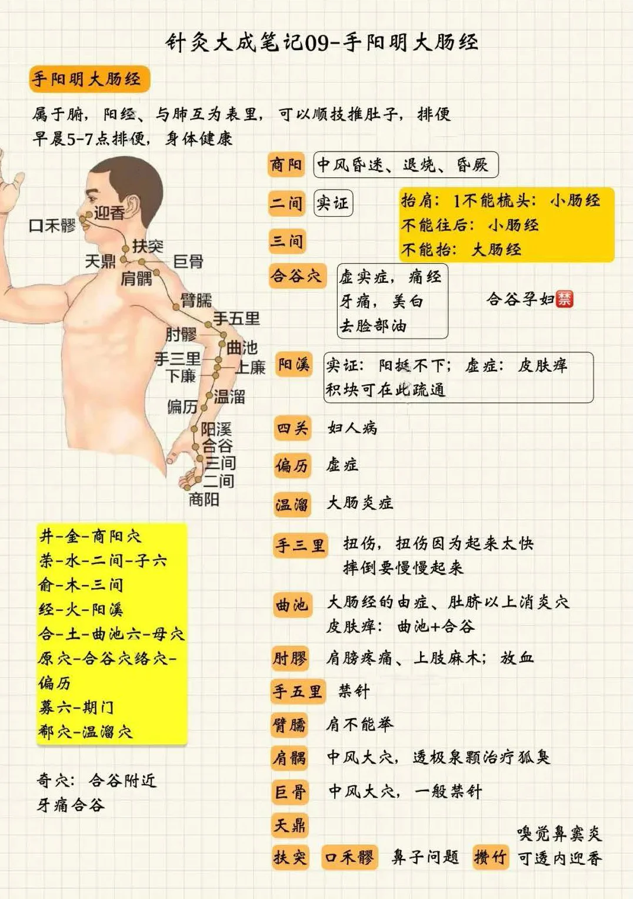

# 手阳明大肠经二十穴循行笔记：从商阳到迎香

## **一、大肠经总论**

### 1. 大肠经的核心定位

- **肺与大肠相表里**：肺主气、主皮毛；大肠主传导、主津液再吸收。二者一肺一腑，共同调节气机与水液。
- **阳明多气多血**：手阳明大肠经气血充盛，手部轻触即易动气，临床反应较灵敏。
- **卯时流注**：大肠经气血流注于卯时（5:00—7:00）。顺时针揉丹田可助排便，可作为时辰养生线索。
- **肺与大肠的水气关系**：

> 吸气为肾主，吐气为肺主；小肠火助大肠气化，热气上升，肺形成津液。

- **五输属性**：阳经五输为 **井金、荥水、输木、经火、合土**。

### 2. 五行与补泻抓手

| 项目 | 内容 |
|---|---|
| 所属脏腑 | 大肠，属金 |
| 表里经 | 肺经 |
| 五输 | 商阳（井金）、二间（荥水）、三间（输木）、阳溪（经火）、曲池（合土） |
| 母穴 | 曲池（土生金） |
| 子穴 | 二间（金生水） |
| 原穴 | 合谷 |
| 络穴 | 偏历 |
| 郄穴 | 温溜 |

记忆：**虚补曲池，实泻二间；原络合谷、偏历；急症郄穴温溜。**

---

## **二、二十穴循行速查表**

> 按商阳 → 迎香排列；标有“核心”的穴位为优先掌握对象。

| 序 | 穴名 | 定位锚点 | 一句关键词 | 重点 |
|---:|---|---|---|---|
| 1 | 商阳 | 食指桡侧指甲角 | 井穴放血、退热 | **核心** |
| 2 | 二间 | 食指掌指关节前 | 荥水、泻实热 | 常用 |
| 3 | 三间 | 食指掌指关节后 | 手不能握、风湿 | 常用 |
| 4 | 合谷 | 手背第1、2掌骨间 | 原穴、面口总穴 | **核心** |
| 5 | 阳溪 | 腕背横纹桡侧 | 经穴、往来寒热 | **核心** |
| 6 | 偏历 | 腕后3寸 | 络穴、耳鸣牙痛 | 常用 |
| 7 | 温溜 | 腕后5寸 | 郄穴、急性肿痛 | 常用 |
| 8 | 下廉 | 前臂背面桡侧 | 手臂病、乳痈 | — |
| 9 | 上廉 | 前臂背面桡侧 | 手臂病、乳痈 | — |
| 10 | 手三里 | 肘横纹下2寸 | 扭伤、落枕 | **核心** |
| 11 | 曲池 | 屈肘横纹外端 | 母穴、皮肤病 | **核心** |
| 12 | 肘髎 | 肘外侧 | 网球肘 | 常用 |
| 13 | 手五里 | 肘上3寸 | 有大动脉，禁针 | — |
| 14 | 臂臑 | 肩髃下2寸 | 瘰疬、臂痛 | — |
| 15 | 肩髃 | 肩峰前下方 | 中风八穴、肩痛 | **核心** |
| 16 | 巨骨 | 肩峰与锁骨间 | 肩臂不利，慎针 | — |
| 17 | 天鼎 | 颈侧大筋外侧 | 咽喉、颈项 | — |
| 18 | 扶突 | 喉结旁3寸 | 咽喉、颈项 | — |
| 19 | 口禾髎 | 鼻翼下缘 | 鼻塞、鼻窦炎 | — |
| 20 | 迎香 | 鼻翼外缘中点 | 鼻病、嗅觉 | **核心** |

> **核心穴提示**：商阳、合谷、阳溪、手三里、曲池、肩髃、迎香。

---

## **三、按循行分段精讲**

### **1. 手腕段：商阳 → 阳溪**

这一段从指端走到腕部，是**退热、咽痛、手部病与面口病**的第一线。

| 穴位 | 定位 | 属性 | 主治方向 | 操作要点 |
|---|---|---|---|---|
| 商阳 | 食指桡侧指甲角旁 | 井穴，属金 | 高热、咽喉肿痛、扁桃腺炎 | 点刺放血 |
| 二间 | 第2掌指关节前桡侧 | 荥穴，属水 | 急性疼痛、热证 | 子穴，泻实 |
| 三间 | 第2掌指关节后桡侧 | 输穴，属木 | 风湿关节痛、手不能握 | 可透劳宫或合谷 |
| 合谷 | 手背第1、2掌骨间 | 原穴 | 面口病、皮肤瘙痒、牙痛 | 孕妇慎针 |
| 阳溪 | 腕背横纹桡侧 | 经穴，属火 | 往来寒热、腕痛 | 临床较少用 |

#### **【核心】商阳**

- **定位**：食指桡侧指甲角旁。
- **重点理由**：大肠经井穴，指端泄热最快的穴位之一。
- **主治抓手**：发热、咽喉肿痛、扁桃腺炎、热证。
- **常用配伍**：少商 + 商阳 + 大椎，用于热病退热思路。

#### **【核心】合谷**

- **定位**：手背第1、2掌骨之间，约平第2掌骨桡侧中点。
- **重点理由**：大肠经原穴，四总穴之一，“面口合谷收”。
- **主治抓手**：牙痛、面肿、口眼歪斜、鼻病、皮肤瘙痒、青春痘。
- **原络配穴**：合谷配列缺，原络相应，用于肺与大肠虚实夹杂。
- **四关穴**：合谷配太冲，用于全身不适、疼痛部位不清时的诊断与通络。
- **注意**：孕妇慎用；“可泻不可补”，临床非专业人士不要自行操作。

> 合谷是临床高频穴，但孕妇、体弱者及特殊人群须严格慎用。

#### **【核心】阳溪**

- **定位**：腕背横纹桡侧，拇指上翘时出现的凹陷处。
- **重点理由**：大肠经经穴，属火，可用于往来寒热一类表证。
- **主治抓手**：寒热往来、腕臂痛、头痛、目痛。
- **操作要点**：临床使用频率不如合谷、曲池，但作为五输体系的一环必须记住。

---

### **2. 前臂段：偏历 → 手三里**

这一段偏重**络穴平衡、郄穴急症、前臂局部与扭伤疼痛**。

| 穴位 | 定位 | 属性/要点 | 主治方向 |
|---|---|---|---|
| 偏历 | 腕后3寸 | 络穴 | 耳鸣、牙痛、肩痛、肺大肠表里失衡 |
| 温溜 | 腕后5寸 | 郄穴 | 大肠经急性发炎、肿痛、热毒 |
| 下廉 | 前臂背面桡侧 | 局部穴 | 手臂痛、乳痈 |
| 上廉 | 前臂背面桡侧 | 局部穴 | 手臂痛、乳痈 |
| 手三里 | 肘横纹下2寸 | 扭伤要穴 | 落枕、扭伤、手臂痛 |

#### **【常用】偏历**

- **定位**：前臂背面桡侧，腕横纹上3寸。
- **重点理由**：大肠经络穴，与肺经络穴列缺相表里。
- **主治抓手**：耳鸣、牙痛、鼻出血、肩臂痛。
- **配伍思路**：与列缺配合，调和肺与大肠表里经气。

#### **【常用】温溜**

- **定位**：腕横纹上5寸，偏历上2寸。
- **重点理由**：大肠经郄穴，主急症、疼痛与热毒。
- **主治抓手**：急性肿痛、咽喉肿痛、肠腹痛、热病。
- **取穴要点**：可在骨缝处进针。

#### **【核心】手三里**

- **定位**：肘横纹下2寸，前臂背面桡侧。
- **重点理由**：原笔记称“扭伤穴”，对落枕、扭伤疼痛恢复常用。
- **主治抓手**：落枕、肩臂痛、肘臂扭伤、腹痛。
- **操作要点**：急症时可配合远端取穴与局部压痛反应。

---

### **3. 肘肩段：曲池 → 肩髃**

这一段是**皮肤、肩臂、中风与肘部疼痛**的常用区。

| 穴位 | 定位 | 主治方向 | 操作要点 |
|---|---|---|---|
| 曲池 | 屈肘横纹外端 | 皮肤病、肩痛、虚证 | 母穴，可补 |
| 肘髎 | 肘外侧 | 网球肘、肘臂痛 | 可放血、拔罐 |
| 手五里 | 肘上3寸 | 臂痛、瘰疬 | 有大动脉，禁针 |
| 臂臑 | 肩髃下2寸 | 瘰疬、臂痛 | 可针可灸 |
| 肩髃 | 肩峰前下方 | 肩痛、中风、狐臭 | 可透极泉 |

#### **【核心】曲池**

- **定位**：屈肘，肘横纹外端与肱骨外上髁连线中点。
- **重点理由**：大肠经合穴，属土，为大肠经母穴；善于扶正、清皮肤与阳明经热。
- **主治抓手**：皮肤病、瘙痒、肩臂痛、发热、肘痛。
- **常用配伍**：配合谷止痒最速；配血海治皮肤瘙痒。
- **手法补充**：原笔记指出曲池、二间不适合迎随法，可用捻转法，补五泻六。

#### **【核心】肩髃**

- **定位**：肩峰前下方凹陷处。
- **重点理由**：中风八大穴之一，肩部局部病要穴。
- **主治抓手**：肩痛、肩关节不利、中风上肢不遂。
- **操作要点**：近取肩病效佳；原笔记记有“透极泉”治狐臭的经验。

---

### **4. 颈项段：巨骨 → 扶突**

这一段穴少但位置敏感，重在**颈项、咽喉与局部触诊判断**。

| 穴位 | 定位 | 主治方向 | 操作要点 |
|---|---|---|---|
| 巨骨 | 锁骨肩峰端与肩胛冈之间 | 肩臂屈伸不利 | 靠近肺尖，慎针 |
| 天鼎 | 胸锁乳突肌后缘 | 咽喉、颈项、肿物诊察 | 有动脉，慎针 |
| 扶突 | 喉结旁3寸 | 咽喉肿痛、咳嗽、气喘 | 慎针 |

> 颈侧肿瘤位置可作经络辨证参考——外侧属大肠经，内侧属胃经。  

---

### **5. 面鼻段：口禾髎 → 迎香**

这一段是鼻部疾病的终点区。

| 穴位 | 定位 | 主治方向 | 操作要点 |
|---|---|---|---|
| 口禾髎 | 鼻翼下缘，口唇上 | 鼻塞、鼻窦炎、鼻出血 | 局部取穴 |
| 迎香 | 鼻翼外缘中点旁 | 嗅觉障碍、鼻塞、鼻窦炎 | 可透内迎香，慎针 |

#### **【核心】迎香**

- **定位**：鼻翼外缘中点旁，鼻唇沟中。
- **重点理由**：大肠经终点穴，鼻部局部取穴核心。
- **主治抓手**：鼻塞、鼻炎、鼻窦炎、嗅觉减退。
- **常用配伍**：配合对侧合谷；也可向上星、素髎方向形成鼻病取穴组合。
- **注意**：慎灸、慎透针，避免伤及眼眶与骨膜。

---

## **四、补泻法则与虚实判断**

### 1. 虚实判断时间轴

| 表现 | 辨证 | 处理原则 |
|---|---|---|
| 痛在1周内 | 偏实 | 泻法为主 |
| 痛多酸少 | 实中带虚 | 先泻后补 |
| 酸多痛少 | 虚中带实 | 先补后泻 |
| 仅酸无痛 | 纯虚 | 补法 |

### 2. 针法关键

- **顺经为补，逆经为泻**。
- **捻转法**：快进慢出，防止卡针。
- **插提法、迎随法**：依据部位、疼痛强度与虚实决定。
- **曲池、二间**：不适合迎随法，改用捻转法，补五泻六。

---

## **五、诊断与经验补充**

- **小儿三关**：风关、气关、命关观察青筋，用于判断病势深浅。
- **合谷诊虚实**：原笔记称“合谷大气足，陷表示虚”，可作气血盈亏望诊线索。
- **大肠经皮肤反应**：手臂大肠经循行处出现压痛、结节或热感，可提示本经气机变化。
- **卯时排便**：卯时大肠经气血旺，顺时针揉丹田有助于排便，可作为生活调养小法。

---

## **六、临床配穴速查**

| 应用方向 | 常用穴 | 配伍思路 |
|---|---|---|
| 发热、咽痛 | 商阳、少商、大椎 | 井穴放血，督脉退热 |
| 牙痛 | 合谷、内庭、颊车 | 面口合谷收，上下牙分经取穴 |
| 皮肤瘙痒 | 曲池、合谷、血海 | 阳明清热，血海治血分 |
| 肩臂痛 | 肩髃、曲池、手三里 | 循经近取与远端并用 |
| 落枕、扭伤 | 手三里、后溪、落枕穴 | 手三里为扭伤要穴 |
| 鼻塞、鼻窦炎 | 迎香、口禾髎、上星、合谷 | 局部通窍，配远端合谷 |
| 耳鸣、牙痛 | 偏历、合谷、听会 | 络穴调和肺与大肠 |
| 急性肿痛 | 温溜、曲池、合谷 | 郄穴应急，合穴清阳明 |

### 大肠经取穴口诀

> 商阳退热少商同，二间泻实三间风；  
> 合谷面口四关主，阳溪寒热腕间逢；  
> 偏历温溜络郄别，手三里扭落枕功；  
> 曲池肩膀清皮肤，肩髃中风臂不充；  
> 天鼎扶突颈侧慎，禾髎迎香鼻窍通。

---

## **七、操作与禁忌速查**

| 穴位 | 注意 |
|---|---|
| 商阳 | 放血须消毒，体弱者慎用 |
| 合谷 | 孕妇慎针，避免强刺激 |
| 手五里 | 有大动脉，禁针 |
| 巨骨 | 靠近肺尖，慎针 |
| 天鼎、扶突 | 颈侧有动脉，慎针 |
| 迎香 | 慎灸，透针须专业操作 |

---

## **八、小结**

> 大肠经二十穴，从商阳到迎香，主线是“指端泄热、前臂调络、肘肩清阳明、颈鼻开清窍”。  
> 先抓商阳、合谷、阳溪、手三里、曲池、肩髃、迎香七穴，再用五输、原络、郄穴把其余穴位串起来，大肠经的取穴体系就清楚了。

---

> 作者: [Acuherb](https://acuherb.xyz/)  
> URL: https://acuherb.xyz/posts/zhenjiu-4-4/  

