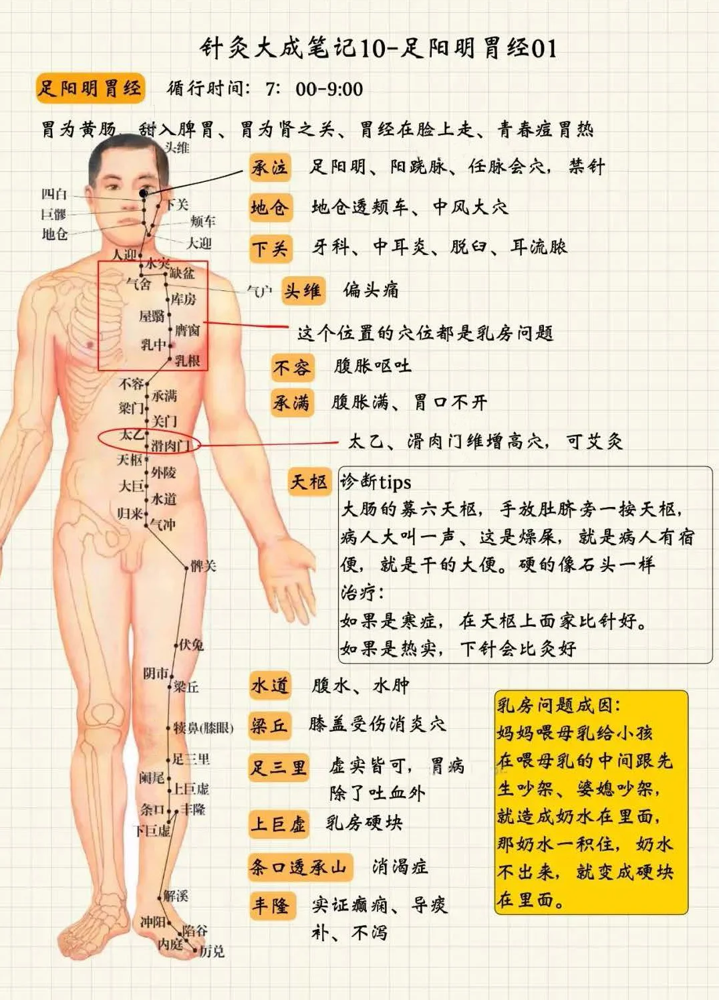
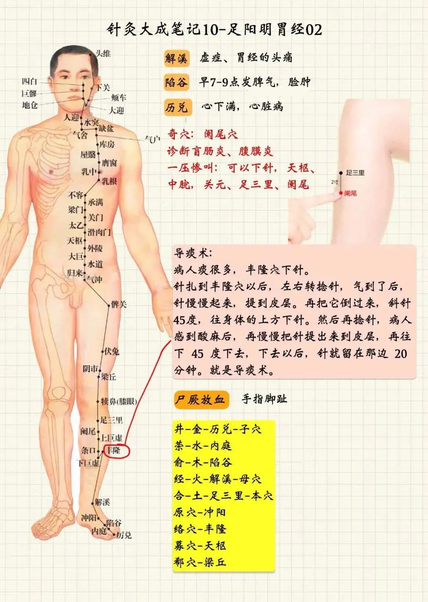

# 足阳明胃经四十五穴循行笔记：从承泣到厉兑

## **一、胃经总论**

### 1. 胃的核心定位

- **胃为仓廪之官**：《内经》称“胃者仓廪之官，五味出焉”，胃主受纳、腐熟水谷。
- **胃气为生命关键**：“有胃气则生，无胃气则死。”食欲、消化、脉象之胃气，都是判断预后的重要线索。
- **五味入五脏**：酸入肝、苦入心、甘入脾、辛入肺、咸入肾，胃为五味之源。
- **胃为肾之关**：严重肾病可见恶心、呕吐，属水反克土。
- **辰时流注**：胃经气血流注于辰时（7:00—9:00），对应右手关部脉象。

### 2. 循行特点

- 胃经从头面下行至足趾，是覆盖最长的阳经之一。
- 循经主治：头面、口齿、咽喉、胸腹、胃肠、下肢与前趾病变。
- 阳明经多气多血，临床反应较灵敏。

### 3. 胃经五输与特定穴

| 项目 | 穴位 | 记忆 |
|---|---|---|
| 井穴 | 厉兑（金） | 急救、心下满 |
| 荥穴 | 内庭（水） | 牙痛、热证 |
| 输穴 | 陷谷（木） | 足背肿痛 |
| 经穴 | 解溪（火） | 母穴，虚证头痛 |
| 合穴 | 足三里（土） | 胃病总穴、保健要穴 |
| 原穴 | 冲阳 | 胃气存亡 |
| 络穴 | 丰隆 | 化痰要穴 |
| 郄穴 | 梁丘 | 急性胃痛、膝痛 |
| 募穴 | 中脘 | 胃之募，腑会 |

**母穴解溪，子穴厉兑；虚补解溪，实泻厉兑。**

---

## **二、四十五穴循行速查表**

> 按承泣 → 厉兑排列；标有“核心”的穴位为优先掌握对象。

| 序 | 穴名 | 定位锚点 | 一句关键词 | 重点 |
|---:|---|---|---|---|
| 1 | 承泣 | 目下眶缘 | 眼疾，禁针 | — |
| 2 | 四白 | 瞳孔直下1寸 | 眼疾、面瘫 | 常用 |
| 3 | 巨髎 | 颧骨下凹陷 | 牙痛、面瘫 | — |
| 4 | 地仓 | 口角旁 | 面瘫要穴 | **核心** |
| 5 | 大迎 | 下颌角前 | 口齿、面瘫 | — |
| 6 | 颊车 | 咬肌隆起处 | 牙关紧闭、面瘫 | **核心** |
| 7 | 下关 | 耳前凹陷 | 中耳炎、牙痛、下颌 | 常用 |
| 8 | 头维 | 额角发际 | 头痛、眩晕 | — |
| 9 | 人迎 | 颈动脉搏动处 | 胃气脉诊 | — |
| 10 | 水突 | 颈侧 | 咽喉、气喘 | — |
| 11 | 气舍 | 锁骨上 | 颈项、咽喉 | — |
| 12 | 缺盆 | 锁骨上窝 | 咳喘，慎针 | — |
| 13 | 气户 | 锁骨下 | 胸满、咳喘 | — |
| 14 | 库房 | 第1肋间 | 胸满、咳喘 | — |
| 15 | 屋翳 | 第2肋间 | 乳痈、胸痛 | — |
| 16 | 膺窗 | 第3肋间 | 乳痈、胸痛 | — |
| 17 | 乳中 | 乳头正中 | 禁针灸，仅定位 | — |
| 18 | 乳根 | 乳下 | 乳房硬块、近取 | 常用 |
| 19 | 不容 | 上腹部 | 胃痛、呕吐 | — |
| 20 | 承满 | 上腹部 | 腹胀、胃痛 | — |
| 21 | 梁门 | 上腹部 | 胃痛、呕吐 | — |
| 22 | 关门 | 上腹部 | 腹胀、肠鸣 | — |
| 23 | 太乙 | 上腹部 | 胃痛、心烦 | — |
| 24 | 滑肉门 | 上腹部 | 呕吐、胃痛 | — |
| 25 | 天枢 | 脐旁2寸 | 大肠募、便秘腹泻 | **核心** |
| 26 | 外陵 | 下腹部 | 腹痛 | — |
| 27 | 大巨 | 下腹部 | 腹痛、便秘 | — |
| 28 | 水道 | 下腹部 | 水肿、妇科 | — |
| 29 | 归来 | 下腹部 | 妇科、睾丸 | — |
| 30 | 气冲 | 腹股沟 | 妇科、助孕 | — |
| 31 | 髀关 | 大腿前 | 腰腿痛 | — |
| 32 | 伏兔 | 大腿前 | 腰腿痛 | — |
| 33 | 阴市 | 大腿前 | 膝痛、下肢冷 | — |
| 34 | 梁丘 | 髌底上2寸 | 郄穴、急症 | **核心** |
| 35 | 犊鼻 | 膝眼 | 膝痛 | 常用 |
| 36 | 足三里 | 膝下3寸 | 胃病总穴、保健 | **核心** |
| 37 | 上巨虚 | 小腿前外侧 | 大肠下合、脐上硬块 | 常用 |
| 38 | 条口 | 小腿前外侧 | 肩痛、小腿病 | — |
| 39 | 下巨虚 | 小腿前外侧 | 小肠下合、脐下硬块 | 常用 |
| 40 | 丰隆 | 外踝上8寸 | 化痰要穴 | **核心** |
| 41 | 解溪 | 踝前横纹 | 母穴、虚证头痛 | **核心** |
| 42 | 冲阳 | 足背 | 原穴、胃气存亡 | — |
| 43 | 陷谷 | 足背 | 输穴、水肿 | — |
| 44 | 内庭 | 第2、3趾缝 | 荥穴、牙痛热证 | **核心** |
| 45 | 厉兑 | 第2趾外侧 | 井穴、急救 | **核心** |

> **核心穴提示**：地仓、颊车、天枢、梁丘、足三里、丰隆、解溪、内庭、厉兑。

---

## **三、按循行分段精讲**

### **1. 头面颈段：承泣 → 缺盆**

这一段主**眼、面、口齿、耳与颈项**，临床多用于面瘫、牙痛、眼疾与下颌病。

| 穴位 | 定位 | 主治方向 | 操作要点 |
|---|---|---|---|
| 承泣 | 目下眶缘 | 眼翳、目痛、流泪 | 禁针，用于眼诊 |
| 四白 | 瞳孔直下1寸 | 眼疾、面瘫、眼睑跳动 | 斜刺，慎深刺 |
| 巨髎 | 颧骨下凹陷 | 牙痛、面瘫、鼻病 | 局部取穴 |
| 地仓 | 口角旁 | 面瘫、口角歪斜、流涎 | 常透颊车 |
| 大迎 | 下颌角前 | 口齿、面肿 | 斜刺 |
| 颊车 | 咬肌隆起处 | 牙关紧闭、面瘫、牙痛 | 可透地仓 |
| 下关 | 耳前凹陷 | 中耳炎、牙痛、下颌脱臼 | 局部取穴 |
| 头维 | 额角发际 | 头痛、眩晕 | 多用于诊断 |
| 人迎 | 颈动脉搏动处 | 胃气存亡、咽喉 | 禁深刺 |
| 水突 | 颈侧 | 咽喉肿痛、气喘 | 慎针 |
| 气舍 | 锁骨上 | 颈项强痛、咽喉 | 慎针 |
| 缺盆 | 锁骨上窝 | 咳喘、咽喉 | 慎针，不可深刺 |

#### **【核心】地仓 / 颊车**

- **地仓**：口角旁，是面瘫口角歪斜的局部主穴。
- **颊车**：咬牙时咬肌隆起处，治牙关紧闭、牙痛、面瘫。
- **常用配伍**：地仓透颊车，是面瘫局部取穴的经典组合。

#### **眼诊提示**

> 眼翳从下向上生长，属胃经问题；承泣可作为观察与诊断线索。

---

### **2. 胸腹段：气户 → 气冲**

这一段主**胸、乳、胃、肠、妇科与下焦**，是胃经调理中焦的核心区域。

| 穴位 | 定位 | 主治方向 | 操作要点 |
|---|---|---|---|
| 气户、库房、屋翳、膺窗 | 胸部肋间 | 胸满、咳喘、乳痈 | 顺经了解 |
| 乳中 | 乳头正中 | 仅作定位标志 | 禁针灸 |
| 乳根 | 乳下 | 乳房硬块、乳汁不通 | 近取穴 |
| 不容、承满、梁门 | 上腹部 | 胃痛、呕吐、腹胀 | 近取胃病 |
| 关门、太乙、滑肉门 | 上腹部 | 肠鸣、腹胀、呕吐 | 调理中焦 |
| 天枢 | 脐旁2寸 | 便秘、腹泻、腹痛 | 大肠募穴 |
| 外陵、大巨、水道、归来 | 下腹部 | 腹痛、水肿、妇科 | 近取穴 |
| 气冲 | 腹股沟 | 妇科、睾丸、助孕 | 多灸法 |

#### **【核心】天枢**

- **定位**：脐旁2寸。
- **重点理由**：大肠募穴，调理肠腑传导与中焦气机。
- **主治抓手**：便秘、腹泻、腹痛、腹胀、痢疾。
- **寒热分法**：寒实便秘可灸，热实便秘可针泻。
- **腹四针**：中脘、关元、双天枢，用于胃肠功能整体调理。

#### **乳房病提示**

> 乳房问题与情志、胃经淤堵相关，并提出初期可用温和艾灸、按摩疏导，重视“胃气”（食欲）作为观察点。  

---

### **3. 大腿膝部：髀关 → 犊鼻**

这一段主**腰腿、膝病与下肢气血**。

| 穴位 | 定位 | 主治方向 | 操作要点 |
|---|---|---|---|
| 髀关 | 大腿前上端 | 腰腿痛、下肢不遂 | 深刺须谨慎 |
| 伏兔 | 大腿前 | 腰腿痛、膝冷 | 可灸 |
| 阴市 | 大腿前 | 膝痛、下肢冷 | 可针可灸 |
| 梁丘 | 髌底上2寸 | 急性胃痛、膝痛 | 郄穴，急症常用 |
| 犊鼻 | 膝眼 | 膝痛、关节不利 | 局部取穴 |

#### **【核心】梁丘**

- **定位**：屈膝，髌底外端上2寸。
- **重点理由**：胃经郄穴，善治急性胃痛与膝部急痛。
- **主治抓手**：急性胃痛、膝关节肿痛、下肢不力。

#### **五穴四针（膝关节炎）**

> 鹤顶、膝眼（双）、阳陵泉透阴陵泉，用于风湿性膝痛。

---

### **4. 小腿足部：足三里 → 厉兑**

这一段是胃经临床最核心的部分，涵盖**胃肠、化痰、虚劳、保健与急救**。

| 穴位 | 定位 | 属性 | 主治方向 | 操作要点 |
|---|---|---|---|---|
| 足三里 | 膝下3寸 | 合穴 | 胃病、虚劳、保健 | 顺补逆泻 |
| 上巨虚 | 足三里下3寸 | 大肠下合 | 脐上硬块、肠病 | 调理肠腑 |
| 条口 | 小腿前外侧 | 局部/远端 | 肩痛、小腿病 | 可配合肩部病 |
| 下巨虚 | 条口下1寸 | 小肠下合 | 脐下硬块、小肠病 | 调理小肠 |
| 丰隆 | 外踝上8寸 | 络穴 | 化痰、丰胸 | 补泻有别 |
| 解溪 | 踝前横纹 | 经穴，属火 | 胃虚、久年头痛 | 母穴 |
| 冲阳 | 足背 | 原穴 | 胃气存亡 | 禁针古法，现可轻刺 |
| 陷谷 | 足背 | 输穴，属木 | 水肿、足背肿 | 顺经取穴 |
| 内庭 | 第2、3趾缝 | 荥穴，属水 | 下牙痛、热证 | 清胃热 |
| 厉兑 | 第2趾外侧 | 井穴，属金 | 昏迷、心绞痛 | 点刺放血 |

#### **【核心】足三里**

- **定位**：犊鼻下3寸，胫骨前嵴外一横指。
- **重点理由**：胃经合穴，胃病总穴，强壮保健第一要穴。
- **主治抓手**：胃痛、腹胀、呕吐、虚劳、乏力、降压、保健。
- **手法**：顺经为补，逆经为泻；常用灸法。
- **阑尾穴**：足三里下1寸压痛点，可作盲肠炎诊察与治疗参考，须配合天枢、关元。

#### **【核心】丰隆**

- **定位**：外踝尖上8寸，胫骨前嵴外二横指。
- **重点理由**：胃经络穴，化痰要穴。
- **主治抓手**：痰多、咳嗽、胸闷、癫狂、肥胖；丰胸用补法。
- **操作要点**：痰湿证多用泻法，虚证可补。

#### **【核心】解溪 / 冲阳 / 内庭 / 厉兑**

- **解溪**：胃经母穴，属火，虚证头痛、胃虚可用。
- **冲阳**：胃经原穴，古法禁针，现多轻刺；脉动可候胃气。
- **内庭**：荥穴，清胃热，下牙痛、口臭、热证常用。
- **厉兑**：井穴，“井主心下满”，可点刺放血用于急救与心胸急症。

---

## **四、导引针法与特殊治法**

### 1. 导引针法

> 通过穴位名称与经气走向引导气血。例如“水沟”之人中用于急救阳亢昏迷，“丰隆”取化痰之意，“天枢”转枢中焦。

### 2. 胃肾病机

- 胃为肾之关。
- 严重肾病出现恶心、呕吐，可从“水反克土”理解。
- 临床需结合胃气、饮食、二便与脉象综合判断。

### 3. 健康观

> 健康不是“没有癌细胞”，而是胃气正常、生活如常，与瘤共存。  

---

## **五、临床配穴速查**

| 应用方向 | 常用穴 | 配伍思路 |
|---|---|---|
| 胃痛、胃胀 | 中脘、足三里、梁丘 | 募合配穴，急症取郄 |
| 便秘 | 天枢、上巨虚、足三里 | 大肠募合，寒热分针灸 |
| 腹泻 | 天枢、关元、足三里 | 温中固本 |
| 面瘫 | 地仓、颊车、合谷 | 局部透刺，配合手阳明 |
| 牙痛 | 颊车、下关、内庭、合谷 | 上下牙分经，清胃热 |
| 痰多、胸闷 | 丰隆、膻中、中脘 | 化痰理气 |
| 膝痛 | 犊鼻、梁丘、阳陵泉、阴陵泉 | 近取加筋会 |
| 虚劳保健 | 足三里、关元、气海 | 扶正固本 |
| 急救 | 厉兑、水沟、百会 | 井穴开窍，督脉醒神 |

### 胃经取穴口诀

> 承泣四白巨髎地，大迎颊车下关维；  
> 人迎水突气舍缺，气户库房屋翳膺；  
> 乳中乳根不容满，梁门关门太乙滑；  
> 天枢外陵大巨水，归来气冲髀伏阴；  
> 梁丘犊鼻三里长，上巨条口下巨丰；  
> 解溪冲阳陷谷内，厉兑井金胃经终。

---

## **六、操作与禁忌速查**

| 穴位 | 注意 |
|---|---|
| 承泣 | 禁针，眼周慎操作 |
| 乳中 | 禁针灸，仅作定位 |
| 人迎 | 有动脉，禁深刺 |
| 缺盆 | 靠近肺尖，慎针 |
| 冲阳 | 古法禁针，现可轻刺 |
| 厉兑 | 放血须消毒，体弱者慎用 |

---

## **七、小结**

> 胃经四十五穴，从承泣到厉兑，主线是“头面开窍、胸腹化水、膝部止痛、足部清胃”。  
> 先抓地仓、颊车、天枢、梁丘、足三里、丰隆、解溪、内庭、厉兑九穴，再用五输、原络、郄穴把其余穴位串起来，胃经体系就清楚了。  
> 胃经学习的关键不是一个“胃”字，而是“胃气”——有胃气则生，无胃气则死。

---

> 作者: [Acuherb](https://acuherb.xyz/)  
> URL: https://acuherb.xyz/posts/zhenjiu-4-5/  

