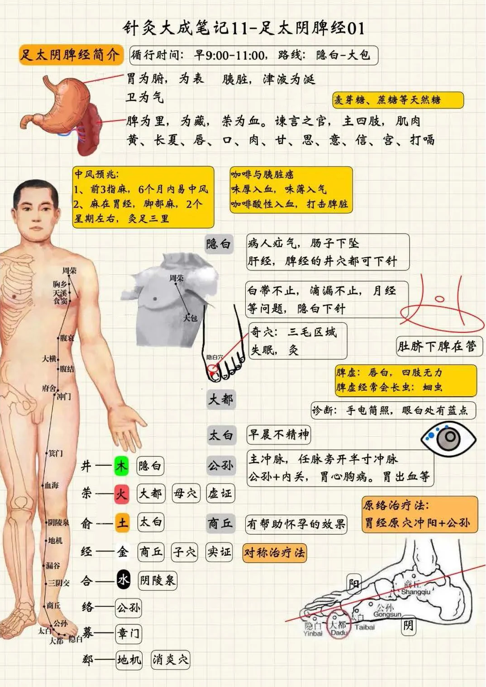
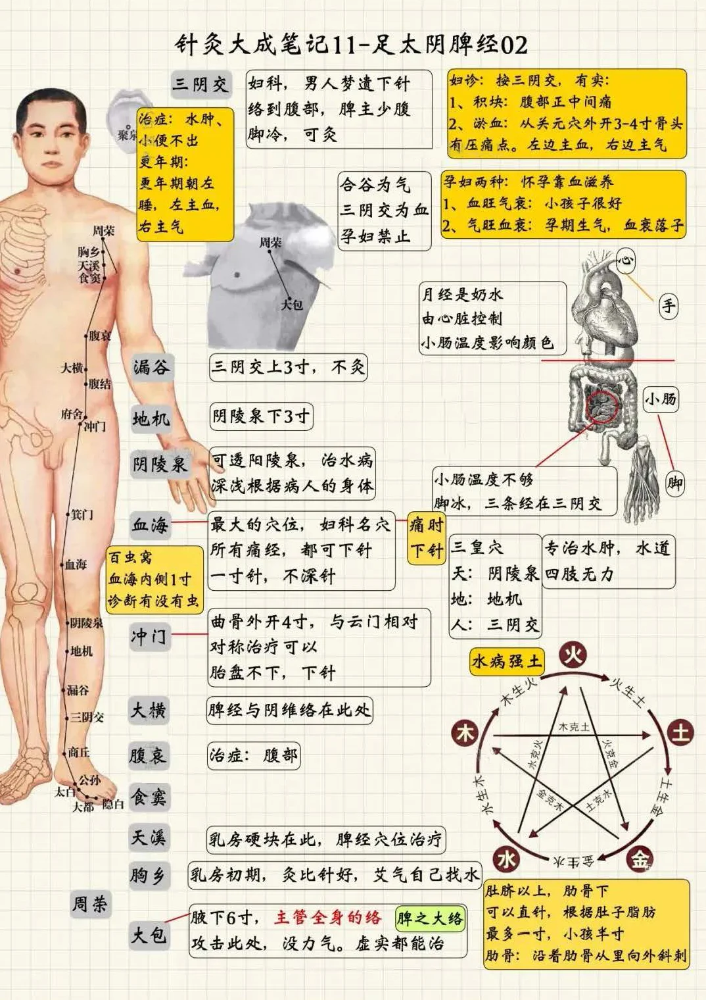

# 足太阴脾经二十一穴循行笔记：从隐白到大包

## **一、脾经总论**

### 1. 脾的核心定位

- **脾为谏议之官**：负责调节身体平衡，类似臣子向君主进谏。
- **脾为后天之本**：主运化水谷，化生气血，是胃气之后的支持系统。
- **脾主统血**：统摄血液运行，脾虚可见出血、崩漏、便血等。
- **脾主肌肉四肢**：脾虚则肌肉无力、四肢乏力。
- **脾开窍于口**：脾主味觉，涎液异常如中风流涎，可从脾考虑。
- **五行属性**：脾属土，味甘，对应黄色食物，如南瓜、小米。

> 中医的“脾”理解为一个系统，包含脾与胰的功能，强调运化与血糖代谢。  

### 2. 脾与胃的表里关系

- 脾与胃相表里：**胃主受纳，脾主运化**；胃主气（卫），脾主血（荣）。
- 胃气下降，脾气上升，一降一升，维持中焦气机。
- 脾虚则运化失司，常见腹胀、便溏、乏力、水肿、白带清稀。

### 3. 时间与五行流注

| 项目 | 内容 |
|---|---|
| 流注时辰 | 巳时（9:00—11:00） |
| 五行 | 土 |
| 五味 | 甘 |
| 五色 | 黄 |
| 情志 | 思，思虑过度伤脾 |

> 若在巳时明显困倦、腹胀或乏力，可作为脾经辨证的时相线索。

### 4. 脾经五输与特定穴

| 项目 | 穴位 | 记忆 |
|---|---|---|
| 井穴 | 隐白（木） | 妇科、急救 |
| 荥穴 | 大都（火） | 母穴，虚证 |
| 输穴 | 太白（土） | 原穴，脾虚 |
| 经穴 | 商丘（金） | 子穴，实证 |
| 合穴 | 阴陵泉（水） | 利湿要穴 |
| 原穴 | 太白 | 脾虚常用 |
| 络穴 | 公孙 | 通冲脉，胃心胸 |
| 郄穴 | 地机 | 急痛、腹水 |
| 大络 | 大包 | 统全身络脉 |

**虚补大都，实泻商丘；原穴太白，络穴公孙。**

---

## **二、二十一穴循行速查表**

> 按隐白 → 大包排列；标有“核心”的穴位为优先掌握对象。

| 序 | 穴名 | 定位锚点 | 一句关键词 | 重点 |
|---:|---|---|---|---|
| 1 | 隐白 | 足大趾内侧甲角 | 崩漏、急救、疝气 | **核心** |
| 2 | 大都 | 第1跖趾关节前 | 母穴、虚证 | 常用 |
| 3 | 太白 | 第1跖骨基底部 | 原穴、脾虚 | **核心** |
| 4 | 公孙 | 第1跖骨基底部前下 | 胃心胸、冲脉 | **核心** |
| 5 | 商丘 | 内踝前下方 | 子穴、泻实 | 常用 |
| 6 | 三阴交 | 内踝上3寸 | 妇科、利水 | **核心** |
| 7 | 漏谷 | 内踝上6寸 | 腹胀、小便不利 | — |
| 8 | 地机 | 阴陵泉下3寸 | 郄穴、腹水 | **核心** |
| 9 | 阴陵泉 | 胫骨内侧髁下 | 健脾利湿 | **核心** |
| 10 | 血海 | 髌骨内上方2寸 | 痛经、皮肤病 | **核心** |
| 11 | 箕门 | 大腿内侧 | 小便不利、腹股沟 | — |
| 12 | 冲门 | 腹股沟 | 腹痛、妇科 | — |
| 13 | 府舍 | 下腹 | 腹痛、疝气 | — |
| 14 | 腹结 | 下腹 | 腹痛、便秘 | — |
| 15 | 大横 | 脐旁4寸 | 便秘、腹泻 | — |
| 16 | 腹哀 | 上腹 | 消化不良、腹痛 | — |
| 17 | 食窦 | 胸外侧 | 胸满、食积 | — |
| 18 | 天溪 | 胸外侧 | 乳痈、胸痛 | — |
| 19 | 胸乡 | 胸外侧 | 胸满、胸痛 | — |
| 20 | 周荣 | 胸外侧 | 咳嗽、胸满 | — |
| 21 | 大包 | 腋下6寸 | 脾大络、四肢无力 | **核心** |

> **核心穴提示**：隐白、太白、公孙、三阴交、地机、阴陵泉、血海、大包。

---

## **三、按循行分段精讲**

### **1. 足趾足踝段：隐白 → 三阴交**

这一段是脾经最核心的“治本区”，涵盖**妇科、急救、脾虚、胃心胸与妇科利水**。

| 穴位 | 定位 | 主治方向 | 操作要点 |
|---|---|---|---|
| 隐白 | 足大趾内侧甲角旁 | 崩漏、白带、尸厥、疝气 | 井穴，可点刺 |
| 大都 | 第1跖趾关节前凹陷 | 唇白、虚证、蛔虫 | 母穴，宜补 |
| 太白 | 第1跖骨基底部前下 | 脾虚、腹胀、乏力 | 原穴 |
| 公孙 | 第1跖骨基底部前下 | 胃痛、心脏病、气喘、妊娠呕吐 | 络穴，通冲脉 |
| 商丘 | 内踝前下方 | 腹痛、腹胀、实证 | 子穴，宜泻 |
| 三阴交 | 内踝尖上3寸，胫骨后缘 | 妇科、水肿、小便不利 | 孕妇慎针 |

#### **【核心】隐白**

- **定位**：足大趾内侧，趾甲角旁。
- **重点理由**：脾经井穴，井主心下满，善治妇科出血与急救。
- **主治抓手**：崩漏、月经过多、白带、尸厥昏迷、疝气。
- **经验配法**：疝气可配合肝经井穴大敦；奇穴三毛灸治失眠，原笔记称“灸至患者入睡”。

#### **【核心】太白**

- **定位**：足内侧，第1跖骨基底部前下方赤白肉际。
- **重点理由**：脾经原穴，是判断与调理脾虚的核心穴。
- **主治抓手**：脾虚乏力、腹胀、食少、便溏；原笔记特别提到“9—11点倦怠”。
- **配伍思路**：配足三里、中脘，补后天之本。

#### **【核心】公孙**

- **定位**：第1跖骨基底部前下方。
- **重点理由**：脾经络穴，八脉交会通冲脉；“公孙内关胃心胸”是其最核心记忆。
- **主治抓手**：胃痛、腹胀、妊娠呕吐、心痛、胸闷、气喘。
- **操作要点**：原笔记提到可替代足三里治疗胃出血，以避免刺激胃经。
- **常用配伍**：配内关，治胃、心、胸相关病证。

#### **【核心】三阴交**

- **定位**：内踝尖上3寸，胫骨后缘。
- **重点理由**：足太阴、足少阴、足厥阴三阴交会，是妇科与水湿病总穴。
- **主治抓手**：痛经、月经不调、不孕、水肿、小便不利。
- **常用配伍**：配中极利水；配关元、气海调妇科。
- **禁忌**：孕妇慎针或禁针。原笔记同时记有“补三阴交、泻合谷安胎”的经验，但两条内容存在语境差异，学习时以安全为先，孕妇不可自行针刺。

---

### **2. 小腿段：漏谷 → 箕门**

这一段主**水湿、脾虚、血分与妇科**。

| 穴位 | 定位 | 主治方向 | 操作要点 |
|---|---|---|---|
| 漏谷 | 内踝上6寸 | 腹胀、小便不利 | 辅助阴陵泉 |
| 地机 | 阴陵泉下3寸 | 腹水、腹痛、妇科 | 郄穴 |
| 阴陵泉 | 胫骨内侧髁下缘 | 水肿、小便不利、膝痛 | 合穴，利湿 |
| 血海 | 髌骨内上方2寸 | 痛经、皮肤病、血分病 | 浅针，忌深刺 |
| 箕门 | 大腿内侧 | 小便不利、腹股沟痛 | 局部取穴 |

#### **【核心】地机**

- **定位**：阴陵泉下3寸。
- **重点理由**：脾经郄穴，善治急症、疼痛与水湿停聚。
- **主治抓手**：腹痛、腹水、水肿、妇科痛证。
- **配伍思路**：与阴陵泉、三阴交组成“三皇穴”，用于强土制水。

#### **【核心】阴陵泉**

- **定位**：胫骨内侧髁下方凹陷处。
- **重点理由**：脾经合穴，五行属水，是健脾利湿第一穴。
- **主治抓手**：水肿、小便不利、腹泻、腹胀、风湿性膝痛。
- **操作要点**：可针可灸，湿证常配三阴交、地机。

#### **【核心】血海**

- **定位**：屈膝，髌骨内上缘上2寸，肌肉隆起处。
- **重点理由**：血分病要穴，妇科与皮肤病常用。
- **主治抓手**：痛经、月经不调、皮肤瘙痒、瘾疹。
- **操作要点**：浅针为宜，忌深刺伤筋。
- **奇穴百虫窝**：血海下1寸，原笔记用于寄生虫病诊断，按压痛提示有虫。

---

### **3. 腹胸段：冲门 → 大包**

这一段顺脾经入腹、上胸，主治**腹肠、胸乳与全身络脉**。

| 穴位 | 定位 | 主治方向 | 操作要点 |
|---|---|---|---|
| 冲门 | 腹股沟 | 腹痛、疝气、妇科 | 近取穴 |
| 府舍 | 下腹 | 腹痛、疝气 | 近取穴 |
| 腹结 | 下腹 | 腹痛、便秘 | 近取穴 |
| 大横 | 脐旁4寸 | 便秘、腹泻、腹痛 | 腹证常用 |
| 腹哀 | 上腹 | 消化不良、腹痛 | 近取穴 |
| 食窦 | 胸外侧 | 胸满、食积 | 顺经了解 |
| 天溪 | 胸外侧 | 乳痈、胸痛 | 近取穴 |
| 胸乡 | 胸外侧 | 胸满、胸痛 | 顺经了解 |
| 周荣 | 胸外侧 | 咳嗽、胸满 | 顺经了解 |
| 大包 | 腋下6寸 | 四肢无力、中风、络脉病 | 脾之大络 |

#### **【核心】大包**

- **定位**：腋下6寸，第6肋间隙。
- **重点理由**：脾之大络，统管全身络脉，协调脏腑与四肢。
- **主治抓手**：四肢无力、中风瘫痪、胸胁痛、全身络脉不和。
- **记忆抓手**：大包是脾经终点，也是“脾主四肢”的落点。

---

## **四、脾经辨证与治疗思路**

### 1. 强土制水

> 水肿不一定只治肾，脾虚不能运化水湿也是关键。  
> 三皇穴：阴陵泉、地机、三阴交。

- 阴陵泉利水湿。
- 地机缓急痛、消腹水。
- 三阴交调三阴、利水道。
- 三穴合用，是从脾论治水湿病的组合。

### 2. 虚实辨证

| 表现 | 辨证 | 取穴 |
|---|---|---|
| 新痛、痛明显 | 偏实 | 泻商丘 |
| 久痛、唇白、乏力 | 偏虚 | 补大都、太白 |
| 水肿、便溏 | 脾虚湿盛 | 阴陵泉、地机、三阴交 |
| 妇科痛、血分病 | 血分不和 | 血海、三阴交 |

### 3. 中风预兆线索

> 手前三指麻：原笔记认为可能在半年内出现中风。  
> 足三里、丰隆一带麻：原笔记认为时间更急，可能两周内中风，可灸足三里急救。

### 4. 蛔虫诊断线索

> 下牙龈白点、眼白蓝斑、夜间肛门瘙痒，作为蛔虫病观察点。  
> 百虫窝按压痛，可作为辅助线索。

---

## **五、临床配穴速查**

| 应用方向 | 常用穴 | 配伍思路 |
|---|---|---|
| 脾虚乏力 | 太白、足三里、中脘 | 补后天之本 |
| 胃心胸病 | 公孙、内关 | 八脉交会经典配穴 |
| 妇科病 | 三阴交、血海、关元 | 调血分、理冲任 |
| 水肿 | 阴陵泉、地机、三阴交 | 三皇穴强土制水 |
| 崩漏、便血 | 隐白、三阴交、血海 | 井穴与血分穴配合 |
| 皮肤瘙痒 | 血海、曲池、三阴交 | 治血分与祛风 |
| 四肢无力 | 大包、足三里、合谷 | 脾主四肢 |
| 腹水、急痛 | 地机、阴陵泉、水分 | 郄穴配利水穴 |

### 脾经取穴口诀

> 隐白崩漏急救先，大都补虚太白原；  
> 公孙内关胃心胸，商丘泻实三阴全；  
> 漏谷地机阴陵水，血海调经百虫验；  
> 冲门府舍腹胸结，大包一络四肢还。

---

## **六、操作与禁忌速查**

| 穴位/主题 | 注意 |
|---|---|
| 三阴交 | 孕妇慎针或禁针 |
| 血海 | 浅针为宜，忌深刺伤筋 |
| 隐白 | 点刺须消毒，体弱者慎用 |
| 公孙 | 妊娠期慎用，尤其有流产风险者 |
| 大包 | 胸胁部针刺不宜过深 |

---

## **七、现代生活提示**

> “咖啡酸味入肝克脾，长期饮用可能伤脾”，这是讲者从五味生克角度提出的观点。  
> 更年期调理方面，灸三阴交、中极，并配合左侧卧以“引血归肝”，可作为传统调养思路记录。

---

## **八、小结**

> 脾经二十一穴，从隐白到大包，主线是“足趾统血、小腿利水、腹胸调络”。  
> 先抓隐白、太白、公孙、三阴交、地机、阴陵泉、血海、大包八穴，再用五输、原络、郄穴与大络把整条经串起来，脾经体系就清楚了。  
> 脾经学习的关键，是一个“土”字：土旺则能运化，土虚则水泛、血失统、四肢无力。

---

> 作者: [Acuherb](https://acuherb.xyz/)  
> URL: https://acuherb.xyz/posts/zhenjiu-4-6/  

