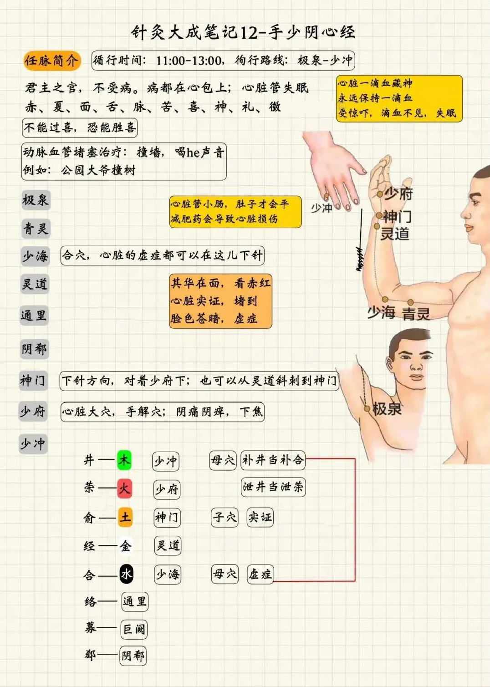

# 手少阴心经九穴循行笔记：从极泉到少冲

## **一、心经总论**

### 1. 君主之官：心脏

> 心为“君主之官”，藏神，主血脉，其华在面，面色反映心脏状态。

- 心主神明：神志、意识、思维与睡眠都归心所主。
- 心主血脉：推动血液运行，脉象与面色是观察心气的重要窗口。
- 其华在面：面色苍白、面赤、面暗，均可以从心与心包考虑。

### 2. 心不受病，病在心包

> 中医认为心脏本身不病，病在心包（心包膜）。现代心脏瓣膜问题（如二尖瓣闭锁不全）多与西药干预有关。
> 后续取穴也围绕这个思路展开：治疗心病多从心包经、心经与胸背募俞入手。

### 3. 心与小肠相表里

> 心脏火气传递至小肠，两者温度、压力一致，心脏也管理体重与腰围。

- 心火下移小肠，是小肠热化与分清泌浊的动力来源。
- 心与小肠表里相合，故心经穴也可用于部分下焦与二阴问题。
- 少府穴治阴痛，正是从“心与小肠表里”展开。

### 4. 情志与五志相克

> 心主喜，过喜则伤心（如范进中举），需以“恐”（肾水）制之，即恐胜喜。

> 心神不宁会导致失眠、气散，长期可能引发忧郁或自杀倾向（与抗忧郁药副作用相关）。

记忆：喜伤心，恐胜喜；心神安，则睡眠与情志稳定。

### 5. 非药物疗法：徵音与撞墙法

> 徵音（“喝”）与撞墙法，通过发声与背部撞击肩胛骨区域，疏通心经淤堵，改善胸闷、动脉阻塞。动作需放松，配合吐气发声。

> 此为传统锻炼法，动作与力度须量力而行。

---

## **二、九穴循行速查表**

> 按极泉 → 少冲排列；标有“核心”的穴位为优先掌握对象。

| 序 | 穴名 | 定位锚点 | 一句关键词 | 重点 |
|---:|---|---|---|---|
| 1 | 极泉 | 腋窝顶点，腋动脉旁 | 诊断乳房病，透穴应用 | **核心** |
| 2 | 青灵 | 少海上3寸 | 肘臂痛，临床少用 | — |
| 3 | 少海 | 屈肘横纹内侧端 | 合穴，母穴，补心虚 | **核心** |
| 4 | 灵道 | 腕横纹上1.5寸 | 经穴，属金 | — |
| 5 | 通里 | 腕横纹上1寸 | 络穴，舌强不语 | **核心** |
| 6 | 阴郄 | 腕横纹上0.5寸 | 郄穴，心悸盗汗 | — |
| 7 | 神门 | 腕横纹小指侧端 | 输穴，子穴，安神 | **核心** |
| 8 | 少府 | 第4、5掌骨间 | 荥穴，本穴，急救 | 常用 |
| 9 | 少冲 | 小指桡侧指甲角 | 井穴，补心虚 | **核心** |

> **核心穴提示**：极泉、少海、通里、神门、少冲。

---

## **三、心经五输与补泻**

| 五行 | 木 | 火 | 土 | 金 | 水 |
|---|---|---|---|---|---|
| 心经五输 | 少冲（井） | 少府（荥） | 神门（输） | 灵道（经） | 少海（合） |
| 应用 | 井穴补虚 | 本穴 | 子穴泻实 | 经穴 | 母穴补虚 |

- **母穴少海**：原笔记以“补井当补合”立论，心经虚证不直接补井穴少冲，而取合穴少海。
- **子穴神门**：土为火之子，心经实证、面赤热、脉洪大时泻神门。
- **本穴少府**：心属火，少府亦属火，为心经本穴。

---

## **四、按循行分段精讲**

### **1. 腋肘段：极泉 → 少海**

| 穴位 | 定位 | 主治方向 | 操作要点 |
|---|---|---|---|
| 极泉 | 腋窝顶点，腋动脉搏动处 | 诊断乳房硬块是否属心经；肩臂病 | 对面为肩髃，可透极泉治狐臭 |
| 青灵 | 少海上3寸 | 肘臂痛、肩臂不举 | 临床少用 |
| 少海 | 屈肘，肘横纹内侧端凹陷 | 心经虚证、失眠、面色苍白 | 母穴，用补法 |

#### **【核心】极泉**

- **定位**：腋窝顶点，腋动脉搏动处。
- **重点理由**：心经首穴，原笔记强调其诊断价值。
- **应用**：用于判断乳房硬块是否属心经；与肩髃相对，肩髃透极泉用于狐臭。
- **特点**：少直接治疗，多用于诊断与特殊透穴。

#### **【核心】少海**

- **定位**：屈肘，肘横纹内侧端凹陷处。
- **重点理由**：心经合穴，属水，为心经母穴。
- **主治抓手**：心经虚证，如面色苍白、失眠。
- **针法**：补法，顺经转针，单数次数。
- **要点**：因井穴少冲属木，“补井当补合”，故补心虚取少海。

---

### **2. 前臂腕段：灵道 → 神门**

| 穴位 | 定位 | 属性 | 主治方向 |
|---|---|---|---|
| 灵道 | 腕横纹上1.5寸 | 经穴，属金 | 心痛、失眠、肘臂痛 |
| 通里 | 腕横纹上1寸 | 络穴 | 舌强不语、心悸、怔忡 |
| 阴郄 | 腕横纹上0.5寸 | 郄穴 | 心痛、惊悸、盗汗 |
| 神门 | 腕横纹小指侧端 | 输穴，属土 | 失眠、惊悸、情志病 |

#### **【核心】通里**

- **定位**：腕横纹上1寸，尺侧腕屈肌腱桡侧。
- **重点理由**：心经络穴，联络小肠经。
- **主治抓手**：舌强不语、心悸、怔忡。
- **记忆抓手**：心开窍于舌，通里善治舌与言语。

#### **【核心】神门**

- **定位**：腕横纹小指侧端，尺侧腕屈肌腱桡侧凹陷。
- **重点理由**：心经输穴，属土，为心经子穴；也是安神要穴。
- **主治抓手**：失眠、惊悸、情志病，如情绪不稳、幻觉。
- **泻法**：心经实证，如脉洪大、面赤热，可取神门泻之。

> **定位口诀**：神门在腕横纹筋内侧，依次上0.5寸为阴郄，再上0.5寸为通里，再上0.5寸为灵道。

---

### **3. 手掌指段：少府 → 少冲**

| 穴位 | 定位 | 属性 | 主治方向 |
|---|---|---|---|
| 少府 | 第4、5掌骨之间 | 荥穴，属火 | 心脏病急救、手解穴、阴痛 |
| 少冲 | 小指桡侧指甲角旁 | 井穴，属木 | 补心虚、急救 |

#### **【常用】少府**

- **定位**：第4、5掌骨之间，握拳时小指尖所指处。
- **重点理由**：心经荥穴，属火，与心同气，为本穴。
- **应用**：
  - 心脏病急救，配合关元、巨阙。
  - 手解穴，解上半身点穴或外伤气滞。
  - 阴痛，从心与小肠表里论治下焦病。

#### **【核心】少冲**

- **定位**：小指桡侧指甲角旁。
- **重点理由**：心经井穴，属木，木生火，可补心虚。
- **结论**：补心虚可用少冲，但临床多取少海替代。

---

## **五、心经与五行生克**

### 1. 相生关系

> 木（肝）→ 火（心）→ 土（脾）→ 金（肺）→ 水（肾）→ 木。

正常状态是相生有序，心火温煦脾土，脾土生肺金，肺金生肾水，肾水涵养肝木。

### 2. 相克与病传

> **结论**：肝病克脾（食欲差）→ 脾虚克肾（水泛）→ 肾弱克心（火衰）→ 心肺衰竭。

### 3. 治疗原则

- **阻断病传**：肝病先强脾土，防其克土。
- **调本穴**：利用本穴少府平衡心经五行属性。
- **虚实分治**：虚取少海、少冲；实取神门。

---

## **六、临床配穴速查**

| 应用方向 | 常用穴 | 配伍思路 |
|---|---|---|
| 心经虚证 | 少海、少冲 | 母穴与井穴补心虚 |
| 心经实证 | 神门 | 子穴泻心火 |
| 失眠、惊悸 | 神门、内关、少海 | 安神定悸 |
| 舌强不语 | 通里、廉泉 | 心开窍于舌 |
| 心痛、心悸 | 神门、阴郄、膻中 | 心经络穴与郄穴同用 |
| 心脏病急救 | 少府、关元、巨阙 | 原笔记急救组合 |
| 乳房病辨证 | 极泉、肩髃 | 诊断与透穴思路 |
| 上半身气滞 | 少府（手解穴） | 原笔记经验 |

### 心经取穴口诀

> 极泉腋下诊断先，青灵少用少海补虚眠；  
> 灵道通里阴郄神，神门泻实镇心烦；  
> 少府本穴急救用，少冲井木补心源。

---

## **七、心脏保健与失眠辨时**

### 1. 心脏保健

- 心平气和，避免过喜或情绪剧烈波动。
- 徵音与撞墙法作为原笔记记录的传统疏通法，动作需放松。
- 心神安则睡眠稳，心气足则面色润。

### 2. 失眠辨时

| 失眠时段 | 对应脏腑 |
|---|---|
| 子时（23:00—1:00） | 胆 |
| 丑时（1:00—3:00） | 肝 |
| 寅时（3:00—5:00） | 肺 |
| 整夜不眠 | 心脏问题 |

---

## **八、小结**

> 心经只有九穴，却紧扣“君主之官”的核心：神明、血脉、情志与睡眠。  
> 极泉用于诊断，少海补虚，神门泻实，通里治舌，少府急救，少冲补心。  
> 掌握这五个核心穴，再按五输五行理解少海、神门、少府的补泻关系，心经体系就清楚了。

---

> 作者: [Acuherb](https://acuherb.xyz/)  
> URL: https://acuherb.xyz/posts/zhenjiu-4-7/  

