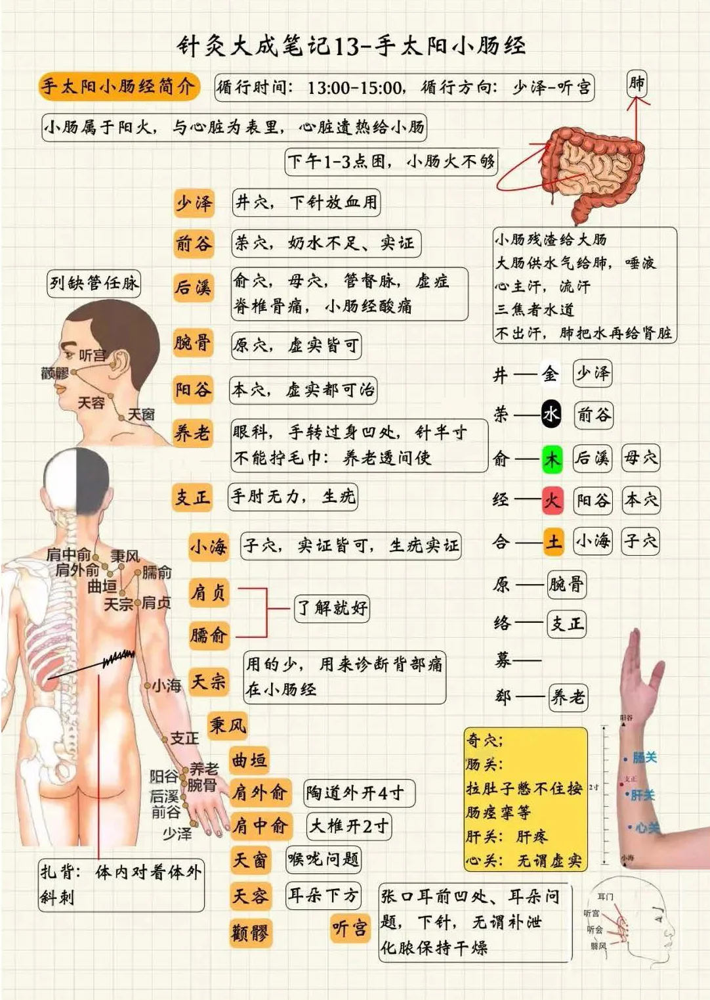

# 手太阳小肠经十九穴循行笔记：从少泽到听宫

## **一、小肠经总论**

### 1. 小肠的核心定位

- **受盛之官**：《内经》称小肠为“受盛之官，化物出焉”，主受盛胃中水谷，分清泌浊。
- **与心相表里**：心火下移小肠，小肠热力帮助水液气化；二者共同维持消化与体温调节。
- **小肠热化**：小肠火气充足，则水谷可分、水道可通；小肠寒则小便不利、水液代谢异常。
- **未时流注**：小肠经气血流注于未时（13:00—15:00）。若此时常疲倦、昏沉，可作为小肠功能偏弱的时相线索。

### 2. 五输与特定穴

| 项目 | 穴位 | 记忆 |
|---|---|---|
| 井穴 | 少泽（金） | 放血退热、促乳 |
| 荥穴 | 前谷（水） | 时症、乳汁不足 |
| 输穴 | 后溪（木） | 母穴，肩背督脉 |
| 经穴 | 阳谷（火） | 本经火气 |
| 合穴 | 小海（土） | 子穴，泻实 |
| 原穴 | 腕骨 | 小肠功能紊乱 |
| 络穴 | 支正 | 通心经，虚实皆治 |
| 郄穴 | 养老 | 急症、老年眼疾 |

- **母穴后溪**：木生火，虚证补后溪。
- **子穴小海**：火生土，实证泻小海。

---

## **二、十九穴循行速查表**

> 按少泽 → 听宫排列；标有“核心”的穴位为优先掌握对象。

| 序 | 穴名 | 定位锚点 | 一句关键词 | 重点 |
|---:|---|---|---|---|
| 1 | 少泽 | 小指尺侧指甲角 | 放血退热、促乳 | **核心** |
| 2 | 前谷 | 第5掌指关节前 | 时症、乳汁不足 | 常用 |
| 3 | 后溪 | 第5掌指关节后 | 通督脉、项背痛 | **核心** |
| 4 | 腕骨 | 手掌尺侧骨间 | 原穴、消化黄疸 | 常用 |
| 5 | 阳谷 | 腕背尺侧 | 经穴、火气 | — |
| 6 | 养老 | 尺骨小头桡侧 | 郄穴、眼疾、扭伤 | **核心** |
| 7 | 支正 | 腕上5寸 | 络穴、手臂无力、疣 | 常用 |
| 8 | 小海 | 肘尖与内上髁间 | 子穴、泻实 | 常用 |
| 9 | 肩贞 | 肩关节后下方 | 肩臂痛 | — |
| 10 | 臑俞 | 肩胛冈下缘 | 肩臂痛 | — |
| 11 | 天宗 | 肩胛骨冈下窝 | 肩背痛、乳腺 | **核心** |
| 12 | 秉风 | 肩胛冈上窝 | 肩胛痛 | — |
| 13 | 曲垣 | 肩胛冈上缘 | 肩胛痛 | — |
| 14 | 肩外俞 | 背部第1胸椎旁 | 肩背痛 | — |
| 15 | 肩中俞 | 背部第7颈椎旁 | 肩背痛、咳嗽 | — |
| 16 | 天窗 | 颈侧 | 咽喉、颈项、耳 | — |
| 17 | 天容 | 下颌角后 | 咽喉、颈项 | — |
| 18 | 颧髎 | 颧骨下缘 | 面瘫、牙痛 | **核心** |
| 19 | 听宫 | 耳屏前 | 耳鸣、中耳炎 | **核心** |

> **核心穴提示**：少泽、后溪、养老、天宗、颧髎、听宫。

---

## **三、按循行分段精讲**

### **1. 手腕段：少泽 → 阳谷**

这一段从指端到腕部，是**乳汁、热证、督脉肩背与小肠原气**的取穴区。

| 穴位 | 定位 | 属性 | 主治方向 | 操作要点 |
|---|---|---|---|---|
| 少泽 | 小指尺侧指甲角旁 | 井穴 | 高热、昏迷、乳汁不足 | 点刺放血，配前谷促乳 |
| 前谷 | 第5掌指关节前横纹头 | 荥穴 | 妇人奶水不足、时症 | 未时发病可用 |
| 后溪 | 第5掌指关节后横纹头 | 输穴 | 督脉痛、项强、落枕、肩痛 | 通督脉，虚证补 |
| 腕骨 | 手掌尺侧骨间 | 原穴 | 消化不良、黄疸 | 原穴无虚实之分 |
| 阳谷 | 腕背尺侧 | 经穴 | 腕臂痛、热病 | 顺经认识即可 |

#### **【核心】少泽**

- **定位**：小指尺侧指甲角旁。
- **重点理由**：小肠经井穴，善治热证与急救，又用于乳汁不足。
- **主治抓手**：高热、昏迷、咽喉痛、乳汁不足。
- **操作要点**：可点刺放血；配前谷用于促乳。

#### **【核心】后溪**

- **定位**：握拳，小指掌指关节后横纹头。
- **重点理由**：小肠经输穴、母穴，同时又通督脉。
- **主治抓手**：脊椎痛、项强、落枕、肩背痛。
- **补泻**：小肠经虚证，如久肩痛，用补法。
- **记忆抓手**：后溪通督脉，颈项腰背皆可考虑。

---

### **2. 前臂肘段：养老 → 小海**

这一段偏重**郄穴急症、络穴平衡与子穴泻实**。

| 穴位 | 定位 | 属性 | 主治方向 | 操作要点 |
|---|---|---|---|---|
| 养老 | 尺骨小头桡侧骨缝 | 郄穴 | 老年眼疾、肘痛、手扭伤 | 转腕取穴，可透间使 |
| 支正 | 腕上5寸，尺骨外侧 | 络穴 | 手臂无力、皮肤疣 | 虚实皆治 |
| 小海 | 肘尖与肱骨内上髁间 | 合穴 | 急性肩痛、生疣、肘痛 | 子穴泻实 |

#### **【核心】养老**

- **定位**：尺骨小头桡侧骨缝，转腕取穴。
- **重点理由**：小肠经郄穴，善治急症、疼痛与老年眼疾。
- **主治抓手**：白内障、近视、手肘痛、手不能扭毛巾。
- **透针经验**：养老透间使，不留针，专治“手不能扭毛巾”。

#### **【常用】支正**

- **定位**：腕横纹上5寸，尺骨外侧。
- **重点理由**：小肠经络穴，联络心经。
- **主治抓手**：手臂无力、皮肤疣、心烦。
- **特点**：虚实皆治。

#### **【常用】小海**

- **定位**：屈肘，肘尖与肱骨内上髁之间凹陷。
- **重点理由**：小肠经合穴，属土，为小肠经子穴。
- **主治抓手**：急性肩痛、生疣、肘臂痛。
- **操作要点**：实证用泻法。

---

### **3. 肩胛段：肩贞 → 肩中俞**

这一段主**肩背、肩胛与局部疼痛**，临床以天宗最常用。

| 穴位 | 定位 | 主治方向 |
|---|---|---|
| 肩贞 | 肩关节后下方 | 肩臂痛、上肢不举 |
| 臑俞 | 肩胛冈下缘 | 肩臂痛 |
| 天宗 | 肩胛骨冈下窝中央凹陷 | 肩背痛、乳腺病 |
| 秉风 | 肩胛冈上窝 | 肩胛疼痛 |
| 曲垣 | 肩胛冈上缘 | 肩胛痛 |
| 肩外俞 | 第1胸椎旁开3寸 | 肩背痛、颈项强 |
| 肩中俞 | 第7颈椎旁开2寸 | 肩背痛、咳嗽 |

#### **【核心】天宗**

- **定位**：肩胛骨冈下窝中央凹陷处。
- **重点理由**：小肠经肩背部最常用穴，善治肩胛痛与乳房相关问题。
- **主治抓手**：肩背痛、肩周炎、乳腺胀痛、乳腺硬块。
- **操作要点**：可按压寻找压痛点，再针刺或艾灸。

---

### **4. 颈面耳段：天窗 → 听宫**

这一段主**咽喉、颈项、面颊与耳疾**。

| 穴位 | 定位 | 主治方向 |
|---|---|---|
| 天窗 | 颈侧，胸锁乳突肌后缘 | 咽喉、颈项、耳疾 |
| 天容 | 下颌角后方 | 咽喉肿痛、颈项强 |
| 颧髎 | 颧骨下缘凹陷 | 面瘫、牙痛、口眼歪斜 |
| 听宫 | 耳屏前，张口凹陷 | 耳鸣、耳聋、中耳炎 |

#### **【核心】颧髎**

- **定位**：目外眦直下，颧骨下缘凹陷。
- **重点理由**：面颊局部要穴，常用于面瘫与牙痛。
- **主治抓手**：口眼歪斜、面肌跳动、牙痛。

#### **【核心】听宫**

- **定位**：耳屏前，张口时呈凹陷处。
- **重点理由**：小肠经终点，耳部局部要穴。
- **主治抓手**：耳鸣、耳聋、中耳炎、耳流脓。
- **配伍**：配合耳门、听会，三焦经、胆经、小肠经耳前三穴交替使用。
- **操作要点**：需张口进针。

---

## **四、特殊治疗与经验**

### 1. 奇穴三关

| 奇穴 | 定位 | 主治 |
|---|---|---|
| 肠关 | 腕横纹上3寸 | 腹泻、肠绞痛 |
| 肝关 | 肠关上3寸 | 肝癌疼痛、肋间痛 |
| 心关 | 肝关上3寸 | 心脏病 |

> 三关属于经验奇穴，需结合具体病证使用。

### 2. 肩痛辨证

> 肩前痛属大肠经，肩后痛属小肠经，中间痛属三焦经。  
> 新痛泻小海，久痛补后溪。

- 肩前：大肠经区域，可取肩髃、合谷。
- 肩后：小肠经区域，可取后溪、天宗。
- 肩中侧：三焦经区域，可取外关、肩髎。

### 3. 膀胱与三焦气化

> 小肠热力助膀胱气化；小肠寒则小便不利，水液代谢异常。
> 这与心与小肠相表里相呼应：心火下移小肠，小肠再协助膀胱与三焦完成水液代谢。

---

## **五、临床配穴速查**

| 应用方向 | 常用穴 | 配伍思路 |
|---|---|---|
| 项强、落枕 | 后溪、风池、申脉 | 后溪通督脉 |
| 肩背痛 | 天宗、后溪、肩贞 | 循经与局部配合 |
| 老年眼疾 | 养老、睛明、光明 | 郄穴配眼周穴 |
| 耳鸣、中耳炎 | 听宫、听会、耳门、翳风 | 耳前三穴合用 |
| 面瘫、牙痛 | 颧髎、地仓、颊车、合谷 | 面部局部配手阳明 |
| 乳汁不足 | 少泽、前谷、膻中 | 井荥与局部并用 |
| 手臂无力 | 支正、曲池、合谷 | 络穴调和心与小肠 |
| 急性肩痛 | 小海、天宗、后溪 | 子穴泻实 |

### 小肠经取穴口诀

> 少泽放血热症宣，前谷催乳时症看；  
> 后溪通督项背主，腕骨原穴化食疸；  
> 养老郄穴眼肘痛，支正络穴手臂全；  
> 小海泻实肩痛急，天宗肩胛乳病参；  
> 颧髎面口听宫耳，小肠十九从头传。

---

## **六、操作与禁忌速查**

| 穴位 | 注意 |
|---|---|
| 少泽 | 点刺放血须消毒，体弱者慎用 |
| 养老 | 透间使属特殊操作，须专业人员执行 |
| 听宫 | 张口进针，注意深度 |
| 肩胛部穴位 | 针刺不宜过深，避免气胸风险 |
| 三关奇穴 | 属经验穴，须辨证使用 |

---

## **七、小结**

> 小肠经十九穴，从少泽到听宫，主线是“指端泄热、腕肘调气、肩胛止痛、颈面开窍”。  
> 少泽、后溪、养老、天宗、颧髎、听宫六穴立住，再以五输、原络、郄穴和肩痛辨经串联，小肠经体系就清楚了。  
> 小肠经的核心，不只在耳与肩背，更在“心火下移、小肠热化、水道气化”这一条阳气转化链。

---

> 作者: [Acuherb](https://acuherb.xyz/)  
> URL: https://acuherb.xyz/posts/zhenjiu-4-8/  

