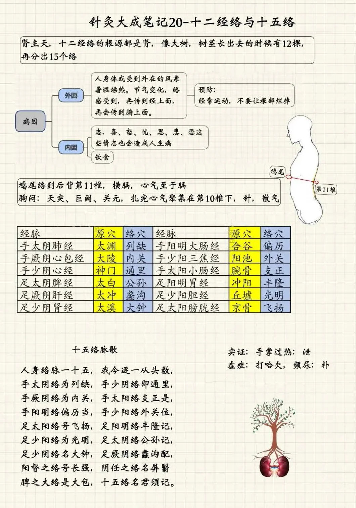

# 十二经络与十五络脉

## 一、经络的基本概念

1. **经络系统**：人体有"经"和"络"，十二正经为主干，十五络脉为分支，相互联系。
2. **肾脏为先天之本**：
   - 肾如树根，十二正经如树枝，遍布全身。
   - 固肾是长寿关键，肾气强弱决定寿命。

## 二、疾病的两大来源

1. **外因**（由外向内）：
   - 风寒暑湿燥热等外邪，从络→经→腑→脏逐步深入。
   - 通过锻炼经络、固护肾气可防病。
2. **内因**（由内向外）：
   - **情志**：过度的喜、怒、忧、思、悲、恐致病。
   - **饮食**：不洁或有害食物（如农药、病死猪）导致病从口入。

## 三、十五络脉的组成与功能

1. **来源**：
   - 十二正经各有一络，加任脉（鸠尾）、督脉（长强）、脾之大络（大包），共十五络。
   - **脾之大络"大包"**：统领全身络脉。
   - **任脉络穴即鸠尾**，又称尾翳/屏翳，不同整理稿中名称混用，实为同一穴。
2. **作用**：
   - 络脉是气血转输的细小通道，病邪由络传经。
   - 络脉病变表现为全身性症状（如疼痛、松弛）。

## 四、重要络穴与主治

> **总原则**：络穴无论虚实，均可在络穴治疗。实证用泻法（如热、痛），虚证用补法（如乏力、失语）。

| 经络 | 络穴 | 主治病症（具体靶点） |
|---|---|---|
| **手太阴** | 列缺 | 实证（手掌热）用泻法；虚证（哈欠、频尿）用补法。 |
| **手少阴** | 通里 | 络心系舌根，**实则支满**（胸膈撑胀）；虚证（失语）。 |
| **手厥阴** | 内关 | 实证（心痛）；虚证（头项强痛）。与公孙配对，构成"公孙内关胃心胸"经典组合。 |
| **手太阳** | 支正 | 主治皮肤疣。 |
| **手阳明** | 偏历 | **大肠经实症**：牙齿痛、耳鸣。不是泛泛"调节气血"，而是大肠经实热的落点。 |
| **手少阳** | 外关 | **通生死桥**（三焦经），虚实皆治。详见下方"外关透内关"专条。 |
| **足太阳** | 飞扬 | **脚没有力量**（下肢无力、不能跑步）。倪师原话"飞扬针下去，脚就像飞毛腿一样"；脚伤不能拖，"一旦坐上轮椅就完了"。 |
| **足少阳** | 光明 | 主治目疾、下肢痿痹。 |
| **足阳明** | 丰隆 | 化痰要穴，治痰多、眩晕。 |
| **足太阴** | 公孙 | 主冲脉，治一切胃痛、腹痛、恶心。与内关配对使用。 |
| **足少阴** | 大钟 | **虚实配对**：肾经实症（小便排不出来）扎大钟；肾经虚症（腰酸痛）也扎大钟。 |
| **足厥阴** | 蠡沟 | **虚实配对**：肝经实症（阳挺不下，阴茎坚挺不退）泻之；肝经虚症（皮肤痒）。穴名带"沟""谷"者（蠡沟、水沟、阴谷等）可治淤积、积块、少腹胀满。 |
| **任脉** | 鸠尾 | 散胸中郁气（常配天突、巨阙、关元）。 |
| **督脉** | 长强 | 通督脉阳气。 |
| **脾之大络** | 大包 | 治全身络病：**实则浑身痛，虚则百节尽纵、全身松软、没办法握拳**。胸胁遍痛、分不清是哪条经时，考虑络病，下大包。 |

### 【专条】外关"通生死桥"：不是静态标签，是透针手法

- **"通生死桥"指的是外关透内关这个动作**，不是外关穴自带的头衔。
- **操作**：病人壮热、高烧时，针外关，左捻右捻引到气，病人说酸痛后，把针慢慢推到内关，热就当场退下来。
- **年龄限制**：**小baby不要用，十四岁以下用单刺**（不留针）。

## 五、临床应用要点

1. **络穴通用性**：无论虚实，均可在络穴治疗。
2. **特殊病症**：
   - 心气郁结：针天突、巨阙、关元后，再针第十椎下（心气终止处）散郁。
   - 全身络病：胸胁痛或肢体无力、不能握拳，取大包穴。
3. **针刺原则**：
   - 实证用泻法（如热、痛），虚证用补法（如乏力、失语）。
4. **配对思路**：
   - **内关—公孙**："公孙内关胃心胸"，表里经络穴配对，治胃、心、胸病。
   - **外关—内关**：透针退壮热，十四岁以下不用。

## 六、总结

- 经络学核心在于"脏腑平衡"，尤其重视肾脏的养护。
- 十五络脉是十二经的延伸，通过络穴调节气血，治疗局部与全身疾病。
- **络穴要有具体靶点**：偏历治大肠经实症（牙痛、耳鸣），飞扬治脚没有力量，大钟虚实配对（小便不出/腰酸痛），蠡沟虚实配对（阳挺不下/皮肤痒），大包治"不能握拳"的全身络病。
- **外关"通生死桥"是外关透内关的退热手法**，不是静态属性；十四岁以下用单刺。
- 外避六淫、内调情志、饮食洁净，是防病根本。

---

> 作者: [Acuherb](https://acuherb.xyz/)  
> URL: https://acuherb.xyz/posts/zhenjiu-5-1/  

