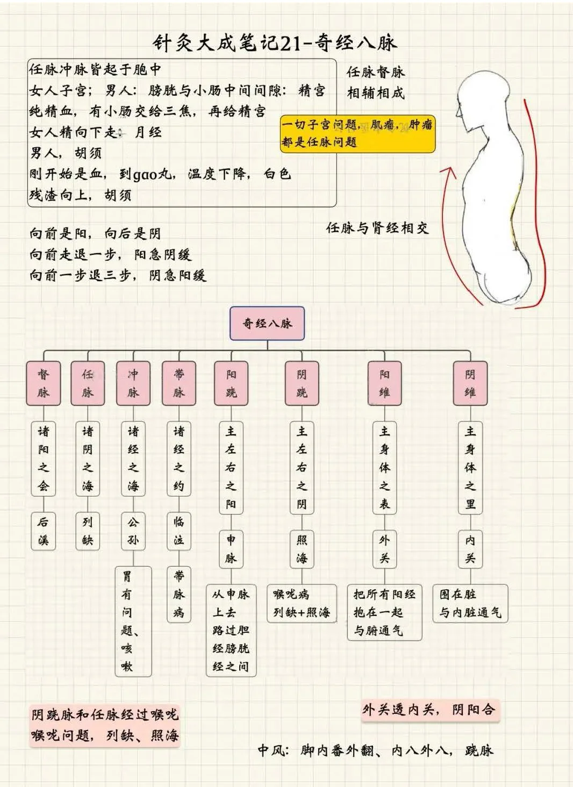

# 奇经八脉

## 1. 督脉

- **循行**：沿脊椎骨（从尾椎至头顶），为"阳气之海"。
- **源头**：**源起曲骨穴**，与任脉表里相通。注意：任、冲同起于胞中；督脉源起曲骨，不宜与任冲并列"起于胞中"。
- **功能**：
  - 总督全身阳气，与五脏六腑通过膀胱经的背俞穴相连。
  - 与任脉协同，维持阴阳平衡（任脉为"诸阴之海"）。
- **主治**：脊柱疾病、阳虚症状。
- **对应穴**：后溪穴（通督脉）。

## 2. 任脉

- **循行**：前正中线，从会阴（曲骨）至咽喉。
- **源头**：与冲脉同起于胞中，主生殖系统（女子胞宫、男子精宫）。
- **功能**：
  - 调节阴经气血，主月经、生育。
  - 女性月经为胞宫残渣下行；男性精液残渣上行成胡须（任脉循行至口唇）。
- **主治**：妇科病、生殖系统疾病、咽喉问题。
- **对应穴**：列缺穴（通任脉）。

## 3. 冲脉

- **循行**：与肾经并行，从胞中上行，环绕口唇，分支至心脏、胃、肺。
- **源头**：与任脉同起于胞中。
- **功能**：
  - "十二经之海"，调节气血。
  - 与生殖、消化（胃心胸）相关。
- **主治**：月经不调、心绞痛、胃病、气喘。
- **对应穴**：公孙穴（通冲脉）。

## 4. 带脉

- **循行**：横向环绕腰部（如腰带），约束纵行经脉。
- **功能**：固摄下焦，主腰腹胀满。
- **主治与辨识指征**：
  - **腰像坐在水里面**——这是带脉病最具辨识度的形象指征。
  - **腰痛是横着一圈痛，像皮带一样**，而不是沿某条经的纵向痛。
  - 腰腹坠胀、带下病。
- **对应穴**：足临泣穴（通带脉）。

> 只记"腰腹坠胀"容易在问诊时漏掉带脉。"腰像坐在水里""横着一圈痛"是患者能直接说出来的感受，是认带脉的入口。

## 5. 阳跷脉与阴跷脉

### 阳跷脉

- **循行**：足外踝（申脉）上行至头。
- **功能**：主下肢外侧运动（外翻）。
- **对应穴**：申脉穴；郄穴为跗阳。

### 阴跷脉

- **循行**：足内踝（照海）上行至咽喉。
- **功能**：主下肢内侧运动（内翻）。
- **对应穴**：照海穴。

### 临床：阴缓阳急的对应关系（关键，不能含糊）

- **脚向外翻**：阴跷松下来、阳跷绷紧，即**阴缓阳急**——**病在阳跷**，取申脉。
- **脚向内翻**：阴跷绷紧，即**阴急**——**病在阴跷**，取照海。
- 这个"松/紧"的肌张力关系，是决定补泻方向的前提：**阳跷的问题在阳跷上治，阴跷的问题在阴跷上治**。
- **取穴示例**：中风足外翻——申脉（阳跷）泻法，照海（阴跷）补法。

### 跷脉的鉴别诊断：痛在两经之间

- 跷脉的病痛**不在正经上，而在两经中间**。
- 病人指得出一个痛点，但这个位置既不在胆经线上，也不在膀胱经线上，这时就要考虑跷脉。
- 这个"痛在两经之间"的提示，比"运动障碍"更能帮助把跷脉用起来。

### 咽喉疾病

- **列缺 + 照海**（任脉 + 阴跷脉）治喉病。

## 6. 阳维脉与阴维脉

### 阳维脉

- **循行**：维系全身阳经（外关穴主管）。
- **功能**：协调表阳。
- **对应穴**：外关穴。

### 阴维脉

- **循行**：维系全身阴经（内关穴主管）。
- **功能**：协调内脏。
- **对应穴**：内关穴。

### 临床：用一个问题决定取穴

面对一个胸痛病人，**先问："痛在肋骨外面，还是肋骨里面？"**

- **痛在肋骨外面** → 阳维 → 取**外关**。
- **痛在肋骨里面** → 阴维 → 取**内关**。
- **分不清内外** → **外关透内关**，同时处理阴阳。

> "外侧/内侧"不是两条脉的属性标签，而是一个**问诊动作**。知道"阳维管外面"不够，要知道"胸痛病人来了，先问他痛在里面还是外面"。"若讲不清楚，就外关透内关"——这是"分不清"时的具体使用时机。

## 奇经八脉关键点

### 1. 源头

- **任、冲同起于胞中**，与生殖密切相关。
- **督脉源起曲骨**，与任脉表里相通。

### 2. 穴道对应

- 督脉：后溪
- 任脉：列缺
- 冲脉：公孙
- 带脉：足临泣
- 阳跷：申脉
- 阴跷：照海
- 阳维：外关
- 阴维：内关

### 3. 八脉交会穴的四组配对（底层结构，不是可选配伍）

八脉交会穴是**成组使用**的，四组配对是结构，不是技巧：

| 配对 | 主治方向 |
|---|---|
| **公孙 — 内关** | 胃、心、胸 |
| **后溪 — 申脉** | 项强（督脉与阳跷） |
| **临泣 — 外关** | 带脉与阳维：腰痛、胸痛 |
| **列缺 — 照海** | 任脉与阴跷：喉病 |

### 4. 治疗原则

- 奇经病多选对应穴（如带脉病取临泣）。
- 阴阳失衡可用透穴法（外关透内关）。
- 跷脉病先辨"阴缓阳急"，再定取申脉还是照海。

## 临床应用示例

- **喉咙痛**：列缺 + 照海（任脉、阴跷脉）。
- **腰痛/胸痛**：外关（阳维）+ 临泣（带脉）；胸痛先问肋骨内/外，分不清则外关透内关。
- **中风足外翻**：申脉（阳跷）泻法，照海（阴跷）补法——外翻为阴缓阳急，病在阳跷。
- **中风足内翻**：阴急，病在阴跷，取照海为主。
- **腰像坐在水里、横着一圈痛**：考虑带脉，取足临泣。
- **痛在两经之间、指得出痛点但不在正经线上**：考虑跷脉。

## 总结

奇经八脉是十二正经的补充系统，通过特定穴道调节气血阴阳，尤其擅长治疗复杂、跨经脉的病症。要点：

- **带脉要认"腰像坐在水里、横着一圈痛"**，不能只记"腰腹坠胀"。
- **跷脉要辨"阴缓阳急"**：外翻=阴缓阳急=阳跷病，内翻=阴急=阴跷病；痛在两经之间要考虑跷脉。
- **维脉要问"肋骨内/外"**：外面取外关，里面取内关，分不清则外关透内关。
- **督脉源起曲骨**，任、冲同起于胞中。
- **八脉交会穴四组配对**（公孙—内关、后溪—申脉、临泣—外关、列缺—照海）是底层结构，不是可选配伍。

---

> 作者: [Acuherb](https://acuherb.xyz/)  
> URL: https://acuherb.xyz/posts/zhenjiu-5-2/  

