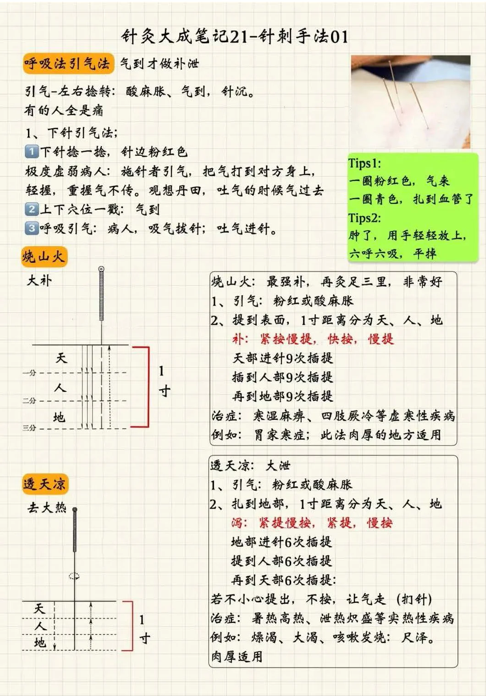

# 针刺手法：呼吸引气法、烧山火、透天凉

## 一、呼吸引气法

### 1. 引气的概念

- 下针后需等待"气至"才能进行补泻操作。**气不到，补泻半天也没效**。
- 气至的标志：
  - **针孔周围出现粉红色圈**（气至）。
  - 若为**青色**，可能刺中血管，不是气至。
  - 病人感觉**酸、麻、胀**。
  - 施针者针感有**吸入感**（针体下沉、被皮肤吸附）。

### 2. 医者导气（适用于严重虚弱者）

- 轻握针柄，**关节放松，不可紧握**；紧握则气不传导。
- 丹田吸气后吐气，意念将气通过金属针传导至患者体内（金属针属肺金，可导气）。
- 若刺中动脉出血，可用手掌**轻按血肿处**，以阳气推动气血运行，**六次呼吸**后血肿可消退。

### 3. 通用引气手法

- **捻转法**：左右捻转针体，出现酸、麻、胀感即为气至；若无感觉但见粉红色圈，亦可判断为气至。
- **辅助引气**：若捻转无效，可轻推上下穴位皮肤，或**上下轻微提插针体**，激发气感。

### 4. 呼吸引气法（气脉极弱时专用，方向不可做反）

- 适用于捻转、提插仍引不到气时。
- **操作方向（关键）** ：
  - **患者吸气时 → 顺势把针往外拔（提针）** ，引导气至。
  - **患者呼气时 → 缓慢微微进针**，导气深入。
- **操作边界**：全程在**皮层内操作，不把针拔出体外**，不是"拔出来再扎进去"。
- 若仍无气至，说明患者元气大伤，建议改用**灸法**。

> **注意**：吸气提针、呼气进针，与"吸气提、呼气进"的反面方向容易混淆，操作前先确认方向再做。

## 二、烧山火（大补手法）

### 1. 适应症

- **里寒证**：胃寒呕酸、肾寒肢冷，面色青白、喜热饮等。

### 2. 操作步骤

**（1）引气**：逐层进针至深层，直至气至。

**（2）分层补法**：将针分**天、人、地**三部（每部约1/3寸），**由浅至深**。

- **天部**：紧按慢提**9次**。
- **过渡**：做完9次后，**把针稍微提起来一点（"提豆许"），针放在那里不动，稍停，再进入人部**。
- **人部**：紧按慢提**9次**。
- **过渡**：同样提起豆许、稍停。
- **地部**：紧按慢提**9次**。

**（3）总数**：9 × 3 = **27次**。

**（4）"紧按慢提"的操作感**：扎下去速度快，提针时要慢，**相当于给轮胎打气**——快按下，慢提起。

### 3. 选穴原则

- 选择**肌肉丰厚处**（如足三里、三阴交、复溜）。
- **不要找涌泉做**——脚底皮薄肉少，不适合做分层大补大泻。
- 避免井穴等敏感部位。

### 4. 注意事项

- 下针需胆大心细，快速穿过皮层以减少疼痛。
- 补后可配合艾灸增强疗效。

## 三、透天凉（大泻手法）

### 1. 适应症

- **实热证**：高热、消渴（中消）、肺热咳嗽、燥渴大渴、发烧。

### 2. 操作步骤

**（1）引气**：同烧山火，**必须先引到气**，没引到气，补泻无效。

**（2）分层泻法**：**由深至浅**，从**地部**开始。

- **地部**：紧提慢按**6次**。
- **过渡**：**只提三分之一，提到人部**，不一提直接提到天部。
- **人部**：紧提慢按**6次**。
- **过渡**：再提三分之一，到天部。
- **天部**：紧提慢按**6次**。

**（3）总数**：6 × 3 = **18次**。

**（4）"紧提慢按"的操作感**：**相当于把轮胎的气放掉**——很快提起来，慢慢、慢慢推回去，不要把气又打回去。

**（5）"紧提"的幅度**：**每部只提三分之一**，不跨层。提得过大，针直接滑出穴位，泻法就中断了。

### 3. 出针

- 泻法后**不按压针孔**，以利邪气外泄。
- 如果提针时**不慎把针提出来了，也不要按针孔**，让气往外走。

### 4. 选穴原则

- 根据病症选穴（如**尺泽**泻肺热，**足三里**泻胃火）。
- 同样**找肉多的地方做**，不要找涌泉。

## 四、核心要点

### 1. 共性原则

- **所有手法需先引气至**，再行补泻。
- 选穴以**肌肉丰厚处**为主，避开血管、井穴与脚底薄处。
- **层与层之间要有"提豆许、稍停"的过渡**，不是连续做完总数。

### 2. 补泻区别

|  | 烧山火（补） | 透天凉（泻） |
|---|---|---|
| **方向** | 由浅至深（天→人→地） | 由深至浅（地→人→天） |
| **手法** | 紧按慢提 | 紧提慢按 |
| **数** | 九，共27次 | 六，共18次 |
| **层间过渡** | 每部做完提豆许、稍停 | 每部只提三分之一，不跨层 |
| **出针** | — | 不按针孔 |

### 3. 灵活应用

- 结合患者体质与病情调整手法强度及穴位选择。
- 呼吸引气法用于气脉极弱、捻转提插均引不到气时；**吸气提、呼气进，方向不可做反**。

---

> 作者: [Acuherb](https://acuherb.xyz/)  
> URL: https://acuherb.xyz/posts/zhenjiu-5-3-1/  

