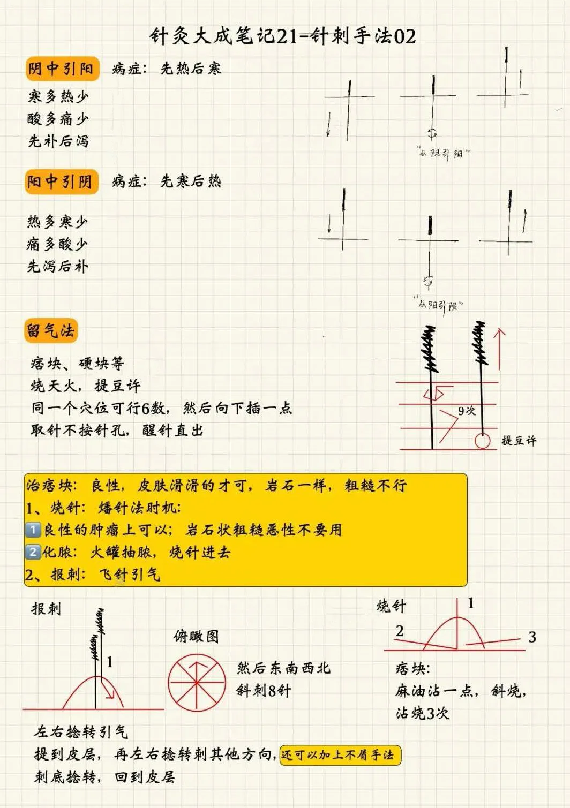

# 针刺手法：阳中引阴、阴中引阳、留气法、烧针法、报刺法

## 一、阳中引阴与阴中引阳（调寒热/痛酸的补泻顺序）

### 1. 概念与判断入口

- **阳中引阴**：先寒后热，**寒多热少** → **先补后泻**。
- **阴中引阳**：先热后寒，**热多寒少** → **先泻后补**。
- **并列判断入口（两组指标，任一即可）** ：
  - **寒热**：寒多热少 → 先补后泻；热多寒少 → 先泻后补。
  - **痛酸**：酸多痛少 → 先补后泻；痛多酸少 → 先泻后补。
- 问诊时问清寒热比例或痛酸比例，两者指向一致，补泻顺序即可确定。

### 2. 操作示例（膀胱经背痛）

- 若患者**酸多痛少**（虚证为主）→ **先补委中**（膀胱经合穴），**再泻束骨**（膀胱经输穴）。
- 若无法取束骨（如脚断）→ 可改用**络穴飞扬**，灵活变通。

### 3. 核心原则

- 补泻顺序取决于寒热/痛酸比例，结合患者反馈调整。
- 针灸需灵活，不可拘泥固定穴道，原穴、络穴等均可替代。

## 二、留气法（远取穴消痞块）

### 1. 适应症与定位

- **远取穴法**：痞块在哪条经，取该经远端穴位（如乳房/腹部硬块多在胃经，取**足三里、上巨虚、梁丘**）。
- 适用于良性痞块、硬块、脂肪瘤、子宫肌瘤、乳房硬块等**表面光滑**者；恶性肿瘤（粗糙坚硬）**禁用**。

### 2. 操作步骤（核心：九补 → 停顿 → 六泻）

**（1）引气**：进针得气。

**（2）行阳数九（补）** ：**紧按慢提**，插提**9次**；可配合捻转，行气力量更强。

**（3）关键停顿：提针豆许，留针五分钟**：
- 9次补法做完后，**将针轻轻上提少许（“提豆许”）** ，针放在那里不动，**等五分钟**。
- 原理：这是强补，气冲上去力量很强，会**冲击痞块、将其打散**。这五分钟是留给“气”去冲开结块的时间。

**（4）行阴数六（泻）** ：气机冲开结块后，在**同一穴位**行**紧提慢按** **6次**，将散开的浊气导引出来。
- **注意**：留气法**不用天人地分层**，在同一层面（或穴位同一深度区域）完成九次和六次即可，与烧山火的分层补法不同。

**（5）出针**：操作完留针，起针时**不按压针孔**，让余邪自然外泄。

> **口诀**：先阳后阴，阳九阴六；**九后提豆许，留针五分钟，再做六**；不按针孔。

## 三、烧针法（近取穴，治良性痞块与化脓）

### 1. 适应症（仅良性，恶性禁用）

- **良性痞块**：脂肪瘤、黑痣、软组织凸起、手腕阳池凸起、软骨凸起——触感**光滑、圆润、质地偏软、边界清晰**。
- **恶性禁用**：坚硬如石、表面粗糙、边界杂乱——不做烧针。
- **化脓**：先火罐抽脓；脓口大、脓稠者，先用**铍针**（九针中扁如剑者）破脓开口，再行烧针排脓。

### 2. 烧针操作条件（成败关键）

- **针具**：**28号粗针**（较粗，耐烧）。
- **烧法**：针身蘸**麻油**（不用汽油等易燃物），**斜烧三次**，针体温热发烫。
- **速度**：趁热**快速刺入**，需**助手在旁协助烧针**，保证“烧完即刺”。

### 3. 三针法（治痞块）

- **第一针**：**从上往下**直刺肿块。
- **第二针**：**从前向后**斜刺穿透结块。
- **第三针**：**从后向前**穿插疏通。
- 三针合围，松解局部淤堵。三针均为烧针。

### 4. 效果

- 轻症一次消肿大半；顽固脂肪瘤、凸起肿块，约**两次**可基本消除。

## 四、报刺法（近取穴，飞针引气散结）

### 1. 特点

- 只用**一根针**，不烧针，适用于**怕烧针**的患者；良性痞块、脂肪瘤、软骨凸起均可。
- 补泻同时出现在一个针头上，通过多方向刺激引气散结。

### 2. 操作步骤（含安全边界）

**（1）第一针**：一只手**抓住痞块**，另一只手从痞块顶部**直刺到底部**，**左右捻转**（“燃针”）得气。

**（2）提至皮层，开始八向斜刺**：
- 捻转后，**将针提回皮层**——只有回到皮下，针才能转向。
- 依次向**东、南、西、北、东北、东南、西北、西南**八个方向**斜刺**。
- **每刺一个方向，都要先捻转，再将针提回皮层**，然后转向下一个方向，不可不提回就直接硬转。

**（3）安全边界**：斜刺到皮肤边际时**小心不要刺出皮肤**，否则会刺到抓痞块的那只手。

**（4）收尾**：八向刺完后，针回到**原点**（第一针垂直进针处），再次**直刺到底部**，左右捻转，**直接出针**（一般不留针）。

### 3. 效果

- 做完后病人通常无明显感觉，次日痞块可见缩小；再做一次可进一步消退。

## 五、核心总结

### 1. 治痞的远近二分

| 分类 | 手法 | 核心逻辑 |
|---|---|---|
| **远取** | **留气法** | 远端穴位，九补冲开痞块 → 停顿留气 → 六泻导出浊气 |
| **近取** | **烧针法** | 直接作用于痞块本体，趁热松解、排脓 |
| **近取** | **报刺法** | 一针多向，引气散结，适合怕烧针者 |

### 2. 必须记住的操作节奏与安全点

- **留气法**：九补之后**提豆许、停五分钟**，再做六泻；**不用天人地**。
- **烧针法**：**28号粗针 + 麻油斜烧三次 + 助手协助 + 趁热快刺**；化脓先**铍针破口**。
- **报刺法**：**每向捻转后提回皮层再转向**；**斜刺勿穿出皮肤**；收尾回原点直刺到底部。

### 3. 辨证前提

- **阳中引阴/阴中引阳**：以**寒热比例**或**痛酸比例**定补泻先后。
- **烧针/报刺**：**仅良性痞块**（表面光滑、质地偏软）可用；恶性禁用。

---

> 作者: [Acuherb](https://acuherb.xyz/)  
> URL: https://acuherb.xyz/posts/zhenjiu-5-3-2/  

