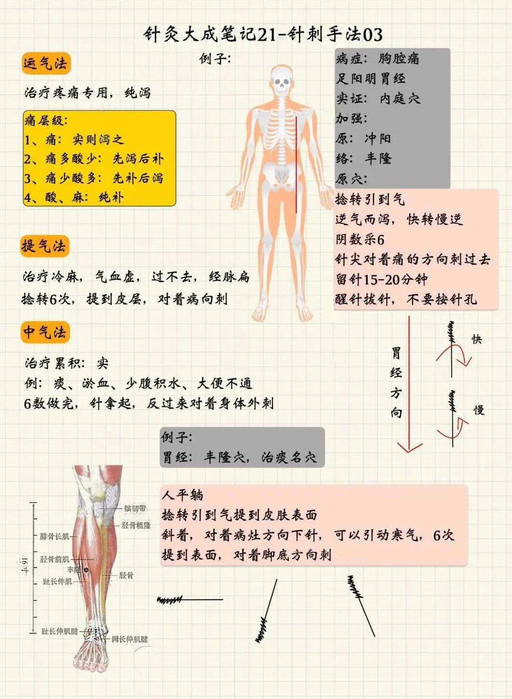

# 针刺手法：留气法、运气法、提气法、中气法

## 一、留气法（远取穴消痞块）

### 1. 适应症

良性痞块、硬块、脂肪瘤、子宫肌瘤、乳房硬块等**表面光滑**者；恶性肿瘤（粗糙坚硬）**禁用**。

### 2. 操作步骤（核心：九补 → 停顿 → 六泻）

**（1）引气**：在穴位（如足三里、上巨虚、梁丘）进针得气。

**（2）行阳数九（补）** ：**紧按慢提**，插提**9次**；可配合捻转，行气力量更强。

**（3）关键停顿：提针豆许，留针五分钟**：
- 9次补法做完后，**将针轻轻上提少许（“提豆许”）** ，**静候五分钟**，让补法鼓动起来的气有足够时间冲击、打散痞块。

**（4）行阴数六（泻）** ：在**同一穴位**行**紧提慢按** **6次**，将散开的浊气导出。
- **注意**：留气法**不用天人地分层**，在同一层面完成九次和六次，与烧山火的分层补法不同。

**（5）出针**：不按压针孔，让余邪自然外泄。

---

## 二、运气法（强泻止痛，按疼痛四层分级）

### 1. 疼痛的四层分级（决定是否用运气法、怎么用）

| 层级 | 表现 | 治法 |
|---|---|---|
| **第一层** | **纯痛，无酸** | 纯实症，**单纯泻法** |
| **第二层** | **痛多酸少** | 实中带虚，**先泻后补** |
| **第三层** | **痛少酸多** | 虚中带实，**先补后泻** |
| **第四层** | **酸麻全无痛** | 重症虚症，**纯补**；此时主力是提气法，而非运气法 |

> 运气法的核心靶点是**第一至第三层的疼痛**；到“酸麻无痛”这一层，应转向提气法。

### 2. 操作步骤

**（1）取穴**：根据疼痛经络取穴（如胃经痛取内庭、冲阳；乳房硬块属胃经取梁丘）。

**（2）引气**：左右捻转至酸麻感。

**（3）泻六数**：逆经捻转（快速逆气，缓慢回正），重复**6次**。

**（4）针尖导向痛点**：调整针尖方向**直接对准疼痛病灶**，留针**15—30分钟**。

**（5）出针**：**不立即按压针孔**，放任余邪外泄，片刻后再轻柔按揉。

### 3. 示例

左乳硬块（胃经）→ 针梁丘（郄穴），泻六数后针尖指向乳房，留针。

---

## 三、提气法（轻提聚气，治顽固冷麻）

### 1. 适应症

**顽固性冷、麻、又冰又麻**（虚症，表层经脉气血亏虚、经气运行无力）。

### 2. 取穴层级（先常规，不效再叠加）

- **第一步**：按病灶归属经络，先在**子穴或母穴**下针。
- **第二步**：若病痛仍在，再在**原穴或本穴**上叠加提气法来加强（如胆经冷麻取侠溪、临泣）。

### 3. 操作步骤

**（1）引气**：轻捻转至得气。

**（2）提气六数：轻提以聚气（实质不是一般意义的泻法）** ：
- **微拈轻提其针，使针下经络气聚**，轻轻做**6次**。
- 数序上虽为“阴数六”，但**操作的“轻”和目的“聚气”才是关键**，不能按祛邪泻法的力度来做。

**（3）针尖导向病所**：提针至皮层，调整方向**指向冷麻处**，留针。

> 提气法的“六”是轻提聚气，针对“经脉是扁的、里面没有东西”的虚症；与运气法祛实邪的“泻六”性质不同。

---

## 四、中气法（逆经泻积滞，引邪下行）

### 1. 适应症

**实证、积证**：痰积、瘀血、水饮、便秘等。

### 2. 操作步骤

**（1）取穴**：根据积滞部位取穴（如痰饮取丰隆，便秘取支沟、照海、上巨虚、天枢）。

**（2）引气**：捻转得气。

**（3）泻六数**：逆经捻转**6次**。

**（4）针尖逆向，引邪下行（核心方向）** ：
- 泻六后提针至皮下，**针尖朝向四肢末端（与病灶相反的方向）** ，**斜刺约1寸**，**使邪气下行**，而不是朝向病灶。
- 关键不只是“背对病灶”，而是**朝向四肢末端这个出口**。

### 3. 丰隆化痰的方向层次

- 先斜刺**45°**，针尖**朝向病灶方向**，引动痰气。
- 泻六后，提针至皮下，**转向下45°**，**逆着方向刺**，把痰引下来。
- 先“引”后“导”，两个方向不能省略。

---

## 五、核心对比

| 手法 | 适应症 | 核心数序与实质 | 针尖方向的关键 |
|---|---|---|---|
| **留气法** | 良性痞块 | 九补 → **提豆许停五分钟** → 六泻 | 远取，不强调转向 |
| **运气法** | 疼痛（第一至三层） | 泻六（强泻） | **对准痛点** |
| **提气法** | 顽固冷麻（虚） | 轻提六数，**聚气** | 对准**冷麻处** |
| **中气法** | 痰瘀水积（实） | 泻六 | **朝向四肢末端，引邪下行**（丰隆先引后导） |

---

## 六、临床要点

1. **辨证分界**：**纯痛/痛多酸少/痛少酸多** → 运气法；**酸麻无痛** → 提气法；**积滞** → 中气法。
2. **提气法的“六”不是泻实**：它是轻提聚气，针对虚症冷麻，力度要轻。
3. **中气法的出口**：针尖不朝向病灶，而朝向**四肢末端**，引邪下行；丰隆化痰有“先引痰、再导下”两步方向。
4. **留气法必须有停顿**：九补后**提豆许、停五分钟**，再做六泻。
5. **禁忌**：恶性肿瘤禁用留气法、烧针法。

---

> 作者: [Acuherb](https://acuherb.xyz/)  
> URL: https://acuherb.xyz/posts/zhenjiu-5-3-3/  

