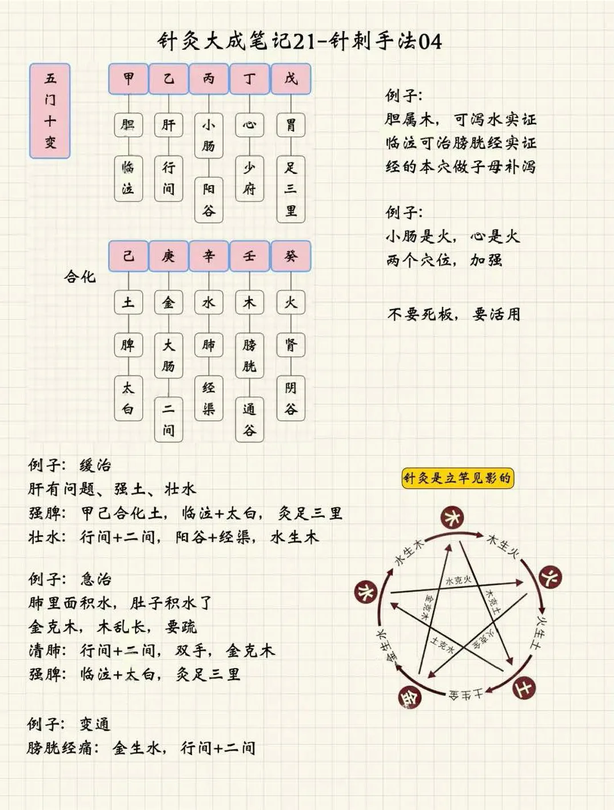

# 针刺手法：五门十变法

## 一、五门十变基础理论

### 1. 天干与五行配属（天干歌）

**歌诀**：甲胆乙肝丙小肠，丁心戊胃己脾乡，庚属大肠辛属肺，壬属膀胱癸肾脏。

- 甲（胆）→ 木，乙（肝）→ 木
- 丙（小肠）→ 火，丁（心）→ 火
- 戊（胃）→ 土，己（脾）→ 土
- 庚（大肠）→ 金，辛（肺）→ 金
- 壬（膀胱）→ 水，癸（肾）→ 水

### 2. 五门十变的核心：合化五行

- **“五门”** ：十天干隔五相合，甲与己合、乙与庚合、丙与辛合、丁与壬合、戊与癸合，又称 **“夫妻配合法”** 。
- **“十变”** ：两两相合后生成新的五行：

| 合化 | 配穴（两经本穴） | 所生五行 |
|---|---|---|
| **甲己合化土** | 胆经 **临泣** + 脾经 **太白** | 土 |
| **乙庚合化金** | 肝经 **行间** + 大肠经 **二间** | 金 |
| **丙辛合化水** | 小肠经 **阳谷** + 肺经 **经渠** | 水 |
| **丁壬合化木** | 心经 **少府** + 膀胱经 **通谷** | 木 |
| **戊癸合化火** | 胃经 **足三里** + 肾经 **阴谷** | 火 |

## 二、五门十变的两层用法

### 第一层：本穴治疗——本穴自带的五行属性直接做子母补泻

- **本穴**：与该经五行属性相同的穴道（如胆经属木，本穴临泣属木）。
- **核心逻辑**：**本穴本身的五行属性是什么，它就能对哪一行做补或泻**。临泣属木，木生火，所以临泣能治小肠经（火）的虚症；膀胱经属水，木是水的“子”，所以临泣也能泻膀胱经的实症。
- **不是** “母经的本穴补虚、子经的本穴泻实”这样一个再推一步的公式；直接记住“这个穴属什么五行，它就能生谁、泻谁”。
- **手法**：本穴治疗**不需复杂补泻**，下针后左右捻转引到气即可，飞经引气、苍龟探穴等都不必用。
- **加强层**：如果平补平泻引气后力量仍不够、要“打到内脏去”，可以再在本穴上叠加 **“青龙摆尾”** 一类飞经引气手法。平补平泻是本穴治疗的基本操作，但不是唯一操作。

### 第二层：双穴合化——两穴生成所需五行

- 两经本穴同时下针，合化出目标五行，再在这个五行上做补泻。
- 适用场景：**取穴受限**（如衣物不便、穴位不可及），或**需要跨经调五行**的复杂病机。

## 三、缓治与急治（合化五行的使用场景分界）

### 缓治：慢性、本脏病机，循序渐进

- **肝病缓治**：先**强土**（临泣 + 太白，甲己化土），再**壮水**（阳谷 + 经渠，丙辛化水），一层一层固本。
- 落点在“慢慢把五行环境调过来”，不追求一针截断。

### 急治：急症、积水、硬块胀满，先解决当下最急的水或结

- **肺积水/肝病合并积水**：木太密则疏木，**先强金制木以排水**（行间 + 二间，乙庚化金），左右共下四针。
- **同时强土**：急症时还要顾胃气，临泣 + 太白强土不可少。
- 落点是“先把水排掉、把结散开”，再回到缓治的框架。

> 如果只把“肝病强土”和“肺积水强金”并列，就看不出前者是缓治的起点、后者是急症的截断。**先辨缓急，再选合化**。

## 四、操作要点（含下针顺序的硬性要求）

### 1. 下针顺序：两穴要“一起下针”，不是先后下针

- **“一起”不是两根针同时扎入**，而是指**上下配穴的对侧同时操作**：例如二间 + 行间，**先下左手的二间，紧接着下左脚的行间**，让两根针**同时留在身上**；先扎行间再扎二间也可以，顺序不拘，但**不能扎完一个、隔一会儿再扎另一个**。
- 合化依赖两个本穴的五行属性**同时在气机层面发生“相合”**，分先后留针会破坏这个“同时性”。

### 2. 补泻手法：本穴治疗以平补平泻为主

- 下的是本穴，**不必刻意做烧山火、透天凉**，左右捻转引到气即可。
- 需要加强时，再叠加飞经引气手法。

### 3. 选穴

- 优先取肌肉较厚、操作方便的本穴；五门十变本身就是**取穴受限时的变通法**，不必舍近求远。

### 4. 边界：辨证不清时不要硬套

- 五门十变是“高阶变通”，**不是万能公式**。**五行生克与虚实判断不清楚时，硬套合化反而会乱**。先用八纲和脏腑辨证定方向，再用五门十变选穴。

## 五、核心总结

1. **两层结构**：本穴治疗（本穴自带五行直接做子母补泻）+ 双穴合化（两穴生成目标五行）。
2. **下针硬性要求**：两穴**同时留针**，不是先后下针。
3. **缓急分界**：缓治（肝病强土→壮水）与急治（肺积水先强金制木排水、同时强土）不是同一层用法，先辨缓急再选合化。
4. **手法**：本穴平补平泻引气即可；需要加强时叠加青龙摆尾。
5. **边界**：辨证不清时不硬套；五门十变是取穴受限和跨经调五行时的变通法。

---

> 作者: [Acuherb](https://acuherb.xyz/)  
> URL: https://acuherb.xyz/posts/zhenjiu-5-3-4/  

