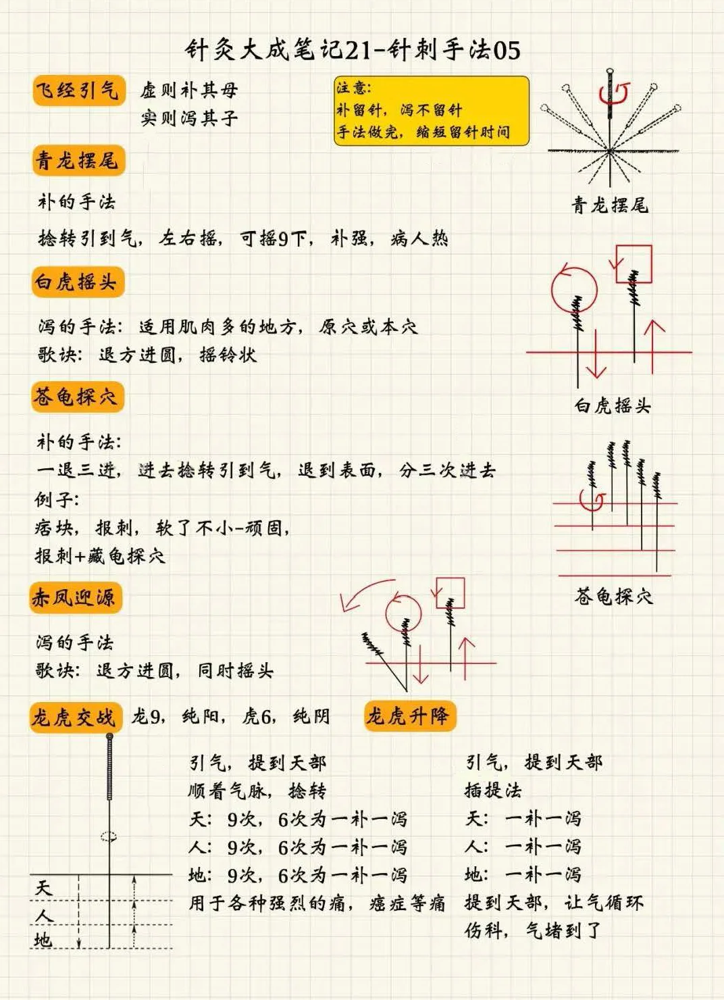

# 针刺手法：飞经引气、苍龟探穴、赤凤迎源、龙虎交战、龙虎升降

## 一、飞经引气四法（共同前提：不留针，做完即出）

> **四法都不留针，动作做完直接出针。** 补法做完拔针后按针孔，泻法做完不按针孔。
> **取穴原则**：四法都在**肌肉丰厚处的本穴、原穴**上做，不在手脚井荥俞原络合等皮肉浅薄的细穴上做。

### 1. 青龙摆尾（补法）

- **操作**：进针得气后，**不进不退，只左右轻轻摇动针柄**，常规摇**九次**（九为阳补数）。
- **体感**：补得越强，病人越热；摇针时用**细针**，减少肌肉牵拉痛。
- **应用**：**虚症**。本穴（如足三里）可替代不好下的母穴做补。

### 2. 白虎摇头（泻法）

- **核心口诀**：**退方进圆**。
- **操作**：得气后做提插摇动，**退针时方形慢慢退出，进针时圆形顺势进入**，形如**摇铃**。
- **取穴**：**肌肉丰厚处的本穴、原穴**，不在手脚末梢细穴上做。
- **应用**：**实症**、气滞壅堵。

### 3. 苍龟探穴（补法，消痞散结）

- **核心手法**：**一退三进**。
- **操作**：得气后，**先一次性将针退回皮肤表面**；再进针时**分三次逐层深刺**——**每一进之间要停、要候气**，不是连续快速扎到底。**可反复操作，反复进退探穴**，如龟入泥、无孔不入。
- **应用**：**硬块、痞块、久积凝滞**。硬块由硬变软即为见效，不必追求立刻消失。

### 4. 赤凤迎源（泻法，又名赤凤摇头）

- **操作**：同白虎摇头的**退方进圆**，但**在“退方进圆”正在进行的同时摇动针柄**——进圆的同时摇，退方的同时也在摇。
- **复杂度**：**比白虎摇头更复杂**，因为要在进退的同时完成摇针，不是“白虎摇头做完再加一个摇针动作”。
- **应用**：**实热、积滞**，通经泻邪。

---

## 二、龙虎交战（捻转镇痛，三部各九补六泻或一补一泻）

- **手法**：**捻转法**。
- **操作**：得气后，在天、人、地三部，**每一部先做九次补（右转），再做六次泻（左转）** 。
- **简化版**：门诊可用“**一个补完一个泻**”替代九和六——**每一部仍然是一个“补+泻”的完整单元**，只是把9和6压缩成1和1，不是随意做。
- **目的**：**镇痛**。头痛、牙痛、癌痛、外伤痛，强烈的痛都可使用；是**针灸麻醉**的核心手法。
- **与龙虎升降的区分**：龙虎交战**用捻转**，龙虎升降**用插提**。

---

## 三、龙虎升降（插提通关节，三部各一次插提）

- **手法**：**插提法**（与龙虎交战的捻转法相对）。
- **“三部”的含义**：在天、人、地**各做一次插提动作**，**不是**在每一部都做一套九补六泻的完整循环。
- **收尾**：气至、插提完成后，将针**提至天部，放在那里等**，让气在关节处持续循环。
- **目的**：**让气通过关节**。适用于**关节脱臼、骨头断了气过不去、风湿关节肿大**等“气机堵在关节”的情况。
- **使用时机**：**外科、伤科，气机严重堵塞时**。

---

## 四、核心对比

| 手法 | 补泻/属性 | 核心操作 | 主要应用 |
|---|---|---|---|
| **青龙摆尾** | 补 | 得气后左右摇针柄，摇九次 | 虚症（本穴替代母穴） |
| **白虎摇头** | 泻 | 退方进圆 + 摇铃状 | 实症气滞 |
| **苍龟探穴** | 补 | 一退三进，每进候气，可反复 | 痞块、硬结 |
| **赤凤迎源** | 泻 | 退方进圆 **同时** 摇针 | 实热积滞 |
| **龙虎交战** | 捻转 | 三部各九补六泻（或一补一泻） | **镇痛**、针灸麻醉 |
| **龙虎升降** | 插提 | 三部**各一次插提**，提至天部留气 | **通关节**（脱臼、风湿肿） |

---

## 五、临床要点

1. **飞经引气四法不留针**：动作做完直接出针，补按孔、泻不按孔。
2. **飞经引气四法取穴**：肌肉丰厚处的**本穴、原穴**，不在井荥俞等细穴上摇。
3. **苍龟探穴的关键在“候”和“反复”** ：每一进之间停一停，可反复进退。
4. **赤凤迎源的关键在“同时摇”** ：进退和摇针是同一动作的两个面，比白虎摇头复杂。
5. **龙虎交战 vs. 龙虎升降**：捻转止痛（交战） vs. 插提通关节（升降）；“三部”在交战是九补六泻，在升降是各一次插提。
6. **操作禁忌**：避免在血管、神经密集处强刺激。

---

> 作者: [Acuherb](https://acuherb.xyz/)  
> URL: https://acuherb.xyz/posts/zhenjiu-5-3-5/  

