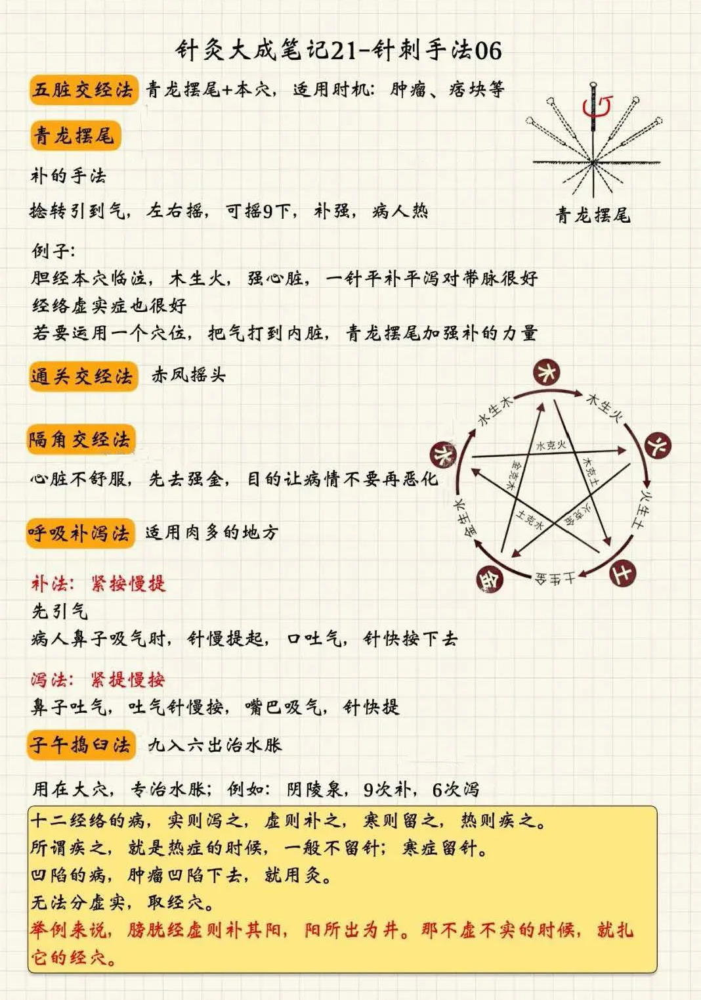

# 针刺手法：五脏交经法、通关交经法、膈角交经法、呼吸补泻法、子午捣臼法

## 一、五脏交经法（青龙摆尾于本穴）

**核心原理**：在本穴（与该经五行属性相同的穴道）上施以青龙摆尾，把气“打到内脏去”。平补平泻仅引到气还不够，需在本穴上**再用青龙摆尾加强补的力量**。

**操作**：
1. 取本穴（如胆经木穴足临泣、脾经土穴太白）。
2. 先平补平泻引气，再施青龙摆尾（左右轻摇针柄9次，意念引气至病所）。

**适应症**：
- **内脏虚证**：如小肠经虚证取胆经本穴临泣（木生火）。
- **深部痞块、硬块、积块在腹部**：如子宫肌瘤，针三阴交 + 青龙摆尾，在止痛的同时加强消瘤的力量。
- **取穴受限时的变通** ：当因为安全顾虑或环境不便（如大庭广众下不便脱衣），腹部、背部腧穴不可用时，在**四肢本穴**上用青龙摆尾，力量仍可到达内脏。这是五脏交经法“偶尔会用”的重要原因，不只是治痞块的专用法。

---

## 二、通关交经法（先青龙摆尾，后赤凤摇头）

**核心原理**：关节受伤、骨头断裂或脱臼后，气机不能通过关节；在常规取穴（常取对侧）效果不足时，用通关交经法加强气通过关节的力量。

**标准顺序（关键，不可省略）** ：
> **先用苍龙摆尾，后用赤凤摇头，运入关节之中，后以补则用补中手法，泻则用泻中手法。**
> ——通关交经的口诀是“苍龙摆尾，赤凤摇头，补泻得理”。

也就是说，**先做青龙摆尾（引气、补），再做赤凤摇头（泻法加强）**，赤凤摇头是“加强”的那一步，不是从头到尾只做赤凤摇头。

**操作**：
1. 取关节周围穴（如膝关治膝、曲池治肘）或对侧相应穴。
2. **先青龙摆尾**引气至关节。
3. **再赤凤摇头**（退方进圆，摇针如凤展翅），以泻法加强通关之力。

**适应症**：骨折后气滞、关节脱臼复位后功能障碍、风湿关节肿胀气机不通。

---

## 三、膈角交经法（五行相生，阻断传变）

**核心原理**：利用五行相生，**在病脏之外先强其所生之行**，使病情停止恶化。举例：**治心脏病时，一开始先治金（肺金），让金强起来，病就停止，不再恶化**，然后再慢慢做其他动作。

**操作**：
- 按五行相生选穴，**先强所生之行**。如心病先强肺金（金生水，水克火）。
- 补泻手法随虚实寒热：或先补后泻，或先泻后补。

**适应症**：重症传变控制（如心病先强金防恶化）、慢性病调理。

**注意**：“肝硬化先强土防传脾”的例子，方向属于治未病的传变截断思路，在膈角交经法下**最明确的示例是“心病先强金”**，引用时宜以这个原例为主。

---

## 四、呼吸补泻法（气机调控核心术）

**前提**：**必须先引气**，气不到，补泻无效。

| 要素 | 补法 | 泻法 |
|---|---|---|
| **呼吸配合** | **鼻吸口吐** | **鼻吐口吸** |
| **提插节奏** | **紧按慢提**（吸气时提针，吐完气后快速按入） | **紧提慢按**（吐气时提针，吸气时按入） |
| **出针处理** | 按压针孔 | **不按压针孔** |

**操作要点**：
- 补法：病人鼻吸口吐，**吸气时慢慢提针**，吐气时针不动，吐完气后**快速按入**；重复，使气“像打气一样充饱”。
- 泻法：病人鼻吐口吸，**吐气时慢慢提针**，吸气时按入，“跟气撞在一起”；起针后**不按针孔**。
- 适用部位：肌肉丰厚处、脏腑俞穴（中脘、章门、关元、中极、背俞穴等）。

---

## 五、子午捣臼法（九入六出，引动三焦退水）

**核心原理**：在治水要穴上**补泻兼施**，引动三焦之气（“三焦者，决渎之官，水道出焉”），使水泻出的力量增大。

**操作**：
- **取穴**：阴陵泉（主穴）、地机、三阴交；可配合水分、水道、关元、中极。
- **手法**：在1寸范围内**九入六出插提法**——**先紧按慢提9次（补），再紧提慢按6次（泻）**，可结合左右捻转。
- **效果**：水泻出的速度很快，**几乎下完针即欲排尿，病人常会要求提前起针去小便**，而不是“留针20分钟才排尿”。地机、三阴交可平补平泻，阴陵泉为大穴，宜重点操作。

---

> 作者: [Acuherb](https://acuherb.xyz/)  
> URL: https://acuherb.xyz/posts/zhenjiu-5-3-6/  

