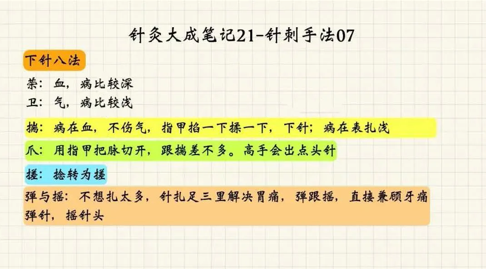

# 针刺手法：下针八法

## 一、揣法（以指甲揣穴，知深浅）

**操作**：
- 用指甲在穴位上**戳一戳、掐一掐、揉一揉**，不是用手随便摸一摸就下针。
- **病在卫（气分）** ：针下得浅，在皮肤与肌肉之间，不伤血。
- **病在荣（血分）** ：针下得深，扎到血脉旁边，不伤气。

**目的**：通过揣穴判断病在气分还是血分，决定下针的深浅，避免"治血而伤气"或"治气而伤血"。

## 二、爪法（拨开动脉，安全进针）

**操作**：
- 与揣法同用指甲，但爪法的核心是**把动脉拨开**。
- 扎太渊、经渠、列缺等动脉旁穴位时，用指甲**把血脉掐开一点**，针下在动脉后方，然后放开指甲，动脉贴回针身。

**"点头针"** ：针体随动脉搏动而颤动，是下针到位的一个标志。

## 三、搓法（左右捻转）

**操作**：
- 搓就是**左右捻转针体**，如搓线的样子。
- **不要转得太紧**。
- 补泻方向随迎随：大指往上为左（补），大指往下为右（泻），但倪师讲八法时对搓法本身未再展开复杂补泻，重点是"左右捻转"这个动作本身。

## 四、弹法（轻补）与五、摇法（轻泻）——两者共用同一前提

> **共同前提**：**引到气以后，先把针"退一点点"（退豆许），让气有一个停留的地方，然后才做弹或摇**。这个"退"不是补泻意义上的"提豆许"，目的是把气留在针下，给弹或摇一个可作用的"气层"。

### 弹法（补）

- **操作**：退豆许后，**用手指弹针柄**，"一直弹一直弹"，气就来了。
- **比喻**：像在池塘边拍水，鱼就聚过来——弹一弹针，气就来了。
- **定位**：**最浅的补法**，适用于不需要重补、但想在当前穴位上"兼顾"另一个症状的情况（如足三里治胃痛，同时弹针处理牙痛）。

### 摇法（泻）

- **操作**：退豆许后，**摇动针头，不是摇动针柄**，"想办法去摇动针头"。
- **定位**：**最浅的泻法**，与弹法相对。
- **注意**：摇法在八法中是"轻泻"，与"摇大针孔"的泻法在幅度上不同，不宜混为一谈。

## 六、扪法（补法出针闭孔）

**原文**：**"扪而闭之……凡补必扪而出之，故补欲出针时，就扪闭其穴，不令气出，使气血不泄，乃为真补。"** 

**操作**：**补法出针时，立即用手按压针孔**，不令气泄。
**与泻法的分界**：泻法出针**不闭其穴**，让邪气外泄。"扪"与"不扪"是补泻在出针环节的最后一道分界。

## 七、循法（泻法框架内散气血）

**原文**：**"凡泻针，必以手指于穴上四旁循之，使令气血宣散，方可下针，故出针时，不闭其穴，乃为真泻。"** 

**操作**：
- 在**下针之前**，用手指在穴位四周**循按**，使局部气血宣散。
- 与出针时不闭孔共同构成"真泻"。
- 一般针灸学中"气至迟缓时沿经循按以催气"的用法，是循法的延伸应用，但**八法口诀中"循"的原生定位首先是泻法框架内的操作**。

## 八、捻法（外捻令气上，内捻令气下）

**原文**：**"治上大指向外捻，治下大指向内捻。外捻者令气向上而治病，内捻者令气向下而治病。"** 

**操作核心**：
- 病在上，**大指向外捻**，令气**向上**。
- 病在下，**大指向内捻**，令气**向下**。
- 出针时，内捻令气行至病所，外捻令邪气至针下而出。

> **与迎随的区分**："循和捻就是迎随法"，是把捻法归入迎随的大范畴。但捻法的直接操作是**外捻/内捻决定气机上下**，不宜简单写成"逆经捻转=迎、顺经捻转=随"。迎随的核心是**针尖斜刺方向与经脉循行方向的关系**，捻转是另一个操作维度，两者不宜压成一组对应。

---

> 作者: [Acuherb](https://acuherb.xyz/)  
> URL: https://acuherb.xyz/posts/zhenjiu-5-3-7/  

