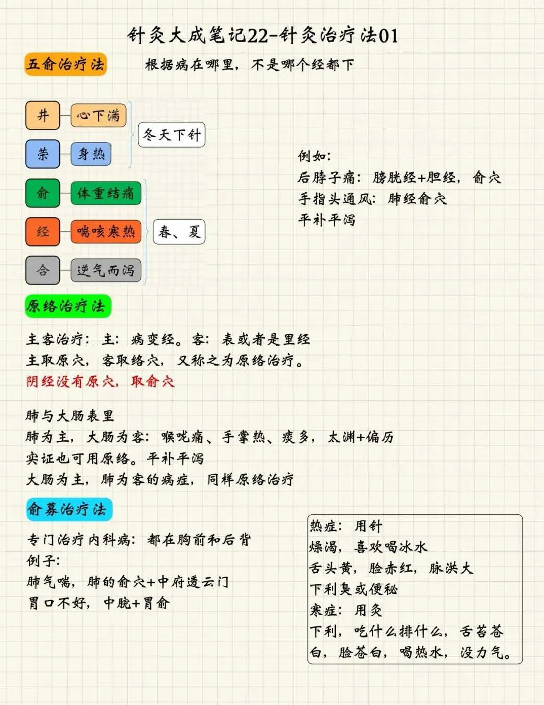
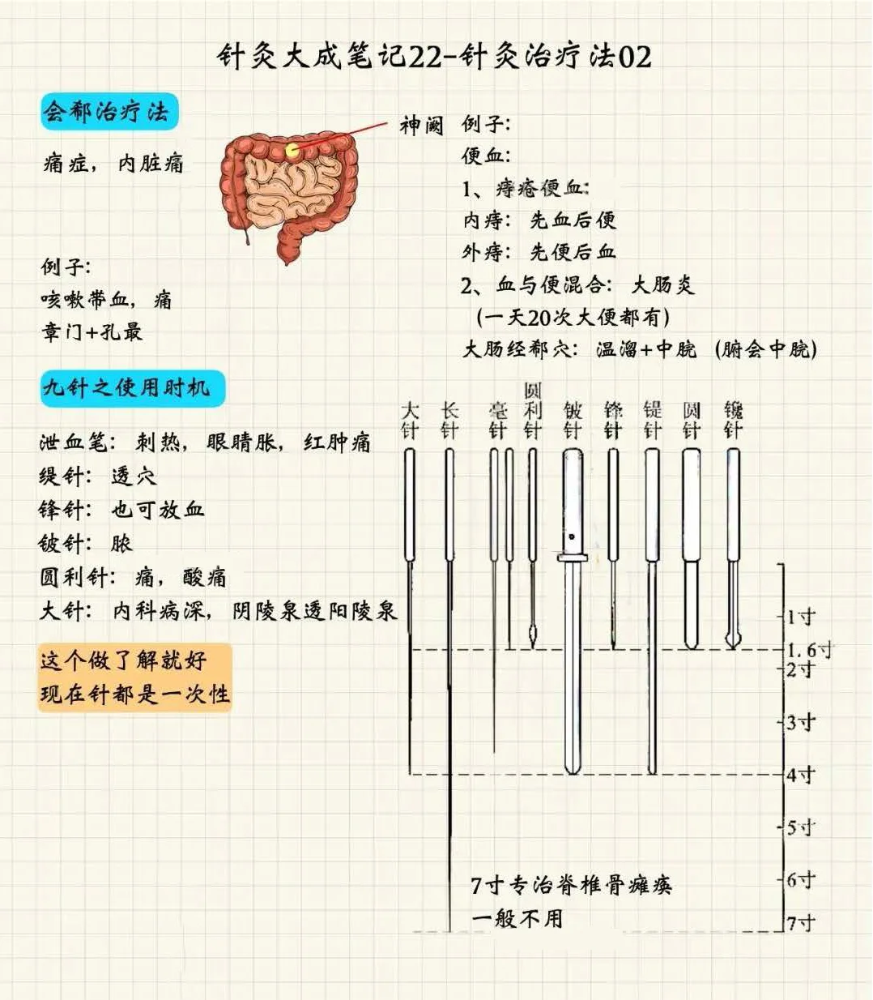

# 针灸治疗法：五俞治疗、原络治疗、俞募治疗、会郄治疗、九针疗法

### **一、五俞穴治疗法**
**核心理论**：  
五俞穴（井、荥、俞、经、合）对应五行与病症特性：  
- **井穴**（木）：主心下满（如乳房胀痛取胃经厉兑）  
- **荥穴**（火）：主身热（如高热刺肺经鱼际）  
- **俞穴**（土）：主体重节痛（如痛风取脾经太白）  
- **经穴**（金）：主喘咳寒热（如哮喘取肾经复溜）  
- **合穴**（水）：主逆气而泻（如呕吐取大肠经曲池）  

**季节取穴**（与[十二正经之井荣俞原经合穴](/posts/zhenjiu/zhenjiu-3-2/)一致，勿混"冬春/夏秋"两分法）：  
- **冬取井、春取荥、夏取俞、长夏取经、秋取合**  
- 冬气潜藏，取四肢末梢井、荥穴不易伤阳；秋合穴主味，归在秋  
- **案例**：膝关节炎（膀胱经俞穴束骨+胆经俞穴足临泣）  

**编者举例说明**：上列"乳房胀痛取厉兑""呕吐取曲池""痛风取太白""哮喘取复溜"为按穴性自配的示例，用于理解五条主治口诀，并非倪师原话，实际取穴仍需随证。  

**补母泻子（五俞穴的补泻落点）**：  
- **实则泻其子，虚则补其母**——按本经五行属性，取本经"子穴"泻实，取本经"母穴"补虚（如肝经属木，木之子为火对应的荥穴行间可泻实，木之母为水对应的合穴曲泉可补虚）。  
- 阴阳经五穴五行不同：**阴经井木→荥火→俞土→经金→合水**；**阳经井金→荥水→俞木→经火→合土**，定母子穴时必须先认经的阴阳。  
- 与"穴性主治"的区别：五条口诀（井主心下满等）是**按穴类定靶点**，补母泻子是**按五行定补泻方向**，两套思路常配合使用。  

---

### **二、原络治疗法（主客配穴）**
**配穴原则**：  
- **主穴（原）**：病变经的原穴；**阴经无独立原穴，以俞代原，一穴两用**  
  - 如肺病取太渊（既是肺经俞穴，又是代原穴）  
- **客穴（络）**：相表里经的络穴  
  - 如肺病配大肠经络穴偏历  
- **次序**：先取原（主）、再取络（客），原主本经、络通表里  

**临床应用**：  
- 内科病（如咳嗽配太渊+偏历）  
- 经络病（如肺经实痛不刺尺泽，改用原络配穴）  
- **诊断**：原穴按压反应可探本脏虚实，原穴麻木/塌陷/剧痛往往对应脏气偏衰  

---

### **三、俞募治疗法（背俞穴+腹募穴）**
**经典配穴**：  
| **脏腑** | **背俞穴** | **腹募穴**       | **适应症**              |  
|----------|------------|------------------|-------------------------|  
| 肺       | 肺俞       | 中府             | 肺气肿、哮喘            |  
| 胃       | 胃俞       | 中脘             | 胃溃疡、食欲不振        |  
| 肝       | 肝俞       | 期门             | 肝硬化、胁痛            |  

**操作注意**：  
- **热证**用针（口渴舌红），**寒证**用灸（畏寒便溏；隔姜灸、米粒灸更贴合寒证）  
- **前募后俞夹击病所**：背俞在督脉两侧浅刺，腹募在任脉一线可深刺，前后同取  
- 小儿仅直刺不留针  

---

### **四、会郄治疗法（急性痛症）**
**"会"——八会穴**（所会之病取相应会穴）：  

| **八会** | **会穴**   | **主治靶点**             |  
|----------|------------|--------------------------|  
| 脏会     | 章门       | 五脏病（如咳血）         |  
| 腑会     | 中脘       | 六腑病（如肠炎）         |  
| 气会     | 膻中       | 气病（胸闷、短气、气逆） |  
| 血会     | 膈俞       | 血病（瘀血、出血）       |  
| 筋会     | 阳陵泉     | 筋病（拘急、痉挛）       |  
| 脉会     | 太渊       | 脉病（脉虚、无脉）       |  
| 骨会     | 大杼       | 骨病（骨痛、骨痿）       |  
| 髓会     | 绝骨（悬钟）| 髓病（脑髓不足、颈项强） |  

> 歌诀：**"血会膈俞气膻中，脉会太渊筋阳陵，骨会大杼髓绝骨，脏会章门腑中脘。"**  

**穴位选择**：  
- **会穴**：取八会中对应者，治"所会"之病  
  - 脏会章门（如咳血刺章门+肺郄孔最）  
  - 腑会中脘（如肠炎刺中脘+大肠郄温溜）  
- **郄穴**：各经气血深聚处，主**急性、炎症、压痛**（如胃经郄穴梁丘治急性胃痛）  

**主从关系**：  
- **急症先郄**，痛剧、压痛明显处以郄穴为主；会穴按所会之病辅之  
- **郄会同用效果最佳**：一穴管病位所属（会），一穴管急性壅滞（郄）  

**典型病例**：  
- 痔疮便血：中脘（腑会）+ 温溜（大肠郄）  

---

### **五、九针疗法（器械选择）**
**九针分类与用途**（依《灵枢·九针论》，非"火针"之类可混入）：  

| **针型** | **形制（长/状）**         | **主要用途**                  |  
|----------|---------------------------|-----------------------------|  
| 镵针     | 头大末锐，寸六            | 浅刺泻阳、头身热            |  
| 圆针     | 身圆末卵，寸六            | 按摩分肉、治分间气          |  
| 鍉针     | 尖如黍粟，三寸半          | 按脉取气、令邪外出          |  
| 锋针     | 身筩锋末，寸六            | 刺络放血、泻热治痼病        |  
| 铍针     | 如剑锋，广二分半，四寸    | 切开排脓、治大痈脓          |  
| 圆利针   | 末大身小，寸六            | 深刺暴痹、痈痹              |  
| 毫针     | 细如蚊虻喙，寸六          | 微刺久留、络中寒热痛痹      |  
| 长针     | 长七寸                    | 取深邪远痹                  |  
| 大针     | 锋微圆，四寸              | 通利关节、取大气滞关节      |  

**现代延伸（不属于九针）**：  
- **火针（钨钢烧针）**：烧红后速刺即出，用于脂肪瘤、痞块（三针法），属后世发展，与《灵枢》九针体系分开看待。  
- **现代等效**：锋针≈三棱针/一次性放血针；铍针≈手术刀片；毫针≈0.25mm×25mm细针；圆利针≈0.30mm×40mm不锈钢针。  

**临床提示**：  
- 透穴法（如阴陵泉透阳陵泉、太溪透昆仑）前提是**针长足够、方向沿经、得气后透达对侧穴下**，并非以"肌肉饱满"选病人。  
- 放血优先选三棱针（四肢血郄如委中、尺泽）或采血笔（头面浅刺）；**血出而止，勿过量**，面部尤须细针浅刺。  

---

### **治疗策略对比表**
| **方法**       | **最佳适应症**       | **补泻特点**          | **禁忌/注意**         |  
|----------------|----------------------|-----------------------|-----------------------|  
| 五俞穴         | 经络特异性症状      | 以穴性定靶点，配合补母泻子 | 井穴放血勿过量      |  
| 原络配穴       | 慢性内脏病/表里相传 | 平补平泻，先原后络    | 原穴处皮肤破损避针  |  
| 俞募治疗       | 脏腑功能失调        | 热证针/寒证灸（隔姜、米粒灸） | 背部感染避用  |  
| 会郄治疗       | 急性炎症/剧痛       | 强刺激泻法            | 虚证慎用              |  
| 九针疗法       | 外科/痛症           | 以刺法（放血/切开/烧针）定性质，非捻转补泻 | 凝血障碍禁用放血 |  

> **《针灸大成》精华**：  
> - "五俞穴性为根，原络俞募为干，会郄九针为枝"——先辨病位（经/脏/腑），再选治法。  
> - 现代简化：毫针+三棱针可解决80%临床问题，特殊病例（如肿瘤）再结合火针。  

**辨证选法（先定病位，再定方法）**：  
- **病位在经、表里相传** → 原络（原主本经，络通表里）  
- **病在脏腑、久病功能失调** → 俞募（前募后俞）  
- **急性痛症、剧痛压痛** → 会郄（急症先郄，郄会同用）  
- **按穴性靶点对症**（心下满/热/节痛/喘咳/逆气） → 五俞  
- **需外科处置（瘤、脓、痞块）** → 九针/火针  
- 同一病可**两法叠加**，如久病胃痛急性发作：俞募（胃俞+中脘）配郄穴（梁丘）。  

**临床心法**：  
1. **急症先郄会**（如胆绞痛取中脘+外丘）  
2. **慢性调俞募**（如糖尿病灸脾俞+章门）  
3. **痛症透九针**（如坐骨神经痛用圆利针深刺环跳）

---

> 作者: [Acuherb](https://acuherb.xyz/)  
> URL: https://acuherb.xyz/posts/zhenjiu-5-4/  

