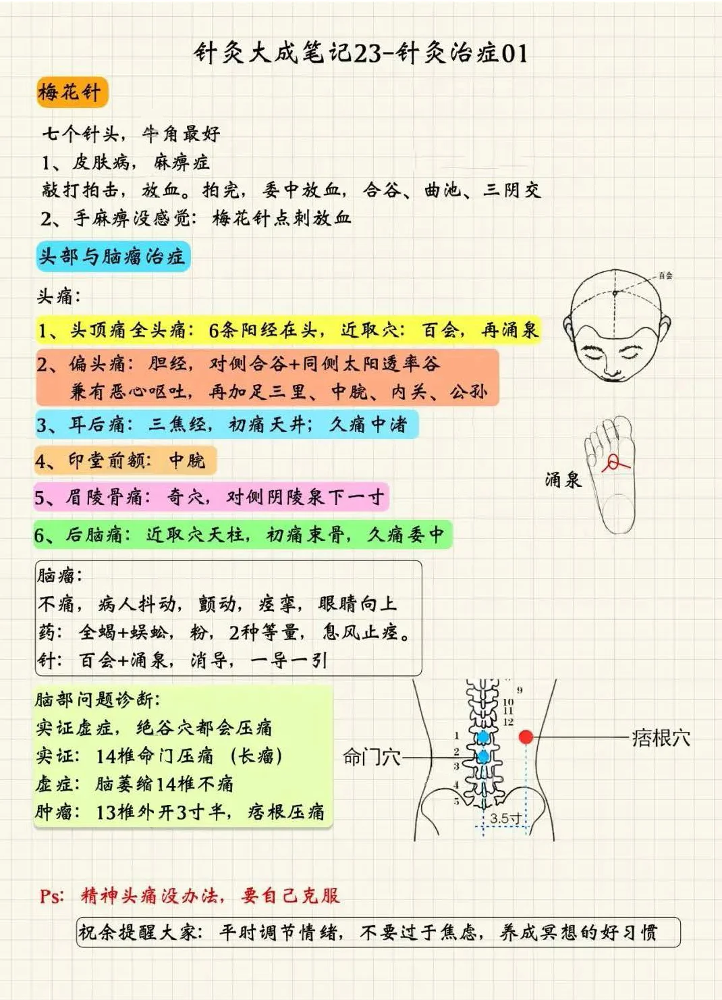

# 针灸治症：梅花针、头部与脑瘤治症

### **一、梅花针的临床应用**  
1. **适用范围**  
   - **皮肤病**：如皮肤癣，需配合委中放血及针刺合谷、曲池、三阴交、血海、筑宾等穴。  
   - **麻痹症**（肢体感觉丧失）：通过梅花针放血活血，刺激浅表不伤元气。  

2. **操作要点**  
   - 针具选择：牛角制梅花针（优于钢针，减轻疼痛）。  
   - 手法：拍击需稍重，确保出血（轻拍无效）。  

3. **完整操作流程（以皮肤癣为例）**  
   - 梅花针拍击患处出血 → **委中放血** → 针刺，三段配合，非单用一法。  
   - **分部配穴**：上半身皮肤病取**曲池、合谷**（清阳明热）；下半身取**三阴交、血海、筑宾**（利湿凉血）。  
   - 提示：面部、体虚者不宜重叩，从患处周围向中心叩。  

---  

### **二、头部治症：头痛分类与针灸取穴**  
> **总则**：初痛多实、当泻其子（如束骨）；久病多虚、当补其母（如委中借"补井当补合"）；以此为各部位初痛/久痛取穴的依据。  

1. **全头痛**  
   - **取穴**：百会（近取穴）→ 无效时加涌泉，可迅速缓解疼痛，兼治头顶撞击伤。  

2. **偏头痛**（胆经循行）  
   - **取穴**：  
     - 对侧合谷（左痛针右，右痛针左）。  
     - 同侧太阳透率谷。  
   - **伴恶心呕吐**：加中脘、内关、足三里、公孙（公孙配内关，通胃心胸）。  

3. **耳后痛**（三焦经）  
   - 初痛：天井；久痛：中渚。  

4. **前额痛**（印堂附近）  
   - **取穴**：中脘（针感酸胀即效）。  
   - **辨经依据**：印堂属阳明，为胃热上冲，故循经远取胃募中脘。  

5. **眉棱骨痛**  
   - **取穴**：对侧阴陵泉下1寸（眉棱点，经外奇穴）。  

6. **后脑痛/颈项痛**（膀胱经）  
   - **取穴**：  
     - 近取天柱；  
     - 初痛：束骨（输穴，子穴泻实）；久痛：委中（合穴，按"补井当补合"代母穴补法）。  

---  

### **三、脑瘤相关治症**  
1. **症状特点**  
   - 可能无痛，但见全身抖动、眼球上翻。  

2. **治疗策略**  
   - **中药**：全蝎+蜈蚣等量打粉（息风止痉）。  
   - **针灸**：  
     - **百会+涌泉**：导引法——**百会宣泻头部邪气，涌泉引邪下行**（以下行为导，先针百会、再针涌泉，将病气从上部引下）。  
     - **诊断穴**：  
       - **绝骨穴**（悬钟）压痛→提示脑萎缩或脑瘤；  
       - **命门穴压痛**→脑瘤（实症）；无压痛→脑萎缩（虚症）；  
       - **痞根穴**（第13-14椎之间、旁开3.5寸上下，**以压痛点为穴**）压痛→肿瘤根结。  

3. **关键区别**  
   - 脑瘤（实症）：命门、痞根压痛；  
   - 脑萎缩（虚症）：仅绝骨压痛。  

---  

### **四、总结**  
- 针灸治症需精准辨经取穴，头痛按部位分治，脑瘤需结合穴位诊断与导引法。  
- 精神性头痛需心理调节，生理性头痛均可通过针灸缓解。  
- 梅花针适用于浅表病症（皮肤病、麻痹），操作需注意力度与工具选择。

---

> 作者: [Acuherb](https://acuherb.xyz/)  
> URL: https://acuherb.xyz/posts/zhenjiu-6-1/  

