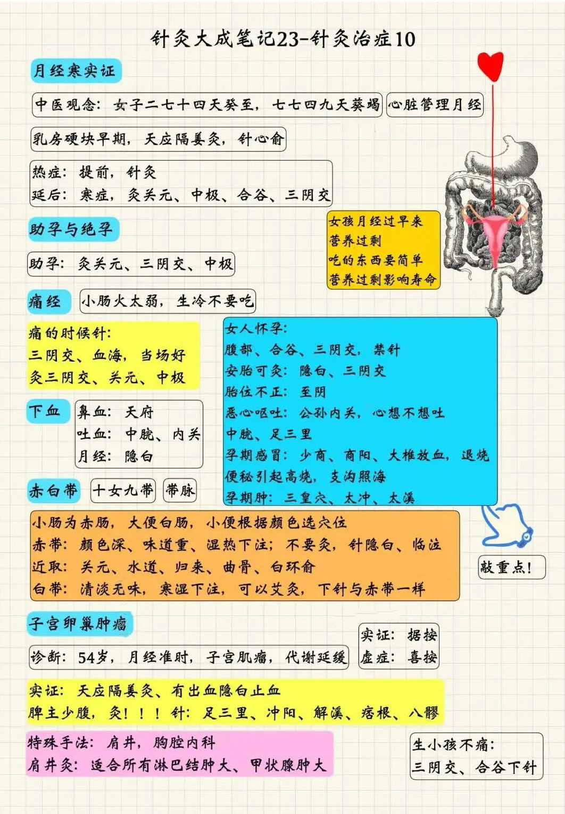

# 针灸治症：妇科疾病与孕产调理

## **一、痛经与月经下血不止**

### **1. 痛经：痛时下针，三阴交要找脾经上的痛点**

- **下针时机**：**痛的时候下手**。三阴交、血海一下去，往往一两分钟内痛就去掉。不痛时下针，效果远不如痛时。
- **三阴交的取穴**：不要死守“内踝上三寸”这个固定点。沿**脾经**从内踝往上推，**找到最痛的点**下针，才是有效的三阴交。扎到“二阴交”（偏离脾经）效果就差了。
- **配伍**：三阴交一下去若还剩一点痛，加**血海**。寒象明显者，可灸**关元、中极**，热气进入，寒散痛止。
- **核心认识**：痛经多属**寒凝血瘀**。正常女子小腹之内应是温热的，这股热来自小肠。小肠火衰，下焦寒生，血遇寒则凝，凝则痛。灸关元、中极的意义在于**温小肠、复胞宫之热**，而不只是“暖宫”一个笼统说法。

### **2. 月经下血不止：隐白双侧留针**

- **取穴**：**隐白**（脾经井穴，大趾内侧甲角旁）。
- **操作**：**双侧下针，留针二十分钟**。血往往在留针过程中慢慢止住，有的当天止，有的隔天止。
- **定位**：隐白是妇科止血的大穴，月经淋漓不止、产后大出血均以它为第一选择。若隐白不可用，再考虑太白、商丘一类脾经穴。

---

## **二、赤白带下：寒热决定灸与不灸**

赤带与白带的根本区别不在“颜色”，而在**寒热**；寒热决定灸法能不能上。

| | **赤带** | **白带** |
|---|---|---|
| **性质** | **湿热**下注 | **寒湿**下注 |
| **特点** | 色深褐，味道重 | 色清淡，无明显臭味 |
| **灸法** | **不灸，只下针** | **可以加灸** |

- **共同取穴**：**隐白**（既止月经不止，又治白带，是带下病的核心穴）、**足临泣**（通带脉）、**三阴交、血海**。
- **近取**：水道、归来、曲骨，在少腹局部近取。
- **背部**：**白环俞**，治肠风下血与白带的名穴。
- **治法逻辑**：**把寒或热去掉之后，湿才有出路**。赤带湿热，针以清利；白带寒湿，针以祛湿、灸以散寒。只去“炎”不去“湿”，问题会反复。
- **脾主少腹**：少腹的湿归脾管，阴陵泉、地机、三阴交均可随证选用。

---

## **三、子宫 / 卵巢肿瘤：本质是瘀血浊物，灸法是主线**

### **1. 病机认识**

子宫、卵巢的“肿瘤”，剖开来看，**很多不过是一包瘀血，或未能排净的浊物**。小肠之热不足，下焦寒凝，血行不畅，瘀血浊物留滞胞宫，身体无法化解，便生成包膜将其裹住。因此治疗方向不是“攻瘤”，而是**温通、化瘀、给浊物以出路**。

### **2. 治疗次序：先止痛，再消积**

- **止痛**：腹痛、经痛与肿瘤并见时，**先下三阴交、血海**，把痛去掉。
- **消积主线**：**天应穴（肿块对应体表位置）隔姜灸**。寒证者，灸硬块局部可温化寒邪、消散瘀结。这是子宫卵巢肿瘤针灸处理的核心动作，不是可选项。
- **异常出血**：**隐白**止血。
- **辅助**：**痞根穴**（第十三椎旁开三寸半）、**八髎穴**（妇科要穴，按压找痛点）可配合使用。

### **3. 判断线索**

- **更年期后月经仍规律**，提示代谢异常，需考虑肿瘤可能。
- 少腹**硬块拒按为实，喜按为虚**；三阴交压痛也随虚实不同。
- **脚的温度**：双脚常年冰冷，提示小肠火衰、下焦阴寒，是妇科肿瘤形成的土壤。**保证小腹温热**，是预防层面的根本。

---

## **四、孕产期调理**

### **1. 安胎与禁忌：记住“血旺气衰”，不必死背补泻**

- **安胎的核心观念**：胎儿在腹中**靠母血滋养，不靠气呼吸**。**血旺气衰**为安胎，**气旺血衰**为堕胎。
- **合谷与三阴交**：**合谷是气穴，三阴交是血穴**。
  - **泻合谷、补三阴交** → 气衰血旺 → **安胎**。
  - **补合谷、泻三阴交** → 气旺血衰 → **堕胎**。
- **操作上的稳妥做法**：补泻手法不熟时，**孕妇干脆不针合谷、三阴交**，腹部穴位也不针。安胎可用**灸法**替代：**灸三阴交、隐白**，脾统血，灸血穴则血旺。
- **情志因素**：孕妇原本血旺气衰，若因生气、婆媳不和等情志刺激转为气旺血衰，有落胎风险。情志调摄本身就是安胎的一部分。

### **2. 胎位不正：至阴一针，隔天转正**

- **取穴**：**至阴**（膀胱经井穴，小趾外侧甲角旁）。
- **操作**：**针一下去，隔天胎位就正了**。这是至阴穴最特殊的治症。不便针刺时，温和灸至阴也可作为替代，以局部温热为度。
- **原理**：膀胱经与子宫相邻，至阴作为井穴，能引气下行、调整胞宫气机，使胎位回归。

### **3. 妊娠呕吐：公孙内关，配一个“意念”**

- **主穴**：**公孙 + 内关**。内关络心包，“心主心意”，下针时让病人心里想着 **“我不想吐”** ，不要想“我好想吐”——意念方向反了，内关可能吐得更快。
- **配穴**：**中脘、足三里**亦可止呕。

### **4. 妊娠便秘与水肿：不动腹部，远端取穴**

- **便秘**：**支沟 + 照海**。孕妇腹部不针，支沟照海从三焦与肾经远端通便，不扰动胎儿。
- **水肿**：**三皇穴（阴陵泉、地机、三阴交）+ 太溪**，可加**太冲、水泉**。针下后水湿即从小便排出，不需用利水药。

### **5. 产后急救：胎盘滞留与血崩**

- **胎盘滞留**：针**昆仑、太溪**，促胎盘排出。可配天应、中极、关元。古人蹲位分娩，胎盘自然而下；现代仰卧位不利于排出，这是体位层面的背景因素，不是针法能替代的，但可作为理解“为什么需要促排”的线索。
- **产后大出血**：**隐白**为首选，妇科止血大穴。隐白不可用时，再考虑太白、商丘。

---

## **五、核心操作速查**

| 病证 | 关键操作 | 判断/禁忌 |
|---|---|---|
| **痛经** | **痛时**下三阴交（沿脾经找痛点）、血海；灸关元、中极 | 不痛时下针效果差；扎偏“二阴交”无效 |
| **月经下血不止** | **隐白双侧，留针20分钟** | 当天或隔天止血 |
| **赤带（湿热）** | 针隐白、足临泣、三阴交、血海 | **不灸** |
| **白带（寒湿）** | 同上，**可加灸**；白环俞 | 寒湿可灸，湿热忌灸 |
| **子宫/卵巢肿瘤** | **天应隔姜灸**为主线；先三阴交、血海止痛；隐白止异常出血；痞根、八髎辅助 | 本质多为瘀血浊物；脚冷提示下焦寒 |
| **安胎** | **泻合谷、补三阴交**；手法不熟则不针，改**灸三阴交、隐白** | 观念是**血旺气衰**；孕妇腹部禁针 |
| **胎位不正** | **针至阴**，隔天转正；或温和灸 | 小趾外侧甲角旁 |
| **妊娠呕吐** | 公孙、内关 + **“我不想吐”意念**；中脘、足三里 | 意念方向不可反 |
| **妊娠便秘** | **支沟、照海** | 腹部不针 |
| **妊娠水肿** | **三皇 + 太溪**（可加太冲、水泉） | 远端取穴，不动腹部 |
| **胎盘滞留** | **昆仑、太溪**；可配中极、关元 | 产后使用，非孕期常规 |
| **产后大出血** | **隐白**首选；备用太白、商丘 | 妇科止血大穴 |

**注**：
- 妇科病“脾主少腹”，三阴交、隐白、阴陵泉、地机构成脾经调治少腹的主线；同时“小肠之热温胞宫”，脚冷、小腹凉是寒凝瘀滞的重要线索，灸关元、中极的意义在于复小肠之火。
- 孕产期针刺有明确禁忌：**腹部穴位不针，合谷、三阴交孕妇禁针**。安胎优先用灸法或远端取穴；胎位不正、胎盘滞留等操作须在具备产科条件的场景下进行，针灸作为协同手段，不能替代必要的产科评估与急救。

---

> 作者: [Acuherb](https://acuherb.xyz/)  
> URL: https://acuherb.xyz/posts/zhenjiu-6-10/  

