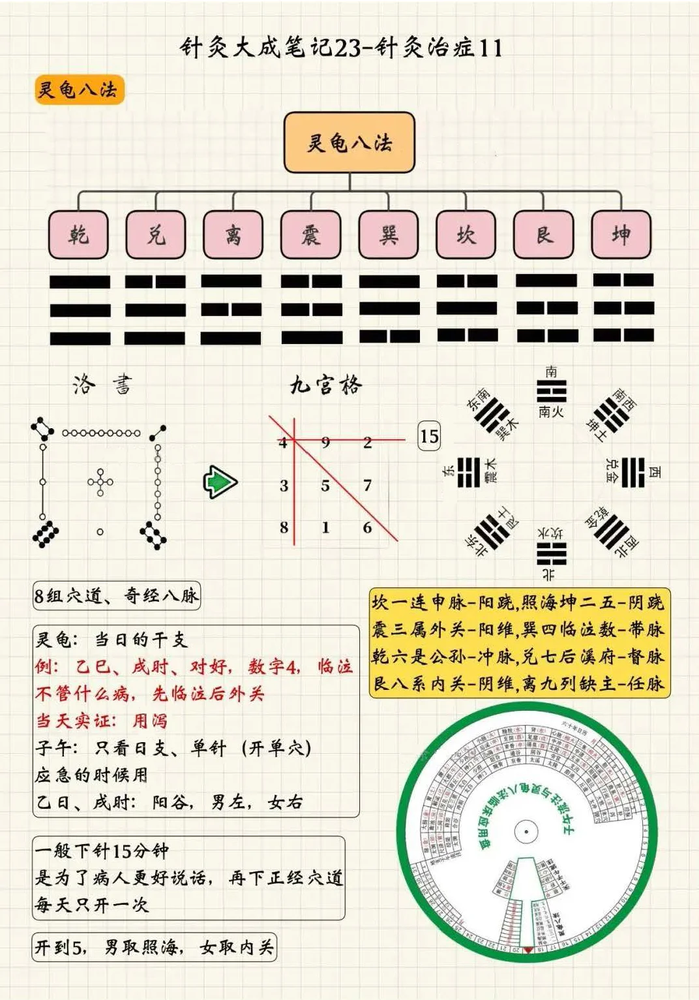

# 灵龟八法与子午流注临床应用

### **一、核心理论**

**1. 灵龟八法**

基于后天八卦与洛书九宫数理，通过奇经八脉的8个关键穴位调节人体气血平衡。八穴分为四组配对：

- **公孙 — 内关**
- **临泣 — 外关**
- **后溪 — 申脉**
- **列缺 — 照海**

操作核心是根据当日干支与时辰，通过八法盘确定开穴，**先开主穴，再配对穴**。

**2. 子午流注**

以十二经脉对应十二时辰，按时开取**单穴**。与灵龟八法不同，子午流注只下一针，不配对穴。

---

### **二、操作规则**

**1. 灵龟八法：数字5的男女分取**

八法盘上数字1—9各对应穴位，唯**数字5需分男女**：**男取照海，女取内关**。其余数字（1、2、3、4、6、7、8、9）男女相同，不需区分。

**2. 子午流注：男左女右**

子午流注开单穴时，取穴的左右规则是**男取左侧，女取右侧**。以乙巳日戌时为例，开**阳谷**：**男人扎左边，女人扎右边**。

**3. 取穴要取准，不能“差不多”**

子午流注开阳谷，就要扎到阳谷，**不能扎到腕骨、阴谷**。开穴的穴位是按时辰推算出来的特定点，扎偏了，单穴的效力就打了折扣。

**4. 八法先主后配，不是随便下两针**

灵龟八法开出的是一组配对穴。**开临泣，就先针临泣，再针外关**；开列缺，就先列缺、再照海。顺序有先后，主穴先立，配穴随后。

---

### **三、临床应用**

**1. 使用时机：急救急诊优先，不可取代正经辨证**

灵龟八法与子午流注最合适的场景是**急救、急诊**——病人喘得厉害、痛得厉害，按正经慢慢辨经络来不及，先按时开穴把症状缓下来。**平常也可以用，但不能学了八法就把正经取穴全丢了**。

单针有效，但**一个有效、十个来诊、九个没效**，因为原本可以救回来的病人被“只用一针”耽误了。**单穴可以用，不能依赖**。

**2. 留针：按新病、久病、重症分层**

| 病情 | 留针时间 |
|---|---|
| **新病、初病** | **三、五分钟**即可起针 |
| **久病** | **二十分钟**为基本 |
| **重症（中风、半身不遂等）** | 可留**一小时至二小时**，每隔十分钟运针（做补泻） |

八法常规操作是**留针十分钟到十五分钟，起针后再下正经穴**。但“十五分钟”是常规起步，不是上限；久病与重症要按上表拉长。

**3. 一天只开一次，重复无效**

同一个病人，当天按八法开过一次穴，**再开效果就没了**。八法是借这个时辰的气血窗口用一次，不是反复叠加的手段。

**4. 示例：哮喘发作**

病人喘得厉害，按时开穴是**列缺配照海**。列缺照海与气喘没有直接经络对应关系，但**针先下去，喘就缓了**，病人感到舒服。留针十五到二十分钟，起针后，**再按正经取穴治喘**（膻中、肺俞等）。八法在这里的角色是“先解燃眉”，不是取代治本。

---

### **四、与正经取穴的协同**

| | **灵龟八法 / 子午流注** | **正经取穴** |
|---|---|---|
| **定位** | 调奇经八脉、借时辰开穴 | 针对具体病经、具体脏腑 |
| **角色** | 急救、缓症、开路 | 治本、辨证论治的主体 |
| **关系** | **翅膀，不是主干** | **主流，不可丢** |

灵龟八法调的是奇经八脉层面的平衡，适合全身性失衡或急症开路的场景；正经取穴才是按经络脏腑辨证的主体。**八法为翼，辨证为体**，本末不能倒置。

---

### **五、禁忌与误区**

**1. 化疗患者：阴阳分隔，力透不进去**

化疗一上，**阴阳分隔**——上面热、下面冷，气血不相交通。这时候处方、下针、艾灸，**病人不受针力、药力**，治疗要“穿过化疗这一层”才能进去，困扰倍增。这是化疗期间八法与正经针灸效果都受限的机理。

**2. 最大的误区：把八法当“万能钥匙”**

学了灵龟八法之后，什么病都用八法、什么时辰都只扎那一针，正常的经络辨证全忘了——这是明确的偏路。八法是特殊疗法，不是主流替代品。

---

### **六、工具与操作速查**

- **八法盘**：正面灵龟八法，背面子午流注，对齐当日干支与时辰即可读出开穴，不需手算复杂过程。
- **黄历 / 万年历**：必备，用于查当日干支。
- **取穴精度**：开阳谷就取阳谷，不取腕骨、阴谷。
- **顺序**：八法先主穴后配穴；子午流注只取单穴。
- **留针**：新病短、久病二十分钟、重症可延长并定时运针。
- **频次**：八法每日一次，重复无效。

---

### **总结**

灵龟八法与子午流注是针灸体系中的时空疗法，核心原则可以压成四条：

1. **急症先用八法开路，再回正经治本。**
2. **子午流注单穴、男左女右，取穴要准。**
3. **八法数字5男取照海、女取内关，先主后配。**
4. **单穴可应急，不可依赖；八法是翅膀，辨证是主体。**

**口诀**：
> 八法调奇经，子午取单穴；  
> 急时先开路，久病需协同。

---

> 作者: [Acuherb](https://acuherb.xyz/)  
> URL: https://acuherb.xyz/posts/zhenjiu-6-11/  

