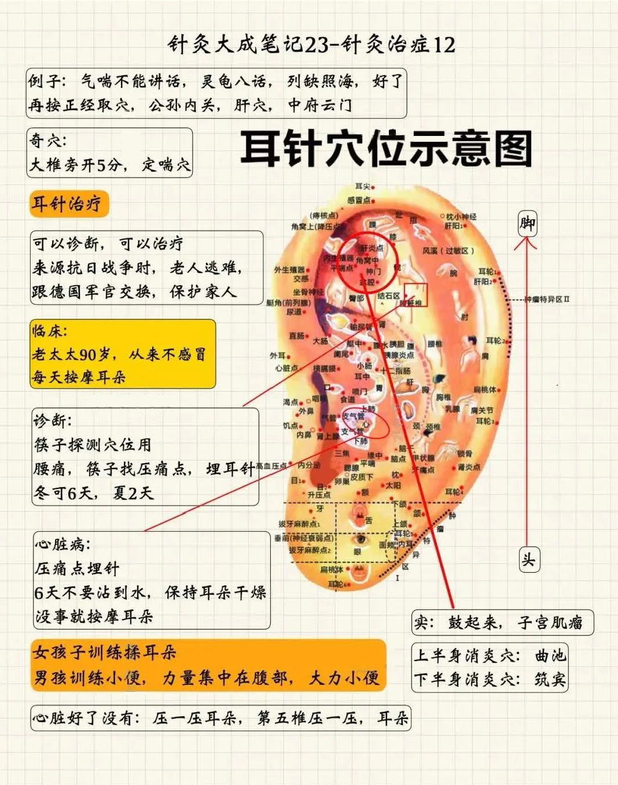

# 耳针与奇穴临床应用

### **一、耳针系统概述**

**1. 理论基础：耳是倒置的胎儿**

耳朵的形态是一个**倒置的投影**，与人体各部位一一对应：

| 耳部区域 | 对应人体 |
|---|---|
| **耳垂** | 头面 |
| **耳轮** | 脊柱（从上到下依次对应颈、胸、腰、骶） |
| **三角窝** | 盆腔脏器（子宫、卵巢等） |
| **耳甲艇下部** | 肾、膀胱 |
| **耳屏正中** | 心 |

**2. 肾主耳，不是“肾开窍于耳”**

中医讲“肾主耳”，耳是肾气的外在显现。**肾虚的人，耳部受伤后不易收口**，容易溃烂、反复感染。因此耳针操作前要先看耳部皮肤状态，肾虚者埋针需格外注意消毒与留针时长。

**3. 核心功能：诊断、治疗、预防三合一**

- **诊断**：按压耳部反射区，以**压痛**定位病灶；**凸起多实，凹陷多虚**。
- **治疗**：在对应反射区的痛点埋针，持续刺激。
- **预防**：日常揉耳至发红发热，促进全身气血循环。

---

### **二、耳针操作规范**

**1. 取穴：以阿是穴为准，不按图索骥**

耳针取穴的核心不是“看图找区”，而是**用圆头探针或筷子钝头按压**，在对应区域内找**最痛的那个点**。病人会明确指出来“啊，是这里”，这个点才是下针或埋针的位置。

常见反射区作为寻找方向：

- **心区**：耳屏正中。
- **肾 / 膀胱区**：耳甲艇下部。
- **子宫区**：三角窝。
- **醒酒穴**：耳垂穿耳洞处。**女性取传统穿洞位置，男性旁开约2mm**。

**2. 埋针：图钉式耳针，留针按季节分长短**

- **消毒**：酒精棉球擦拭耳廓，待干后再埋。
- **针具**：图钉式微型揿针，贴压于痛点，胶布固定。
- **留针**：**夏季4—5天，冬季6—8天**。夏季出汗多、易感染，留针短；冬季干燥、感染风险低，可留长一些。留针期间保持耳部干燥。
- **起效速度**：坐骨神经痛埋针后疼痛可即刻减轻；心脏病患者在心区埋针期间，心绞痛发作频率下降。

**3. 放血：醒酒穴与耳部感染**

- **醒酒**：耳垂醒酒穴点刺放血，挤出**两滴**即可。已打耳洞者，在耳洞旁开1—2mm处点刺，避开疤痕组织。
- **耳部感染化脓**：三棱针点刺排脓，配合**曲池**（上半身消炎）与**筑宾**（下半身消炎）针刺。

---

### **三、经典应用场景**

**1. 急症处理**

- **酒醉**：耳垂醒酒穴放血两滴，是耳针最直接的急症用法之一。
- **心绞痛**：**心区埋针 + 体针内关、巨阙**。耳针管“即时缓痛”，体针管“调心通脉”，两者协同，不是二选一。

**2. 慢性病管理**

- **肾结石**：耳部**肾 / 膀胱区**找痛点埋针；同时在小腿内侧**太溪—交信段**按压找痛点，两处痛点对应埋针，形成“耳—体”双重刺激。
- **子宫肌瘤**：**三角窝凸起点**埋针，配合**灸痞根穴**（第十三椎旁开三寸半）。耳针管局部对应区，灸法管行阳消积，方向不同，可以并用。

**3. 消炎**

- **耳部感染**：局部点刺排脓，配**曲池**（上半身）、**筑宾**（下半身）。曲池与筑宾是上下半身消炎的常用组合，耳部感染按“上半身”取曲池为主，筑宾可随证加减。

---

### **四、诊断价值：凸实凹虚，隔日复按验疗效**

**1. 虚实鉴别**

- **实症**：反射区**凸起**，如肿瘤、囊肿在对应区可触及隆起。
- **虚症**：反射区**凹陷**，提示该脏腑功能衰退。

**2. 疗效验证：取针后隔两天再按**

埋针期间局部持续受刺激，当场按压痛点往往仍有反应，不能作为“好了没有”的判断依据。**正确做法是取针两天后再复按原痛点**：不痛了，说明这一轮刺激已经起效；仍痛，再考虑下一轮。当场检查容易出现假阳性。

---

### **五、奇穴补充**

**1. 定喘穴**

- **定位**：大椎旁开0.5寸（第七颈椎棘突下旁开0.5寸）。
- **操作**：直刺0.5—1寸，或隔姜灸。
- **定位说明**：定喘是**止咳平喘的即时用穴**，但不能替代正经辨证。哮喘的根本在肺、脾、肾，定喘缓解症状之后，仍需配合肺俞、膻中一类正经穴治本。

**2. 醒酒穴**

- **定位**：耳垂传统穿耳洞处。女性取穿洞位置，男性旁开约2mm。
- **操作**：三棱针点刺，挤出两滴血。

---

### **六、养生延伸**

**1. 揉耳法**

晨起用双手揉搓耳廓，**揉至发红发热**，约二十下，促进全身气血循环。长期坚持对预防感冒、改善末梢循环有帮助。耳部有破损或感染时暂停。

**2. 男性养生：小便时提肛**

小便时**腹式发力 + 提肛**，有助于预防前列腺疾病。肝经绕阴器，提肛动作同时调动肝经与盆底肌群，是日常可操作的养生习惯，不能替代治疗。

---

### **临床要点总结**

**1. 耳针的优势**

- **诊断早于仪器**：胃部炎症在耳部对应区出现压痛，可早于影像学发现。
- **即时止痛**：坐骨神经痛、心绞痛等埋针后可较快缓解，适合作为急症开路的辅助手段。

**2. 必记原则**

> 耳倒人形找痛点，肾虚耳溃曲池消；  
> 急症先埋阿是穴，久病需配正经调。

**3. 禁忌与边界**

- **耳部皮肤破损、感染**者暂缓埋针。
- **化疗患者慎用**：化疗后阴阳分隔，上热下冷，气血不相交通，耳针与体针的刺激都难以透达，疗效受限。
- 耳针是**辅助与协同手段**，不能替代脉诊、问诊与正经辨证；急重症仍需现代医学评估。

---

> 作者: [Acuherb](https://acuherb.xyz/)  
> URL: https://acuherb.xyz/posts/zhenjiu-6-12/  

