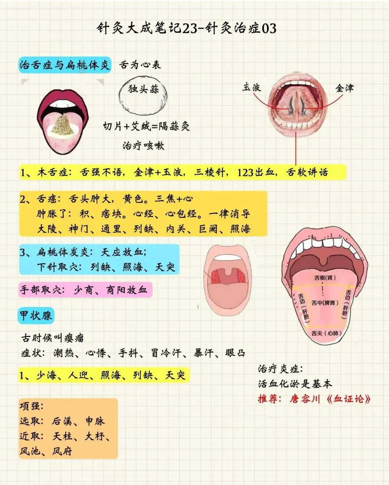

# 针灸治症：舌症、扁桃腺炎与甲状腺疾病

## **一、舌症治疗**  
### **1. 木舌症（舌强不语、中风舌僵）**  
- **症状**：舌头僵硬、言语不清。  
- **治疗**：  
  - **金津、玉液放血**（舌下静脉点刺出血，立即缓解）。  
  - **仅此放血即可**，不需另针他穴。  

### **2. 舌癌（舌肿、黄苔）**  
- **中医病机**：心火上炎（舌为心之苗） + 湿热内蕴（黄苔主湿热）。  
- **取穴**：  
  - **心经/心包经**：神门、通里、大陵、内关（泻法）。  
  - **通任脉**：列缺（肺经，八脉交会通任脉）、巨阙（心之募穴）。  
  - **少海**（心经合穴、母穴，治喉咙肿块）。  
- **治法**：  
  - **活血化瘀**（舌癌多属血瘀，可参考唐容川《血症论》）。  
  - **泻法**：赤凤迎源、白虎摇头等手法。  

### **3. 小儿不语（心气不足）**  
- **治疗**：  
  - **灸巨阙、心俞**（补心气）。  
  - **同舌癌取穴**（心经相关穴位）。  

---

## **二、扁桃腺炎与喉癌**  
### **1. 扁桃腺肿大（急性炎症）**  
- **治疗**：  
  - **天应放血**（扁桃腺周围点刺出血）。  
  - **远取穴**：列缺、照海（通任脉+通阴跷脉，针入痛消）。  
  - **近取穴**：天突（快速消肿）。  
- **注意**：  
  - **抗生素无效**，甚至加重病情。  
  - **不可切除扁桃腺**（否则易高烧伤脑）。  

### **2. 喉癌（类似扁桃腺炎但更严重）**  
- **治疗**：  
  - **同扁桃腺炎取穴**（列缺、照海、天突）。  
  - **加强放血**：少商（肺经）、商阳（大肠经）井穴放血。  
  - **活血化瘀**（参考舌癌治法）。  

---

## **三、甲状腺疾病（瘿瘤）**  
### **1. 甲状腺肿大（甲亢/甲减）**  
- **症状**：心悸、潮热、手抖、突眼、易出汗。  
- **病因**：缺碘（内陆地区多见）或肝郁气滞。  
- **治疗**：  
  - **远取穴**：少海（心经，治心悸、甲状腺肿）。  
  - **近取穴**：  
    - 人迎（胃经，甲状腺局部）。  
    - 天突（任脉，消肿）。  
    - 列缺、照海（通任脉+通阴跷脉）。  
  - **中药辅助**：海带、海藻（补碘）。  

### **2. 项强（脖子僵硬）**  
- **治疗**：  
  - **远取穴**：后溪（通督脉）、申脉（通阳跷脉）。  
  - **近取穴**：天柱、大杼（膀胱经）、风池（胆经）、风府（督脉）。  
  - **其他疗法**：拔罐、艾灸（如申脉可灸）。  

---

## **四、核心治疗原则**  
1. **舌症**：  
   - 木舌→金津玉液放血。  
   - 舌癌→心经/心包经取穴，活血化瘀。  
2. **扁桃腺炎**：  
   - 列缺+照海+天突（特效组合）。  
   - 忌手术切除！  
3. **甲状腺疾病**：  
   - 少海+人迎+天突（主穴）。  
   - 配合饮食调养（海带、海藻）。  
4. **项强**：  
   - 后溪+申脉（远取）+天柱/风池（近取）。  

**总结**：  
- **同证同治**（如舌癌与小儿不语均取心经穴）。  
- **急症先放血**（如木舌、扁桃腺炎）。  
- **远取穴+近取穴结合**（如甲状腺用人迎+少海）。  
- **避免破坏性治疗**（如扁桃腺切除）。

---

> 作者: [Acuherb](https://acuherb.xyz/)  
> URL: https://acuherb.xyz/posts/zhenjiu-6-3/  

