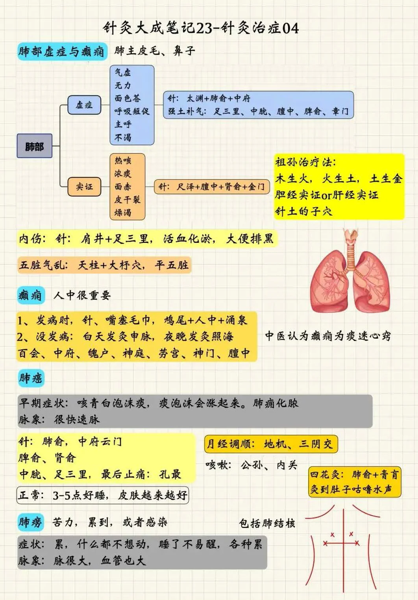

# 针灸治症：肺症虚实、内伤气乱、癫痫、肺癌、肺痨

## **一、肺症虚实与治疗**

### **1. 肺虚症（气虚、呼吸无力）**

- **症状**：面色苍白、气短无力、呼吸浅促。
- **治疗原则**：**补肺气，强脾胃（土生金）**。
- **取穴**：
  - **太渊**（肺经母穴，补气）。
  - **肺俞 + 中府**（俞募配穴）。
  - **足三里、中脘、膻中**（补气强土）。
  - **脾俞、章门**（脏会章门，健脾补肺）。

### **2. 肺实症（热咳、痰黄、燥渴）**

- **症状**：咳嗽痰黄、面赤、皮肤干燥、口渴。
- **治疗原则**：**泻肺热，化痰止咳**。
- **取穴**：
  - **尺泽**（肺经子穴，泻热）。
  - **膻中**（气会，治热咳）。
  - **肺俞**（通用穴）。
  - **肾俞、金门、然谷**（引火下行）。

### **3. 祖孙治疗法（特殊补泻手法）**

- **适用**：当母经或子经取穴受限时，可跨代取穴（如肝实症取脾经穴）。

---

## **二、内伤与五脏气乱**

内伤与五脏气乱处理的是**外力撞击或极度惊吓导致的气机紊乱与瘀血**，与肺症虚实的慢性内生辨证是两条不同的治疗路径。其核心不是“补虚泻实”，而是“**导气**”与“**化瘀下行**”。

### **1. 胸部撞击（肺脏受伤）**

- **场景**：胸腔受到大力撞击，肺脏受伤，瘀血内停。
- **取穴**：
  - **肩井**（活血化瘀）。
  - **足三里**（将瘀血向下导引）。
- **治疗逻辑**：肩井负责化开胸中瘀血，足三里把化瘀后的浊物往下导，通过大便排出。
- **验证指征**：治疗后**隔天大便变黑**，说明瘀血已经排出。这是判断胸部瘀血是否真正导出的直观指标。
- **注意**：肩井禁深针，防气胸；孕妇禁用。

### **2. 五脏气乱（气机紊乱）**

- **场景**：因内伤（如被马踢到）或极度惊吓，出现**脉象混乱、内心慌乱、静不下来**。
- **取穴**：
  - **天柱**。
  - **大杼**。
- **治疗原则**：**不补不泻，以导气而已**。
- **治疗逻辑**：天柱与大杼合用，目的在于导气，恢复脏腑气机的正常秩序。这与肺虚补太渊、肺实泻尺泽的补泻逻辑完全不同——五脏气乱的核心矛盾是“气机失序”，不是“气血虚实”，因此不设补泻，只求气顺。
- **临床提示**：这类病人脉象混乱但未必有明确虚实指征，若按常规补泻处理，反而可能加重紊乱。先导气，再辨虚实，是更稳妥的次序。

### **3. 与肺系病证的衔接**

内伤与五脏气乱虽属独立板块，但与肺系病证存在交集：胸部撞击直接伤肺，五脏气乱可波及肺之气机。临床遇到“外伤后咳喘”“受惊后气短胸闷”一类情况，不能只在肺经上找虚实，要先看是否有瘀血内停或气机紊乱，再决定是导气、化瘀，还是补泻。

---

## **三、癫痫（痰迷心窍）**

### **1. 发作期急救**

- **取穴**：
  - **人中**（醒脑开窍）。
  - **涌泉**（引痰下行，促清醒）。
  - **鸠尾**（化痰源）。
- **操作**：
  - 防止咬舌（垫软毛巾）。
  - 强刺激泻法。

### **2. 缓解期调理**

- **分型取穴**：
  - **昼发**：灸**申脉**（阳跷脉）。
  - **夜发**：灸**照海**（阴跷脉）。
- **通用穴**：
  - **百会、中府、魄户、神庭、劳宫**（安神定志）。
  - **丰隆**（化痰要穴）。

### **3. 预后判断**

- **好转指征**：额角血管逐渐消退。

---

## **四、肺癌（肺痈）**

### **1. 早期辨证**

- **关键症状**：咳**清白泡沫痰**（中医认为与女性月经不调相关）。
- **病机**：忧思伤肺，奶水（月经）逆流成痰。

### **2. 针灸治疗**

- **主穴**：
  - **中府透云门**（直接作用于肺）。
  - **肺俞**（俞募配穴）。
  - **孔最**（肺经郄穴，止痛）。
- **强胃气**（保命关键）：
  - **中脘、足三里**（固护胃气）。
- **调月经**（女性患者）：
  - **地机、三阴交**（调经要穴）。

### **3. 外治法**

- **隔蒜灸肺俞**（蒜性辛散入肺，优于隔姜灸）。

### **4. 康复指征**

- 皮肤变润泽、寅时（3—5点）能入睡。

---

## **五、肺痨（肺结核、虚劳）**

### **1. 典型症状**

- 长期疲劳、脉洪大无力、面色萎黄、消瘦。

### **2. 特效疗法：四花灸**

- **取穴**：**膈俞 + 胆俞**（第7椎下、第10椎下旁开1.5寸，双侧共四穴，故名“四花”）。
- **操作**：
  - 灸至腹中水声作响（灸透标志，同膏肓灸之肠鸣音增强）。
  - 壮数：视体质长期坚持施灸（膏肓灸常达100—500壮）。

### **3. 临床意义**

- **膏肓穴**为**百病皆治**要穴，尤其适合久病虚损；灸后需灸足三里引火下行。

---

## **六、核心治疗原则总结**

1. **肺病虚实**：
   - 虚则补太渊 + 强脾胃，实则泻尺泽 + 化痰。
2. **内伤与五脏气乱**：
   - 胸部撞击取**肩井 + 足三里**，化瘀下行，以**大便变黑**为验证；
   - 气机紊乱取**天柱 + 大杼**，**不补不泻，以导气而已**；
   - 外伤后咳喘、受惊后胸闷，先辨瘀血与气乱，再论肺经虚实。
3. **癫痫**：
   - 发作期重人中、涌泉，缓解期分昼夜灸申脉/照海。
4. **肺癌**：
   - 中府透云门 + 调月经（女性），隔蒜灸肺俞。
5. **肺痨**：
   - 四花灸（膈俞、胆俞）为根本大法，久病配灸膏肓。

**注**：肺为娇脏，治肺需兼顾脾胃（培土生金），久病必灸膏肓；外伤内伤则先导气化瘀，不可一味补泻。

---

> 作者: [Acuherb](https://acuherb.xyz/)  
> URL: https://acuherb.xyz/posts/zhenjiu-6-4/  

