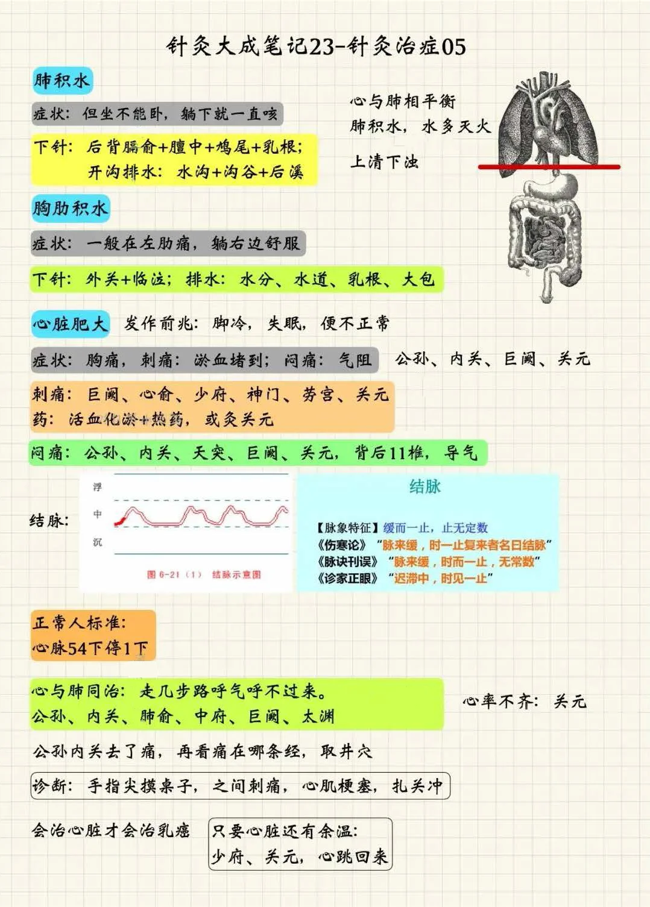

# 针灸治症：肺积水、胸肋积水与心脏病

## **一、肺积水（水饮停肺）**

### **1. 核心病机与辨证**

- **肺为“华盖”**，主宣发肃降，水液代谢失常则停聚成饮。
- **关键症状**：**但坐不得卧**——平卧则水饮上迫，咳喘加剧。
- **病理定位**：**积水一定在肺的下方**。水重而沉，不会停在肺尖，所以近取穴取的是膈、胸、乳根一带，而不是肺的高处。
- **心肺关系**：肺好比水箱，心好比引擎。肺积水不排，水会反过来把心火浇弱，严重时导致心肺衰竭。因此治肺积水不能只利水，还要顾护心脏功能。

### **2. 针灸治疗：两步走**

治肺积水的次序很清楚：**先用近取穴把“水闸”打开，再把水往下导**。

**第一步：近取穴（开膈、宽胸、降逆）**

| 穴位 | 定位 | 作用 |
|---|---|---|
| **膈俞** | 第七椎下（至阳）旁开1.5寸 | 横膈膜区域，打开水液下行的“闸门” |
| **膻中** | 两乳之间 | 气会，行气以化饮 |
| **鸠尾** | 胸骨剑突下 | 宽胸降逆 |
| **乳根** | 乳头直下，乳房根部 | 近取利水 |

**第二步：导水下行（名字带“沟、谷、溪、海”的穴位）**

水闸打开之后，要把水往下导。选穴有一个很直观的规律：**穴名带“沟、谷、溪、海”的，都可通利水道**。

| 穴位 | 所属 | 导水逻辑 |
|---|---|---|
| **水沟** | 督脉 | “沟”以通水 |
| **阳谷** | 小肠经 | “谷”以行水；小肠主津液 |
| **后溪** | 小肠经 | “溪”以利水 |
| **照海** | 肾经 | “海”以引水下行 |

此外，**水分、水道**可直接利水，**大包**（脾之大络）通调水湿，亦可随证加入。

> **操作要点**：针刺以**泻法**为主，可配合艾灸（如水分）增强气化。近取与导水两步的次序不宜颠倒——先开膈，水才有路可下。

---

## **二、胸肋积水（悬饮）**

### **1. 辨证要点：与肺积水的关键区别**

| | 肺积水 | 胸肋积水 |
|---|---|---|
| **平卧** | **不能平卧**（但坐不得卧） | **可以平卧** |
| **侧卧** | 平卧即咳喘 | **不能往健侧躺** |

胸肋积水的侧卧方向常被理解反。正确的规律是：**左边是血，右边是气在管**，胸肋积水**几乎都在左肋**（血分）。所以病人左肋痛，**只能往左边侧躺，不能往右边侧躺**——积水的这一侧是左，病人恰恰要往左躺才舒服，受限的是健侧（右侧），不是患侧。少数病例左右相反，辨证时以实际侧卧受限方向为准。

### **2. 针灸治疗**

- **通阳维、调胸肋**：**外关 + 足临泣**。胸肋之间是阳维脉所过，外关通阳维，足临泣通带脉，二穴合用以调胸肋气机。
- **通胸肋、利水湿**：**大包**。脾之大络，位于极泉下六寸，“胸肋正好通到大包”，是胸肋积水从局部排水的重要穴位。
- **利水要穴**：**水分、水道**。
- **健脾化饮**：**章门**（脏会、脾募）。胸肋积水涉及脾的运化，章门从“强土”的角度辅助消饮。若兼中焦不运，可考虑**中脘、足三里、胃俞**一类穴位，但核心框架仍以外关、足临泣、大包、水分、水道为主。

> **临床提示**：西医抽水易复发，中医从**气化**论治，恢复水液代谢的秩序，方向不同。但急症大量积液压迫时，仍需结合现代医学处理，针灸作为协同与后续调理手段。

---

## **三、心脏病（胸痛、心律不整、心脏肥大）**

### **1. 胸痛：先分刺痛与闷痛，但下针次序不必等分清楚**

胸痛分两类：**刺痛属瘀血，闷痛属气滞**。但在实际操作上，有一个比“先辨证再下针”更实用的原则：**不管气堵还是瘀血，进来先下公孙、内关、巨阙、关元，痛往往当场就去掉了**。

这意味着**通用基础方优先于精细分型**：

> **公孙 + 内关 + 巨阙 + 关元**（背后可加第十椎下/第十一椎导气）

- **公孙 + 内关**：八脉交会，“公孙内关胃心胸”，宽胸理气，是胸痛的第一道通用门户。
- **巨阙**：心之募穴，直接调心。
- **关元**：小肠之募，心与小肠相表里。关元温阳，小肠热增，水气回到胸腔，增加心的热力——好比油渍加热后软化，瘀血得温则行。

**分型加减**：

- **瘀血刺痛**：在上述基础上加**少府、神门、劳宫**（心经/心包经穴，清心活血定痛），痛处可下**天应穴**。背后配**心俞**，与巨阙构成俞募配穴。
- **气滞闷痛**：在上述基础上加**天突**（开胸散结）。若胸闷伴短气、走几步就喘，说明肺气也受影响，加**肺俞、中府、太渊**，心肺同调。

### **2. 心律不整（结代脉）**

- **核心穴**：**关元**。治心律不整，关元是用得最多的穴位。
- **预后判断**：正常脉**跳五十四下停一下**，属常；**跳五十三下停一下**，即为病。再往下，**跳两下停一下、跳一下停一下**，越来越差，提示病进。
- **脉搏跳跳停停时**，**关元一针下去，脉常当场跳回来**，速度很快。

### **3. 心脏肥大（水气凌心）**

- **病机**：**心脏肥大就是“水”**。好比面包放在水里会变大——会治水，才会治心脏。
- **治疗原则**：**强心温阳、宽胸利水**。
- **取穴**：
  - **巨阙 + 关元**（心募 + 小肠募，温阳固本）。
  - **公孙 + 内关 + 天突**（宽胸导气）。
  - **少府、神门、劳宫**（宁心通脉）。

### **4. 心脏病急救：关元、少府，以及两个“前提判断”**

心搏骤停或脉微欲绝时，急救取穴是**关元 + 少府**（可加巨阙）。少府是心经本穴，针下后心脏重新跳动，脉常当场回来。

但比穴位更关键的是两个**判断前提**：

1. **“心口还有余温”才下针**。病人心脏脉没有了，**摸他的心口还有余温**，就下关元、少府。这是最后一线生机的判断依据；如果心口已经冰冷，针灸的介入窗口已经极其有限。
2. **“少府针下去，心脏还没动，这个病人就差不多了”**。少府针感很痛，如果强刺激下病人毫无反应，提示预后极差。这是一个在操作中即时判断预后的节点，不是事后才评估的指标。

> **急救定位**：针灸急救是在“心口尚有余温”这一窗口内的院前干预。任何心搏骤停都必须同时启动现代急救流程并立即送医，针灸不能替代心肺复苏和除颤。

---

## **四、心脏病前兆与调护**

### **1. 四大预警信号**

动脉堵塞与心脏问题的前兆，核心是四条：

| 信号 | 机理 |
|---|---|
| **无缘无故的失眠** | 心藏神，心有问题则神不归心 |
| **大便不规则** | 心与小肠表里；心跳节律影响小肠蠕动节律，心跳不规整则大便时秘时溏 |
| **手脚冰冷** | 心阳不足，温度从末梢开始下降；可伴手指麻木、刺痛 |
| **心胸痛、心口痛** | 心脏问题的直接表现 |

这四条中，**“心胸痛/心口痛”是最直接的信号**，不应被手指麻、下肢冷等末梢表现挤掉位置。手脚冰冷、麻木可以作为心阳不足的佐证，但不能替代心口痛这一核心预警。

### **2. 防治要点**

- **避免寒邪**：护心口、足部保暖。手脚刚开始冷时就治，不要等冷感从手脚蔓延到肘膝。
- **保持大便通畅**：心与小肠相表里，大便节律反映心跳节律对小肠的影响。
- **情志调摄**：忧思伤肺，肺病及心；心肺同属上焦，治心不能完全不顾肺。

---

## **五、核心治疗原则**

1. **积水必治气，且积水必在下方**：肺积水近取膈俞、膻中、鸠尾、乳根，再以水沟、阳谷、后溪、照海导水下行；先开膈，后导水。
2. **胸肋积水辨左右**：**左血右气**，左侧积水者**只能往左侧躺，不能往右侧躺**；外关、足临泣通阳维，大包通胸肋，水分、水道利水。
3. **心脏病通用方优先于精细分型**：不管气滞还是瘀血，**公孙、内关、巨阙、关元**先下，痛多能当场缓解；再依刺痛/闷痛加减。
4. **急救重关元少府，但有两个前提**：**心口还有余温**才下针；**少府针下无反应**则预后差。急救必须同步送医。
5. **心律不整的预后标尺**：**54停1为常，53停1为病**；跳二停一、跳一停一，病进。

**注**：针灸治心脏病与积水，核心在“气化”二字——气行则水行，阳回则瘀化。但急症、危症必须与现代医学协同，不可偏废。

---

> 作者: [Acuherb](https://acuherb.xyz/)  
> URL: https://acuherb.xyz/posts/zhenjiu-6-5/  

