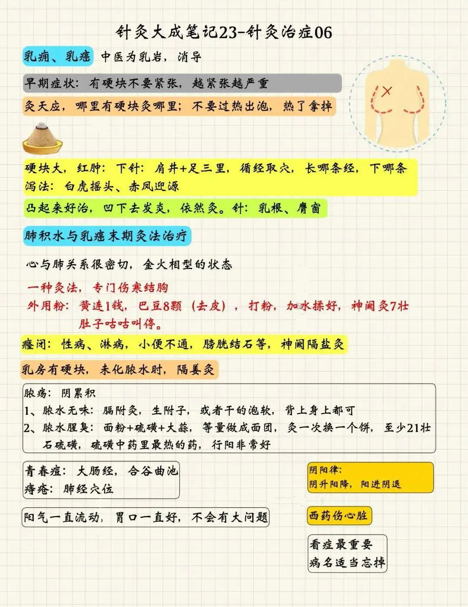

# 针灸治症：乳癌分期治疗与肺积水灸法

## **一、乳癌（乳岩）分期治疗**

### **1. 初期（硬块未化脓）：隔姜灸天应，消导水饮**

- **病机**：奶水即月经，由肺所生、靠心阳推动下行。心脏力量不足时，奶水在乳房停滞，初期形成硬块。
- **治疗思路**：奶水属水，艾灸的行阳之力有助于消导停滞的水饮。初期硬块越早灸越好，不必先纠结良性恶性。
- **操作**：
  - **隔姜灸天应穴（硬块处）**：生姜切片，艾绒置于姜上，**感到温热即拿掉**，不要灸到起水泡。
  - **壮数**：五壮、七壮、九壮皆可，取单数。初期硬块艾灸后可能明显软化或消散。
- **辅助针刺（硬块较大或红肿时）**：
  - **肩井 + 对侧足三里**：扎右肩井配左足三里，扎左肩井配右足三里。
  - 肩井把上焦之气打下来，胸腔瘀滞、乳房硬块、奶水才能被冲下去。**需配对侧足三里以导气下行**；只下肩井而不配足三里，上焦之气无下行之路，可能出现胸闷等不适。
  - 近取可加**膺窗、乳根**（避开乳中）。

### **2. 中期（红肿未溃）：肩井导气 + 循经泻实**

- **针刺框架**：仍以**肩井 + 对侧足三里**为统治乳房的基础组合，先把气导下来。
- **循经取穴**：按硬块所在经络选取子穴、母穴、郄穴、原穴或络穴。**虚实辨证不清楚时，取原穴或络穴**；仍难确定时，取本穴泻之。
- **泻法**：有硬块属“实”，可用白虎摇头、赤凤迎随、透天凉等泻法。
- **外治**：若局部发热，可配合**隔蒜灸**，取大蒜辛散之力助排毒。

### **3. 晚期（溃烂流脓）：按脓液性状分灸**

| 脓液性状 | 灸法 | 操作要点 |
|---|---|---|
| **无味脓水** | **隔附子灸** | 生附子切片（泡水后使用；无生附可用炮附），置于脓口有水处施灸。身体其他部位的无味脓疡同样适用。 |
| **腥臭脓水** | **硫磺面饼灸** | **白面粉、硫磺、大蒜等量**，揉成面饼，置于脓口。**灸一次，扔一次面饼**，不可重复使用。**至少21壮**，灸至腐肉脱、新肉生。 |

> **硫磺选择**：用**淡黄色石硫磺**；褐色土硫磺是伤科接骨外用，不作此用。

- **针刺辅助**：**丰隆**（化痰）、**上巨虚**（通肠，使浊毒从大便而出）。

---

## **二、乳癌核心病机与调护**

### **1. 奶水—月经—心脏—大便的链条**

- 奶水由肺所生（色白），靠**心阳**推动下行，化赤为月经。心脏搏动力量不足，奶水不能完全下达子宫，停滞在乳房，日久成块。
- **更年期后月经停止，奶水仍有出路——大便**。此时若便秘，奶水无路可出，反成乳癌的病理基础。
- **通便标准**：更年期后以**一天两到三次大便**为通利目标，而不是“一天一次”即可。

### **2. 调护原则：强心、通便、睡眠体位**

- **强心**：灸**巨阙**，针**内关**。判断心脏功能恢复的实用指征是：每天正常大便、一觉到天亮、手脚不麻不冷。
- **通便**：保持大便通畅，是更年期后奶水下行的重要出路。
- **睡眠体位**：更年期潮热者，建议**靠左侧睡**。左血右气，气包住血，有助于缓解燥热。

### **3. 对“切除乳房”思路的审慎说明**

从经络与腺体连续性的角度看，乳房切除后腺体被截断，奶水仍会生成，可能在疤痕或残余组织处继续累积，因此切除不等于消除了奶水停滞的源头。这一论述属于特定视角下的病机推演，旨在说明“强心通便”作为根本调治方向的理由，不应被理解为对手术指征的否定。临床决策应结合分期、病理与现代医学规范综合判断。

---

## **三、肺积水重症灸法：结胸灸**

### **1. 适用场景与定位**

肺积水在针灸层面，轻者可取乳根、膻中一类近取穴。**结胸灸**是更峻猛的外治手段，适用于水饮结聚较甚、需要“给邪以出路”的情况。其思路不是直接“抽水”，而是通过温通阳明，使水饮从**上吐下泻**排出。

### **2. 操作**

- **配方**：**黄连一钱，巴豆八颗（去壳取仁）**。
- **制法**：巴豆仁与黄连粉混合揉匀，**戴手套操作**；太干可加少量水润湿。
- **敷灸**：将药饼置于**神阙（肚脐）**，上置艾炷施灸。
- **壮数与停止指征**：基本灸**七壮**，**以腹中肠鸣、咕噜作响为度，肠鸣一起即停灸**。停灸后病人会急于如厕，出现上吐下泻，水饮随之排出。
- **务必在专业人员操作下进行**；峻下之剂有明确风险，不可自行尝试。

### **3. 其他灸法鉴别**

- **隔盐灸神阙**：用于**小便癃闭**（膀胱炎、结石等所致尿闭），取炒熟青盐（炒后放温）再敷，不可热盐直接上脐，隔盐施灸，温阳利水。与结胸灸的适应证不同，不可混用。

---

## **四、临床思维总结**

1. **乳癌分期操作线**：初期以**隔姜灸天应**消导水饮；中期以**肩井 + 对侧足三里**导气下行，再循经泻实；晚期按**脓味分灸**——无味隔附子，腥臭硫磺面饼。
2. **乳癌调治的根在“心—肠”**：强心是恢复奶水下行之动力，通便是给更年期后的奶水一条出路。二者不解决，局部硬块即使暂时处理，病机仍在。
3. **肩井配足三里的本质是“导气”**：不是简单穴位配伍，而是给上焦壅聚之气一条下行之路；配对侧，不配同侧。
4. **结胸灸的停止指征是“肠鸣”**：不是固定壮数灸完为止，而是以肠鸣为邪有出路的信号，中病即止。
5. **峻猛灸法有边界**：结胸灸、硫磺灸均属外治峻法，须在明确适应证和专业操作下使用；急危重症应同步评估现代医学手段。

**注**：
- **硫磺**用淡黄色石硫磺；褐色土硫磺仅供伤科外用。
- 乳癌的针灸调治以“行阳”为方向，灸法是重要手段，但分期判断、操作精度与安全边界同样关键。

---

> 作者: [Acuherb](https://acuherb.xyz/)  
> URL: https://acuherb.xyz/posts/zhenjiu-6-6/  

