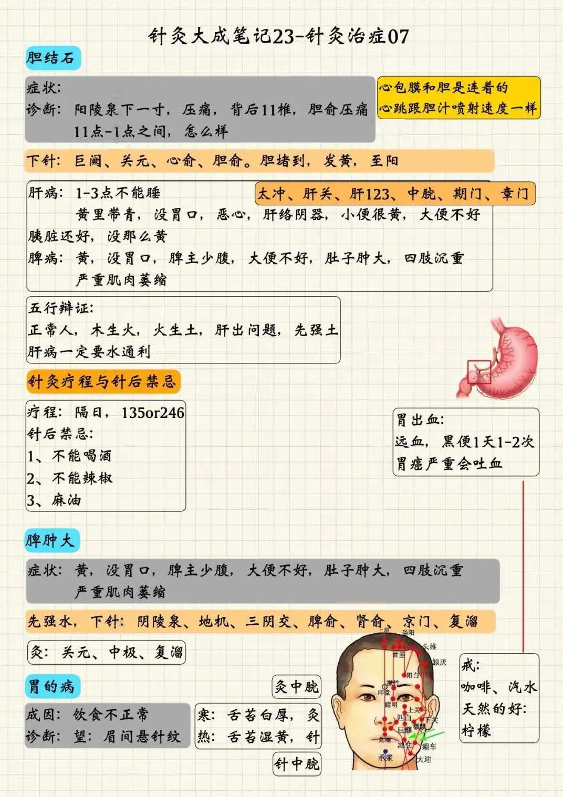

# 针灸治症：胆结石、肝病、脾肿大与胃病治疗

## **一、胆结石**

### **1. 诊断：压痛是首要抓手，时间辨证为辅**

胆结石的诊断不需要依赖复杂检查，**压痛**是最直接的入口。

- **胆石点**：阳陵泉正下一寸，在两块肌肉之间找压痛点。胆结石患者在此处一定有强烈压痛，按压时病人会明确说“很痛”。
- **胆俞**：第十椎下旁开一寸半，附近有压痛可进一步支持判断。
- **时间辨证**：夜间11点至1点（子时胆经当令）症状加重，可作为辅助线索。

### **2. 针刺：胆石点用一寸半针，不作透刺**

胆石点是一组**独立的经外奇穴**，针法与阳陵泉透刺完全不同。

- **阳陵泉**可以透阴陵泉；**胆石点不要用三寸针透过去**，因为“另一边没有穴道”。用**一寸半针**下进去即可。
- 找到最痛的压痛点下针，从痛治到不痛，胆结石的绞痛往往当场缓解。

### **3. 配伍：前募后俞加侧奇穴**

胆结石的固定组合是**胆石点（侧）+ 日月（前，胆募）+ 胆俞（后，背俞）** ，形成前、后、侧三面合围。阳陵泉作为胆经合穴可同时选用，但胆石点的针法仍按奇穴处理，不与阳陵泉透刺混为一谈。

可随证加**巨阙、关元**调心胆气机，胆道阻塞发黄时取**至阳**退黄。

### **4. 饮食配合**

治疗期间忌酒、辛辣与麻油，避免进一步壅滞气机。

---

## **二、肝病（肝炎、肝硬化、肝癌）**

### **1. 诊断：治肝三穴的压痛，是肝硬化的窗口**

肝病早期沉默，黄疸出现时往往已非轻证。倪师体系中有一个直接的鉴别抓手：**按压大腿内侧的治肝三穴**。

- **定位**：膝盖内侧高骨与腹股沟连线，**中点为肝一**；中点**往前一寸**为肝二，**往后一寸**为肝三。左右腿对称。
- **鉴别意义**：**肝炎阶段，邪在气分，按下去不痛；肝硬化或肝癌，有实质的东西长在里面，一压就剧痛**。压痛是把“肝硬化的窗口”提前打开，而不是等到影像学报警。
- **针法**：用**一寸半针**，**不要用三寸针深刺**——大腿内侧有大动脉，扎一寸即可。痛在哪个点就扎哪个点，两腿都下。

此外，**丑时（凌晨1—3点）定时醒来**是肝经阻滞的早期信号，但需结合治肝三穴压痛与全身症状分层判断，不把“丑时醒”直接等同于某一个固定证型。

### **2. 治疗：强土是主线，通大肠是前提**

肝病传脾，是《金匮》“见肝之病，知肝传脾，当先实脾”的基本逻辑。针刺上的落地方式是：

- **强土（脾胃）** ：**中脘 + 足三里**，防止木继续克土。章门作为脾募兼脏会，也承担“强土”角色。
- **治肝本身**：太冲、期门（肝募）、肝俞。期门与肝俞的俞募配伍，操作上次序以**先期门、再肝俞**为顺，针后可嘱患者自行灸期门。
- **通大肠**：**大肠不通，肝气无路可走**。肝的上面是肺，下面是大肠；大肠壅滞，浊气上逆，肝被上下夹击，疏泄必然受阻。治肝不能只在肝经上找穴，**保持大便通畅是疏泄功能恢复的前提条件之一**。
- **利水防腹水**：阴陵泉、三阴交健脾利湿；肾俞、复溜补肾行水。

### **3. 虚实分层**

- **肝炎阶段（偏实）** ：以清利、疏泄为主，太冲、阳陵泉随证选用。
- **肝硬化/肝癌阶段（虚实夹杂，以实为标、以虚为本）** ：治肝三穴压痛取穴，配合强土、固肾，不宜一味攻伐，也不宜只补不疏。

---

## **三、脾肿大**

### **1. 辨证抓手**

脾肿大的外在信号比较直观：**面色发黄、没有胃口、肚子大、少腹满、身体沉重**。脾主四肢肌肉，脾病则四肢沉重，人像“气球漏了气”，走路不再轻快。

肝病日久克脾，脾脏肿大，肌肉随之萎缩——这也是肝病“肚子大而四肢瘦”的机理。

### **2. 治疗：三皇穴 + 俞募，土病强水**

- **健脾利水**：**三皇穴**——阴陵泉、地机、三阴交。全身重、下肢肿者，这是基础组合。
- **俞募治脾**：**章门（脾募、脏会）+ 脾俞**。
- **土病强水，截断病势**：脾属土，土克水。脾病出现时，**先去固肾（强水）** ，目的是让病“到此为止”，不再向肾传变。
  - **肾俞、京门**（肾募）从背部与侧面固肾。
  - **复溜**（肾经母穴）用补法，迎随或提插均可。
  - 灸法可选**关元、中极、肾俞**，复溜亦可常灸。

> **注意**：强水是“截病势”，不是治脾肿大的主线。主线仍是三皇穴与脾之俞募；固肾是在此基础上加一层防线，不可本末倒置。

---

## **四、胃病**

### **1. 寒热分治：舌苔与面色是第一眼判断**

胃病首分寒热，望诊与舌诊的权重高于问诊细节。

| | **寒证** | **热证** |
|---|---|---|
| **舌苔** | 白厚 | 黄湿/黄腻 |
| **面色** | 苍白 | 红 |
| **体型倾向** | 偏瘦 | 偏胖 |
| **治法** | **重灸** | **重针，不灸** |

胃寒者，**灸中脘（胃募）效果比针更好**；可配足三里。隔姜灸足三里还能止呕，公孙也是止呕要穴。

胃热者，**中脘下针**，配**内庭**（胃经荥穴，泻热），背部胃俞亦可下针。不宜加灸，灸对热证反而助火。

### **2. 公孙 + 内关：胃心胸的即时止痛组合**

无论寒热，**公孙配内关**在胃痛发作时往往**针下痛止**。公孙通冲脉，内关通阴维脉，“公孙内关胃心胸”，是胃痛、恶心、胸脘痞闷的第一道通用门户。寒证有水者，在此组合基础上加灸中脘、足三里；热证则纯以针刺取效。

### **3. 胃出血（远血）的特殊处理**

黑便提示上消化道出血。此时的取穴逻辑与普通胃痛不同：

- **不针足三里**：足三里会加速胃肠蠕动，出血时可能加重出血[reference:16]。
- **取公孙、内关**宽胸和胃，**内庭**清胃热，**膈俞**（血会）与**隐白**（脾经井穴）止血。
- 急症必须同步评估现代医学手段，针灸作为协同处理。

---

## **五、传变逻辑与操作边界**

1. **胆结石**：压痛定诊断，胆石点用一寸半针，配日月、胆俞三面合围；不与阳陵泉透刺混用。
2. **肝病**：治肝三穴压痛是肝硬化的窗口；强土（中脘、足三里、章门）防传脾；**通大肠是疏泄的前提**，不能只在肝经上打转。
3. **脾肿大**：三皇穴 + 章门、脾俞为主线；土病强水（肾俞、京门、复溜）以截病势，但强水不喧宾夺主。
4. **胃病**：寒灸热针，舌苔定方向；公孙内关即时止痛；胃出血避足三里，取内庭、膈俞、隐白，并同步就医。

**注**：
- 胆石点、治肝三穴均强调**一寸半针、勿深刺**，大腿内侧与小腿外侧均有重要结构，操作需专业判断。
- 肝病、脾肿大、胃出血均属需要综合评估的病证，针灸是协同手段，不能替代必要的现代医学诊断与急症处理。

---

> 作者: [Acuherb](https://acuherb.xyz/)  
> URL: https://acuherb.xyz/posts/zhenjiu-6-7/  

