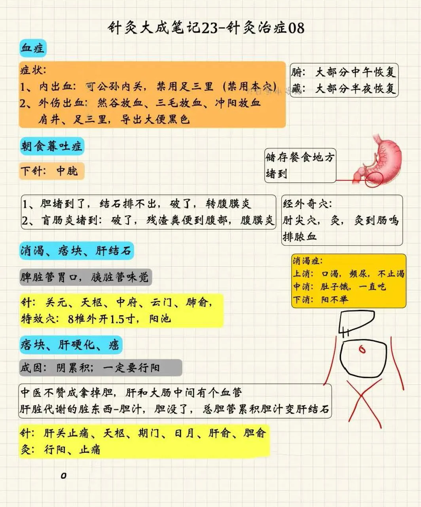

# 针灸治症：血症、消渴、痞块与肝结石

## **一、血症：外伤与内脏出血，处理逻辑不同**

血症首先要分外伤与内脏出血。外伤是“瘀血有出路”的问题，内脏出血是“本穴不能动”的问题，两者的取穴禁忌和操作方向完全相反。

### **1. 外伤出血：先放血，再导瘀下行**

**第一步：放血**

- **然谷**是外伤出血的第一放血点。不限于脑溢血，**脑部外伤、脑震荡**同样适用。脑部受撞击后，然谷附近常出现青筋，用三棱针点刺放血。
- 然谷放血后仍有胸痛，加**三毛穴**（大趾背青筋处）放血；下肢外伤可取**冲阳脉**放血。

**第二步：胸腔内出血的导瘀组合**

- **肩井 + 足三里**。肩井把胸腔的瘀血化开，**必须配足三里把阳气往下导**，瘀血才有下行之路。只针肩井不针足三里，气无下行之路。
- **验证指征**：瘀血是否真正导出，看**大便**。肺与大肠相表里，瘀血从肺下方渗入三焦油网，再从大肠排出，**大便变黑**说明瘀血已经下行。

**止痛**：外伤疼痛按经络取穴；一整块说不清经络的痛，**公孙配内关**可即时宽胸止痛。

### **2. 内脏出血：本穴不能用，取子穴或旁经**

内脏出血的取穴原则是**避开出血脏腑的本穴**，因为本穴会加速该脏腑的蠕动与阳气运行，出血反而增多。

| 出血部位 | 不能用的本穴 | 可取穴位 |
|---|---|---|
| **胃出血** | **足三里** | 公孙、内关、中脘（胃募） |
| **脾出血** | **太白** | **商丘**（脾经子穴，实则泻其子）、**内庭**（胃经荥穴） |

胃出血时针足三里会“让阳行得更快，出血会增加”，这是操作上的硬禁忌，不是可选项。

### **3. 病愈信号：腑病看中午，脏病看半夜**

- **腑病恢复**：中午胃口恢复，感到饥饿。
- **脏病恢复**：半夜饿醒，想吃东西，提示阳气回头。

---

## **二、朝食暮吐与腹膜炎**

### **1. 朝食暮吐：中脘一针，胃即动**

- **病机**：胃下方本有一个存留宿食的小空间，新旧食物交替。此处蠕动停滞，早餐吃进去到黄昏仍不消化，恶心吐出，即为朝食暮吐[reference:7]。
- **治疗**：**中脘**下针或施灸。针入后病人会感到胃开始蠕动、食物往下走，起效很快。取穴必须准确，偏上脘、下脘效果明显下降[reference:8]。

### **2. 腹膜炎：肘尖隔姜灸，灸到肠鸣即止**

- **来源**：胆结石堵塞致胆破裂，或盲肠炎破裂，食物残渣与粪便进入腹腔，引发腹膜炎[reference:9]。
- **诊断线索**：原本剧痛，**突然剧痛一下后不痛了**，不是好转，而是破裂；用手触摸腹部，**某一处皮肤特别热**，提示局部已化脓。通常手温而身凉，化脓处反热[reference:10]。
- **治疗**：**肘尖穴**（手肘尖端，三焦经所过），**隔姜灸**。两侧肘尖均可灸，**灸至腹中肠鸣为止，肠鸣一起即停**。肠鸣后病人会急于如厕，排出脓血，排净即缓解[reference:11]。
- **边界**：这是急症外治手段，必须在明确诊断和专业操作下使用，同时应评估现代医学处理，不可替代必要的外科干预。

---

## **三、消渴：津液升发的链条，比“降糖”更关键**

消渴的核心矛盾不是血糖数字本身，而是**津液不能上承**。针灸的着力点在于恢复“小肠蒸化大肠水分—水气上归于肺—肺布津液至口”的链条。

### **1. 津液升发的主线**

- **关元**（小肠募，针或灸）：增加小肠的热力，使大肠水分得以蒸化。
- **天枢**（大肠募）：调节大肠蠕动节律。天枢的用法是双向的——下利时针灸可止，便秘时针灸可通，目的是恢复“正常速度”。
- **中府、云门、肺俞**：水气上归于肺后，取肺经募穴与背俞，助肺受纳、布散津液。
- **天突**：近取穴，促津液上承至口。

**次序逻辑**：先关元、天枢把水气“蒸上去”，再中府、云门、肺俞“接住”，最后天突“引到口”。只针天突而不解决下焦蒸化，津液没有源头。

### **2. 特效穴**

- **阳池**（三焦经原穴）：消渴、口渴的经验特效穴。
- **第八椎下旁开一寸半**：至阳之下，消渴的特效经验穴。

---

## **四、痞块：行阳是主线，固胃是前提**

痞块（肝硬化、肝癌、脾脏癌、胃癌等形成的肿块）的基本认识是：**阴成形而累积**。治疗方向不是直接“攻块”，而是**加快阳气循环的速度，使阴不再继续累积**[reference:18]。

### **1. 主穴与灸法**

- **痞根穴**：第十三椎下旁开三寸半，经外奇穴。
- **消积穴**：脚后跟上三寸。
- 痞根与消积以**灸**为主；痞块局部可配合**隔姜灸**，艾火之力即为“行阳”[reference:19]。

### **2. 局部与循经配穴（以肝痞块为例）**

- 痛甚：**肝关**、**肝一/肝二/肝三**、**行间**；背**肝俞**，前**期门**，俞募配伍。
- 虚证或久病：**曲泉**补肝。
- 无论痞块在何脏，**强土不可省**：中脘、足三里、章门一类，先固胃气[reference:20]。

### **3. 疗效判断：先看睡眠，再看块消**

痞块治疗有一个比“肿块缩小”更早出现的疗效指征：**睡眠**。肝硬化、肝癌患者原本**丑时（1—3点）不能入睡**，治疗后能一觉到天亮，说明**阳气循环开始通畅**，即使痞块仍在，病情也已稳住。治疗需持续，隔日针（一三五或二四六），给阳气以恢复的时间[reference:21]。

**原则**：**先固胃，再行阳**。胃气不倒，人才有持续治疗的基础；阳气通畅，阴积才不会继续加重。

---

## **五、肝结石：胆切除后的远期问题**

### **1. 病机：胆切除后胆汁无出路，约十五年后成肝结石**

胆囊切除时，总胆管因与肝脏相连、内部血管丰富，通常保留。胆汁失去胆囊的储存与排泄通道，在总胆管内慢慢淤积，**大约十五年后**可形成肝结石。肝结石发作时疼痛剧烈，且位置深、手术难度大。

### **2. 针灸治疗**

- **止痛**：**肝关**（经外奇穴）。**对侧取穴**——痛在右肋取左肝关，痛在左肋取右肝关。平补平泻，捻转后疼痛逐渐缓解。
- **利胆疏肝**：**期门**（肝募）、**日月**（胆募）、**肝俞**、**胆俞**，前后配伍，把胆汁往下消导，使结石慢慢软化、疏解。
- **通便**：**天枢**、**支沟**。大便通畅是胆汁与浊物下行的重要出路。

### **3. 长期调理的方向**

胆切除后，**疏肝利胆与通便不是“术后可选项”，而是长期管理的一部分**。胆汁淤积的根源没有因为切除胆囊而消失，反而改变了出路；保持大便通畅、维持肝气疏泄，是减少肝结石形成与发作的基础。

---

## **六、核心操作速查**

| 病证 | 关键操作/穴位 | 判断或禁忌 |
|---|---|---|
| **外伤出血** | 然谷放血；胸痛加三毛、冲阳 | 脑外伤、脑震荡均可用然谷 |
| **胸腔内出血** | **肩井 + 足三里** | 大便变黑为瘀血下行之验证；肩井不配足三里则气无下行之路 |
| **胃出血** | 公孙、内关、中脘 | **足三里禁针** |
| **脾出血** | 商丘、内庭 | **太白禁针** |
| **朝食暮吐** | 中脘针或灸 | 取穴须准，偏上脘/下脘效减 |
| **腹膜炎** | 肘尖隔姜灸 | **灸至肠鸣即止**，排脓血；须同步评估现代医学处理 |
| **消渴** | 关元→天枢→中府/云门/肺俞→天突；阳池、第八椎旁 | 先蒸化，再布津，次序不可颠倒 |
| **痞块** | 痞根、消积穴、局部隔姜灸；强土 | **先固胃，再行阳**；以睡眠改善为早期疗效指征 |
| **肝结石** | 肝关**对侧**止痛；期门、日月、肝俞、胆俞；天枢、支沟 | 胆切除后约十五年形成；长期疏肝通便 |

**注**：
- 血症的放血操作须严格消毒；内脏出血的“避本穴”是硬禁忌，不可因“常取足三里”而误用。
- 腹膜炎、肝结石剧痛等急重症，针灸是协同与后续调理手段，必须结合现代医学诊断与必要的外科评估，不可替代急救与手术决策。

---

> 作者: [Acuherb](https://acuherb.xyz/)  
> URL: https://acuherb.xyz/posts/zhenjiu-6-8/  

