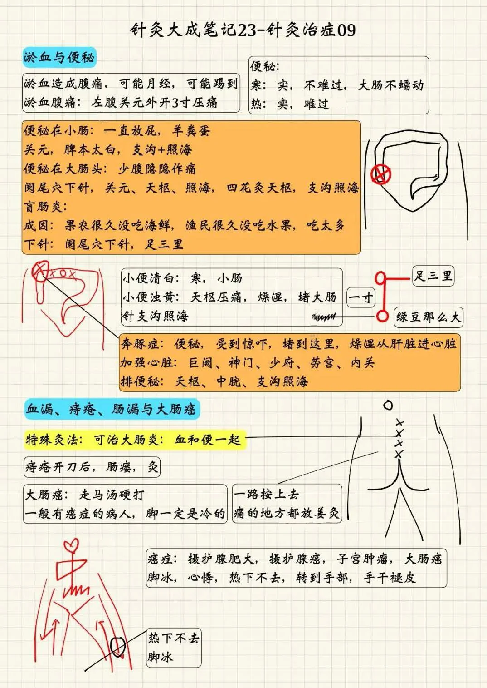

# 针灸治症：腹痛、盲肠炎、痔疮、妇科与助孕

## **一、腹痛与便秘**

### **1. 瘀血腹痛：左腹天枢外开三寸压痛**

- **定位与意义**：左腹**天枢穴外开三寸**处有压痛点，提示瘀血。左侧主血，右侧主气，腹痛先辨左右。
- **治疗**：
  - **活血化瘀**：三阴交、血海、膈俞（血会）。
  - **艾灸**：关元、中极，温经散寒，助瘀血化行。

### **2. 便秘：先问小便，清寒浊热**

便秘分型的第一步不是看大便性状，而是**问小便**：**小便清长属寒，小便浊黄属热**。这一问直接决定用灸还是用针。

#### **（1）寒实便秘**

- **表现**：没有便意，腹部冷，小便清长。
- **治疗**：**以灸为主**。天枢、关元、中脘隔姜灸，温通大肠；可配支沟、照海通利三焦。

#### **（2）热实便秘**

- **表现**：腹胀痛，小便浊黄，舌红苔黄。
- **治疗**：**以针为主，不加灸**。支沟、照海通便，内庭泻胃热。

#### **（3）小肠便秘**

- **特点**：大便干如羊粪，频繁排气。小肠蠕动过速，水分来不及蒸化，大便被“挤”成颗粒状。
- **治疗**：
  - **强心脾**：巨阙（心募）、章门（脾募）。
  - **增津液**：关元（小肠募）、复溜（补肾水）。

---

## **二、盲肠炎（阑尾炎）**

### **1. 急性发作：阑尾穴是首选**

- **定位**：足三里下一寸，以**压痛点**为准，不一定是固定点。盲肠炎患者此处必有明显压痛。
- **操作**：针刺阑尾穴，疼痛往往当场减轻；可配天枢、关元。
- **边界**：针灸可作为早期干预与协同手段，但急性阑尾炎有化脓、穿孔风险，必须同步评估现代医学处理，不可仅靠针灸观察。

### **2. 预防化脓：肘尖隔姜灸**

- **触诊线索**：腹部局部皮肤发热，提示可能已化脓；或剧痛后突然不痛，需警惕破裂。
- **处理**：**肘尖穴隔姜灸，灸至腹中肠鸣即止**，肠鸣后排出脓血可缓解。具体操作与腹膜炎一节相同，急症须在专业判断下进行并同步就医。

---

## **三、痔疮与肠风下血**

### **1. 外痔：放血为主**

- **放血部位**：可在**痔疮局部**点刺放血，或取**承山、孔最**附近青筋刺络拔罐。外痔瘀血明显者，放出瘀血后肿痛缓解较快。
- **辅助**：传统枯痔散外敷，须在明确适应证下使用。

### **2. 内痔 / 肠风下血：灸十四椎下压痛点**

- **定位**：第十四椎下（命门附近）**找压痛点**，不一定是正中，偏一点也可以，以痛点为灸处。
- **操作**：隔姜灸，**灸至便血停止**。内痔出血不宜在局部直接放血，以灸促收口、温通下焦为主。

### **3. 肠漏（术后瘘管）**

- **取穴**：长强、腰俞，隔姜灸，促进瘘管收口。

---

## **四、妇科与助孕**

### **1. 月经不调：寒热分治，灸针不混**

| | **寒证（月经延迟）** | **热证（月经提前）** |
|---|---|---|
| **特点** | 月经往后延，小腹冷 | 月经提前，量多色深 |
| **治疗** | **重灸，不针**：关元、三阴交 | **重针，不灸**：太冲、行间泻肝热 |

寒证以灸温胞宫，热证以针泻肝火。**寒证不宜针，热证不宜灸**，方向反了会加重病情。

### **2. 助孕：关元、中极、三阴交常灸**

- **主穴**：关元、中极、三阴交，隔姜灸。
- **频率**：常常灸，**月经期不停**。关元为“生命之火”，温胞宫是助孕的核心方向。
- **判断基础**：妇科以**脚热**为小肠功能正常的指征；脚冷者先温下焦，再谈助孕。

### **3. 绝孕：石门长期灸**

- **穴位**：**石门**（三焦募，脐下二寸）。长期施灸有绝孕之效。
- **说明**：这是传统针灸文献中的记载，属于特定条件下的历史经验，不作为常规避孕手段推荐。

---

## **五、核心操作速查**

| 病证 | 关键操作 | 判断或禁忌 |
|---|---|---|
| **瘀血腹痛** | 左腹**天枢外开三寸**压痛；三阴交、血海、膈俞；灸关元、中极 | 左血右气，先辨左右 |
| **寒实便秘** | 灸天枢、关元、中脘；支沟、照海 | 小便清长定寒 |
| **热实便秘** | 针支沟、照海、内庭 | 小便浊黄定热，**不加灸** |
| **小肠便秘** | 巨阙、章门、关元、复溜 | 大便如羊粪、多排气 |
| **盲肠炎** | 阑尾穴压痛点；防化脓灸肘尖至肠鸣 | 须同步评估现代医学处理 |
| **外痔** | 局部或承山、孔最放血 | 内痔不宜局部放血 |
| **内痔/肠风下血** | 第十四椎下**压痛点**隔姜灸 | **灸至便血停止** |
| **月经不调（寒）** | 灸关元、三阴交 | **寒证不针** |
| **月经不调（热）** | 针太冲、行间 | **热证不灸** |
| **助孕** | 关元、中极、三阴交常灸 | 月经期不停；脚冷先温下焦 |

**注**：
- **大肠癌望诊线索**：脚冷、手掌皮肤干燥，提示阳气不达下，可作为进一步检查的提醒，不能单凭此诊断。
- 盲肠炎、内痔大量便血等急症，针灸是协同手段，必须结合现代医学诊断与必要的外科评估。

---

> 作者: [Acuherb](https://acuherb.xyz/)  
> URL: https://acuherb.xyz/posts/zhenjiu-6-9/  

